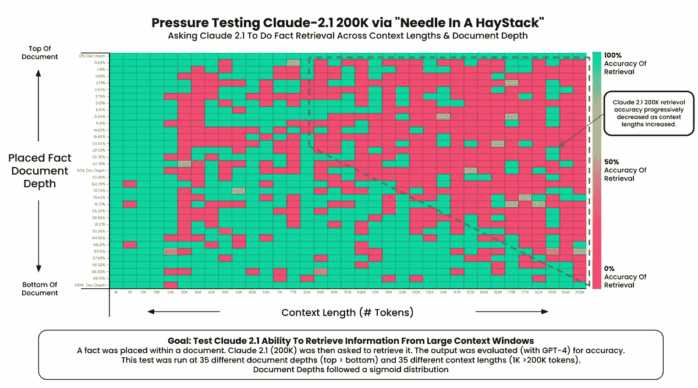
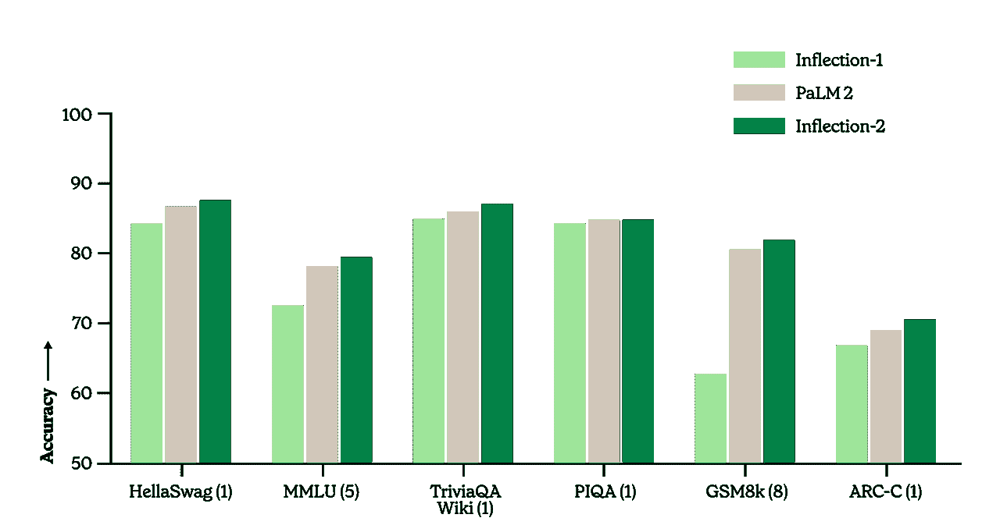
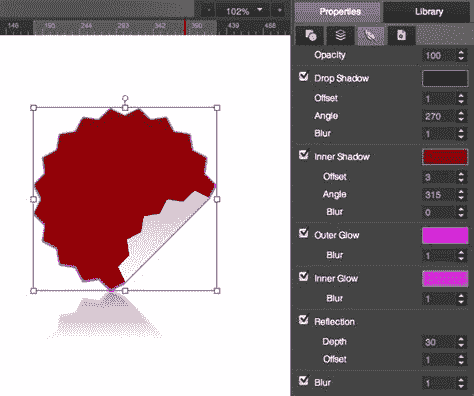
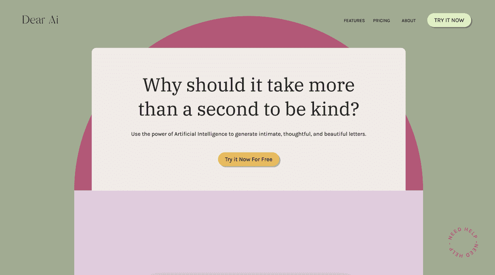
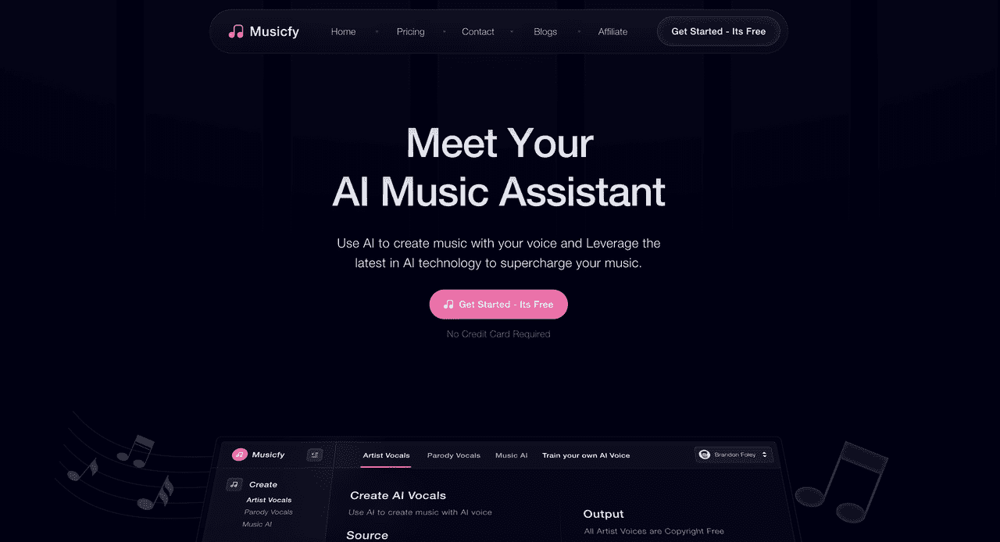
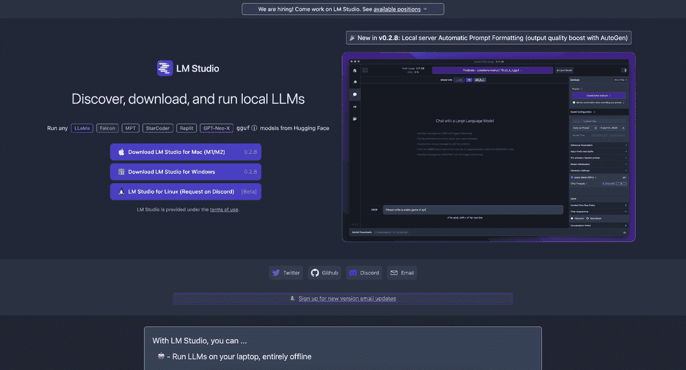

# 231126｜Stability AI 发布视频生成模型、Anthropic 发布 Claude 2.1、Inflection AI 发布 Inflection-2

> 来源：[https://leonzhang.feishu.cn/docx/GVvvd8u6voDi55xwg9PcjQg8nKd](https://leonzhang.feishu.cn/docx/GVvvd8u6voDi55xwg9PcjQg8nKd)

|  |
| --- |

```
Prompt：
Perspective from the wilds, tall grasses and creeping vines in the foreground, looking up through a tangle of branches, the crumbling relics of the old world half-buried in flora, in the distance, the massive fortified walls of Medina rise, monolithic structures of the dystopian Chicago silhouette against a heavy sky, a patchwork of security towers and surveillance equipment dotting the walls, the juxtaposition of nature&#x27;s resurgence against humanity&#x27;s last bastion, the scene bathed in the eerie light of a setting sun casting long, dramatic shadows --ar 16:9
```

## 上周一二事

### [Introducing Stable Video Diff](https://stability.ai/news/stable-video-diffusion-open-ai-video-model)usion — Stability AI

上周，Stability AI 发布了他们预告已久的视频生成模型：稳定视频扩散（Stable Video Diffusion）。该模型是基于扩散模型的，可以从单个静止图像生成高质量的视频。

稳定视频扩散模型的训练数据集包括 6 亿个视频样本，其中包括电影、电视节目、音乐视频等各种类型的视频。该模型使用了一种称为“运动动力学”的技术来保持视频的连贯性。运动动力学可以帮助模型学习视频中物体之间的运动关系，从而生成更加自然的视频。

Stability AI 在其发布的博客文章中展示了稳定视频扩散模型生成的视频效果。这些视频效果令人印象深刻，具有很高的逼真度。例如，一张猫咪的静态图像可以被生成为一段猫咪在奔跑、跳跃的视频；一张风景图可以被生成为一段风景在变化的视频。

### Introducing Claude 2.1｜Anthropic

Claude 2.1 是一个新的模型，它通过 API 为 claude.ai 聊天体验提供支持。它提供了 200K 代币的上下文窗口，降低了模型幻觉率，并增加了系统提示和工具使用功能。它还在准确性和可靠性方面取得了显著进步。这个新版本的 Claude 已经可以使用，并且为免费版和专业版提供支持。用户现在可以上传更大的文件，并可以与开发人员定义的函数或 API 进行编排和交互。

|  |
| --- |

### Inflection-2: The Next Step Up｜Inflection AI

上周，Inflection AI 发布了下一代 LLM 模型 Inflection-2。Inflection-2 在参数量、数据量和性能等多个方面都超越了之前的 LLM 模型。

Inflection-2 是一个在 5,000 个 NVIDIA H100 GPU 上进行训练的模型，采用 fp8 混合精度，可以进行约 10²⁵ FLOP 的训练。它在多个 AI 性能基准测试中表现出色，包括 MMLU、TriviaQA、HellaSwag 和 GSM8k。Inflection-2 的设计考虑了服务效率，并将在 Pi 中提供支持。我们已经取得了重要的里程碑，期待在 22,000 个 GPU 集群上训练更大的模型。

我们展示了 Inflection-2 在多个基准测试中的性能，并与 Inflection-1 以及其他外部模型进行了比较。Inflection-2 在 MMLU（5-shot）的评估中表现出色。在发布之前，Inflection-2 将经过一系列的对齐步骤，以成为一个有用且安全的个人人工智能。

|  |
| --- |

## 上周 News

1.  [Bard can now help with understa](https://x.com/JackK/status/1727352315303350288?s=20)nding YouTube videos

1.  ChatGPT 的所有用户均支持使用语音对话功能。

1.  OpenAI 董事会让 Sam[What is OpenAI, Really?（OpenAI 到底是什么？) ](https://sm84lfdag7.feishu.cn/wiki/CJCgwzTELiS2kFkaliAcUdf8n6k)Altman 重返 OpenAI 担任首席执行官，详见：

## 产品推荐

### UIDraw Github 地址 ｜开源产品推荐

UIDraw 是一个开源的、基于 Python 的 UI 设计工具。它可以帮助用户快速、轻松地创建 UI 界面。

UIDraw 的特点包括：

+   使用简单，易于上手。

+   功能强大，支持各种 UI 元素。

+   灵活性高，可以满足各种需求。

UIDraw 的使用方法非常简单。用户只需输入一些简单的代码，就可以创建出各种 UI 元素。

|  |
| --- |

### [Dear AI ](https://dearai.xyz/)

Dear AI 是一个人工智能写信工具，由新加坡的一家创业公司 Dear AI 开发。该工具使用人工智能来生成个性化、情感丰富的书信，帮助用户表达自己的想法和感受。

Dear AI 的功能包括：

+   语气控制 用户可以根据自己的需要调整书信的语气，例如正式、亲切、幽默等。

+   日程安排：用户可以将书信预先安排发送，以确保在重要日期准时送达。

+   社交媒体集成：用户可以将书信直接发送到社交媒体上，与更多人分享。

+   AI 手写：用户可以选择将书信以手写的形式发送，增加了一份温暖和真诚。

+   自动驾驶：用户可以设置自动驾驶模式，让 Dear AI 自动生成和发送书信。

Dear AI 的目标是让人们更容易表达自己的想法和感受。该工具可以帮助用户在重要时刻传达爱意、祝福或歉意。

|  |
| --- |

### [H](https://www.heartheweb.com/)earTheWeb: Instantly Turn Your Newsletter Into a Podcast

HearTheWeb，它可以将文本自动转换成有声播客节目。这个服务提供了多个 AI 合成声音的主持人，可以将用户提供的文章或新闻稿转换成双人对话的播客节目。它声称可以在 5 分钟内完成一个节目的转换。转换后的节目可以上传到主流播客平台，帮助用户扩大受众。

|  |
| --- |

### [Musicfy AI](https://musicfy.lol/)

Musicfy AI 是一个由新加坡创业公司 Musicfy AI 开发的音乐创作平台。该平台使用人工智能技术，帮助用户轻松创作音乐。

Musicfy 的功能包括：

+   无限的音乐类型可能性：Musicfy 提供了无尽的音乐类型可能性，使用户能够轻松实现他们的音乐创意。用户可以选择流行、摇滚、电子、古典等多种音乐类型，也可以创建自己的独特音乐类型。

+   强大的人工智能语音克隆技术：Musicfy 使用人工智能语音克隆技术，可以生成不同艺术家的声音。用户可以使用此功能将自己的歌曲转换为不同艺术家的声音，也可以创建原创的音乐作品。

+   易于使用的界面：Musicfy 的界面设计简洁易用，即使是没有音乐创作经验的用户也可以轻松上手。

|  |
| --- |

### [👾 LM Studio - Discover](https://lmstudio.ai/) and run local LLMs

LM Studio 是一个由 Element Labs 开发的人工智能工具，用于探索、下载和运行本地大型语言模型 (LLM)。该工具支持 Hugging Face 上任何 ggml Llama、MPT 和 StarCoder 模型，包括 GPT-Neo-X、GPT-Neo 3.0、Llama 2、Orca、Vicuna、Nous Hermes、WizardCoder 等。

LM Studio 的功能包括：

+   模型发现：用户可以浏览 Hugging Face 上可用的 LLM 模型，并查看其详细信息，例如模型大小、训练数据集、性能指标等。

+   模型下载：用户可以下载所需的 LLM 模型，并将其保存到本地计算机。

+   模型运行：用户可以使用 LM Studio 运行本地 LLM 模型，生成文本、翻译语言、编写不同类型的创意内容等。

|  |
| --- |

## 精选长文

+   [What is OpenAI, Really?（OpenAI 到底是什么？) ](https://sm84lfdag7.feishu.cn/wiki/CJCgwzTELiS2kFkaliAcUdf8n6k)

+   OpenAI 的错位与微软的收获