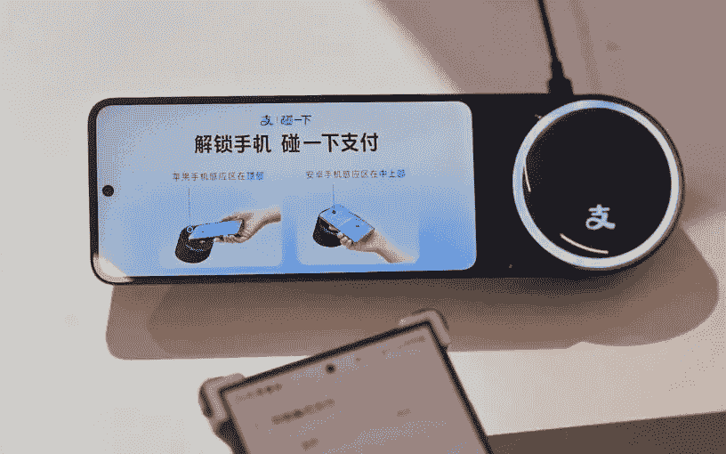

# NFC 及应用场景

> 来源：[https://leonzhang.feishu.cn/docx/WvuZdgV0Xojxsrx7fCKcC9fmnif](https://leonzhang.feishu.cn/docx/WvuZdgV0Xojxsrx7fCKcC9fmnif)

### NFC

NFC，全称 Near Field Comm**unication****，即近场通信，是一种 **短距离无线通信技术。NFC 允许电子设备之间进行 非接触式点对点数据交换，主要用于智能手机、平板电脑、智能手表等设备的互联互通。

#### 工作原理

NFC 基于 [RFID](https://zh.wikipedia.org/wiki/RFID)（无线射频识别）技术，通过电磁感应原理在频率为 13.56 MHz 的频段内工作，通信距离一般在 10 厘米以内。其传输速度有 106Kbit/秒、212Kbit/秒或者 424Kbit/秒三种。NFC 的工作模式包括三种：

1.  **卡模拟模式**（Card emulation mode）：NFC 设备可以模拟成为一张智能卡，被其他读卡设备读取。

1.  **点对点模式**（P2P mode）：两台 NFC 设备可以相互交换数据。

1.  **读卡器模式**（Reader/Writer mode）：NFC 设备可以读取和写入 NFC 标签或智能卡的数据。

#### 优点

1.  **便捷**：无需配对过程，用户只需将设备靠近即可完成操作。

1.  **安全**：短距离通信使得被窃听的风险较低，并且支持加密通信。

1.  **低功耗**：NFC 技术的功耗较低，几乎等同于 BLE，适合嵌入在各种移动设备中。

#### 应用场景

1.  **移动支付**：

+   **Apple Pay**、**Google  Pay**、Samsung Pay、Mi** Pay、**Huawei Pay 等支付服务通过 NFC 的「卡模拟模式」技术实现非接触式支付。用户将手机靠近支持 NFC 的 POS 机，进行快速、安全的支付。

1.  **门禁系统和交通卡**：

+   NFC 的「**卡模拟模式**」可以用于门禁系统的身份验证，用户通过 NFC 设备如智能手机解锁门禁系统。

+   在公共交通中，NFC 的「**卡模拟模式**」技术被用于公交卡和地铁卡，用户可以通过手机或 NFC 卡轻松进出车站。

1.  **数据交换**：

+   通过 NFC 的「**点对点模式**」技术可用于设备之间的数据交换，如照片、联系人信息等。用户需将两台 NFC 设备靠近，从而实现数据传输。比如两台 iPhone 的 “碰一碰”交换名片。

1.  **智能家居和物联网**：

+   NFC 技术可以用于智能家居设备的配置和控制，如连接智能音箱、智能灯泡等设备，用户通过 NFC 进行简单的触碰即可完成设备的配对和控制。

1.  **标签和标识**：

+   NFC 标签可以嵌入在各种物品中，如广告海报、产品包装等。用户通过 NFC 设备扫描标签，可以获取相关的信息或执行特定的操作。此时，NFC 设备充当读卡器，而 NFC 标签则充当被读取的目标。

### NFC 与投屏

前段时间做了一个“NFC 投屏”的需求，对应 NFC 的工作原理，其实这里指的“NFC 投屏”并不是指通过 NFC 本身传输视频数据，而是指通过 NFC 的「点对点模式（P2P mode）」实现设备间的握手与配对，以便随后利用其他无线技术（如 Wi-Fi Direct、Miracast 或 Chromecast）进行实际的屏幕投屏。

#### 工作原理

NFC 在“投屏”中的角色是简化设备之间的连接过程，而真正的屏幕内容传输则依赖于其他无线技术。

#### 工作流程

1.  **设备握手**：将支持 NFC 的手机靠近另一台支持 NFC 的显示设备（如智能电视、投影仪等）。这时，NFC 会启动并完成设备之间的快速配对和验证，验证通过后，后续将不再需要二次验证。

1.  **连接建立**：NFC 触碰后，两台设备通过 Wi-Fi Direct、Bluetooth 或其他更高带宽的无线协议建立连接。这一步是实际数据传输的基础。

1.  **启动投屏**：一旦连接建立，设备之间就可以开始传输屏幕内容。用户可以将手机的屏幕镜像投射到电视、投影仪或其他显示设备上。

#### NFC 在投屏中的作用

+   **快速配对**：NFC 的主要作用是在两个设备之间快速建立连接，简化了投屏的准备过程。相比手动选择设备、输入密码等步骤，NFC 只需要一次简单的接触就可以完成设备间的配对。

+   **用户体验提升**：这种方式提高了用户体验，因为 NFC 可以自动触发投屏操作，而无需用户在手机或平板上进行复杂的设置。

#### 应用场景

+   **手机到智能电视、投影仪**：用户可以通过 NFC 将手机的内容迅速投射到智能电视或投影仪上，观看视频、浏览图片或演示文档。

###  NFC 与支付宝碰一下支付

想到上个月在滨江天街吃饭，结账的时候发现商家已经支持“支付宝碰一下”，便好奇心驱使，当然选择用它！手机解锁情况下，碰上去，直接调起付款浮窗，点击「确认」后即可支付，整个过程很是丝滑。

后来看到 UP 主差评君的视频介绍，原来更丝滑的是 Android 手机，可以直接付款，不需要二次确认；目前只有 iPhone 是支持二次确认的，嗯，这个操作很苹果！

#### 工作原理

**首先通过 **NFC 技术来实现手机与支付宝支付设备握手，其次通过「点对点模式」将支付宝条码信息传输至支付设备上，然后由支付设备发起支付请求，最后对应的支付宝账户进行相应的扣款，支付完成。

所以，支付宝这里的碰一下支付，看起来是利用 NFC 的「**卡模拟模式****」后进行支**付，但实际上却是利用「点对点模式」进行的「条码支付」。

#### 工作流程

1.  **设备握手**：将已解锁的手机靠近支付宝支付设备的右侧感应区时，NFC 会在两台设备之间建立短距离的无线连接。

1.  **启动支付宝**：通过 NFC 建立连接后，手机会通过 NFC 识别支付设备，并启动支付宝付款或调起支付页面。启动支付宝和识别功能由手机读取支付宝支付设备 NFC 标签实现。

1.  **数据交换**：通过 NFC 的「**点对点模式**」将条码信息加密传输至支付设备上，然后由支付设备发起支付请求，支付设备通过云端网络（Wi-Fi 或蜂窝网络）对相应的支付宝账户进行对应的扣款，最后支付完成。

#### 补充：NFC 支付的工作流程

> *内容参考 UP 主差评君的视频，视频地址见文末附录。

NFC 设备握手的流程是：手机靠近 POS 机后，通过 NFC 的「卡模拟模式」进行设备认证和密钥交换，然后再进行支付流程。

1.  手机靠近 POS 机建立 NFC 连接。

1.  进行设备认证和密钥交换。

1.  发起支付请求并完成支付。

### 最后

原计划是打算找一下 UP 主楼斌拆解 iPhone 与安卓手机的视频，更直观看下 NFC 的位置和硬件，然后我去看了几个我想看的品牌（Apple、魅族、坚果/Smartisan）的拆解视频，结果发现视频里都没有这部分的讲解，有点小遗憾。

不过我大概知道 iPhone 的 NFC 硬件位置，是在手机顶部与侧边的边框位置，印象是靠近摄像头的一侧，但又有些拿不准，不过一定是在顶部。所以大多数情况下你会看到，大多数人拿着 iPhone 刷地铁卡的时候，更多是顶部贴近，拿着 Android 手机更多是将手机水平贴近感应器。

最后的最后，我把喜欢的手机品牌的拆解视频也放到了文末，有需要的话可以关注下，相信我，看完 Apple、魅族、坚果/Smartisan 这三个品牌的手机拆解视频，你一定不会后悔～

### 附录

#### 相关内容

+   银[联闪](https://zh.wikipedia.org/wiki/%E9%97%AA%E4%BB%98)付（Q[ui](https://zh.wikipedia.org/wiki/%E9%93%B6%E8%81%94)[ck P](https://zh.wikipedia.org/wiki/HCE)ass）：闪付是中国银联推出的一种非接触式支付方式，基于 NFC HCE 卡模拟技术，可以在无卡情况下使用支持 NFC 的手机完成小额交易，目前在中国大陆已经应用在包括餐饮、零售、公共交通等多领域。苹果 Apple Pay 在中国大陆区的交易方式便是采取闪付通道完成的。

+   **移动支付费率**：中国大陆的移动支付费率通常为 0.3%-0.6%，而贴支付宝二维码收款的商家，费率几乎为 0。

#### 相关阅读

+   NFC Wikipedia（维基百科）： https://zh.wikipedia.org/wiki/%E8%BF%91%E5%A0%B4%E9%80%9A%E8%A8%8A

+   非接触式射频识别（[RFID](https://zh.wikipedia.org/wiki/RFID)）： https://zh.wikipedia.org/wiki/RFID

+   中国银联闪付：https://zh.wikipedia.org/wiki/%E9%97%AA%E4%BB%98

+   电视怎么投屏教程 手机投屏到电视上怎么操作： https://n.znds.com/article/61457.html

+   “支付宝碰一下”到底是个啥？ https://36kr.com/p/2855558959057794

+   【支付宝"碰一下"用了 NFC，却不是 NFC 支付？【差评君】】 https://www.bilibili.com/video/BV1vH4y1w7WV/?share_source=copy_web&vd_source=672ec070780ce29c890256a5fabe799b

+   【支付宝碰一下：新型支付方式体验如何？】 https://www.bilibili.com/video/BV1cw4m1k7zJ/?share_source=copy_web&vd_source=672ec070780ce29c890256a5fabe799b

+   確認你的手機 NFC 天線位置 https://help.maktar.com/hc/zh-tw/articles/11281723361177-%E7%A2%BA%E8%AA%8D%E4%BD%A0%E7%9A%84%E6%89%8B%E6%A9%9F-NFC-%E5%A4%A9%E7%B7%9A%E4%BD%8D%E7%BD%AE

+   【【享拆】iPhone 15 Pro 系列拆解：年复一年，还能看到未来么？】 https://www.bilibili.com/video/BV1c94y1W77E/?share_source=copy_web&vd_source=672ec070780ce29c890256a5fabe799b

+   【【享拆】iPhone 14&Pro&Pro Max 三连拆：一如既往的“内外兼修”】 https://www.bilibili.com/video/BV1EY4y1T7ER/?share_source=copy_web&vd_source=672ec070780ce29c890256a5fabe799b

+   【【享拆】魅族 21 PRO 拆解：第一次拆 AI 终端～】 https://www.bilibili.com/video/BV1Kr421W7Y4/?share_source=copy_web&vd_source=672ec070780ce29c890256a5fabe799b

+   【楼斌拆解 坚果 R1】 https://www.bilibili.com/video/BV1TW411P74C/?share_source=copy_web&vd_source=672ec070780ce29c890256a5fabe799b