# Arc｜重新定义下一代浏览器？

> 来源：`https://leonzhang.feishu.cn/docx/FOwOdklx4oNgXyxdsICcK7A6nlc`

Leon Zhang, June 2, 2024

> Arc is the Chrome replacement I've been waiting for.

## 前言

说起来 Arc，最初是在 X 上看到有人分享，甚至还说是什么是他用过的最好的 Web Browser（网络浏览器）。

当时的我根本不信，甚至心里还在想，它难道能比 Google Chrome 做得还好？虽然 Chrome 疯狂吃我的内存，Mac 的内存也被戏称“比黄金还贵”，但也不影响我对它的喜爱。

怎么可能呢？! 然后我便直接划走，就这样，第一次完美错过...

提到 Chrome，我在去年的时候就提过自己有个不太好的使用习惯，甚至到现在还没有改掉：在浏览器里开很多个 `Tab`（标签页）不关，原因是信息焦虑。

当然我也一直在寻找这个问题的解法，包括也和好友阿珂讨论，她告诉我，她自己从来不会遇到这种问题，如果没时间而被迫选择不看了，那就直接错过好了，与其放着吃内存，还不如直接关掉，因为放着不看和直接关掉，本质没有任何区别。

她总是这么大脑清醒，明确知道自己想要什么，不想要什么。我也尝试过，根本做不到，因为我还是会去翻历史记录。

为了体验更快地体验到新功能，我经常去 Check 软件更新，甚至我的 Chrome 用的是 Dav 版本，常年保持一周一次更新（甚至偶尔还会去更新处 Check），时不时我也会自己折腾一些插件在用，包括它“吃内存”的问题，我也通过插件几乎完美解决。

解决“吃内存”问题的插件叫做 `Tab Suspender`（`Chrome Web Store`、`https://tabssuspender.com/`），好处之一是省内存，而且不仅能够看到当前 `Tab` 的“睡眠”时间，还能通过 `Command + E` 去 `Search Tab`，就很好用。不过，它也不是完美无缺，它经常在我重新打开浏览器时会重复打开一些 `Tab`，而且这个 bug 在我后来用 Arc 之后也没有被解决。但这对我而言并不是什么大不了的问题，所以一直用到了现在。

回到刚才的问题，后来我关注它的契机是什么呢？直到我又在即刻上注意到推荐它的人越来越多，出于好奇，然后我就去关注、了解，并沿用至今。

老罗曾经说过，“过度的批评和赞美，都是一种偏见。”

显然，是我对 Chrome 过于偏爱了，这或许算是一种爱屋及乌。因为喜欢 Google 搜索，然后有 Google 账号，然后 Gmail，再到 Google 全家桶，确实好用。再加上 Chrome 基于 Chromium 开源，才有了很丰富的插件生态，我刚去翻插件列表，发现常用的有 Kimi Copilot、沉浸式翻译、火山翻译、篡改猴等，它们都或多或少帮我解决了一些问题，我很喜欢。

至于 Arc，我后来甚至看到介绍：Chrome 浏览器 16 年的元老、副总裁 Darwin Fisher 都跑来给这个浏览器打工，这是几个月前我注意到它的原因。

如果你也想试试，可以关掉这篇文章，直接去 b 站搜相关的视频，或许视频会更加直观。

当然，如果你想先简单了解下，那希望这篇文章能帮到你。

为了做这期内容，我去搜了相关的视频，自己在学习的同时，顺手也做一下体验推荐的内容，除了表达喜爱，还能知道自己是否有没有用到的功能，更何况上周还答应了竹荫的小伙伴（毕竟这篇内容已经欠了很久）。

有些啰嗦，我们现在开始～

## 快捷键

首先介绍一些通用的快捷键，当然，这些快捷键在 Chrome 和 Arc 上都是通用的，我是从 Chrome 过度过来的，快捷键肯定必不可少呀。以 `macOS` 为例，列一些常用的快捷键，有需要的话，欢迎自取～

**基本导航：**

+ `Command + T`：打开新标签页

+ `Command + W`：关闭当前标签页

+ `Command + Shift + T`：重新打开最近关闭的标签页

+ `Command + [` 或 `Command + Shift + ]`：在浏览历史中后退/前进

+ `Command + L`：选中地址栏

+ `Command + D`：将当前页面添加到书签栏

+ `Command + J`：打开下载内容页面

**页面操作：**

+ `Command + P`：打印当前页面

+ `Command + R`：刷新当前页面

+ `Command + Option + I`：打开开发者工具

**标签管理：**

+ `Command + Shift + N`：开启无痕浏览模式

+ `Command + 点击链接`：在新标签页中打开链接（不会离开当前标签）

**其他：**

+ `Command + F`：在当前页面上查找文字

+ `Command + Y`：查看浏览历史记录

+ `Command + Shift + B`：显示或隐藏书签栏

+ `Command + Shift + Del`：清除浏览数据（如 `cookies` 和缓存）

如果你喜欢用快捷键，但又经常记不清快捷键，推荐一个我用了很久的 App，名称是 `CheatSheet`，安装后只需要长按 `command` 就可以调起一个浮窗（下图），然后显示它读取到的当前前台应用的快捷键。

超级好用，甚至它还是免费的。

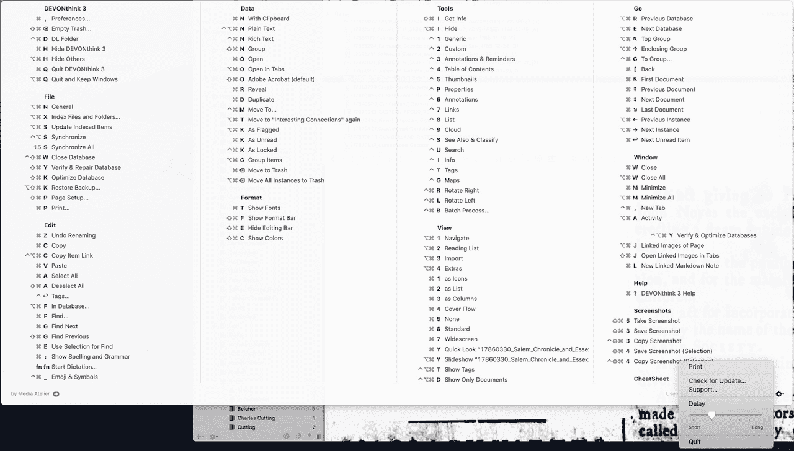

超级好用，我第一次用的时候就被震惊到了，有了这么优秀的产品，这还用什么带快捷键的鼠标垫呀（虽然我也从来没用过），哈哈～

## 基本功能

### 全屏

+ `Command + S`：`Show/Hide Sidebar`（显示/隐藏侧边栏）

就，很简洁有没有～ 😊

| 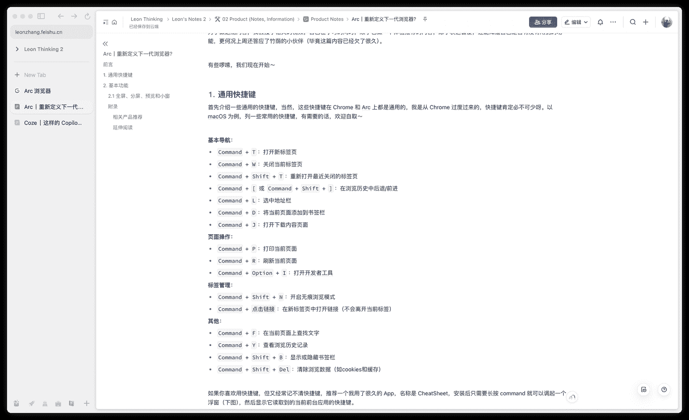 | 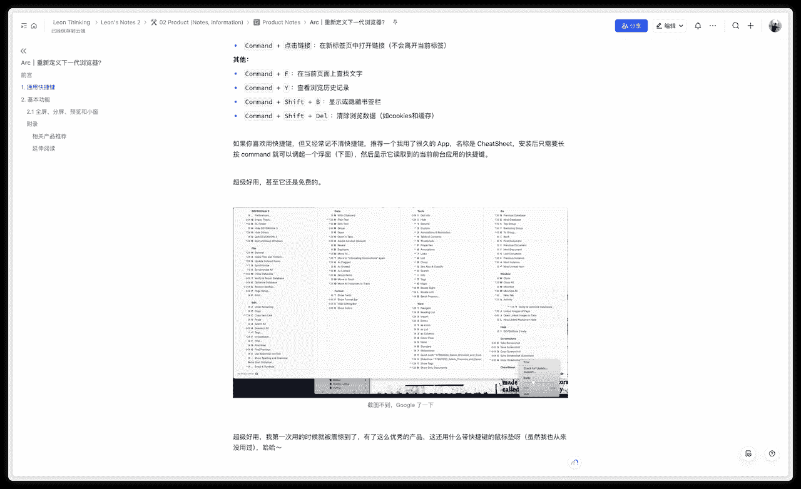 |

| --- | --- |

### 预览

+ `Shift + 点击链接`：打开预览窗口

+ `Shift + 光标放在链接/站点处`：概要链接/站点 信息

超级好用、且是我常用的功能之一，就是那些你认为不用新建 `Tab` 打开的链接，可以快速预览内容，可以先用 `Shift + 点击链接` 打开预览窗口，然后根据你的需要选择全屏打开（`Command + O`）、关闭（`Command + W / Esc`）、或者分屏。

尤其是用 AI 概要信息部分，我超级喜欢！

|  | 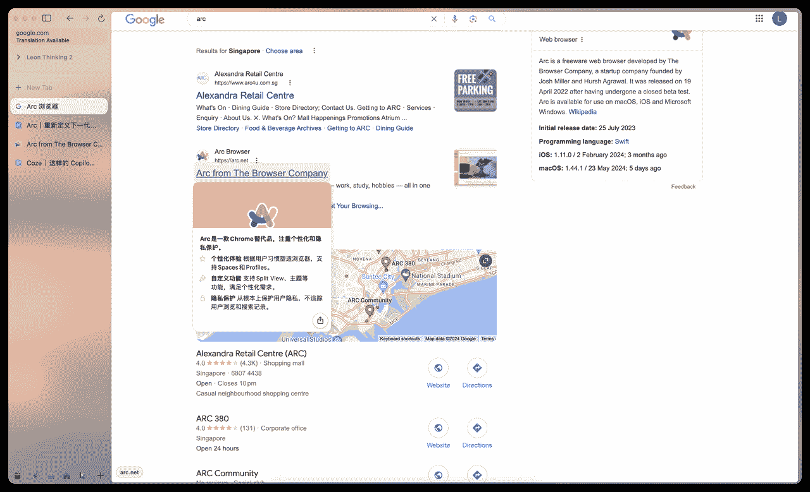 |

| --- | --- |

### 分屏

+ `Option + 点击链接`：新建多个分屏（不会离开当前标签）

你可以从一个内容、分屏到两个，甚至是多个内容，当你分到四个以上的时候，你会发现，诶？这不是 TNT... 🌚

在物理世界中，我们经常需要对照一些重要内容，进行内容誊写或者记忆。事实上，我们在手机或者平板的场景，也会这么用，这不仅是因为触摸屏给我们带来的触摸交互给我们带来的良好体验，更深层次的原因是因为这个操作习惯更符合我们的物理交互习惯。

遗憾的是，在电脑设备上想要并排两个 App 的场景虽然很多，但通常因为操作不便而放弃，主要是交互逻辑和习惯的问题。所以你能看到，有些人在办公的时候，通常是采用副屏、甚至多个屏幕的方式使用。

或许是 Arc 的产品负责人/交互设计师意识到了这个问题，从而给了我们这个解决方案。

事实证明，这个在我对比看一些文章的场景下，很是好用。甚至你也可以真的模拟物理世界，左侧看，右侧记录内容。Arc 也内置了 `New Easel`，类似 Apple 的无边记 App，一个大的画布，你可以贴图片、文字、形状、剪头、笔画、网站链接等各种内容，甚至还支持分享链接协作，就很神奇。

| 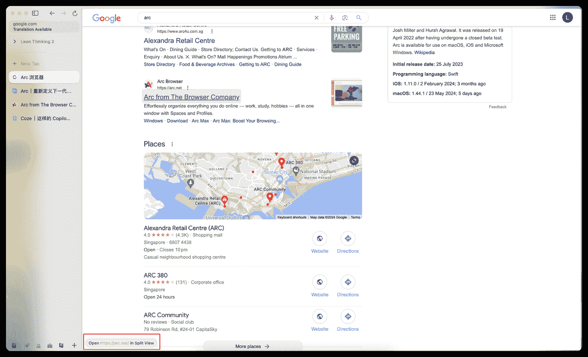 |  |

| --- | --- |

| 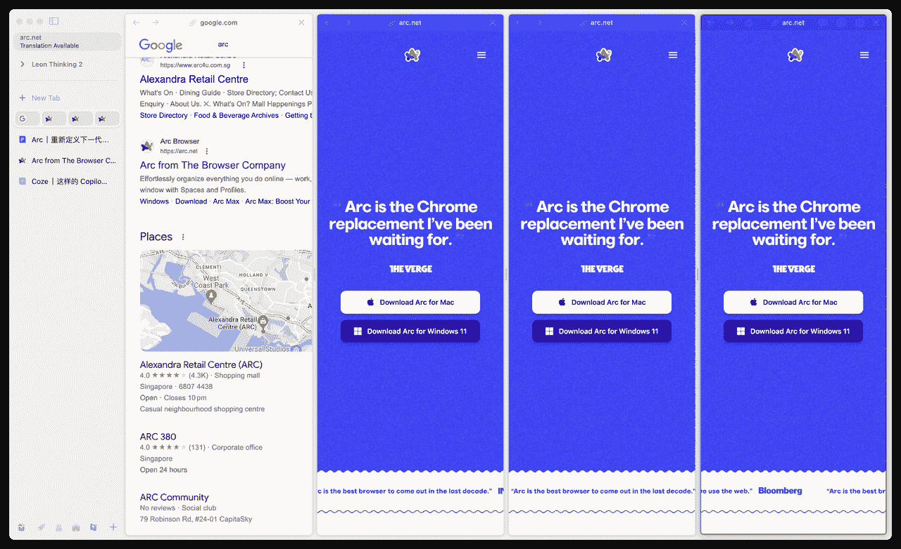 | 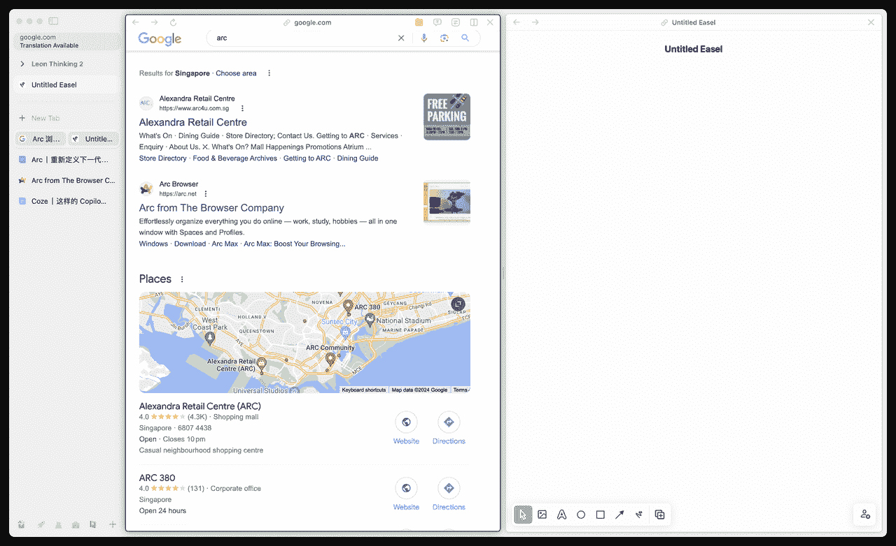 |

| --- | --- |

### 小窗

+ `Command + Option + N`：新建小窗口

快速打开 `Little Arc`。我的场景是：正在看内容，然后突然想起什么事情需要确认下，然后就快速打开搜索。这个行为就很契合物理世界中你手边有多个笔记本，马上记一下、或者快速查询下，然后用完即弃。这个设计就很绝！

|  |  |

| --- | --- |

## 标签管理

提到“标签管理”，相信大家一定不陌生。标签管理，以高灵活性著称，凭借清晰的层次结构，方便我们能够更快速的组织内容或信息，从而实现更高效的信息管理，深得大家喜爱，因为标签管理意味着高度自定义。

### 标签应用

Arc 当然也没有放过它，它支持对 `Tab` 进行 `Icon` 更换、重命名（双击标签），甚至支持 `Customize Page`（页面自定义），即 `Boost` 模式，能够更改网站的颜色、字体、布局，甚至通过 `Boost` 中的 `Code` 支持通过 编写 `CSS` 和 `JavaScript` 代码来自定义网页，真的强！

| 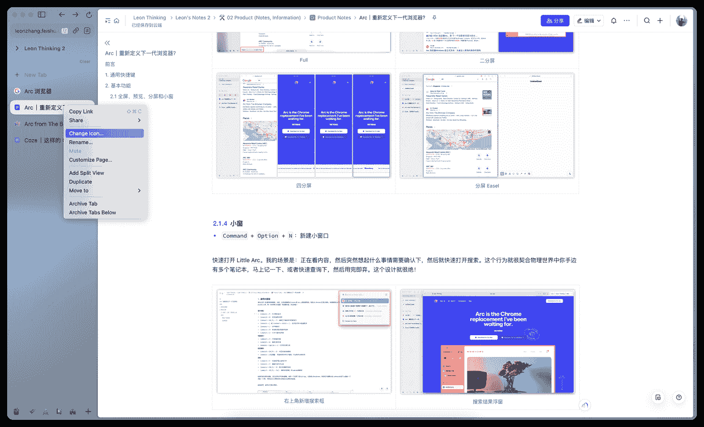 | 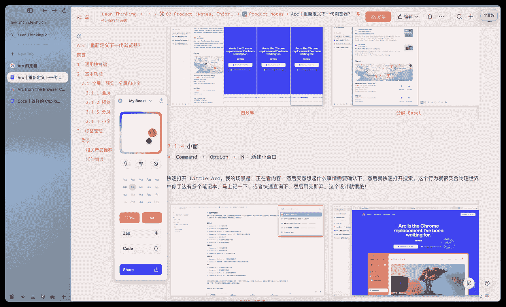 |

| --- | --- |

### 标签页切换

比如常用的标签页切换，如果你已经打开了，或者历史打开过，你在搜索框检索的时候就能够直接跳转，或者优先打开你已打开或者曾经打开过的 `Tab`，这点也很痛。

我经常在用 `Chrome` 的时候意识到，短时间打开多个页面，然后有一种错觉就是，这个页面好像被我打开过，然后再去确认一遍。这个问题在 Arc 上被完美解决，无论你是通过 `Command + T` 新建 `Tab`，还是 `Command + Option + N` 新建小窗，搜索框候选均为常用 `Tab`，真的太棒了。

再对比 `Chrome`，它本就吃内存，结果还被人为的新开了重复的 `Tab`，简直是资源浪费！

| 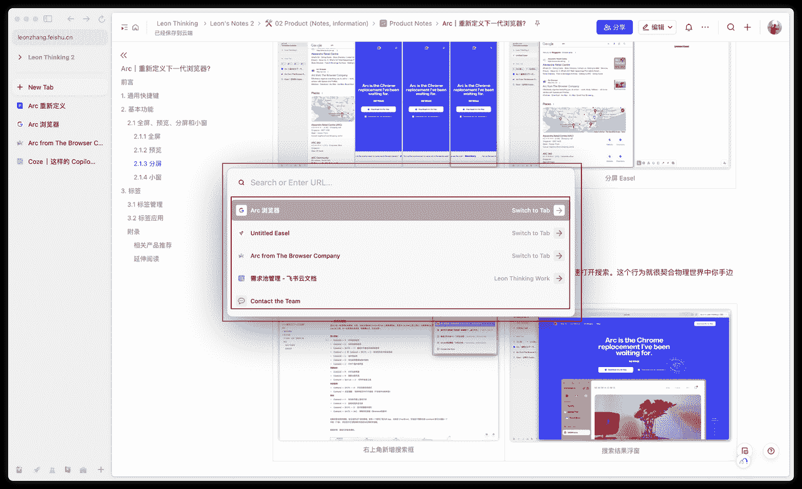 | 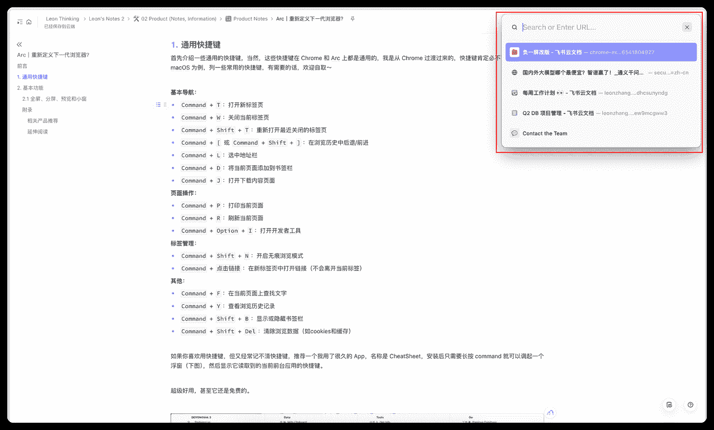 |

| --- | --- |

### 收藏分组

+ `Command + D`：收藏当前 `Tab`

如果没有被收藏，则默认 12 小时后 `Tab` 会自动归档，设置里的其他可选项有 24 小时、7 天、30 天，你可以根据需要选择你需要的时间。甚至你在收藏的时候，它还会根据网站信息，帮你重命名 `Tab`，当然你也可以选择你喜欢的名称。

当你收藏的标签变多时，你可以新建文件夹（`New Folder`），作为 `Tab` 合集来管理 `Tab`，比如某个项目的合集、感兴趣的话题、本周的学习等等，简单、直接。

| 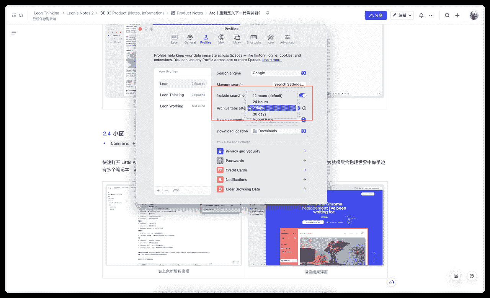 | 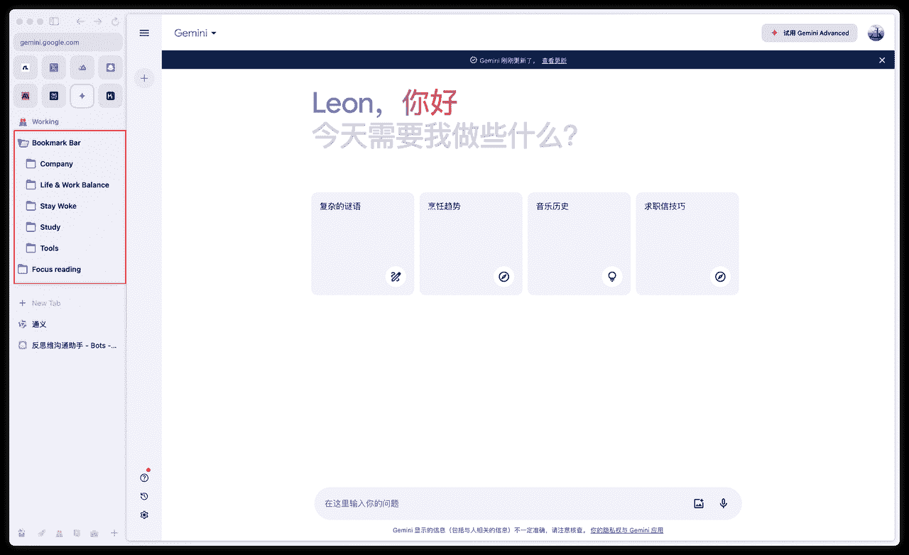 |

| --- | --- |

## 多空间、配置文件

### 多空间

+ `Command + Option + →`：`Next Space` 切换到下一个空间

+ `Command + Option + ←`：`Previous Space` 切换到上一个空间

+ `Control + 1`：`Space 1` 切换到空间 1

+ `Control + 2`：`Space 2` 切换到空间 2

这个部分是空间和配置文件的设置。这里也没有什么强制要求，怎么习惯怎么来就行，截图中，我是配置了两个配置文件/账号（分别是 Leon 与 Leon Thinking），四个空间，四个空间分别是观影娱乐、阅读、个人和工作。

配置文件就相当于 `Chrome` 里的「个人资料」，目的都是一样，就是将内容分门别类，比如像我这种将工作内容和娱乐内容分开。

至于排列顺序，也是怎么习惯就怎么来。

|  | 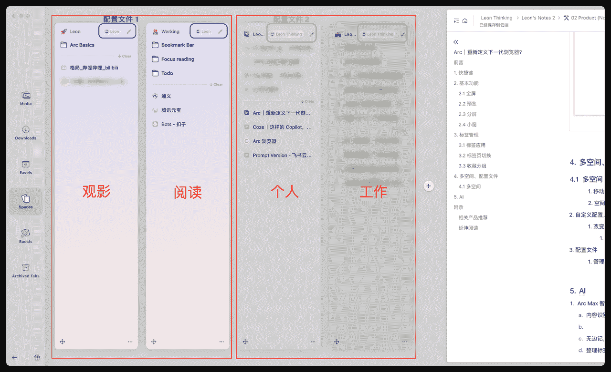 |

| --- | --- |

### 配置文件

配置文件或者也可以称为“账号”管理，支持管理和它相关的所有空间的设置。可以切换不同的配置文件/账号，以便快速切换不同的工作环境。而且每个配置文件都有独立的书签、历史记录、扩展程序等，互不干扰。

设置方面和 `Google Chrome` 是一致的，也可以参考你之前浏览器的设置。

| 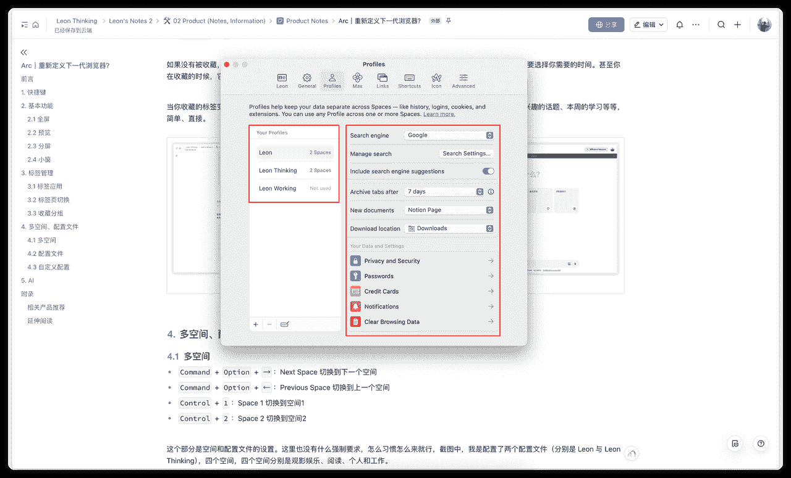 | 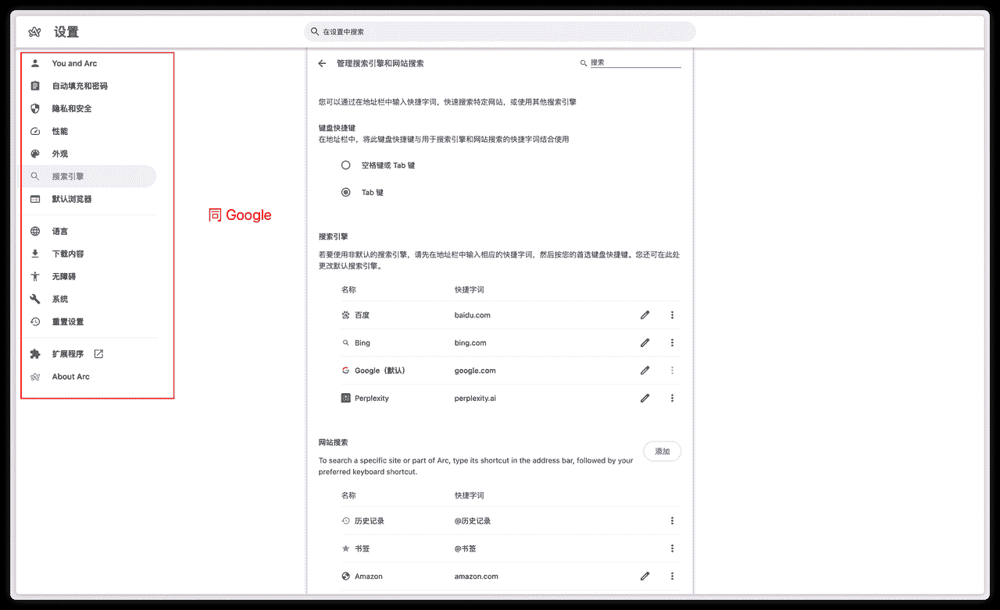 |

| --- | --- |

### 高度自定义

这部分更简单一些，你可以根据自己的喜好定义空间主题，包括但不限于颜色可以设置为渐变色、调整透明度，甚至实现磨砂效果般的噪点设计等等，Arc 的设计真的长在了我的审美上。

与 `Tab` 同理，空间的 `icon`、名字也支持自定义。

| 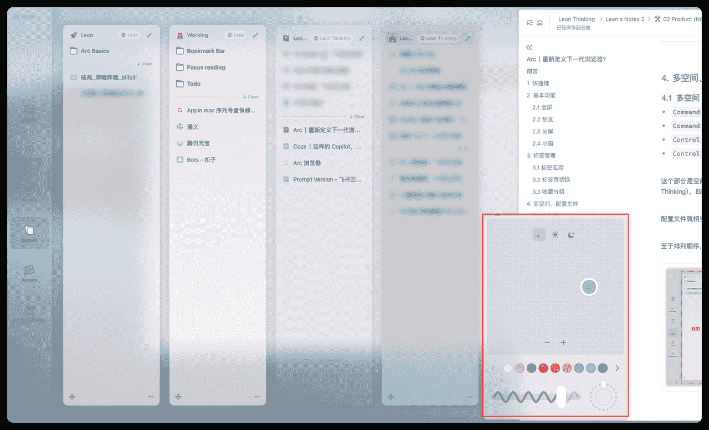 |

| --- |

## AI

最后一部分，我想来介绍下 `AI`。在 `AI` 技术快速发展的今天，大家都恨不得将 `AI`“赋能”给每个 App 中，无论是以期望实现更智能、更高效的服务，亦或是噱头。

现阶段，`AI` 能做的事情确实有很多，比如模式识别、`NLP`、文生图（`Text-to-Image Generation`），还有类 `Sora` 的“文生视频”等等，但它也有当前阶段的局限。产品的设计者需要更深刻的理解 `AI` 的能力与局限，并找到技术与需求之间的平衡点，是衡量一个产品设计者专业水平的重要标准之一。

如何巧妙地结合 `AI` 技术的优势，同时规避其局限性呢？Arc 的设计者，给出了他们的答案。

为了让你在浏览器里获得更好的体验，Arc 做了很多具有开创性的 `AI Feature`，比如当前页面提问、鼠标悬停生成网页摘要、`Tab` 、下载文件自动重命名、搜索框内跳转 `ChatGPT`、`Tab` 自动整理等等。对，就是 `Arc Max`（`Arc Max` is a bundle of AI-powered features that enhance Arc）。

| 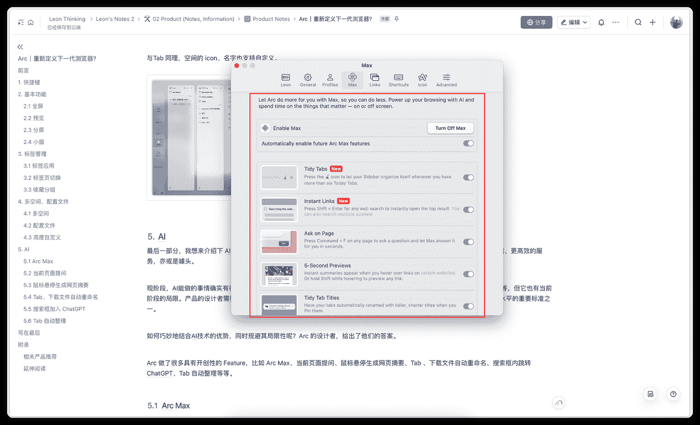 | 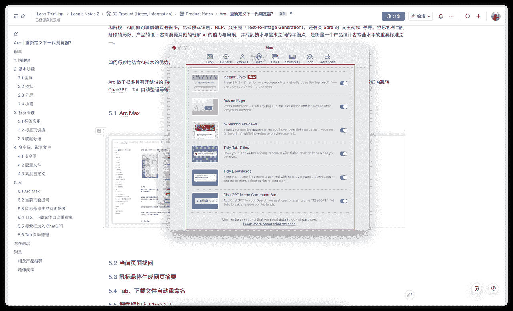 |

| --- | --- |

### 当前页面提问

+ `Command + F`：在当前页面上查找文字

在快捷键部分，已经放上了这组快捷键。其实也是我们很常用的一组快捷键，比如在 `Microsoft Office` 里，会用来进行查找/替换文字，而在网页里，我们会用它来进行页面的文字检索，以快速定位我们所需的内容部分。

在 Arc 里，`Command + F` 除了可以帮你检索内容，还可以针对当前页面提出问题，然后会调用 `Max`（`AI`）回答。

| 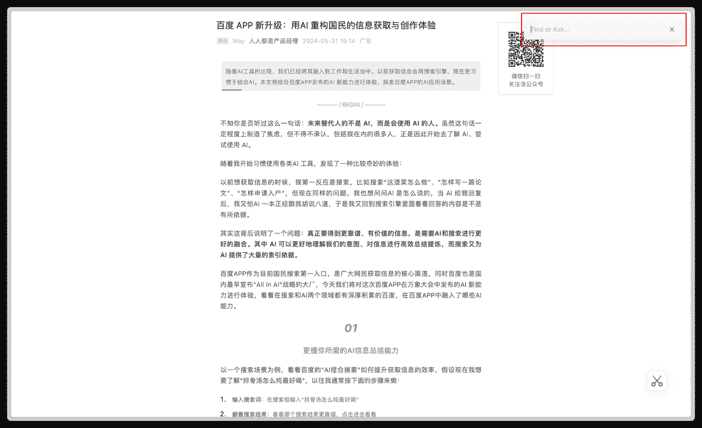 | 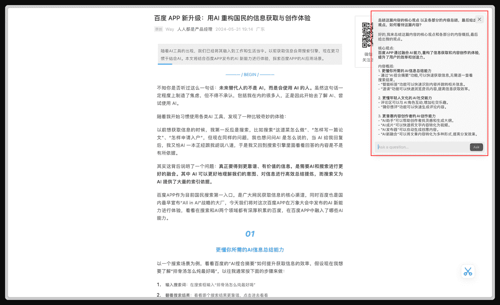 |

| --- | --- |

### 鼠标悬停生成网页摘要

如题，将鼠标光标悬停在链接处，帮你生成该链接的摘要。一般是自动出现的，但我也偶尔会遇到没有自动出现的情况，通常我的做法是，手动再按一下 `Shift` 键即可。

这个相当于前面预览页面的升级版，即 `AI Summary`。

顺便多说一句，Arc App `iOS` 端双指捏和的交互设计，被某产品像素级抄袭。

| 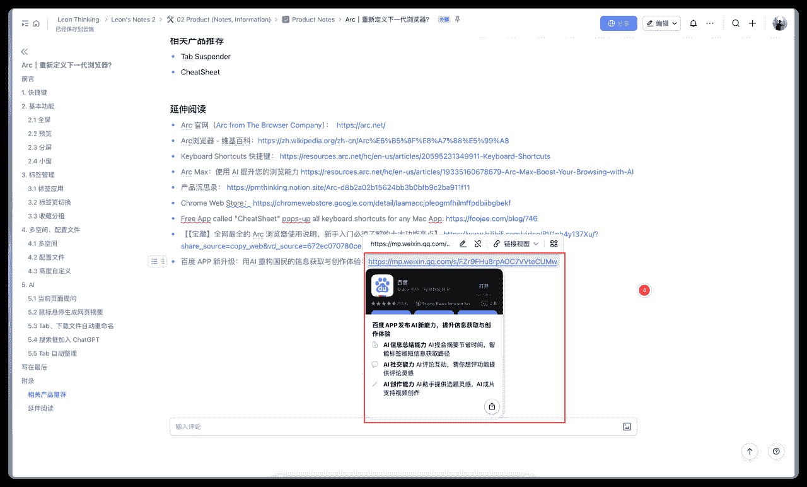 |

| --- |

### 自动重命名、自动整理、搜索框 ChatGPT

具体功能如下，

1. 下载文件时，会自动重命名。

1. 收藏 `Tab` 时，也自动根据页面内容帮你重命名。

1. `Tab` 也是，当日 `Tab` 太多的话，侧边栏会自动整理。

1. 搜索框融入了 `ChatGPT`

1. `Command + T`：打开新标签页

1. `Command + Option + G`：文本框调起 `ChatGPT`

| 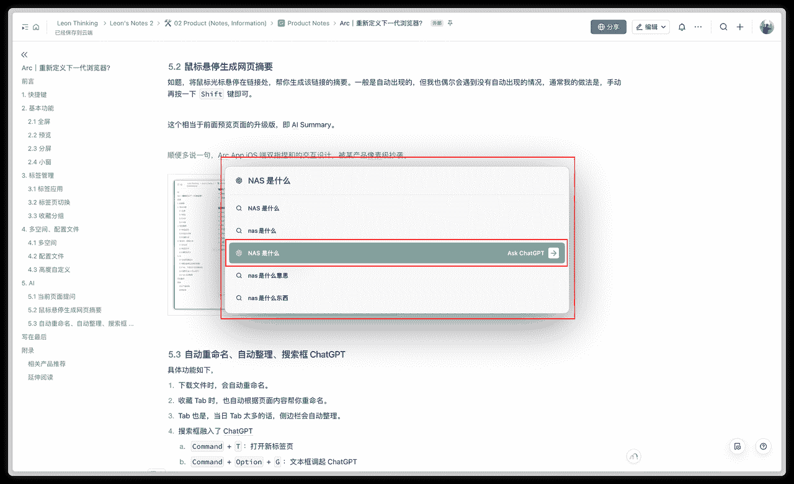 | 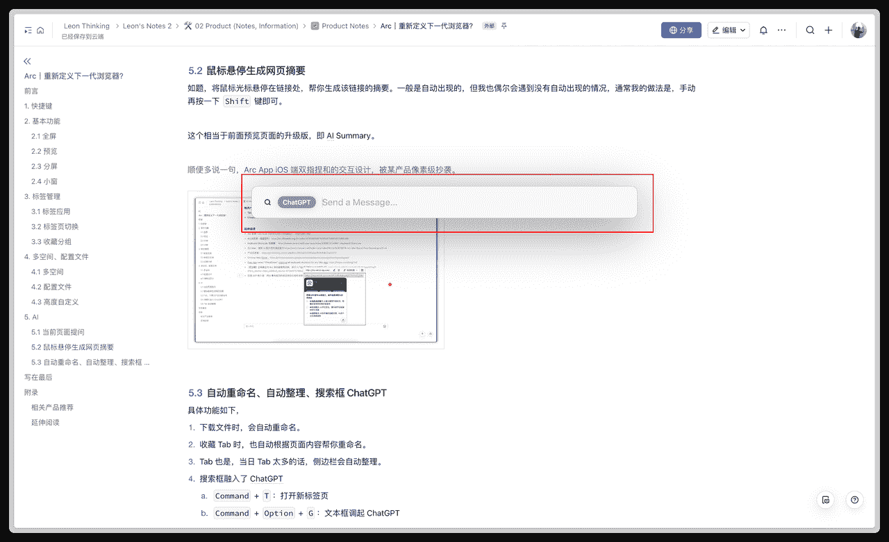 |

| --- | --- |

## 写在最后

> Sharpening the axe will not hold up the work of chopping firewood; Making full preparation will not delay your job but quicken the process.

[如果你看](https://arc.net/gift/50f24939)到这里，觉得这个产品比较感兴趣，欢迎你 下载试用 它。

可推荐人使用新产品，总绕不开的两个问题是：一句话介绍下这个产品，亮点是什么；替换它的理由（替换成本）。

我认真想了一下午，结果是 没有答案。这里并不是说，想不到更合适的介绍方式，不是的，电梯演讲，算是基本操作/技能了，但这并不意味着，推荐人使用产品的过程和结果就一定是好的。

既然如此，那就反推不需要被推荐的人的特点，找到他们的特征点，然后匹配。

核心是明确对方的需求。比如对方一周可能用不了一次浏览器，那实在没有这个推荐的必要。如果对方对新鲜的内容/服务/产品不感兴趣，那也没有必要。

其实这部分本质是好奇心：你是否对这个新事物充满好奇，是否想要去亲自尝试...

**正所谓“磨刀不误砍柴工”，一个好的工具，**在用的时候可能会让你倍感欢喜、心情愉悦。

前段时间在尝试双拼，小鹤双拼，设计者说，“一个小时记住键位，一周堪比全拼，一个月一飞冲天。” 我的原计划是，顺利的话也许一个月后就能用起来了。我尝试了一段时间，一来是时间不够，二来是个人盲打效率低。现阶段，我在全拼输入法的场景下，盲打都不是很好。

我最初的想法是，那就没必要再记录全屏的键位了，但盲打困难，带来键位的记忆问题。接下来，我会先尽量提升盲打，然后才是双拼。

没办法，既然“一口吃不成一个胖子”，那就一个馒头一个馒头的吃，一口一口的吃。

## 附录

### 产品推荐

+ Tab Suspender
+ CheatSheet

### 延伸阅读

+ Arc 官网（Arc from The Browser Company）： https://arc.net/gift/50f24939
+ Arc 浏览器 - 维基百科：https://zh.wikipedia.org/zh-cn/Arc%E6%B5%8F%E8%A7%88%E5%99%A8
+ Keyboard Shortcuts 快捷键： https://resources.arc.net/hc/en-us/articles/20595231349911-Keyboard-Shortcuts
+ Arc Max：使用 AI 提升您的浏览能力 https://resources.arc.net/hc/en-us/articles/19335160678679-Arc-Max-Boost-Your-Browsing-with-AI
+ 产品沉思录： https://pmthinking.notion.site/Arc-d8b2a02b15624bb3b0bfb9c2ba911f11
+ Chrome Web Store: https://chromewebstore.google.com/detail/laameccjpleogmfhilmffpdbiibgbekf
+ Free App called "CheatSheet" pops-up all keyboard shortcuts for any Mac App: https://foojee.com/blog/746
+ 【【宝藏】全网最全的 Arc 浏览器使用说明，新手入门必须了解的十大功能亮点】 https://www.bilibili.com/video/BV1ph4y137Xu/?share_source=copy_web&vd_source=672ec070780ce29c890256a5fabe799b
+ 百度 APP 新升级：用 AI 重构国民的信息获取与创作体验：https://mp.weixin.qq.com/s/FZr9FHu8rpAOC7VVteCUMw

以上，祝你早安、午安、晚安～
