# 提升表单设计效果的 18 个技巧

> 来源：[https://leonzhang.feishu.cn/docx/G7ePdk5CTo3Nd5xsCRwcn5Kqn0g](https://leonzhang.feishu.cn/docx/G7ePdk5CTo3Nd5xsCRwcn5Kqn0g)

> 编辑导语：表单是用户和应用程序之间主要的沟通桥梁，一个合理、优秀的表单模块不仅能帮助用户顺畅的完成业务诉求，更能让用户体验到成功感、满足感，从而提升用户对产品满意度。作者分享了 18 个提升表单设计效果的技巧，我们一起来看看吧。

## 一、表单始终使用标签

人都喜欢接受确定性的信息，面对不确定的信息，尤其是在输入不确定的字段，如果用户忘记了字段的用途并且必须在其外部单击以再次查看占位符，此时的体验将是异常糟糕的。

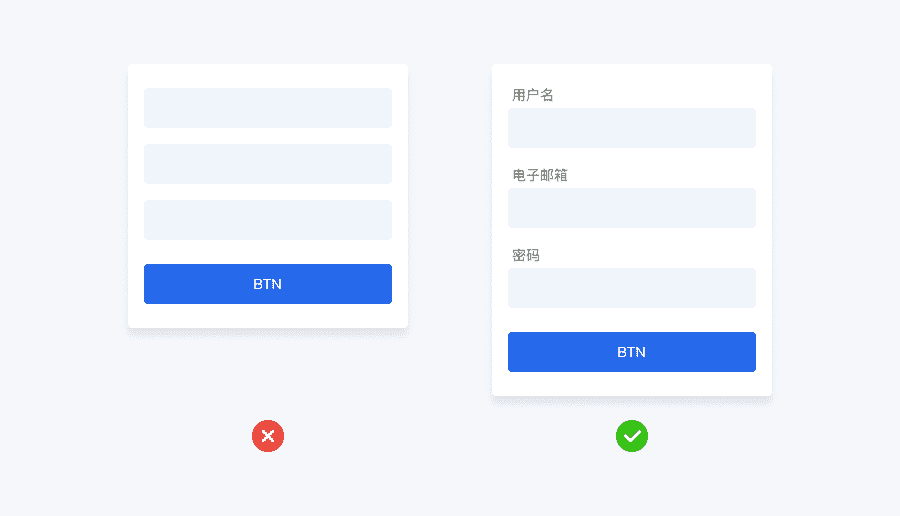

## 二、避免用户阅读路径呈“Z”字型

“Z”字型的阅读路径，是指用户在阅读表单的时候呈现从左到右，再从上到下的规律，这样阅读模式的跳跃感较强，导致用户阅读的效率降低，表单数量过多的时候可能进一步导致用户的反感。

当表单分布垂直线上时，用户可以快速垂直浏览表单，从而更容易完成他们的任务。

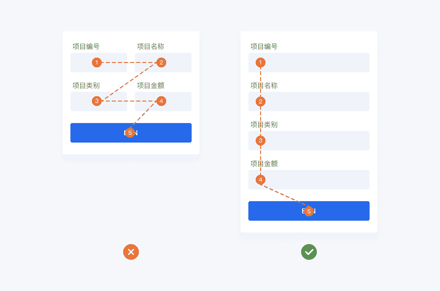

## 三、表单标签选择顶对齐

当表单标签是左对齐 （右对齐），有点像是“Z”字型阅读路径的一个扩展，左对齐 （右对齐） 的表单会自动创建一个“Z”阅读模式，导致表表单阅读效率的下降。当表单标签字段非常短，左侧的标签字段对阅读影响不大。

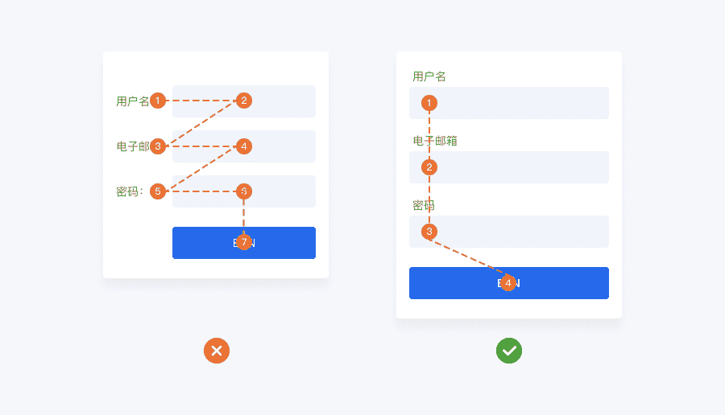

## 四、使用右对齐标签

表单标签左对齐、右对齐相比较而言，右对齐使得标签和输入域之间的距离固定，有明确的视觉关联，可以让用户更轻松地浏览页面，表单的视觉层次也更清晰。

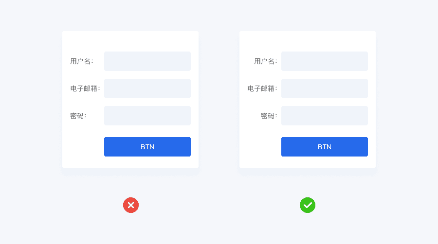

## 五、亲密性强的字段分组整合

较长、平铺的表单会增加用户的填写压力，降低用户的填写意愿。将亲密性强的相关表单组合成子模块 （子流程），不仅在视觉上降低长表单带来的压力，还会使表单更具吸引力。

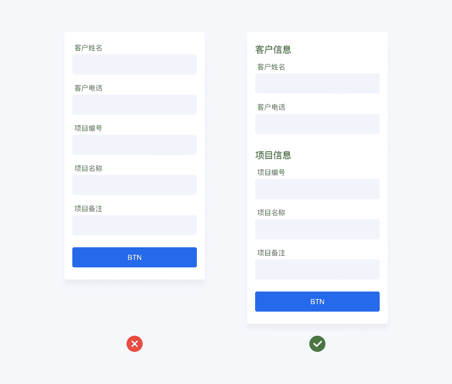

## 六、尊重用户的操作习惯

按一定的逻辑顺序一个接着一个地填写每个字段，然后提交表单，是一个用户十分熟悉的操作习惯 （流程），把操作按钮放置表单末尾，是符合用户认知和尊重用户操作习惯的。

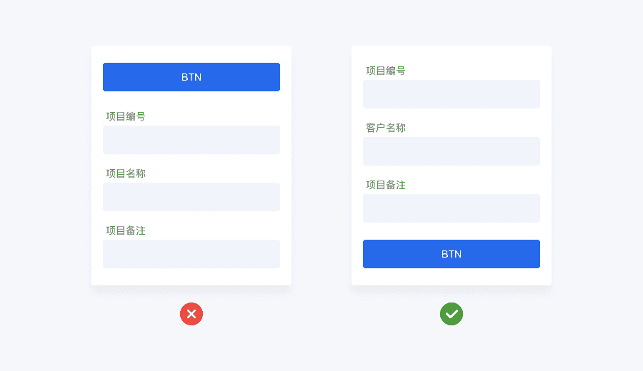

## 七、表单之间留有足够的空间

标签应该靠近各自的表单输入域，尤其是选择标签顶对齐的时候，利用空间将相邻表单分割开来，适当且合理的空间留白不仅会提高表单的阅读效率，更会使表单更具有美感。

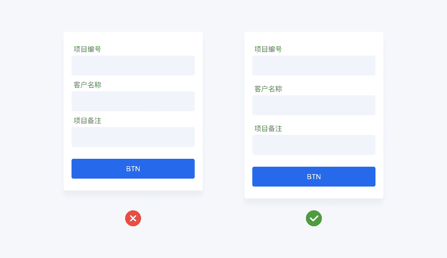

## 八、避免标签重复

一般用“*”标记必填字段，有时候“*”是页面中的标签还是用来描述标签的会造成一定的误解，同时“*”的颜色有时候也会引起负面关联，例如：红色表示错误。

对于表单来说，省略不必要信息的字段信息会给表单起到视觉降噪的作用。

3 个表单，其中有 1 个选填表单，2 个必填表单，则可在选填表单标签处标记选填；1 个必填表单，2 个选填表单，则在必选表单标签处标记必填。

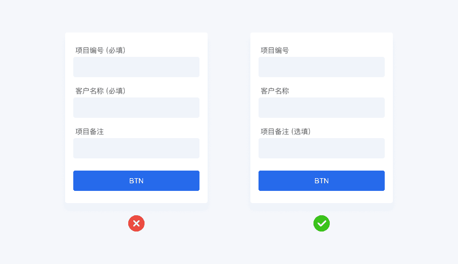

## 九、清晰的描述错误信息

表单校验出现错误时，不仅要给用户提示到哪个表单填写错误，还要给用户提示到该表单填写错误的原因以及如何快速改正错误。

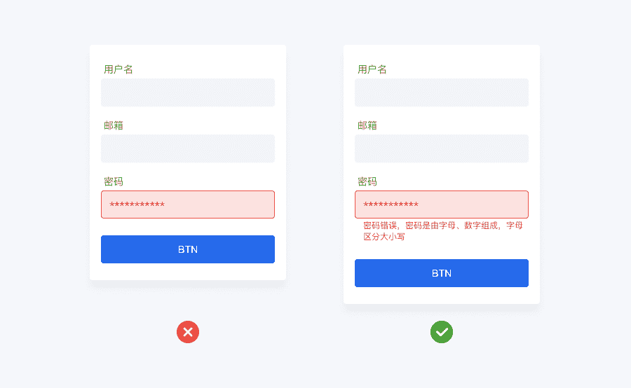

## **十、谨慎使用下拉菜单**

当已知的选项较少 （≤3），建议使用单选按钮，平铺完全展现出来的选项会让用户心理更安全，用户更能清晰的了解自己面对的选项，而不是面对未知的选项。较少平铺的单选按钮，也会提升用户的操作效率。

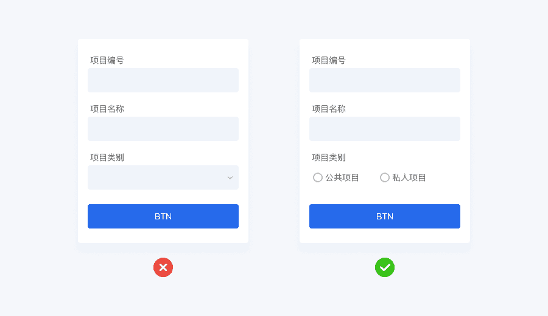

## 十一、充分利用占位符

占位符不仅起到引导提示用户填写表单的的用作，也可以让表单字段格式更具有可预知性。示例型占位符，可以告诉用户该字段的正确格式，减少用户输入错误的几率，通用型占位符，则不会为用户提供有价值的格式信息。

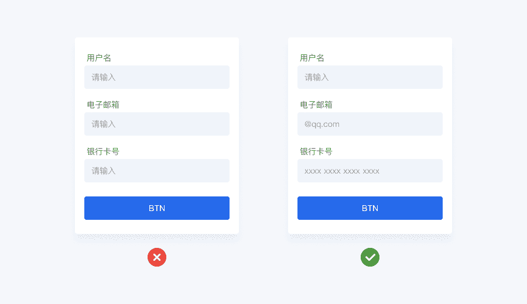

## 十二、保证一个主操作按钮

在一个表单模块中，始终保持一个主操作按钮，若存在多个按钮的情况，则需要根据业务去作区分，尝试一个主操作按钮，其余几个则是次级操作按钮。

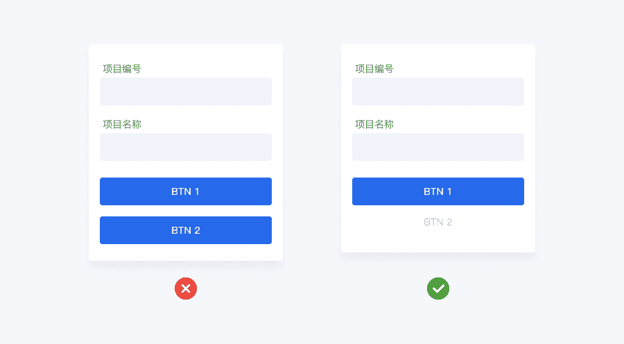

## 十三、更具操作性的按钮文本

表单的提交按钮，应尽量避免使用“提交”、“下一步”、“继续”之类的通用型文本。尝试使用更具有操作性、更能凸显接下来即将发生动作的文本，例如：“创建账户”、“加入团队”、“创建新账号”之类的文本。

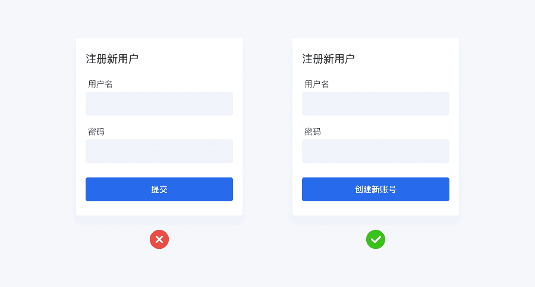

## 十四、选择正确的输入类型

不要对所有填写内容都使用文本字段，字段的类型应该适应其内容，针对有特殊类型的内容对文本做特殊处理，使之符合用户日常的使用习惯。例如：电话号码（183 **** 0530）、银行卡 （6222 **** **** 0000）。

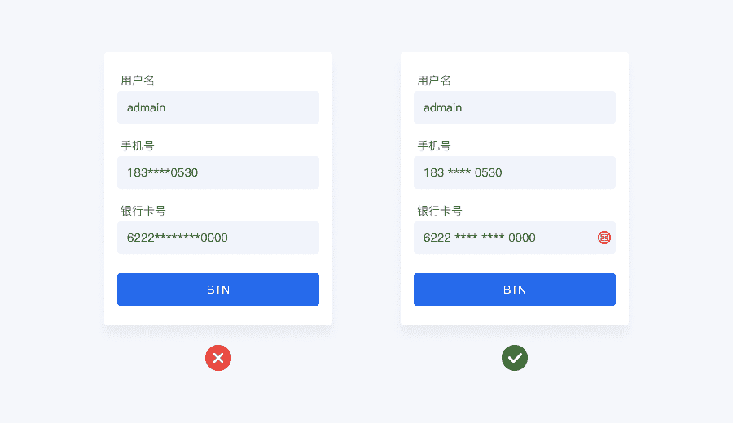

## 十五、文本域显示限制字符

表单字段有输入限制的情况，要把限制条件显现出来，给予用户明确的提示，增加用户感知，减少出错率。

## 十六、告知用户已启用大写锁定

在用户没有意识到大写锁定已经开启，尤其在输入密码的时候，错误消息甚至没有告诉用户大写锁定已开启，一直提示用户的密码错误，这是在一次次的挑战用户的极限。

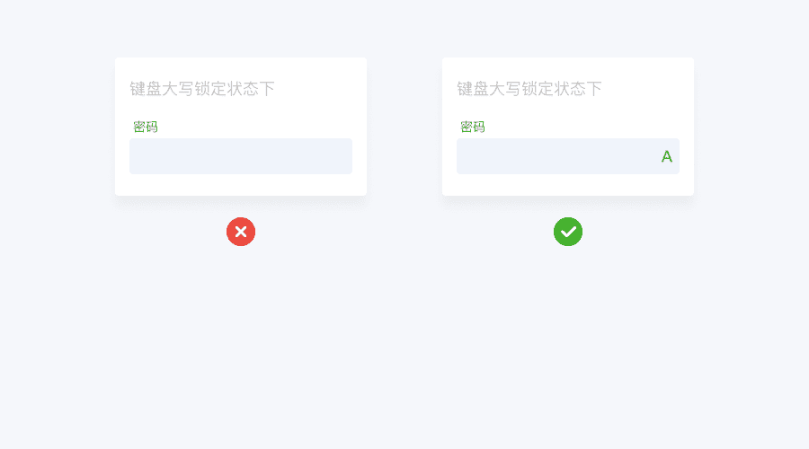

## 十七、确定字符较短的表单使用视觉约束

视觉约束有助于强化用户所需的信息。例如，如果“项目金额”字段需要的字符不如项目编号那样长，输入域则不需要与“项目编号”字段一样长，否则可能会导致用户混淆，同时也会增加用户的录入压力。

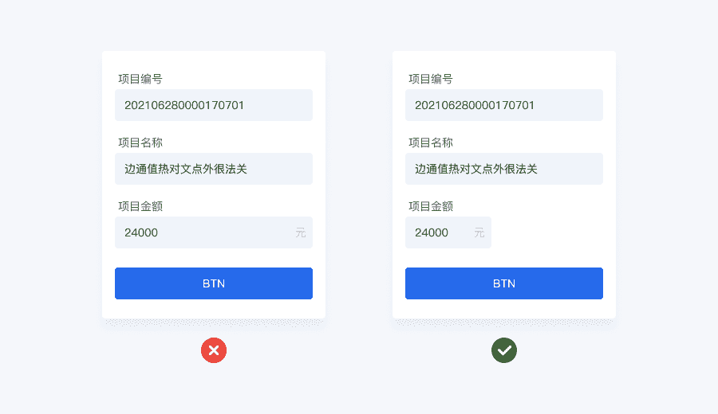

## 十八、使用自动完成功能

人都是有惰性的，表单录入过程中能用选择的就不用输入的，自动填充能使表单录入速度提高 30％，对提高用户的使用体验来说，自动填充无疑是一个非常有益的选择。

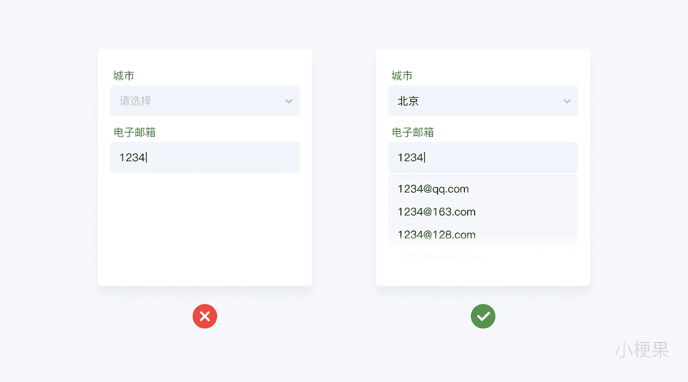

**参考文献：**

https://medium.muz.li/15-tips-for-better-ui-forms-744febd107f9

> 🔗 原文链接：提升表单设计效果的 18 个技巧 | 人人都是产品经理