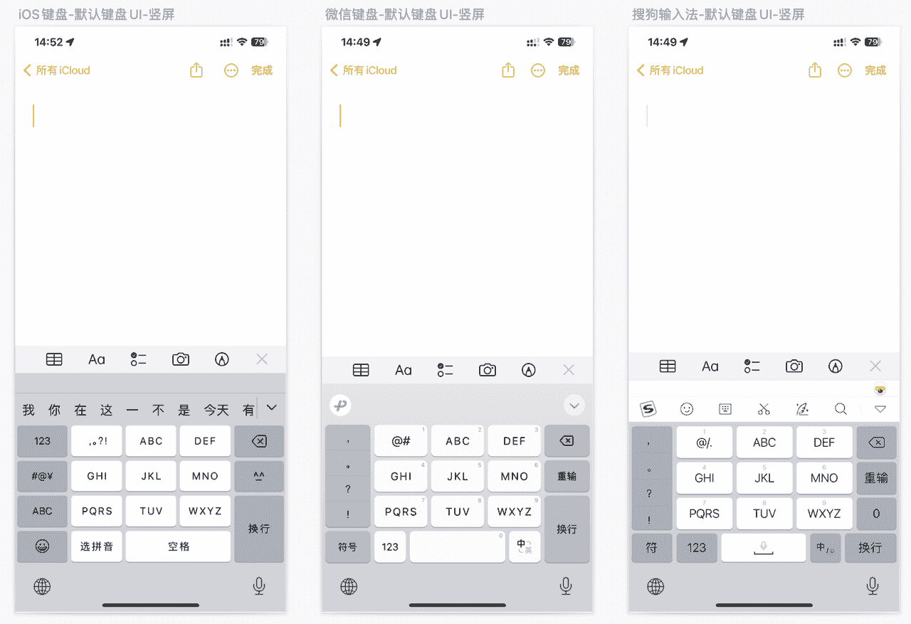
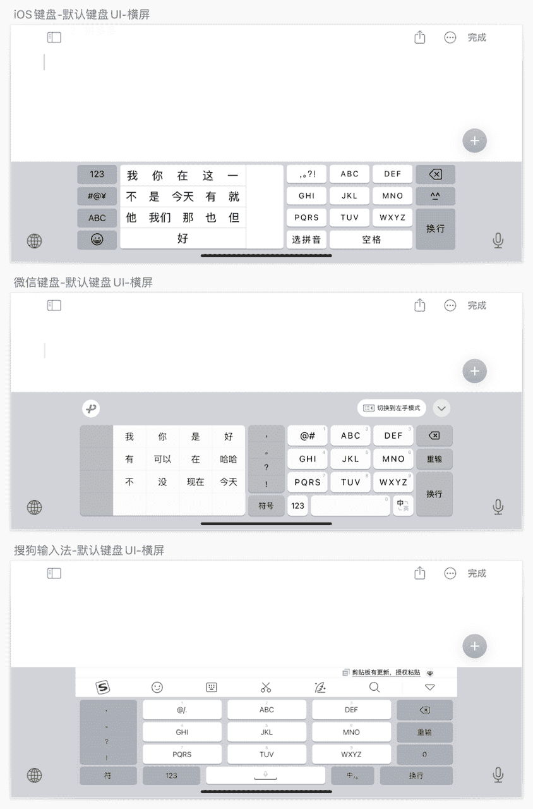
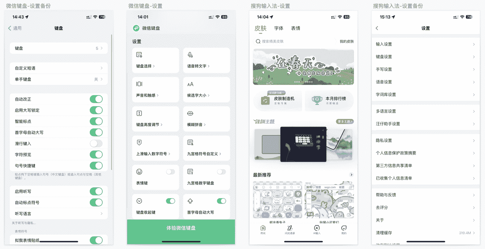

# Life Blog

> 来源：[https://leonzhang.feishu.cn/docx/K89xdDlLpoJdHyx19sccZw6An7G](https://leonzhang.feishu.cn/docx/K89xdDlLpoJdHyx19sccZw6An7G)

> 施工中...

## 一、子页面目录

## 二、一些观察、思考

### 20230521 价格歧视：同样的商品，为啥你买的比我便宜？

在市场经济中，企业追求利润最大化是一个普遍存在的目标。为了实现这个目标，一些企业采取了所谓的「价格歧视」策略，也就是对不同消费者或不同市场采取不同价格定价的方式。那什么是「价格歧视」？以及这种做法到底有哪些优劣势？我们展开说一下。

何谓**价格歧视**？

首先，价格歧视是指针对不同市场或消费者，采取不同的定价策略。目的是为了根据市场竞争、消费者需求弹性等条件来实现利润最大化。

其次，价格歧视通常基于消费者特征的差异，如收入水平、需求弹性、购买力等，这种差异被称为「市场细分」。

举两个「价格歧视」的 Case，第一是九号电动车（下称九号）对同一产品根据不同城市的发达程度进行分级的定价策略；第二是合资品牌汽车根据不同城市或地区采用同一产品不同配置的定价策略。

以九号为例，一线城市消费者收入水平相对较高，需求弹性也相对较高，因此“加价”可能不会导致需求下降太多；而农村地区消费者收入相对较低，价格敏感，若再“加价”可能导致销售量下降。

综上，厂商通过区分城市级别并采取不同加价策略，实现了针对性的价格歧视。

那如此做法的**优劣势**如何？

第一，优势。

1.  通过价格歧视实现利润最大化；

1.  利用市场细分，满足不同城市的消费者需求；

1.  避免过度竞争，确保各个城市的渠道都有一定的销售额；

第二，劣势。

1.  对品牌形象有影响，影响产品口碑，部分消费者被认为是「歧视性定价」；

1.  管理成本增加，需要花费更多人力、物力、财力去区分市场，制定价格策略；

既然可以优劣势明显，那为何其他厂商不跟进呢，理由是什么？

1.  为了保持品牌形象和减少管理成本；

1.  针对不同城市级别制定不同的价格策略，需要具备一定的专业能力和经验积累。

以上，其他厂商会更倾向于制定统一的价格策略。

综上，针对不同消费者采取同一产品不同定价的策略，本质是想通过「价格歧视」来实现利润最大化，但也有可能会导致产品品牌形象受损、管理成本增加。

### 20230513 手段还是目的，这是一个思维误区

焦虑会蒙蔽人的双眼，做出不理智的判断，甚至行为，而越是简单、朴素的道理，越容易被忽略。

今天和朋友聊天，聊到我们作为产品经理的未来方向。

说教育是个非常好的行业，然后我们就开始深入细节，他说负责人是关键，我说老板是关键... 讨论了半天**，一直围**绕在公司的团队管理方面，没有结果。但我们陷入了一个特别大的误区，根本没有意识到教育的核心和关键并不是产品，而是「内容资源」。

教育行业如果没有优秀的课程资源和老师，是做不下去的。因为在过往没有好的互联网产品时，只要有好的课程和老师，照样是可以过的很好的，比如“人人皆知”的衡水中学。

包括还提到说互联网医疗，因为看病是刚需，未来有发展...

**还是刚才**的逻辑，互联网医疗做的好与不好，核心是「医疗资源」。是对接了多少医院、多少医生以及药品的供应链等等这些东西，而并非产品。所以做的比较好的互联网医疗公司都是从一线城市开始的，并非是三四线城市。

产品经理之所以会灯下黑，是因为产品经理往往以为自己是“互联网”的产品，思维是陷在互联网陷阱里的，甚至于想到产品的第一反应就是指“App”。

无论是教育还是医疗行业，他们的本质是“互联网+”，或者说“产业互联网”，重点在于产业，「互联网是手段，而不是目的」。

很多人经常会在日常判断里混淆过程和结果，把因果关系搞反了，这是一种根本的思维误区，很多时候需要多问问自己，当下在追求的东西是手段还是目的。

一个很简单的道理，很朴素的道理，朴素到我们忽略了它的存在！

---

### 20230417 对输入法的观察

**20230420 补充**

补充一下我对 iPhone 侧键盘的需求：打字震动反馈、重输、换行、滑动键盘控制光标、剪贴板记录。

---

继上次发现搜索引擎的粘性低之后，又发现输入法的粘性也不是很高，哈哈～

微信键盘 iOS 版本已经更新到了版本 1.0.5，随着使用体验的不断完善，我也从逐渐从搜狗输入法切换到了微信键盘。

最初使用搜狗输入法的契机是因为当时的 iOS 键盘还不支持触感反馈（iOS16 之前的系统键盘确实差点意思），所以在 iPhone 上就一直沿用下来了。

> 内容框架

+   一、场景

+   二、基本情况对比

+   三、隐私与便利

**一、场景**

键盘输入法工具是我们经常会用到的产品之一。一个趁手的输入法工具，一定程度上还决定着你打字/沟通的效率。

我之前就被吐槽用手机（虚拟）键盘打字慢，额，不过我至今认为实体键盘打字更快…

**二、基本情况对比**

下面针对我在用的 iOS 系统键盘、微信键盘、搜狗输入法做一个简单对比。

> iOS 版本：16.4.1

> 微信键盘：1.0.5

> 搜狗输入法：11.19.0

1、竖屏 UI 对比

+   iOS 键盘：苹果一贯的简约设计，布局简洁，上手无负担；

+   微信键盘：微信团队的杰作，风格和 iOS 基本一致；

+   搜狗输入法：中规中矩，功能都给足了；

另外，三者在 9 宫格按键与两侧字符按键的大小处理上有侧重。iOS 的基本一致，搜狗输入法的对比更明显，微信键盘介于两者之间（V1.0.4 之前，微信键盘的处理和 iOS 是一致的）。

2、横屏 UI 对比

横屏情况下，iOS 键盘、微信键盘的处理是比较好的，搜狗只是粗暴（偷懒）的做了拉伸，横屏打字场景下体验尤其差。

3、设置对比

在需求/交互设计中，我们经常会用到的一个原则是「席克定律」，即用户在面对决策时，可选项越多，需要的决策时间就越长。

对比来看，iOS 键盘与微信键盘的设置简单明了，路径清，而搜狗输入法会先进入皮肤设置，然后进入我的-设置。如果不考虑商业化，iOS 键盘与微信键盘的设置明显更加易用，用户体验也会优于搜狗输入法。

4、基本功能

+   微信键盘在微信中使用时，可以智能识别并推荐公众号、小程序、视频号、影视内容、音乐、书籍等内容，而搜狗输入法没有这个功能；

+   搜狗输入法有更换皮肤和字体的功能，以及拍照识文字/文字扫描的功能，而微信键盘没有这些功能；

+   微信键盘在微信文本框里，支持有序列表和无序列表；

+   ……

> 因为我确实不太爱折腾这类输入法工具，同时我对这类工具的定义就是「够用就行」，所以只是简单对比 UI，很多功能并未展开。

**三、隐私安全与便利**

这是个永不过时的话题，甚至李彦宏曾公开表示，“中国用户愿用隐私换方便”以及“保障用户信息安全和运用用户数据为之提供更好服务之间，找到更好的平衡点。”

除 iOS 键盘外，微信键盘、搜狗输入法，都会保存你的邮箱地址，也许还有信用卡、银行卡、账号/手机号…

（以上请自行查阅各产品的隐私协议）

最后，如果你比其他人更加重视隐私安全，那 iOS 键盘可能是你的最优选/唯一选择。

**延伸阅读**

+   央视评论：谁说“中国人愿意用隐私换便利”？

+   微信键盘 - Apple Store

+   搜狗输入法 - Apple Store

---

### 20230405  **产品观的狭隘理解到开放包容**

上周末与几个朋友聊的一个话题，关于「产品观」。

**主**要是三个话题，产品生命力的底层逻辑、方案力、将自己视作产品，其中的产品生命力部分对我还是很有启发的。

**话题一：产品生命力的底层逻辑**

1⃣️ 顺从人性，做产品和做人。

第一，做产品（运营、迭代）。想到之前少楠和飞哥说的，“让一切自然发生，像生命一样自发生长。”比如 flomo 的共建者，共建者氛围，让用户自发反馈，从而推动产品迭代。尤其是最初产品还没有成型的时候，很多用户就对它有足够的包容，当它实际上线的时候，就会不遗余力的向身边朋友去推荐，这是一种参与感。Zara 说，人毕生的追求是「被看见」；

[第二，](https://zh.wikipedia.org/wiki/%E6%AE%B5%E6%B0%B8%E5%B9%B3)做人。前两天看到一则故事，讲段永平先生在最初做小霸王游戏机的时候，备受人喜爱，而且人也足够“慷慨大方”，也优先考虑分享成功。通过「进四出六」的方式，照顾（分钱）到了团队和合作伙伴，直到后来创业做步步高，人气也是越攒越足。直到后来对网易的投资（两年间获利超过 10 亿美元），以及成立的 OPPO、vivo 等等。

2⃣️ 极简主义，体验与成本之间的权衡。

极简，意味着要付出更多的「成本」，为用户减少「麻烦」。

以 App 产品为例，问题如下，

+   产品登录页面，选择验证码登录，输完验证码之后，还需要再点击 Button「确认登录」；

+   可选方案：输入完验证码后会自动登录，减少一步操作确认；此处与输入密码不同，注意区分；

+   默认要求输入/修改的文本输入框，没有编辑光标，需要手动再点击一次输入框；

+   可选方案：默认要求输入/修改的文本输入框，有编辑光标的同时需要调起键盘；

+   很多 App 的设计是要求用户手动点以下文本框，有的 App 在登录页输入手机号时，就应该调用键盘；

+   内容社区的「发布」按钮在键盘后面，需要先收起键盘，然后再点击；

+   可选方案：内容社区的「发布」按钮在键盘上方，靠右；

3⃣️ 产品学习成本，操作次数越少，成本越低。

抖音、快手等信息流产品。步骤只有一步，向上或者向下滑动即可。

**话题二：方案力**

沟通的时候其实并没有提到这三个字，但描述的内容就是它。

第一次听到是脱不花和 Zara 的 Podcast 里听到，所谓方案力，简而言之就是「寻求帮助的时候，降低对方帮助我们的门槛。」

第二次听到是罗胖的一次演讲，在脱不花的故事基础上又补充了几个故事。

**话题三：将自己视作产品**

这个话题其实近几年听太多次了，不同的地方不同的人，都会聊到这个话题。

1⃣️ 热爱/享受生活才能真正设计好一款产品；

2⃣️ 识人识己才能更好的感知人性；