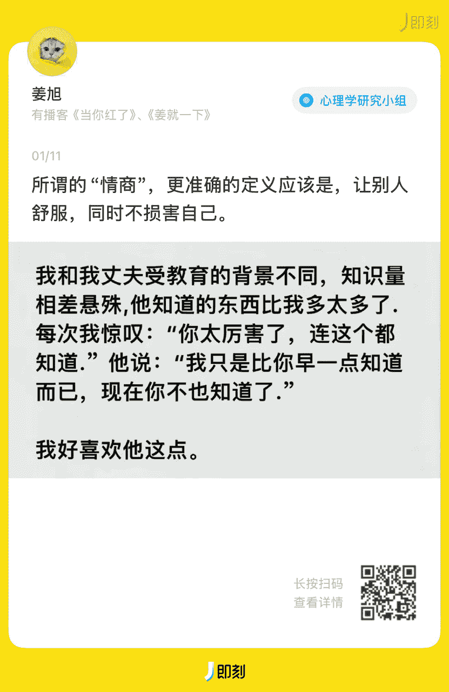
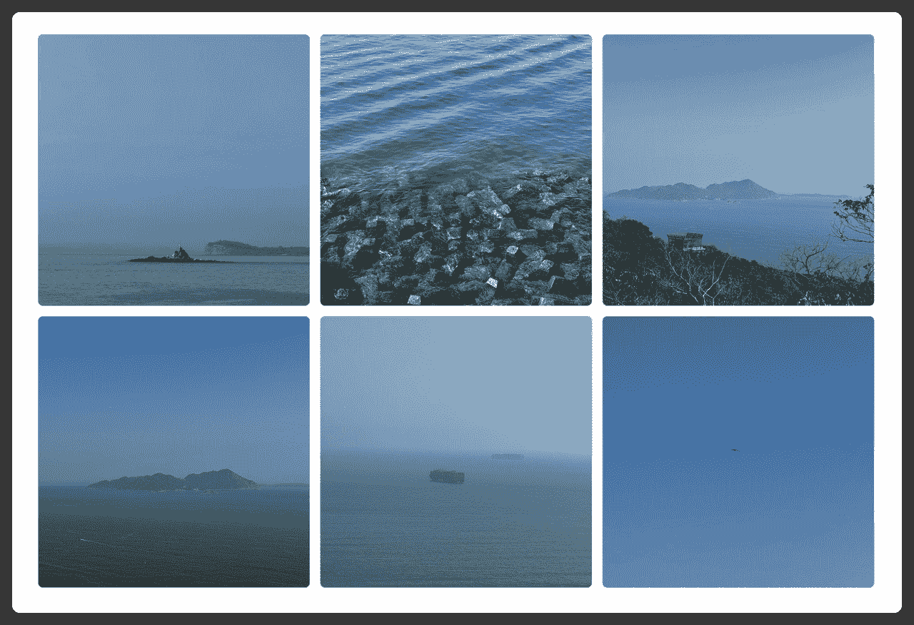
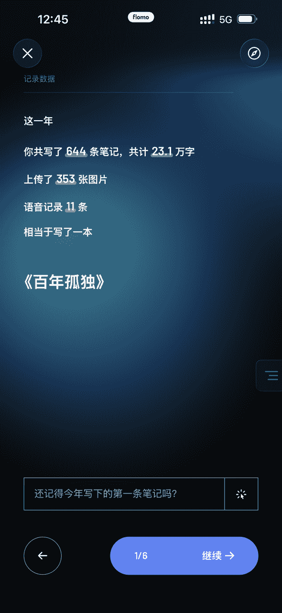
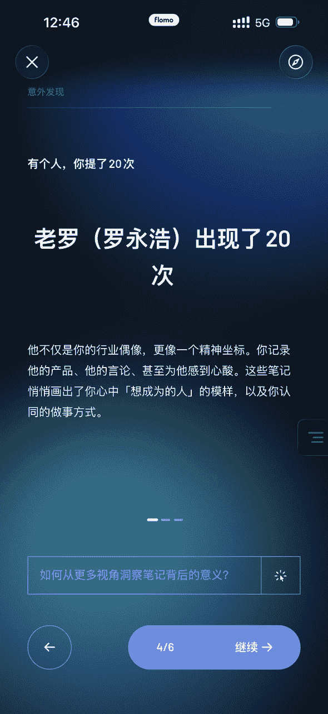
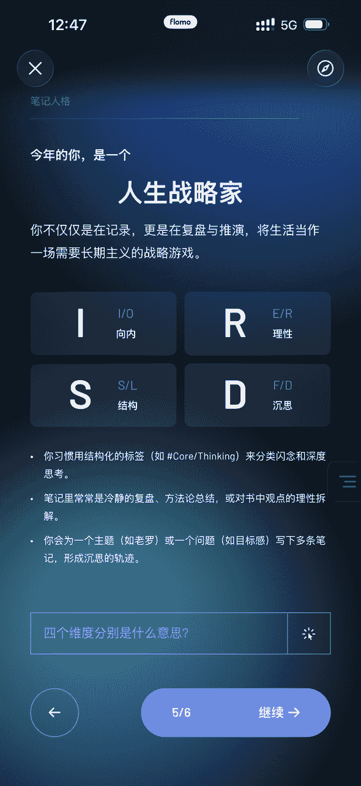
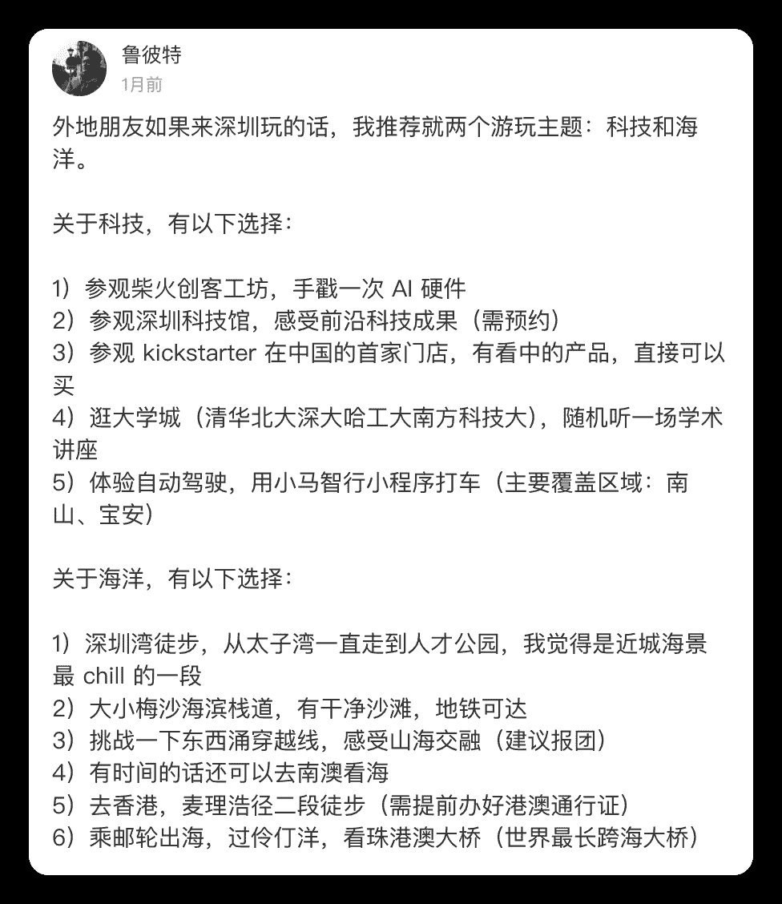
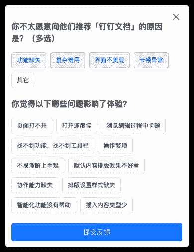
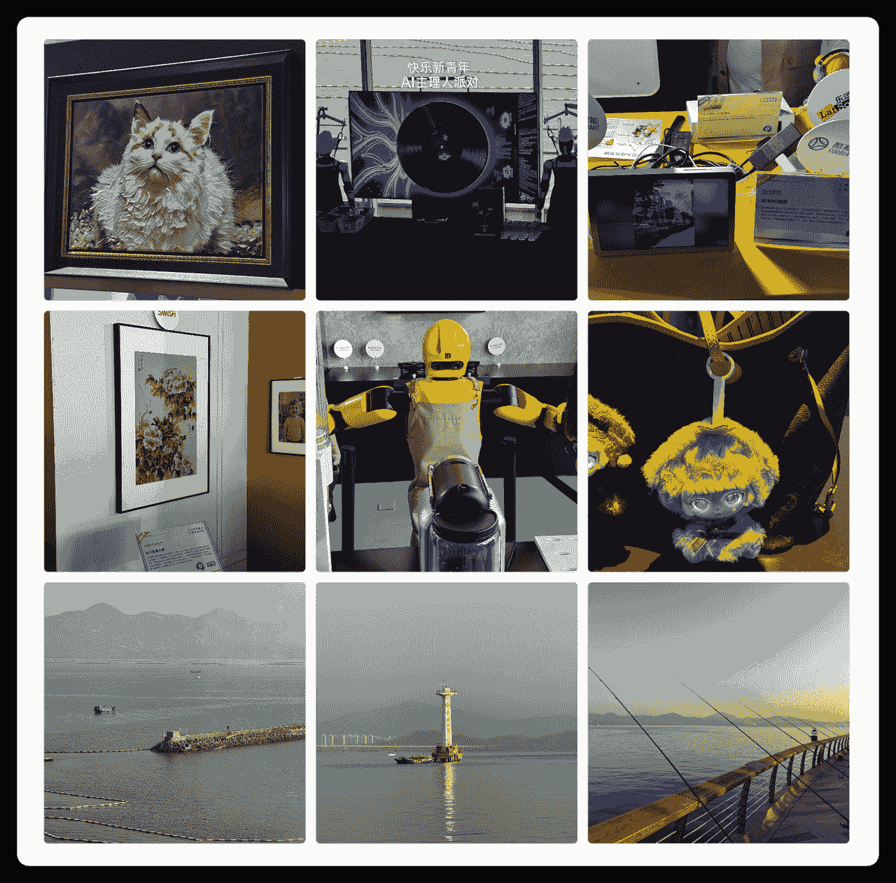

# 202601｜“命运，是你所有注意力投射的历史总和”

> 来源：[https://leonzhang.feishu.cn/docx/Fxecdbb3woFJFixNMXYcYrqrnGg](https://leonzhang.feishu.cn/docx/Fxecdbb3woFJFixNMXYcYrqrnGg)

### 最近观察和思考

#### 生活

**1**

> 即刻原帖：https://m.okjike.com/originalPosts/6967bc55800201ac68ebe985

“在你二三十岁的时候，你会很想证明自己很优秀。重要的是，你要抵制住为那些不在乎你的人表演的冲动。”

**2**

“我只是比你早一点知道而已，现在你也知道了。”

|  |
| --- |

**3**

+   任何有价值的思考，都得逼我们走出舒适区。

+   在很复杂的问题上，过于坚定的立场，往往不是思考的结果，而是一种逃避思考的方式。

+   最危险的从来不是没有答案，而是那些不经过思考，却毫不犹豫地笃定。

**4**

> 即刻原帖：https://m.okjike.com/originalPosts/696b421cc5a1d4e6495cad3b

山风送爽，落叶为径，一步一景。

西涌郊野径

**5**

> 即刻原帖：https://m.okjike.com/originalPosts/695de697800201ac68076e40

我的 flomo 2025 年度洞察

|  |  |  |
| --- | --- | --- |

以及，3 个 flomo App Pro 会员兑换码

1.  70CD-7959-CF16

1.  CE54-0245-02E4

1.  976C-081D-0ED0

flomo App 下载地址：https://flomoapp.com/register2/?MzA3MTI5

**6**

一个人的伴侣是 TA 的终极审美和投射。—— 阿珂

**7**

> 即刻原帖：https://m.okjike.com/originalPosts/695c915925bae5661217c6c4

|  |
| --- |

深圳两个游玩主题：科技与海洋

关于科技，有以下选择：

1）参观柴火创客工坊，手戳一次 AI 硬件

2）参观深圳科技馆，感受前沿科技成果（需预约）

✅ 3）参观 kickstarter 在中国的首家门店，有看中的产品，直接可以买

4）逛大学城（清华北大深大哈工大南方科技大），随机听一场学术讲座

5）体验自动驾驶，用小马智行小程序打车（主要覆盖区域：南山、宝安）

关于海洋，有以下选择：

✅ 1）深圳湾徒步，从太子湾一直走到人才公园，我觉得是近城海景最 chill 的一段

2）大小梅沙海滨栈道，有干净沙滩，地铁可达

3）挑战一下东西涌穿越线，感受山海交融（建议报团）

✅ 4）有时间的话还可以去南澳看海

5）去香港，麦理浩径二段徒步（需提前办好港澳通行证）

6）乘邮轮出海，过伶仃洋，看珠港澳大桥（世界最长跨海大桥）

**8**

“未来是什么样子呢？未来不是一个你要去的地方，而是一个你此时此刻正在创造的东西。”

**9**

“每一部文学作品都有它的理想读者，人也一样，迟早会遇到最懂自己的人。”

**10**

“命运，是你所有注意力投射的历史总和。”——李继刚

**11**

> 即刻原帖：https://m.okjike.com/originalPosts/695adf41f9f724324fcb195c

如何深挖一件事的价值？

1.  任务清单：我要做什么事？

1.  方法：怎么做成这件事？

1.  工具箱：用哪些工具来干？

1.  提示词：怎么让 AI 做这件事？

1.  工作流：下次遇到同样的事怎么做？

1.  Skill：如何让 AI 跑这个工作流？

1.  项目手册：遇到哪些问题，怎么解决的？

1.  经验清单：整个过程中总结了哪些经验？

1.  模型：如何用一个模型来抽象这些经验？

1.  新手指南：如何把经验分享给别人？

**12**

宇宙中最反直觉的真理：你给予他人越多，得到的也越多。理解这一点，是智慧的开端。——Kevin Kelly

#### 工作

**1**

用 Cursor 写代码，然后听着《Catch My Breath》，感觉好爽。

更开心的创造。

**2**

> 即刻原帖：https://m.okjike.com/originalPosts/696847bbc5a1d4e649150b68

那些藏在产品里的问题，最清楚的莫过于产品自己。

|  |
| --- |

**3**

> 即刻原帖：https://m.okjike.com/originalPosts/69626c12800201ac68738ea1

阿里云通义智能硬件展

嗯… 还是公园更好看一些 ❤️

### 最近在听、在看

#### 播客

**1**

> 《卫诗婕｜40。影石敲钟，一群 90 后眼中的世界级公司｜和刘靖康复盘创业十年》: https://www.xiaoyuzhoufm.com/episode/684c3e602a38b4d979894b68

1.  “**人才的价格是由稀缺性决定的**。1 克拉的钻石，市场价是 1 万美金，但是 10 克拉的钻石，市场价不是 10 万美金，而是 100 万美金。”

1.  “如何变得更稀缺？两个方向，1 是垂直方向做的很专业，市场很少人能够达成这个目标；2 是复合型人才，跨领域掌握很多知识和技能，使得在决策层面会更立体、协调层面更高效。”

1.  挑选赛道的标准：公司毛利 5 成以上，年销售额在百亿人民币级别，以及还有别人未解决的痛点和需求。

1.  “软件优势可能会被很快的抄袭掉。但软件层面很大程度要依赖于迭代的速度，而迭代的速度又会受限于公司的协作方式，也受限于你需求挖掘的准确性，更首先于早期软件架构的设计。”

1.  “制度和流程决定下限，文化和价值观决定上限。当公司规模经历一个比较大规模的组织扩充就会有很多问题，比如企业文化可能会稀释。”

1.  “业务扩张需要更多人，但组织还没有 ready，还不能够同时接纳和 Training，能够给这么多人提供一个好的舞台和环境。”相当于一边兼顾业务，一边要做组织升级。特别像在高速路上一边开车，一边换轮胎。

1.  “谁坚持谁决策谁背锅，而反对的人是不需要的。”

**2**

> 《罗永浩的十字路口｜Lovart 创始人陈冕×罗永浩！且让我大闹一场，然后悄然离去》: https://www.xiaoyuzhoufm.com/episode/69608f978f388c61e1fa0ad0

是的，之前我每一次跳槽，也是我认为在那里没有机会成为引领者或决策者，所以换个地方。

**内容摘要**

1.  “想赢，很重要！核心是想要过好自己的未来。”

1.  “天生有野心，天生就想赢。有强烈的胜负欲。”

1.  “我觉得我是一个什么都不懂的人，但我也是一个很想赢的人。所以我很想自己做点什么，很想自己决策改变点什么的人。这是我的原动力。我之前每一次跳槽，是我认为在这里没有机会成为引领者或者决策者，那就考虑换个地方。”

1.  “创业最需要的就是，认知、速度和信念。”

#### 文章

**1**

> 《晚点 LatePost｜在 B 站找新商机的人》：https://mp.weixin.qq.com/s/TL4yRoFpnaqni7aQVc5bsQ

内容创作从短平快的效果营销（如搜索类效果广告），转向品牌营销心智打造转变的趋势。占领用户心智的核心手段是“讲故事”，通过有情感、有细节的内容与用户建立情感连接，而非单纯堆砌产品参数，也印证了乔布斯 “讲故事的人拥有强大影响力” 的观点。

海外品牌有 Airbnb、Bose，国内品牌有 Insta360、领克。比如领克与 @公路旅人 FOX 合作在新疆做汽车测评；影石与 @影视飓风 合作定制了一个卫星，搭载 Insta360 全景相机，送入近地轨道拍摄太空影像，实现 “太空之眼” 计划。

**原文摘要**

1.  1994 年，时任皮克斯首席执行官的史蒂夫·乔布斯（Steve Jobs）曾说过：“世界上最有影响力的人是讲故事的人。讲故事的人能够塑造未来一代人的愿景、价值观和行动方向。”

1.  美国零售巨头 John Wanamaker 说过一句经典的话：“我花在广告上的钱有一半是浪费的，但我不知道是哪一半。” 它之所以能流传一个世纪，本质是在说：品牌广告的效果往往滞后、分散、难归因，企业很难像算订单那样算清 ROI。

**2**

> 《产品沉思录｜一切都不会很糟》：https://mp.weixin.qq.com/s/iIsxg-Oje0rCDUAMuJiS6w

“一切没有想象的那么糟糕，则是把自己从中心的位置摘出来，用理性去客观地看待发生的一切。”

**3**

> 《混沌学院｜从 UP 主到 CEO，影视飓风 Tim 的管理进化》: https://mp.weixin.qq.com/s/hvNweUSAKSJjdPnvmNzDIQ

“当你不去承受一种痛苦，那代价往往是另一种痛苦。”

“精确、透明的规则、流程和决策体系，才是内容源源不断生产的动力。”

圆通总裁的三个锦囊妙计：

1.  **盲目换人，从来不解决本质问题。**

1.  有效量化，降低信息差是一家企业运作的核心。

1.  人性是经不起挑战的，商业是切蛋糕的艺术。

三条建议合在一起，真正教会了他什么？  其实就是一句话： 不要靠“人更好”来解决问题，要靠“结构更好”。

当团队变大、业务变复杂，真正决定上线的，不再是个人能力，而是组织能否持续修正自己。

**4**

> 《数字生命卡兹克｜一文带你看懂，火爆全网的 Skills 到底是个啥》：https://mp.weixin.qq.com/s/nRVVqPaGxWdNqNrUcurSXg

“几乎所有能用 workflow 完成的 AI 任务，都可以用 Agent + Skills 实现。”——宝玉

Skills 本质是一个**可复用的能力模块，**减少对 AI Context Window 的占用。

演化关系：Prompt Engineering -->  Context + Protocol + Tool

Skill = Prompt + 结构 + 资源 + 执行逻辑

1.  主 Prompt（核心行为描述）

1.  子 Prompt / 模板

1.  脚本（如工具调用逻辑）

1.  示例数据（few-shot）

1.  参考资料（知识片段 / RAG 数据）

1.  输入输出格式定义

1.  可能的工具绑定（Tools）

#### 视频

**1**

> 【林亦 LYi｜为什么🛰️能让苹果低头做人？】https://www.bilibili.com/video/BV188qZBBEug?t=295.4

苹果对🛰️松口（将小程序相关的“苹果税”从 30%降至** **15%）是「两害相权取其轻」，核心在于：

1.  **🛰️的绝对市场地位**：不可替代的超级生态（用户体量/社交网络）。若强硬对抗，可能面临用户“弃 iPhone 选🛰️”的风险。

1.  **苹果的经济利益考量**：从“颗粒无收”到“稳定税源”。从小游戏到日常消费，纯增量收入增加。

1.  **全球监管压力**：反垄断风暴下的被迫调整，全球范围内被迫降低抽成比例。

### 相关阅读

-