# 202512｜理性的人适应世界，非理性的人坚持让世界适应自己

> 来源：[https://leonzhang.feishu.cn/docx/UKNqdXjg6oqN0UxuIPjc3xSSnSe](https://leonzhang.feishu.cn/docx/UKNqdXjg6oqN0UxuIPjc3xSSnSe)

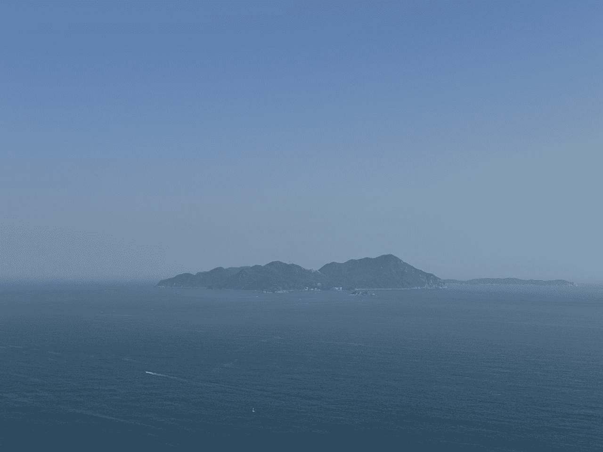

> 别人之所以能如此对待你，实际上是你授权的结果。——大冰

### 最近观察和思考

**1**

过早/过晚 的预测泡沫，本身就是一种风险。

1.  投资原则：分散投资、不要过度杠杆，并且时刻保持对市场的了解和警惕。

1.  更关键的是，必须根据自己的年龄来调整自己投资组合结构里的风险程度。比如年轻时，可以稍微激进一些，但当人到中年或快要退休的时候，就要更换为其他策略。

在投资中，最昂贵的一句话，“This Time It's Different”。

**2**

> Imagine a world in which every single person on the planet has free access to the sum of all human knowledge.

> — Jimmy Wales, Founder of Wikipedia

想象一下，如果地球上的每个人都能自由获取全人类知识的总和，那会是怎样一番景象。——吉米·威尔士，维基百科创始人

**3**

有个“导航理论”，大意是指，当你错过导航规划路线时，它不会指责或宕机，反而会重新规划新路线。不要担心错过，只是会增加途径点而已。

**4**

在工作中，越是无能的人，在解决问题的时候就越矫揉造作；

在工作中，越是无能的人，在解决问题的时候就越没主见，越会放大范围，有意/无意间，会将小事放大为大事情。

**5**

“人的情绪是用来影响他人的，而不是左右自己的。公开的言论是用来维护立场和利益的，不是表达自己思想和认知的。”

**6**

| 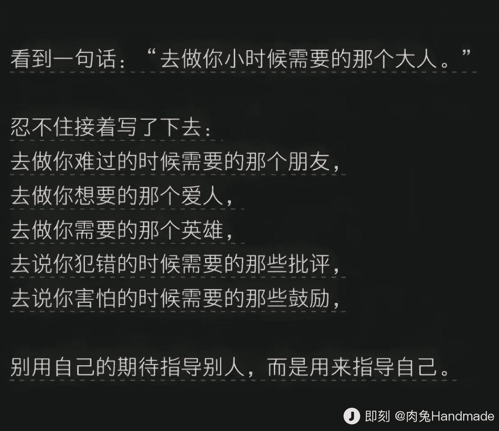 |
| --- |

“去做你小时候需要的那个大人。”

**7**

"理性的人让自己适应世界；非理性的人坚持让世界适应自己。因此，所有的进步都取决于那些非理性的人"

"我宁愿错误的乐观，也不要正确的悲观"

"无论你认为自己行，还是认为自己不行你都是对的"

"从没有哪个悲观主义者发现了星辰的秘密，或航行了到未知的土地，或为人类精神开启了新的大门"

"悲观者看起来很聪明，但乐观者赚到了钱"

| 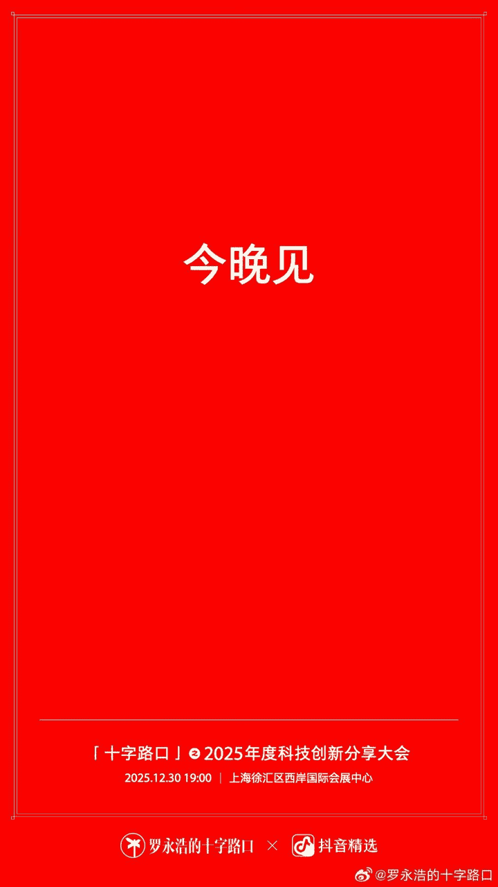 | 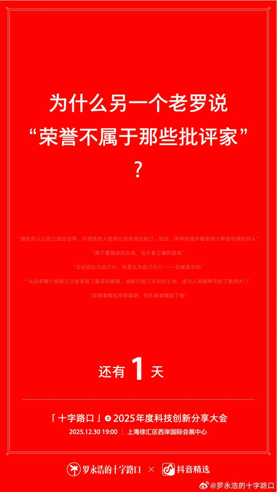 | 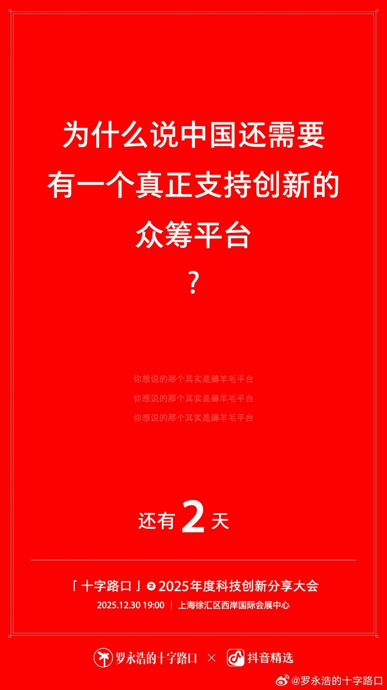 | 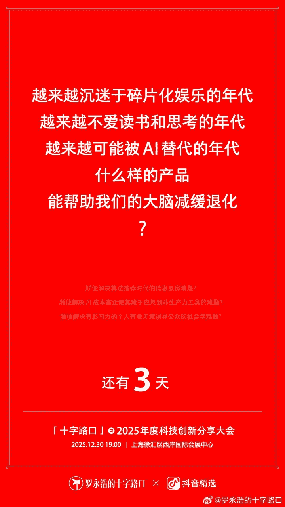 |
| --- | --- | --- | --- |
| 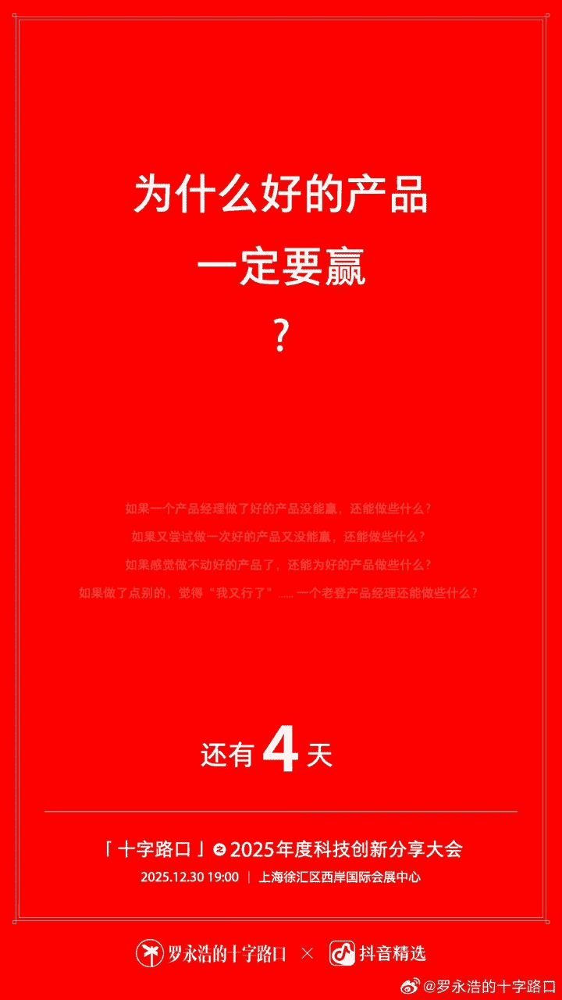 | 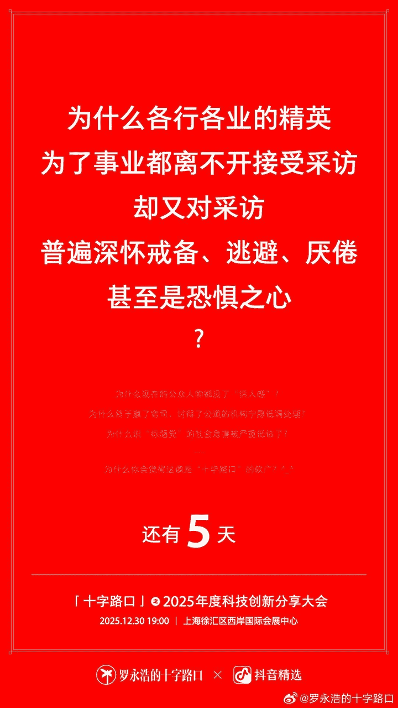 | 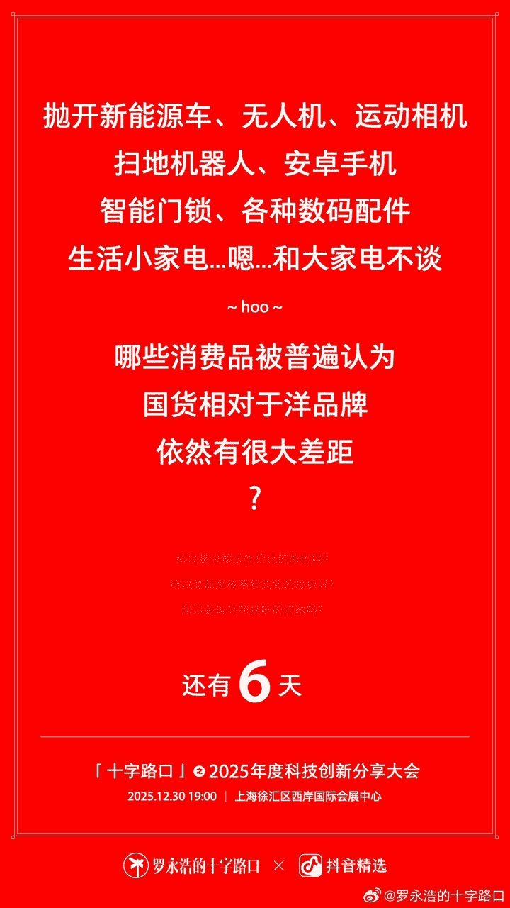 | 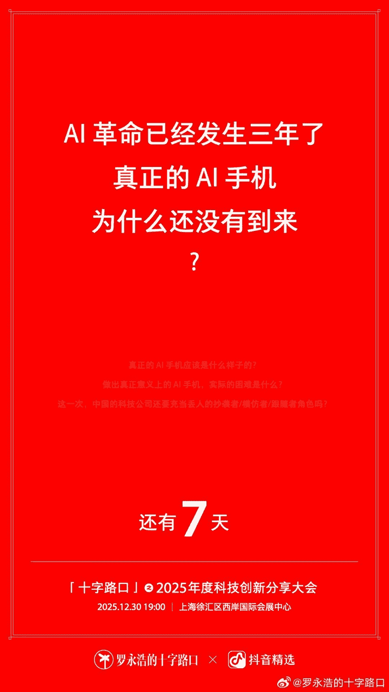 |

**8**

| 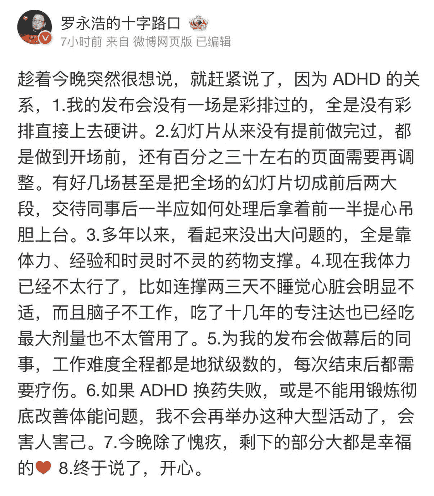 |
| --- |

看完今年老罗的科技春晚，作为罗粉和锤友，心情甚至有些分裂，既开心又心酸…

1.  开场延后 48min，嗯，破纪录了（之前最高 47min）。确实如老罗所说，非当年负责锤科发布会“原班人马”，失误在所难免，而且这次从 Keynote 的粗糙程度就能看出来，甚至还有文本标注。是的，许岑没参与...

1.  彩蛋，确实有，也就是“门票费用全返”。仿佛回到了锤科时期，会突然来一个惊喜。

1.  选品推荐，除 LAVA Studio 和 厘刻洗碗机，其他全部都知道，甚至还买了 DJI Neo2

老罗最后说，这是他发布会史上，过程中走的人最多的一次。其实不难想到，之前是惊喜，这次很多都不是悬念。

结合老罗再次提到 ADHD，突然有些共情 罗嫂，她为此承受了太多。

Tim 不要折磨老罗了，他已经 53 了，经不起太大折腾了，更何况想要看他笑话的人太多了！！

### 最近在听、在看

#### 播客

**1**

> 《E10 钱力：Kickstarter 硬件出海众筹冠军 硬件出海产品设计、成本控制与渠道运营》：https://www.xiaoyuzhoufm.com/episode/6919b1f86018cc2c98130296

验证、节奏、信任、执行

别急着扩张，先学会预判；别盲目造梦，先学会验证。

KT2 众筹冠军的三大关键：设计、定位与本地化。

> 没有白走的路。

步步为营，稳扎稳打。

1.  跨境电商新人，先考虑走完一个流程。洞察跨境电商领域流动性最强的品类就是服装，于是决定从做标品（男士内裤）开始，完成从洞察、设计、Kickstarter 众筹和上架。

1.  做 KT2 时，做渲染图、视频去做 A/B Test，验证产品颜色（白/黑）和名称（KT2）。

> 全流程设计，半成品到成品需 6 个月左右。

把准备工作（预热）放在前面，精心设计一套客户在众筹前加入社群、了解产品的途径，“蓄水蓄客户”。

可能踩坑点

1.  运费或关税。

1.  知识产权调研。

1.  专利须注册美国的。

**2**

> 《导演大鹏×罗永浩！我这两辈子（The life before and the life after）》: https://www.xiaoyuzhoufm.com/episode/6942389c4c65abaff36b20a8

“契约精神并不是指不能违约，而是违约了你要承担违约成本。”

**3**

> 《影石 Insta360 创始人刘靖康×罗永浩！比生存更重要的是那些微小的念头》: https://www.xiaoyuzhoufm.com/episode/694cb5e1946dca09253c1b2e

1.  “客观讲，讽刺更容易传播。”

1.  画面不会直接说话。如果你想，你就可以 100% 误导别人。

1.  创造解决别人没有解决的问题，那你一定在创造过程中开发了新的知识。

1.  如果一家公司是通过创造为优先的话，更应该关注员工的发展。无论是作为新员工继承老的知识，以及不断解决固有有问题，并开发新的知识。

1.  公司创始人"all in not nothing"

1.  创业者成长/投资平台。员工创业，公司投资，未来可能也会变成股东价值。

1.  Think Bold

#### 文章

**1**

> 《一鸣的 AI 交易思考｜高中辍学、不懂数学，这位“00 后”如何用 AI 自学编程，闯进 OpenAI？》: https://mp.weixin.qq.com/s/9GhdepC68IsTdRojyS4wyQ

**只要你自己有极强的主动性（Agency），并且擅长**向 AI 提问，知识本身不再是稀缺资源。

一位来自瑞典偏远小镇的年轻人，高中没毕业就离开学校，甚至一度认为自己“不够聪明”而不敢碰编程。

后来，他靠深度利用 ChatGPT 来学习，包括那些博士级难度的科目：机器学习、扩散模型等等，最终加入 OpenAI Sora 视频模型团队，担任研究科学家。

**在 AI 时代，大学不再垄断基础知识，个人的主动性与深度运用** AI 的能力，才是通往顶尖机会的钥匙。

递归的过程：发现不懂 -> 向下挖掘 -> 直到搞懂 -> 返回上一层。

AI 生成的代码，我必须**一行一行读懂**。我非常挑剔。我利用 AI 来加速实现，但我必须理解每一行背后的原理。我想要走捷径，但我是为了“更快地理解基础”，而不是“跳过基础”。

**为什么一定要去旧金山？因为“一定要**和最顶尖的人一起工作，并疯狂寻求反馈。”

**Gabriel：** 我发过一条推文：**“**70%的人长期处于轻微的痛苦中，因为只要‘什么都不做’这个选项存在，他们就会对任何需要心理能量的决定过敏。”

**2**

> 《GameLook｜《苏丹的游戏》制作人：小作坊的离谱生存术，没钱没人才叫“真·游戏设计”！》: https://mp.weixin.qq.com/s/5y6uVTAhlcz8HMaT4QKscQ

**完成比完美更重要**。做得快、做完、上线，比什么都重要。

**原文摘要**

1.  **不要先想“我想做什么”，而是先盘点自**己手头已经有的资源，看看“我能做什么”。这是一个非常重要的心理转变。你身边有什么样的伙伴？你自己具备什么技能？作为玩家或开发者，你对哪个领域最熟悉？这些就是你冰箱里的“菜”，你要用这些菜来做出一顿饭。

1.  只有当你知道自己什么都没有，却仍要坚持做出一个让大家喜欢的应用。所以请一定要鼓起勇气，用手上现有的东西去努力创造。

1.  你要习惯在团队中成为一个“创意整合者”，当然你也要贡献自己的创意，但你的创意更应该体现在如何用好大家的创意上。

1.  文化创意产业可怕的地方就在于：当你意识到失败时，往往已经无法挽回了，因为这是一个完全基于“生长”的过程。

**3**

> 《潘乱｜前方道路并不拥挤》：https://mp.weixin.qq.com/s/KN4jXCO-bYTLkEvVc1YZLw

“创作终将回响，笔下自有远方。”

**4**

> 《智东西｜罗福莉首次站台小米演讲，揭秘 MiMo 大模型和背后团队》：https://mp.weixin.qq.com/s/ItOGl1xVbJF_weshWT4WDQ

**摘要金句**

1.  AI 正以非线性的方式重演人类大脑 6 亿年的进化史。

1.  语言是人类思维和物理世界在符号空间的“投影”。

1.  AI 进化的下个起点，一定是有一个能跟物理世界交互的模型。

1.  开源的价值本质上是一种分布式的技术加速主义。

**5**

> 《Celia 的年终感悟 | 42 章经》：https://mp.weixin.qq.com/s/XLTyCkwUkXIVhZu-jgDKBQ

公司付钱让你转过身去，背对那些更精彩、更有意义的机会。他们是在购买你的机会成本，工资是对你浪费生命的赔偿。

#### 视频

-

### 相关

-