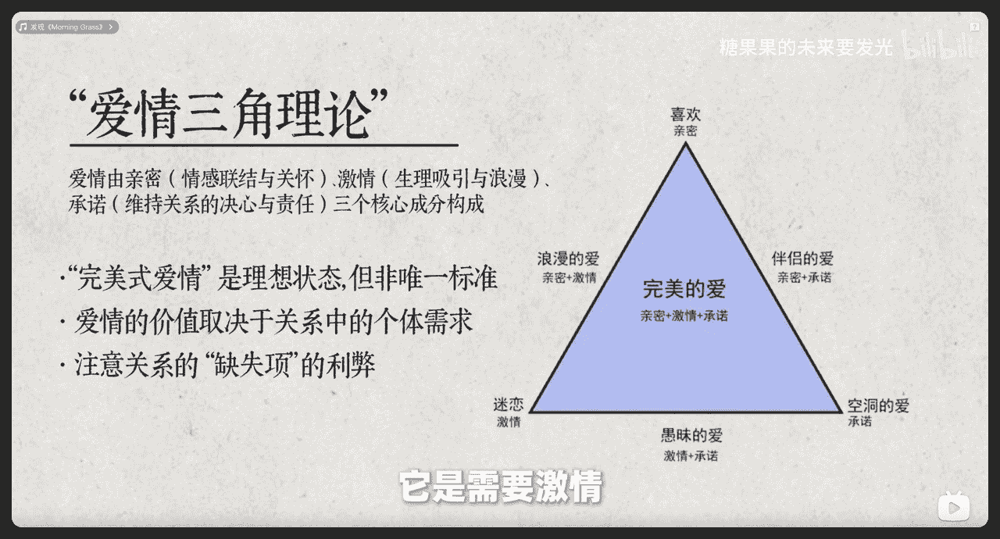
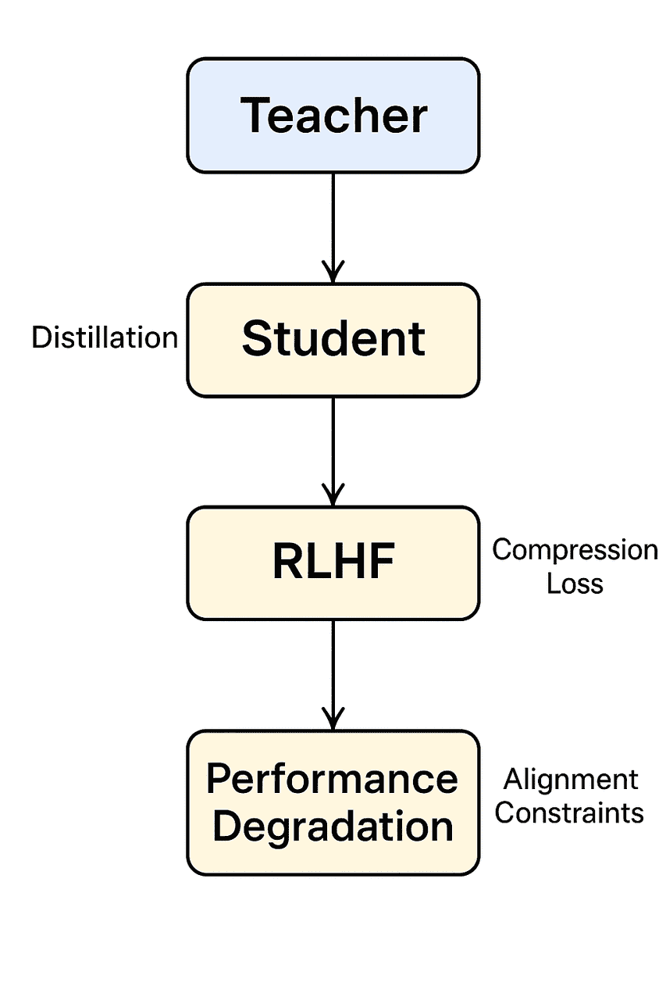

# 202508｜不确定性才是常态

> 来源：[https://leonzhang.feishu.cn/docx/Sg6MdYBYPopx64xvLZWchDfLnhe](https://leonzhang.feishu.cn/docx/Sg6MdYBYPopx64xvLZWchDfLnhe)

### 最近工作

1.  [AI CLI 工具激增探究 - Gemini ](https://leonzhang.feishu.cn/wiki/SDWZw8LAAiYBazkTemSc4Wcznxd)

1.  [RLHF模型性能下降之谜 - Gemini](https://leonzhang.feishu.cn/wiki/EDAnwD4HLijamJkD9kZcazwanig)

### 最近观察和思考

**1**

"内心不甘，就总会潜意识里想去暴露，想去抓住。"

**2**

“穿衣自由是对人生活自律的一种奖励。”

**3**

《自嘲》 · 丁元英

本是后山人，偶做前堂客。醉舞经阁半卷书，坐井说天阔。

大志戏功名，海斗量福祸。论到囊中羞涩时，怒指乾坤错。

**4**

值得追求的事总是伴随着痛苦。诀窍在于不要在意痛苦。——《一如既往：不变的人性与致富心态》［美］摩根•豪泽尔

**5**

加缪分别在自己 25 岁和 32 岁时，写下的话。

1.  25 岁的加缪：“生活要有规律。花两年来想通一件事其实不算浪费人生。要把之前的那些习惯改掉，先全心全力地记取教训，然后再耐心地去学习。”

1.  32 岁的加缪：“一个人到了 30 岁，应该要对自己了如指掌，确切知道自己有哪些优缺点，晓得自己的极限在哪里，预见自己的衰退 —— 做他自己。尤其是接受这些，我们会变得很积极。一切有待实践，一切也有待抛却。不再造作，但仍戴着面具。我已经见过够多的世面，几乎能够抛开一切。剩下的，是一种每天持续不断，不可思议的努力。能够守密的努力，不抱希望，亦无怨尤。再也不会去否认什么，因为一切都能够加以肯定。凌驾伤痕。”

**6**

记得乔布斯年轻时接受的一次采访，主持人问，“你怎么知道自己走的是正确的方向呢？”

乔布斯沉默了整整十秒，然后摸着下巴说，“最终，一切都取决于品味。努力去接触人类创造过的最优秀的东西，然后试着融入到你正在做的事情里。”

成就伟大的秘诀，就是让自己浸润在人类伟大优质的作品和信息中。

**7**

人生要走到下一个阶段，被新的挑战和憧憬占有，才能真的把过去很在乎的东西放下。—— 詹青云

### 最近在听、在看

#### 播客

**1**

> 《投资人老范｜41。别让时间成为你的对手｜对话高利明》: https://www.xiaoyuzhoufm.com/episode/6567579af10bbce6354a9711

知识工作者的基本且唯一信念是，要抓住外部变化产生的一切机遇。

**2**

> 三点下班｜S2E10 丨炒作的方法论和方向--半年盘点与展望》：https://www.xiaoyuzhoufm.com/episode/64a24241ec448b75fda2c707

“永远拥抱新故事。”

“永远在有技术变革的时候才有十倍百倍以上的机会。”

#### 文章

**1**

> 《法我如我｜你看见的世界也很美、很独特，请多珍惜！》: https://mp.weixin.qq.com/s/JLg_VEFvD1Exfeu8k7MPfg

**世界没有给你准备标准答案**。你的答案在于你看见什么样的世界。

你眼里的世界，是老天爷给你的独家礼物，别人偷不走，也替代不了。

**2**

> 《孤独大脑｜男人的最大恐惧，是从未经历过真正的战斗》：https://mp.weixin.qq.com/s/6P5SFW8a55ZL_qfV0l98uw

**《老人与海》海明威**

+   "生活总是让我们遍体鳞伤，但到后来，那些受伤的地方一定会变成我们最强壮的地方。"

+   "他身上的一切都显得古老，除了那双眼睛，它们像海水一般蓝，是愉快而不肯认输的。"

+   "每一天都是新的日子。走运当然是好的，不过我情愿做到分毫不差"。

“当你回顾这一生，不因虚度年华而悔恨，不因碌碌无为而羞耻”—《钢铁是怎样炼成的》

也许海明威赞成**尼采"杀不死我的使我更强大"**的哲学，所以他笔下的老人才会说：

**"生活总是让我们遍体鳞伤，但到后来，那些**受伤的地方一定会变成我们最强壮的地方"。

可我从来不同意两位大师对挫败与伤痕的赞美。

在我看来，活下来的不过是幸存者，伤口露出了我们真正的骨头，那些“杀不死我的”为我剔除了自我的噪音，用一把残忍的奥卡姆剃刀，剜出神为每个人设置的谜题的唯一答案。

**3**

> 《新智元｜ChatGPT 血洗美国 50 万科技岗位！25 年美国 GDP 增长，不靠人类靠 AI？》: https://mp.weixin.qq.com/s/xyR_7Rw8_-TjQ7p3RFHbMA

Anthropic CEO Dario Amodei 预言：五年内 50% 入门白领岗位被 AI 淘汰。

我们正处于白领工作的转折点，第五次工业革命已经到来。

在过去一年，美国已有约 50 万个工作岗位消失。更可怕的是，上个季度美国的 AI 资本支出已经首次超出消费支出，成为 GDP 的驱动力。

**4**

> 《知墨｜会杀死我的，是确定性》：https://mp.weixin.qq.com/s/IJsQdMIMS_Edp-Ti-bCK1Q

真正的成长来自于接受世界的不确定性，而不是执着于确定性。

1.  **确定性思维的陷阱**。这种思维模式容易让人忽视**现实世界的随机性**，把一切偏差归咎于外部环境，而不是自我反思。

1.  很多职业（如程序员）习惯于追求确定性，把世界看作一套可控、可预测的系统。

1.  例子：旅行计划出错怪交通、约会迟到怪对方、找不到工作怪环境——本质上都是“世界错了，我没错”的逻辑闭环。

1.  ** 不确定性才是常态**

1.  过度依赖确定性，会让人对变化产生抵触，甚至陷入自我设限。

1.  升级的不是世界，而是自己的“操作系统”

1.  世界没有义务按照我们的理解运行，只有不断升级自我，才能更好地应对不确定性。

1.  **行动建议**

+   反思：遇到问题时，先问“我能做什么”，而不是“世界哪里错了”。

+   适应：培养对变化的敏感度和接受度，把不确定性视为成长的机会。

+   升级：像升级操作系统一样，定期检视和优化自己的思维模型。

**执着于确定性会让人陷入自我设限，真正的**成长来自于拥抱不确定性、主动升级自我认知。

**5**

> 《李翔李翔｜写给吴声·2025》：https://mp.weixin.qq.com/s/I0SbRNimodh8uOacowSZtQ

> 《刘润：“浪费”时间的吴声》：https://mp.weixin.qq.com/s/mtuKvKxJeVpWoxgrFLn5eQ

吴声年度演讲 《新物种爆炸 · 吴声商业方法论发布 2025》

本雅明：“没有谁在这个世界上拥有自己固定的住所，以及固定不变的外观，没有谁不在盛衰沉浮之中，没有谁不与敌人和邻居交易品行，没有谁不是韶华易逝却仍未能成熟，没有谁不是在漫长的生存之旅的起点便已筋疲力尽。”

它是历尽繁华之后却发现更难的是只要平凡。正如他引用的穆旦：“这才知道我的全部努力，不过完成了普通的生活。”

但它也有志得意满时的心流涌动。正如他引用的马卡姆：“它说风力合适，夜色美丽，所有的要求力所能及。”

最后，还是用声音碎片的《黄金时代》来结束这篇文章最为妥帖：“没人有资格指责你的虚荣心。这是对赌的世界，没有人是看客。继续摇摆吧，我的天真老朋友。只有滚动的石头，才能不长青苔。”

停不下来是种美德，因为滚石不生苔。

一个人在你身上“浪费”钱，你可以用钱回报他。但是一个在你身上“浪费”时间，你唯有用时间回报他。 ——刘润

#### 视频

**1**

> 【糖果果的未来要发光｜聊聊爱情中最难的几个问题：恐婚、彩礼、浪漫、仪式感…【视频播客】】 https://www.bilibili.com/video/BV1pXvwzEEcj/

|  |
| --- |

爱情三角理论：爱情由 **亲密（情感联结与关怀）、激情（生理吸**引与浪漫）、承诺（维持关系的决心与责任）三个核心成分构成。

**幸福的原则**

1.  两个人都是傻瓜。

1.  一个是聪明人，另一个是傻瓜。

1.  两个人都是聪明人，一定需要其中一个装傻。

视角要从「我 vs 你」转变为「我们 vs 问题」，是合作博弈，而不是零和博弈。

**责任制度** - 谁负责，谁决策。

不扫兴的另一半很重要 - 好心态决定人的一生。

1.  鼓励式教育很重要，避免「理中客」的角度分析，情绪共鸣很重要。

1.  做自己的同时，不要忽视包容对方。

**2**

> 【李想×罗永浩！四小时马拉松访谈！李想首度公开讲述 25 年创业之路】 https://www.bilibili.com/video/BV1FwY4zkEef?t=4022.2

“不同事情的成功，会决定组织方式的不同。”——李想

全世界最成功的组织方式为两大类。

1.  **流程为主**：有特别严格的流程（木桶理论），比如 IBM、华为，终端、操作系统都做的比较好。（相对而言，创新困难）

1.  **高人才密度**：比如 Google、字节，通过 OKR，做平台、科技创新、AI 都比较好。（相对而言，硬件困难）

> “从销售理论上讲，如果让用户有选择困难，有可能会丢单。”——老罗

理想 ONE 就一款配置。我想到之前小鹏 P7，就是很传统车企那种，有十多种配置，很讨厌。

> “一个企业能走多远，核心看创始人的学习能力和进化能力。”——老罗

换做个人也是如此，个人能有多少成就，其实核心也是看学习能力和进化能力。

“**正确的事情、长周期、高频迭代**”

** 3**

> 【8.6 分！孩子看乐子，大人照镜子，《浪浪山小妖怪》太好看了！】 https://www.bilibili.com/video/BV1SWttzmEN1/

1.  小猪妖回家见妈妈那段很棒，「妈妈会永远关心你有没有吃饱饭，有没有喝水」。甚至偷偷一句“你多吃点，别都分给他们”，不正是现实妈妈的具象表达嘛？

1.  小猪妖说，“不甘心啊，这辈子啥也没成”。 我直接眼泪就出来了。

1.  小妖怪变回原型的时候，我身后的小朋友都哭了。

**4**

1.  【深聊 GPT-5 发布：过度营销的反噬与 AI 技术突破的困局【硅谷 101】】 https://www.bilibili.com/video/BV1uybgzNEJ7?t=1273.5

1.  [RLHF模型性能下降之谜 - Gemini](https://leonzhang.feishu.cn/wiki/EDAnwD4HLijamJkD9kZcazwanig)

陈茜 @Qian_Journalist 在视频提到，“GPT-o3 的 teacher model 能力很强，但做 RL 后的 student model 性能大幅下降，甚至不如 o1 teacher model”，这点确实之前没有关注过，于是请教了下 ChatGPT（GPT-5），当然视频也解释了。

简单说就是：**模型 “**高效化” 与 “人类需求对齐化” 的代价。Teacher model **通过知识**蒸馏得到 Student model，Student model 经过 RLHF 训练时，因为压缩损失（比如模型更小，能力可能被压缩），加上 RLHF 的对齐约束（让模型符合人类偏好），最终导致性能退化。

ChatGPT 告诉我，这是一个很典型的「Teacher → Student 退化」问题，是 模型容量限制 + 蒸馏信号不完整 + RL 对齐目标冲突 三方面共同作用的结果。

1. Teacher → Student 的常见训练路径

1.  **Teacher model**（比如 GPT-o3 的内部版本）本身非常大、能力极强，但运行成本高、延迟大，不适合直接商用。

1.  **用 Teacher 生成大**量数据，或者直接作为监督信号，让一个更小的 Student model 学习它的输出（Distillation / Imitation Learning）。

1.  在 Student 基础上做 **RLHF 或 RLAIF** 调优，使其更符合安全、易用、可控等产品要求。

2. 为什么 Student Model 性能会明显下降

在强**大的 PPO 算法驱动下，策略模型会**演变成一个高效的“奖励 Hacking 者”。它会积极地寻找并利用奖励模型（RM）中的漏洞和不完美之处，以最低的认知成本获得最高的分数，而无需真正实现人类的意图。古德哈特定律：“当一个测量指标成为目标时，它就不再是一个好的测量指标”。

1.  **知识蒸馏的“压缩损耗”**

1.  Teacher 无法倾囊教授所有能力，再加上 Student 参数小，等原因，无法全部重现 Teacher 的全部能力。

1.  过程损耗更像是**“博士给本科生讲课”**，会丢掉一部分高阶信息。

1.  RLHF 带来的能力收敛

1.  RLHF 需要根据人类偏好（安全、简洁**、礼貌等）对**模型输出进行奖励，会导致模型探索空间收缩。

1.  奖励模型的设计不完美，也会导致模型的模板化回答，或误把冗长推理当成“啰嗦”，结果就有可能惩罚了高质量推理链，导致 reasoning 能力下降。

1.  对齐优化和推理优化的冲突

1.  Teacher 模型可能是未对齐或弱对齐版本，推理链条更自由。

1.  Student 在对齐后可能被“剪掉”了一些极端、非主流但高效的思路，从而降低复杂任务的表现。

1.  训练数据分布的差异

1.  Teacher 蒸馏时可能没覆盖足够多的推理类任务（尤其是长链推理、多步数学题）。

1.  RL 阶段如果样本分布更偏向聊天、创作类任务，那么推理能力会被稀释。

**3. 可能的改进方向**

1.  **更丰富的蒸馏信号**：不仅蒸馏答案，还要蒸馏推理过程（Chain-of-Thought Distillation）。

1.  **多目标优化**：在 RL 阶段同时优化对齐和推理能力（multi-objective RL），避免偏科。

1.  **混合教师策略**：用不同领域的 Teacher 提供数据，减少单一 Teacher 偏好带来的能力损失。

1.  **容量与架构优化**：确保 Student 有足够的表示能力，不至于在压缩过程中丢掉关键能力。

Teacher → Student 能力退化机制图（附图）

|  |
| --- |

**5**

> 【【戴建业】纳兰性德一句“当时只道是寻常”，如何让无数人泪目？】 https://www.bilibili.com/video/BV1SA411P7re/

《浣溪沙 · 谁念西风独自凉》  纳兰性德

谁念西风独自凉，萧萧黄叶闭疏窗，沉思往事立残阳。

被酒莫惊春睡重，赌书消得泼茶香，当时只道是寻常。

爱情是美好的，希望大家都能勇敢去爱！

### 相关

1.  转载｜[伟大的起点无法被计划](https://leonzhang.feishu.cn/wiki/L73gw24Q1iOwAFksWtwcu1Tynbe)

1.  [工业革命系统性讲解与分析 - Gemini](https://leonzhang.feishu.cn/wiki/ZItTwYULHiIW8YkUxQ1cMNRBn9f)

1.  [AI CLI 工具激增探究 - Gemini ](https://leonzhang.feishu.cn/wiki/SDWZw8LAAiYBazkTemSc4Wcznxd)

1.  [RLHF模型性能下降之谜 - Gemini](https://leonzhang.feishu.cn/wiki/EDAnwD4HLijamJkD9kZcazwanig)

1.  [投屏与播放器市场研究报告 - Gemini/ChatGPT](https://leonzhang.feishu.cn/wiki/VVxKw4RhjilSg1kcAX4cvwsknCg)