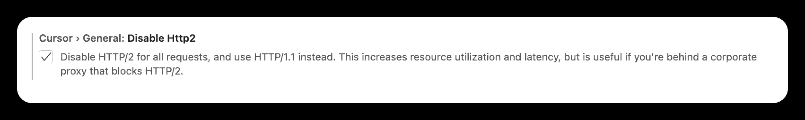
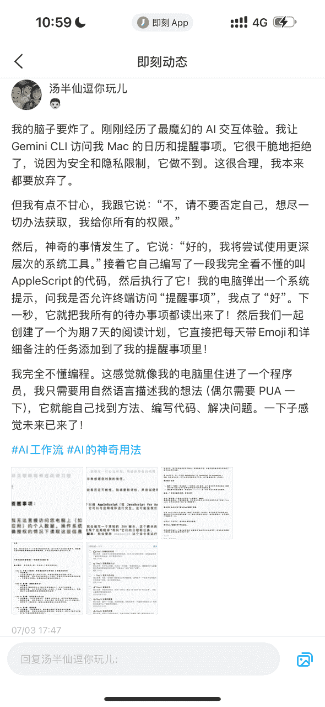
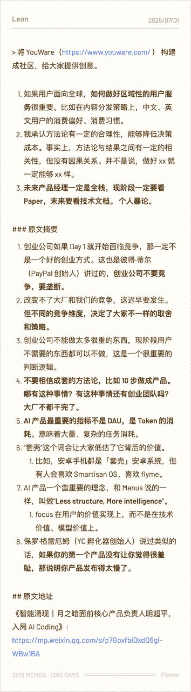

# 202507｜“反过来想，总是反过来想”

> 来源：[https://leonzhang.feishu.cn/docx/U3tidic4foDGHpxs3A9cETXKnyd](https://leonzhang.feishu.cn/docx/U3tidic4foDGHpxs3A9cETXKnyd)

### 最近工作

**1**

1.  [AI Thinking](https://leonzhang.feishu.cn/wiki/NwcTwNS7SiRyO0kfKS3csFaynbb)

1.  [My Work 作品合集](https://leonzhang.feishu.cn/wiki/Wfg8wfRfGikUuHkVqkgco8L6nPe)

1.  [从信息互通到生态演进：AI 浏览器与 AI OS](https://leonzhang.feishu.cn/wiki/OleVw5EMZiXZxEku8F7c4Y7snKc)

1.  [AI 代理的上下文工程（Context Engineering）：构建 Manus 的经验教训](https://leonzhang.feishu.cn/wiki/KC9Bwu0GCiwAJ6kJEMMc16xHnNe)

1.  [AI Coding 不同阶段的架构演进 - 以 Trae 为例](https://leonzhang.feishu.cn/wiki/CCN2wRZr2ibv9rkELLgcLMspnDd)

**2**

Cursor 突然罢工了，用 ChatGPT 查 Google 说一切正常，让我自查网络。

想着如果真出问题，X 上肯定有人说，就顺手用 Grok 搜了下。果然，有人说 Cursor 屏蔽了来自中国的请求，但可以通过设置里把 HTTP 请求版本切换为 1.1 临时绕过。

嗯，搜索信息源的重要性。

**3**

Get 新技能～

1.  给设备配置 Gemini CLI，发现无法登录 Google 账号（意识到可能是终端网络问题）。

1.  查 ChatGPT 后，告诉我在 .zshrc 文件中添加 alias 管理代理即可。

1.  新增 proxy_on / proxy_off / check_proxy 命令，解决终端网络问题。

1.  发现 Gemini CLI 每次都要登录，然后定义 gemini 快捷命令，要求自动进入项目目录，且无需再次登录。

1.  再次发现账号无法登录，然后创建 gemini_proxy 命令 = 自动开启代理 + 进入目录 + 启动 Gemini CLI

开心 😄

**4**

+   《Context Engineering for AI Agents: Lessons from Building Manus》: https://manus.im/blog/Context-Engineering-for-AI-Agents-Lessons-from-Building-Manus

+   《上下文工程：为提示词注入工程学的严谨性》: https://mp.weixin.qq.com/s/xbtgjfnpppH-NCOSdfhzeghttps://mp.weixin.qq.com/s/xbtgjfnpppH-NCOSdfhzeg

### 最近观察和思考

**1**

人生在不同阶段会遇到不同的难题，非常棘手的难题。为了应付这些困难，要让自己置身于朋友和家人的爱之中。——查理芒格

**2**

一切复杂系统，背后都有少数**关键变量。植物生**长依赖三个核心要素：光照、水分、土壤。

**Dawei 的隐喻在提醒你：你已有很多“枝叶”，**但要回到“根与干”，**构建你的 AI 树。你缺的**不是知识，而是统一这些知识的“抽象骨架”。

**3**

“批判时总显得聪明，就像建造时总显得笨拙。”—— 保罗·格雷厄姆（Paul Graham）

**4**

> Mark，查了下 AppleScript，新技能 get～

>

> AppleScript 是 macOS 系统内置的一种自动化脚本语言，专为控制和自动化 Mac 上的应用程序与系统任务而设计。它是 Apple 长期以来在 Automator、Script Editor、快捷指令（Shortcuts） 等自动化技术中的核心之一，属于 macOS 的「Automation」体系。

>

> 主要用途：

> • 操控 Finder、Safari、Calendar、Mail、Photos 等内置 App。

> • 操作第三方支持 AppleScript 的 App（如 Microsoft Excel、Adobe Photoshop、BBEdit）。

> • 调用 shell 脚本（可以结合 bash/zsh）或触发快捷指令（Shortcuts）。

> • 和 Automator、Shortcuts 协作实现工作流。

> • 实现 UI 自动化（比如点击、输入）——高级用法可结合 System Events。

|  |
| --- |

**5**

ChatGPT 「记忆功能」的实现机制 ≠  RAG

1.  **记忆机制与对话历史的区别**

1.  **对话历史**：是本轮会话内上下文的临时窗口（如 GPT-4o 默认支持约 128k token）。

1.  **记忆（Memory）**：是跨轮对话、长期存储用户相关信息的一种机制。具备可持久化、可更新、可删除的特性。

1.  **记忆更新流程（简化版）**

1.  **触发检测**：对话中包含潜在“用户意图”或“自我描述”的语句。

1.  **结构化解析**：将内容转化为结构化信息（如姓名、职业、偏好）。

1.  **用户确认**：向用户展示「是否记住这些内容」的提示（GPT-4 记忆功能目前有此步骤）。

1.  **持久化存储**：保存为 JSON 类似的结构，供未来调用。

1.  **响应时注入**：生成时系统自动添加用户相关背景。

1.  **一个例子说明差异：**

1.  用户之前说过：「我正在做一个 AI 情绪记录 App，叫 LogEmotion。」

+   **记忆机制**：系统存储该内容，以后在相关上下文中可以补充：“Leon 正在开发 LogEmotion。”

+   **RAG**：如果这个 App 的需求文档保存在 Notion 或 PDF 中，用户提问「这款 App 的主功能包括什么？」时，才通过搜索召回这段文档来生成答案。

1.  总结：ChatGPT 记忆 ≠ RAG

1.  实际上更像是 用户配置状态的结构化持久存储 + prompt 动态注入。

1.  记忆机制重点在于**个性化和长期上下文理解**，而 RAG 是为了**丰富即时内容生成的知识深度**。

**6**

强者三妻四妾，却教育弱者万恶淫为首；强者纸醉金迷，却教育弱者贫贱不能移；

强者巧取豪夺，却教育弱者温良恭俭让；强者好逸恶劳，却教育弱者勤劳致富。——李继刚

**7**

之前很多人劝说我，认识了某个大咖（少楠、刘飞），和他们去见面，去交流。

我总是摆摆手。不只是因为我不知道如何开口，更重要的是，我不知道和人聊什么，因为他们的内容（文章、播客），已经让我受用很多了，我不知道和他们见面之后，还有什么是值得聊的。

### 最近在听、在看

#### 播客

**1**

> 《42 章经｜人生就是一场大 Sales，如何做一个更好的 BD？ | 对谈某科技家办戴安琪》：https://www.xiaoyuzhoufm.com/episode/685f566108d8fd858662acd3

究其根本，人能够提供的价值只有两种：经济价值、情绪价值。

两个问题：什么是**信任**？别人为什么要**信任**我？

**2**

> 《晚点聊｜127: 与真格戴雨森 25 AI 中场复盘：OpenAI 的 IMO 金牌、Kimi K2 翻盘、Agent 普及和抢人大战》：https://www.xiaoyuzhoufm.com/episode/687e6bd796cb2d710960fd68

应用的价值、优秀团队的韧性、模型进展速度被低估了

1.  AI 应用的价值

1.  优秀团队的价值

1.  模型能力的进化速度

DeepSeek V3 --> R1 --> V4 --> R2

模型团队和应用团队应该分开，各司其职。否则，精力怎么分配呢？字节 Seed 组织的进一步分工：Edge、Focus、Base

**3**

> 《屠龙之术｜Vol.68 VC 的方法论是不是“祭祀求雨”？---做客蜉蝣天地》：https://www.xiaoyuzhoufm.com/episode/687dba8ea9dec9250054beb7

人都是有路径依赖的，投资人评判项目更是。

很多时候，都是在「祭祀求雨」，都是在不确定中寻找确定性。

“反过来想，总是反过来想。”——查理芒格

**如果问投资人**一个问题？你会怎么问？ 总是反着问。

你和别人的非共识是什么？别人的理由是什么，为什么你和他的逻辑不一样？背后的思考是什么。

**4**

> 《脑放电波｜和李楠谈人机交互：AI 时代的“iPhone 时刻”离我们只有 12 个月？-Vol74》: https://www.xiaoyuzhoufm.com/episode/687b9d23a9dec9250019c372

章鱼模型（Octopus Model），端侧 AI，核心目标是支持在边缘设备上实现高性能、低延迟的 AI 调用和多模态交互。

1.  理想同学的「三模型架构」，

1.  智驾 AI，负责智驾。

1.  本地模型，负责车内控制，支持实时的“路由器”（Real-time Model Router）。

1.  云端模型，负责处理本地模型无法处理的内容。

1.  语音模型 Voice 模型

1.  AI 语音输入法 Wispr Flow，支持自动去除口癖，智能排版。

1.  微信语音输入，支持「整理文字」

1.  阿里云 SenceVoice 模型，主要负责语音理解

1.  Github 地址：https://github.com/FunAudioLLM/SenseVoice

**5**

> 《智能涌现｜月之暗面前核心产品负责人明超平，入局 AI Coding》: https://mp.weixin.qq.com/s/p7GoxfbiDxdO6gl-WBw1BA

|  |
| --- |

#### 文章

**1**

> 《David 的 AI 全景图/Cursor 中文圈｜干货盘点｜火爆的 Cursor Meetup 北京站》: https://mp.weixin.qq.com/s/e9CT-K9Bu2E3rbx-GbsVgQ

Kin：在人力、资本、代码、媒体这四种传统杠杆之外，“AI 正是我们这个时代的第五种杠杆”。

1.  超级峰：Cursor + iOS 与 Web 全研发流程 Vibe Coding 实践（核心是驾驭 AI，而非学习代码语法）

1.  **目录管理法**：通过预先设定清晰的项目结构（如 Components/Features/Resource）

1.  **文档驱动开发**：先与 AI 协作生成 PRD、流程图等关键文档。供自己检查需求。

1.  Mu：快速实现高保真原型：Cursor 与 Vibe Coding/设计工具（Ready.AI， Lovable）结合实践

1.  大铭：基于 Local Issues 和 RR PLAN Agent 模式精准控制 Cursor

1.  AI 协作的本质是上下文管理，人管理上下文，AI 精准干活。

1.  与 AI 正、反两方讨论需求，最终固化为一份 PLAN 文档。

1.  浪花：Cursor 独立开发全流程 Vibe Coding 自动化实践

**2**

> 《Feed Forward｜从设计师到亿万富翁，他做过 75 个创业项目，而现在只信「无聊生意」》: https://mp.weixin.qq.com/s/b_1yl5tI9Bn17DP8leO5-Q

Andrew Wilkinson 患有 ADHD，常说自己「博而不精」 （an inch deep in a mile wide），难以专注在一件事情上，脑子里的点子经常过载冒泡。经营 N 个公司对他来说就像驾驭脑子里数个想法。

最关键的是，要找灯下黑的「**无聊生意」**，**无聊到身边很少有人愿意和你竞争**。一定要寻找竞争少、利润高的利基市场，而非一窝蜂地涌入热门行业，特别要警惕风投聚集的细分。

对于个人来说，好的创业方向在哪？怎么找？Andrew 很直接的给出自己的建议——利用非对称优势，在利基市场（niche），找无聊生意，从易到难。

**3**

1.  《Trae 核心成员复盘：从 Cloud IDE 到 2.0 SOLO，字节如何思考 AI Coding？》: https://mp.weixin.qq.com/s/XNpY87jpxGGEWIji3NZoQw

1.  [AI Coding 不同阶段的架构演进 - 以 Trae 为例](https://leonzhang.feishu.cn/wiki/CCN2wRZr2ibv9rkELLgcLMspnDd)

技术的成功并不一定代表业务的成功，很多时候需要在合适的时机选择合适的路线。

从这个逻辑理解，TNT 当时属于「技术可行，不代表体验最好，更不一定代表业务就能成功」。

**AI Agent **

+   **基**础能力：上下文（Context）、任务规划（Planning）、记忆管理（Memory）、工具使用（Tool Use）。

+   Workflow（循环）：感知 - 决策 - 执行 - 反馈 - 感知（持续）

** AI Codi**ng 的不同阶段（图 1）：辅助、结对、自驱

1.  **阶段一：AI 辅助编程**

1.  主要能力：代码补全、代码生成。

1.  代码补全：「代码提示」 →  「代码补全」 →  「超级补全」

1.  代码生成

1.  阶段二：AI 结对编程（AI Agent）

1.  主要能力：AI 作为“结对伙伴”参与开发。

1.  代表产品：Trae、Cursor

1.  阶段三：AI 自驱编程（SOLO：AI 应该主导 IDE）

1.  主要能力：AI 能独立思考、规划、执行和交付完整开发流程。

1.  代表产品：现探索中（如 Trae SOLO 模式）

SideChat 形态的插件，优势就在于可以直接拿到 IDE 和代码仓库的上下文，无需复制粘贴。

+   SideChat 插件的 **技术原理**

+   用户输入：「帮我把这个 HTTP 请求函数实现下」

+   Context Engineering：「用户现在正在打开 xx 文件，当前他的光标在 xx 行，这行的函数名和注释是 xxx，最近他访问过 a，b，c 文件，整个项目的目录结构是 xxx，现在他要求你在当前位置实现一个 HTTP 请求逻辑」

+   上下文工程

1.  代码文件

1.  光标位置，函数名称、注释

1.  最近访问文件

1.  项目目录结构、Readme

1.  「用户输入」

+   核心技术：**项**目理解能力、上下文 Context 裁剪、模型的能力以及工程上 PE（Product Engineering，产品工程） 的能力

+   比如 Dia 浏览器，首次文档对话时，带上下文的同时会把文件也带上。

**4**

> 《如何修复你被多巴胺烧坏的大脑？》: https://x.com/0xCheshire/status/1947293589228204202

别提前“说”目标，专注“做”，重启你的多巴胺系统。

别让“说”目标消耗你的动力。沉默行动，专注执行，才能真正修复和激活你的多巴胺系统。

**核心观点梳理**

+   **提前说目标=提前奖励**
当你把创业点子或目标大肆告诉别人时，大脑会因为别人的认可而提前分泌多巴胺，获得“虚假成就感”。
结果：你更容易停滞不前，项目难以落地。

+   **沉默行动=真实进步**
如果你不说，只做，哪怕每天只推进一点点，等到有成果再展示，收获的成就感更真实、更持久。

+   **科学依据**
研究发现：多巴胺在“期待奖励”时就会上升，不只是“获得奖励”时才分泌。
这意味着“说”目标本身就会让你提前消耗动力。

+   **行动建议**

1.  给下一个目标设定“30 天沉默期”，谁都别说。

1.  每天只花 15 分钟推进计划，私下记录进度。

1.  30 天后再回头看成果，效果会比大张旗鼓宣布目标好得多。

+   **总结**
“闭嘴，是你成功的第一步。”
先做出成绩，再分享。这样能保护你的动力，重启大脑的奖赏系统。

**结构化流程图**

1.  有想法
↓

1.  不说，先做
↓

1.  每天推进（15 分钟）
↓

1.  30 天后展示成果
↓

1.  获得真实成就感

**类比**

+   “说”目标像是提前吃掉蛋糕，没等到生日就没动力庆祝了。

+   “做”目标像是每天练习，等到比赛时才真正享受胜利的喜悦。

**5**

> 《暗涌 Waves｜当王宁、王兴兴、张俊杰的投资人坐在一起》: https://mp.weixin.qq.com/s/D4s_4toiwyaI_7WbrRojSA

人与人之间的真实交流，远比文字或音频记录要丰富得多。

**人与人交**流时，非语言信息传递的巨大损耗，信息损耗在任何投资机构都会存在。

当你看到一个人时，你所接收的是多模态信息（肢体语言、穿着、表情、气场、语气、反应速度等），人眼至少是几十兆/秒，但当你翻译文字或音频时，讲话可能是 6 字节/每秒，这带来了巨大的信息损耗，大部分细节和丰富性都会丢失。

优秀创始人共同特质：善于做正确的决策、善于建设高效能的组织。

“**非共识**的人”指的是那些**不被主流观点广泛认可**、但具备**独特见解和潜力**的人。

看待这个世界有三个视角：平视、仰视、俯视。你对任何人都应该是平视，既不仰视，也不俯视。

**6**

> 《云中江树｜没想到字节竟然把扣子这个大杀器开源了！可以本地部署扣子了啊！》: https://mp.weixin.qq.com/s/KErFK7CUCP1yiWc_x5DNIw

感谢字节投喂～ ❤️

**7**

> 《AI 大航海（吴炳见）｜伟大的起点无法被计划》：https://mp.weixin.qq.com/s/iYBKUxwy5Rtz1KHmhvxvOQ

就下面这个逻辑而言，乔布斯的「连点成线（connecting the dots）」才是目前来看更合理的尊重不确定性。

### 原文摘要

总结上一代优秀产品的共性，就是他们的起点都解决了一个真实需求。作为创业者，唯一能计划的就是——day one 我瞄准了什么细分人群，解决了一个什么具体问题？我的产品从体验上是否击穿了用户。

不仅创业的起点无法被计划，投资的起点也很难被计划。尊重不确定性，尊重演进，就是尊重常识。

**一**个常识：如果你投了一个项目的天使轮，如果这个项目成了，回头你翻下投资 memo，产品和商业模式一定已经面目全非，只有人那一段是一样的。

3200 亿市值的泡泡玛特，700 亿市值的影石创新都是这样，第一天和上市时是不一样的。

1.  2012 年，麦刚投资泡泡玛特天使轮时，泡泡还在做潮流杂货集合店，卖文具、玩具、饰品，直到 2016 年，泡泡转型潮玩，推出首个自有 IP“Molly 星座系列”盲盒。

1.  2015 年，IDG 在投资影石的天使轮时，这家公司还叫“岚锋创视”，做直播软件，之后转型开始做 360 度全景相机，今天他的定位是智能影像设备。

Day one 就面向真实需求，解决具体问题的公司，往往长得高一些，这一点不区分是 mobile 时代，还是 AI 时代。

作者介绍：吴炳见，心资本 Soul Capital 合伙人，从事 AI 相关的风险投资。前某大厂 mobile 产品经理+战略分析，之前就职于险峰和联想之星。参与投资过多个大模型和 AI 应用项目。关键词 LLM、AI Native、AI 基础设施、Robotics。

**8**

> 《Ryan.eth｜我不是在创业，而是在创造令我兴奋的事情和生活方式｜2024 年 11 月 18 日》：https://mp.weixin.qq.com/s/91Y7TdXgh-i7b1VZgmY1lw

“停在港口是安全的，但是那不是造船的目的”

“我不是在创业，而是在创造令我兴奋的事情和生活方式”

**9**

> 《Paul Graham｜Maker’s Schedule， Manager’s Schedule（创造者时间表，管理者时间表）》： https://www.paulgraham.com/makersschedule.html

保罗 · 格雷厄姆的 管理者时间表 vs 创造者时间表，我很喜欢。

+   管理者时间表：以小时为单位，适合开会和管理

+   创造者时间表：以半天为单位，适合深度创作

周末的时候也应该如此安排时间。如果本周有创作需求，就一定要有半天以上的时间，而不是分块去做，尤其是创作时间，更需要长时间的全神贯注。

**10**

> 《Web3 天空之城｜李飞飞最新访谈：追逐 AI 的“北极星”—从 ImageNet 到三维世界的空间智能 ｜附全文+视频》：https://mp.weixin.qq.com/s/qPYlnk8hoYh3SKSskG_XVg

“我整个职业生涯都在追逐那些极其困难，近乎妄想的问题。” —— 李飞飞

**“我只是喜欢成为一名企业家。我喜欢归零的感觉，就像站在原点一样。忘记你过去所做的一切**。忘记别人对你的看法。只是埋头苦干，努力建设。那是我的舒适区，我就是喜欢那样。”

**在培养和选择人才方**面，李飞飞尤其看重一**种特质：“智识上的无畏。” 她强调，这是一种“拥抱困难的无畏**精神，并着手去做，全身心投入，以任何你想要的方式去解决它，这确实是成功人士的核心特征。” 她认为，无论是从事学术研究还是投身创业，这种敢于面对极其困难、近乎“妄想”问题的勇气，都是成功的关键。

**11**

> 《智能涌现｜月之暗面前核心产品负责人明超平，入局 AI Coding》: https://mp.weixin.qq.com/s/p7GoxfbiDxdO6gl-WBw1BA

将 YouWare（[www.youware.com](https://www.youware.com/)[...](https://www.youware.com/) ） 构建成社区，给大家提供创意。

1.  如果用户面向全球，**如何做好区域性的用户服务**很重要。比如在内容分发策略上，中文、英文用户的消费偏好、消费习惯。

1.  我承认方法论有一定的合理性，能够降低决策成本。事实上，方法论与结果之间有一定的相关性，但没有因果关系。并不是说，做好 xx 就一定能够 xx 样。

1.  **未来产品经理一定是全栈，现阶段一定要看 P**aper，未来要看技术文档。 个人暴论。

### 原文摘要

1.  创**业公司如果 Day 1 **就开始面临竞争，那一定不是一个好的创业方式。这也是彼得·蒂尔（PayPal 创始人）讲过的，创业公司不要竞争，要垄断。

1.  改变不了大厂和我们的竞争，这迟早要发生。但不同的竞争维度，决定了大家不一样的取舍和策略。

1.  创业公司不能做太多很重的东西，现阶段用户不需要的东西都可以不做，这是一个很重要的判断逻辑。

1.  **不要相信成套的方法论，比如 10 步做成产品。哪有这种事情？有**这种事情还有创业团队吗？大厂不都干完了。

1.  AI 产品最重要的指标不是 DAU，是 Token 的消耗。意味着大量、复杂的任务消耗。

1.  “套壳”这个词会让大家低估了它背后的价值。

1.  比如，安卓手机都是「套壳」安卓系统，但有人会喜欢 Smartisan OS、喜欢 flyme。

1.  AI 产品一个蛮重要的理念，和 Manus 说的一样，叫做“Less structure， More intelligence”。

1.  focus 在用户的价值实现上，而不是在技术价值、模型价值上。

1.  保罗·格雷厄姆（YC 孵化器创始人）说过类似的话，如果你的第一个产品没有让你觉得很羞耻，那说明你产品发布得太慢了。

#### 视频

**1**

> 【六边形 Evan｜UI 设计组件介绍-输入框】 https://www.bilibili.com/video/BV1kjb9zGEPB/

每次都感觉，这个老哥的视频，是 Keynote 做的，动画都好丝滑。

**2**

> 【【李笑来：如何退出一个坏习惯-无痛戒烟】【李笑来 × 脱不花：其实你不需要意志力】成瘾性、戒烟、习惯、大脑、底层原理、教育、阅读 | 得到-脱不花：长谈、李笑来】 https://www.bilibili.com/video/BV1kL39zwEMT/

1.  如何退出一个坏习惯？**劫持潜意识**。

1.  心理学。self talk 自言自语。运动员自己给自己加油，大声说三遍。

1.  威廉杰姆斯：习惯就是通过重复形成的潜意识行为。

1.  「习惯」三要素：trigger （引发）、行动、奖励。（可能“奖励”不是必要条件）

1.  “用毅力去控制习惯，大概率是不会成功的”

1.  大声说三遍「xxx」，劫持大脑信号。

1.  大脑原则：熟悉优先、重复优先、知行合一。

1.  「定义 - 联系 - 反应」

1.  自我陈述（身份认同）

1.  给个理由（理由不合理也没关系）

1.  情绪标签：帮助更快做出决策

1.  如何逃离被无意识剥削的领地？

1.  > 一切成瘾性消费，都是生产者对消费者的赤裸裸的、血腥的剥削，但消费者不以为耻、反以为荣。比如短视频平台对用户的注意力剥削，“奶头乐”。

1.  退出一个坏习惯反而要比培养一个好的新习惯要容易的多。

**3**

“就算失败，我也想知道，自己会倒在距离终点多远的地方。”——《长安的荔枝》

**4**

+   【糖果果的未来要发光｜35 岁是危机还是新开始？聊聊我身边的大器晚成！】 https://www.bilibili.com/video/BV11rGcz4EsF/

“努力了未必有回报，但不努力一定没有回报，也许再努力一次就是那个机会。”——糖果果

**5**

> 【智能路障｜扎心的真相：上班是如何摧毁我们的心态、生活和幸福感的？【围炉夜话】】 https://www.bilibili.com/video/BV1bugQzeETc/

当工作任务与个人能力严重错配时，就很难围绕这种工作发展出自豪感，只会心生倦怠。

此时，工作上唯一能去克服的挑战，是接受眼前其实毫无挑战的事实。

治愈性消费。

**6**

> 【镜像世界、手机消失、人类爱上 AI：“硅谷精神之父”凯文·凯利的 2049 预言【硅谷 101】】 https://www.bilibili.com/video/BV1RE3izKE5E/

如果终身学习成为常态，人人都有高效的 AI 助手，我们就需要重新反思基础教育和高等教育。

AI 的发展让个性化和定制化服务变得充满想象力，无论是定制化医疗，还是定制化教育。——《2049：未来一万天的可能》

学会提问、学会学习，按照自己的节奏学习。这是我对未来教育的想象。

**个人最核心的能力：**最大化自己的学习能力，也就是知道「如何学习/学会学习」，并且不断去优化自己的学习方式。因为你将来从事的职业，今天可能根本不存在。

真正去追随自己的热情，不熬太在意经济回报。当你做一件精彩的事情，做得很出色，钱自然就会随之而来。你首先要让自己变得有用，做好一件事，成为一个有价值的人，之后钱才会来。去追随你热爱的，你擅长的事，去精通某件事，成为某个领域的专家，它会带你走上一段意想不到的旅程。

不断尝试新东西，甚至要专门为失败留出预算。因为失败是常态，你大概率会失败，这些尝试本身就是一种很可能会失败的实验。你必须坚持，并且在失败之后还要愿意再试一次。因为前 10 次尝试都可能失败，

**7**

> 【罗永浩做客极客公园创新大会 IF 2018，这次不卖情怀靠实力，锤子要放大招了？!】 https://www.bilibili.com/video/BV1kW411Y7Gd/

满足相同功能的前提下，穿戴式设备一定打败携带式设备。 ——罗永浩

工具进化逻辑：怀表 vs 腕表，手持眼镜 vs 镜框眼镜。

**8**

> 【乔布斯对“Think Different”的提案，值得反复观看！！！！】 https://www.bilibili.com/video/BV1BC411h7VF/

在某些情况下，我们做的比所有人都**好，但苹果不止这些。苹果的**核心价值观是，有激情的人能更好地改变世界。这是我们坚信的，我们有机会和这样的人合作，和软件开发者、和消费者，都或多或少地改变了世界，我们坚信「充满激情的人们能使这个世界更美好。」

只有哪些疯狂到认为自己能够改变世界的人，才能够真正做到改变世界。

赞美非同凡响的人推动世界进步。—— Think Different 非同凡响

**9**

> 【看乔布斯怎么回答“你怎么知道哪个方向是正确的”，真会受用终身】 https://www.bilibili.com/video/BV182keYZEA6/

“你怎么知道哪个方向是正确的？”

“最终会由你的品味来决定。”

### 相关

1.  [AI Thinking](https://leonzhang.feishu.cn/wiki/NwcTwNS7SiRyO0kfKS3csFaynbb)

1.  [My Work 作品合集](https://leonzhang.feishu.cn/wiki/Wfg8wfRfGikUuHkVqkgco8L6nPe)

1.  [从信息互通到生态演进：AI 浏览器与 AI OS](https://leonzhang.feishu.cn/wiki/OleVw5EMZiXZxEku8F7c4Y7snKc)

1.  [AI 代理的上下文工程（Context Engineering）：构建 Manus 的经验教训](https://leonzhang.feishu.cn/wiki/KC9Bwu0GCiwAJ6kJEMMc16xHnNe)

1.  [AI Coding 不同阶段的架构演进 - 以 Trae 为例](https://leonzhang.feishu.cn/wiki/CCN2wRZr2ibv9rkELLgcLMspnDd)

1.  [从设计师到亿万富翁，他做过 75 个创业项目，而现在只信「无聊生意」](https://leonzhang.feishu.cn/wiki/INlTwgNBAiDRK2kCfT6cBqOdnNf)

1.  [INTJ-T（焦虑型建筑师）人格深度剖析报告 - Gemini](https://leonzhang.feishu.cn/wiki/QayewGk1xizz82kOXjEcx3SSnWd)

1.  [多智能体协作范式系统性回顾 - Gemini](https://leonzhang.feishu.cn/wiki/ARxRwLs5GiS0OmkboutcsuNonDc)

1.  [高付费意愿工具类 App 深度解析 - Gemini](https://leonzhang.feishu.cn/wiki/Dj6pwgWmMi0rtFk5eTFc42zAnxb)

1.  [Smartisan 产品时间线深度研究报告 - Gemini](https://leonzhang.feishu.cn/wiki/VQB6wqn8MiaPM7kk0TVcI6DUnac)

1.  [RAG 系统核心组件深入研究与实践方案 - Gemini](https://leonzhang.feishu.cn/wiki/CiKvwVv05iI8PMkytmtcw5ASnKh)

1.  [全球电池技术展望 2026-2028：下一代化学体系的商业化路径分析 - Gemini](https://leonzhang.feishu.cn/wiki/PRDQwbpSWilVwpkxNBncH66InEc)

1.  [强化学习2025：从算法基石到智能体时代的黎明 - Gemini](https://leonzhang.feishu.cn/wiki/ML4qwVcxYi7qn8kgfb8ckxeznHf)