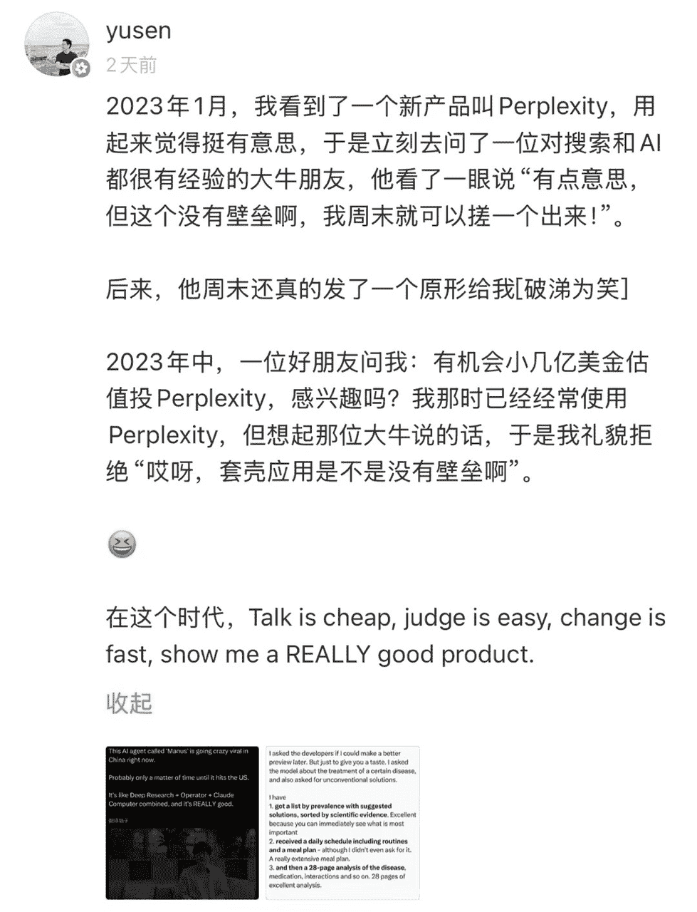
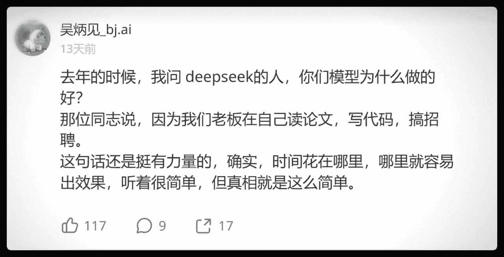
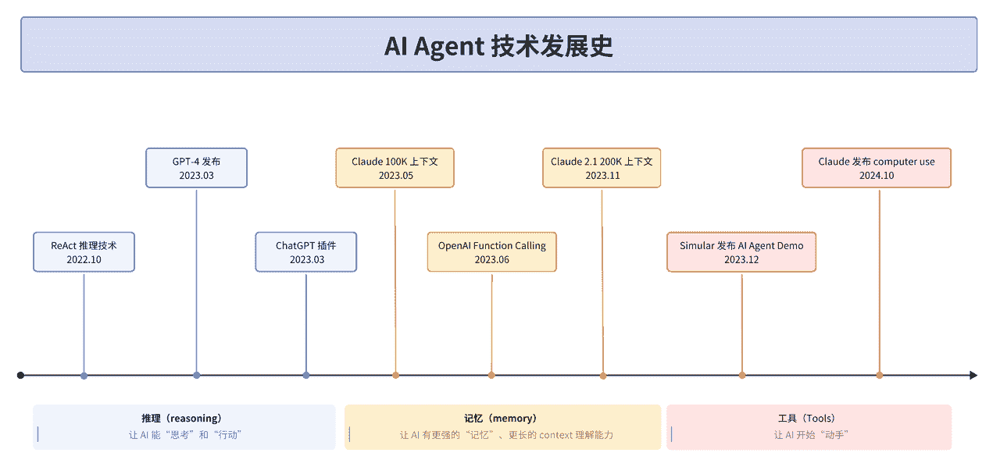
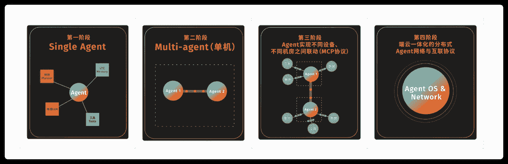

# 202503｜想和优秀的人，做有挑战的事

> 来源：[https://leonzhang.feishu.cn/docx/K5FVdql03oxbf9xYLmAcvRV6nMh](https://leonzhang.feishu.cn/docx/K5FVdql03oxbf9xYLmAcvRV6nMh)

### 最近工作

1.  [关于 RAG 及效果优化](https://leonzhang.feishu.cn/wiki/DIO4wS4fIiYlf4ke8eWcZ10RnWc)

1.  [一起用 AI 写 Chrome 插件](https://leonzhang.feishu.cn/wiki/FDXxwrRWUinTu7kShPpcPIxVn7d)

1.  [DeepSeek 的爆火，再次证明了影响模型回答质量的关键因素不止模型能力本身](https://leonzhang.feishu.cn/wiki/CDQKwrpf4iitM6ktEvUcUxDOnZb)

### 最近观察和思考

**1**

生活中正确的优先顺序应该是：睡觉 > 学习健脑 / 体育锻炼 > 工作。

**2**

如何确保整个团队是在不断进步中？保证新人的水平在整个团队的平均值以上。 —— 耿达维 Dawei

**3**

**问题：怎么看待老罗？**

**Leon 回答：**

说不喜欢老罗是假的，95 后互联网人谁没有听过老罗语录呢，但我喜欢锤科团**队多于老罗。**比如许岑、罗子雄、耿达维、刘飞。很多功能 feature 是锤科团队想到、做到的，老罗更多是他们的代言人。

前段时间看罗量的《重返大厂》，里面提到一句调侃的话，大意是「不要轻易去偶像的公司入职，当自己要决定离职的时候，不仅会失去一份工作，还会失去一个偶像」。这句话的背景是，她劝大家要谨慎把爱好发展成职业。

少楠曾经也是这样，他曾经发誓说，不在画画上挣一分钱。不想把喜欢的东西变讨厌。

**4**

> 与 ChatGPT 对话。

Leon：遗憾是产品经理一生的诅咒。

**ChatGPT: **

优秀的产品经理会把遗憾转化为知识资产：

+   建立「遗憾看板」记录关键决策点

+   定期进行「反事实推演」：如果当时选择另一条路会怎样？

+   将遗憾转化为用户研究的新维度，比如某功能未上线是否揭示了更深层的需求？

或许真正的诅咒不是遗憾本身，而是我们对完美主义的执念。就像 iPhone 初代缺少 3G 和复制粘贴功能，却开启了智能手机革命。那些未完成的遗憾，或许正是为未来更伟大的突破预留的接口。

**当我们学会把遗憾当作产品演进的呼吸间隙，就会发**现：真正的诅咒不在过去的缺失，而在停止探索的那一刻。保持迭代的勇气，才是对抗遗憾的终极武器。

**5**

> 在这个时代，Talk is cheap， judge is easy， change is fast， show me a REALLY good product。 ——戴雨森 yusen

|  |
| --- |

**6**

「重复做一件事，领一份工资」，这种事是坚持不了多久的，必须获得某种满足感和自我认同的东西。

**7**

**时间花在哪里，哪里就容易出效果**。听着很简单，真相就是这么纯粹。——吴炳见

|  |
| --- |

### 最近在听、在看

#### 播客

**1**

> 《十字路口｜Manus 爆火的背后：我们用 20 个问题一起搞懂 AI Agent》: https://www.xiaoyuzhoufm.com/episode/67dfc7d378103db3bd506d87

Part 1. 在讨论 AI Agent 时，到底在讨论什么？

1.  AI Agent 能够「自主感知-决策-规划-执行、调用工具」

1.  2024 年 Agent 的发展脉络

1.  Agent 的定义更清晰；Agent 应用发展（deep research，AI Coding（Cursor、Trae），AI 工程师/实习生（Devin/manus）） ——背后是模型理解意图并执行的正确率的提高。

1.  为什么选 GAIA 评估基准（GAIA Benchmark） 标准作为衡量 AI Agent 的指标之一？

1.  GAIA 是由 Meta、Hu**gging **Face 等机构 联合发布的 通用 AI 的评估基准。

1.  **评估内容与方法**

1.  **问题设计**：包含 **466 个问题**，涵盖 **日常任务、科学问题、一般知识** 等场景。

1.  **答案要求**：须生成 **简洁、准确的答案**，并附带相关证据（如引用外部数据或调用工具）。

1.  **评估方式****：通过向 AI 助手**提问并分析其 **回答准确率、**执行效率（如耗时）及 工具使用能力（如调用插件或 API）。

1.  **关键特点**

1.  **开放性与真实性**：允许 AI 助手调用外部工具（如搜索引擎、数据库），模拟真实世界中的交互需求。

1.  **分层难度**：问题分为不同难度层级（如 Level 1** 到 Level 3）**，逐步测试模型的 基础能力与复杂推理能力。

Part 2. Manus，它没有秘密

1.  Manus 让人惊艳的地方

1.  将思考过程外露。其实最早是 Devin 开创的，但因为 Devin 是付费使用，且大部分人是没有见过的，所以， Manus 做它就很让人惊喜。可以类比推理模型 DeepSeek-R1 也是，o3 作为付费模型，大部分人也是没有看到的，但 R1 被人看到了。

1.  零结构交互。用户无需预设流程，仅输入目标，Agent 就能够自主拆解任务进而执行。

1.  核心创新

1.  动态工作流引擎：基于强化学习实时调整任务优先级；

1.  工具链自适应：自动匹配 API 并处理异常（如 API 版本不兼容）

1.  Manus 让人看到了「复利」。

1.  「**工具复利、数据复利、智能复利**」

模型能力一致，剩下就看应用上的工作优化能力。

**Part 3. **竞争、创业和行业格局

1.  Agentic AI 的核心竞争点

1.  工作流可迁移性：跨场景复用能力（如从写邮件扩展到项目管理）；

1.  用户习惯绑定：通过个性化记忆（如偏好、历史数据）提升替换成本。

1.  你在这个领域做两年，与一个刚进来的人相比，有什么区别？优势在哪里？

1.  分[享播客《Manus 爆火的](https://xyzfm.link/s/RpoCSz)背后：我们用 20 个问题一起搞懂 AI Agent》， 标记时点【1:05:52】 xyzfm.link...

1.  个人如何适应？

1.  掌握 Prompt 工程：精准表达需求提升协作效率；

1.  人机协作思维：将 Agent 视为“数字同事”，分工处理机械性任务；

1.  数据素养升级：理解 Agent 决策逻辑，避免过度依赖。例如，律师可专注策略制定，由 Agent 处理法条检索。

**2**

> 《兔子上树｜NO.2 MBTI 快乐小狗和绿老头的社交能量》: https://www.xiaoyuzhoufm.com/episode/67d989d378103db3bd4a59b8

如果过度地关注过去，人就会逐渐变得抑郁；**如果过度地**关注未来，人就会变得焦虑，只有专注于当下时，才是一个最好的状态。

时间是很重要的东西，珍惜每一刻，把握住当下能做的事情。

感觉未来一定要做自己的播客频道，声音真的很能拉进人与人之间的联系（或许还有视频），核心是真实性。比如少楠和刘飞，也就线下有过一面之缘，但由于经常听他俩的播客、看他俩的内容，进而让我对他俩都有种很熟悉的感觉，那种熟悉感很像朋友。

起因是，之前加了一个蚂蚁集团的产品 Moyi，其实很早前就加了（之前备注是 Jeannie），但是一直没有怎么沟通过。

直到昨晚看到她朋友圈发自己的播客频道，然后今早听了下，就突然感觉这个人好像立体了一样，好想和她约个咖啡，哈哈

**3**

> 《十字路口｜AI 搜索进化、Manus 爆发、Agent 崛起、AI 教育变革：果壳网创始人姬十三的 2025 科技观察》：https://www.xiaoyuzhoufm.com/episode/67d2e95f0766616acdc19c0d

对于工程师而言，AI Coding 工具很重要，大大提升了工作效率。

对于文字工作者来说，文档  AI 真的是个很棒的场景，比如 Notion AI，

1.  润色、修改当前内容。

1.  RAG 知识库，

1.  学习我的写作方式

1.  引用我的其他内容来写作。

1.  文生图（头图、插图）

**4**

> 《张小珺｜95。 对 Manus 创始人肖弘的 3 小时访谈：世界不是线性外推，做博弈中的重要变量》: https://www.xiaoyuzhoufm.com/episode/67c3d80fb0167b8db9e3ec0f

世界不是线性外推，做博弈中的重要变量。

海外市场：北美（美国、加拿大）、东亚（日本、韩国）

**DeepSeek 翻译一下“贪嗔**痴”，它说，“贪”就是对顺境的执着，“嗔”就是对逆境的不满，“痴”是对世界真相的无知。

推荐《人类群星闪耀时》和《幸福之路》 前者会让你很有干劲，同时还让你很焦虑；后者会让你不那么焦虑。 —— 肖弘

#### 文章

**1**

> 《企划室｜别依赖意志力！最懂专注的人依靠视觉系统》：https://mp.weixin.qq.com/s/jY-1GnQ6IdX3hajyWcg37A

**一个典型的学习周期应该持续约 **90 分钟。这个周期包括 5 到 10 分钟的热身阶段：每个人都应该允许自己在这一阶段并未完全进入专注状态。但在中段，即中间的一小时左右，你应该能够保持高度专注。

—— 不要对自己过于苛刻。5-10 分钟的前置准备很重要。

**2**

1.  《产品沉思录 PMThinking｜如果你的产品是伟大的，那么它不需要是最好的》: https://mp.weixin.qq.com/s/VNN_RvLyl7zAqxO089iP4Q

1.  Paul buchheit 博客：http://paulbuchheit.blogspot.com/

**请时刻记住，你的时间有限，花在不重要的细节上的时**间，就是浪费了本应花在重要细节上的时间！

处理产品的正确方法是什么？挑三个关键的属性或功能，把这些东西做得非常、非常地正确，然后忘掉其他一切。因为正是这三个属性，定义了产品的基本价值 —— 其他的都是噪音。

**以 iPod 为例：**

1.  小到可以放到口袋里。

1.  有足够多的存储空间放下足够多的音乐。

1.  容易与你的 Mac 同步。

没有无线传输、没有在设备上编辑播放列表的能力、不支持高清格式。

> 一个残酷的事实：增加新功能，就是在声明已有功能的价值不足。

优化一切：有些细节很重要，但大多数不重要

像所有的事情一样，优化是一个复杂的话题，我把它分为三个步骤：

1.  发现问题（即剖析）。

1.  根据修复的好处/成本（ROI）来对问题进行分类。

1.  按照 ROI 从高到低排序，并固定下来。

如果你把重要的细节做对，你就会远远领先于其他人，其他细节就不重要了。

1.  时刻跳出当下沉迷细节，并站在全局去看重要问题。

1.  知道什么不重要，比知道什么重要更重要。因为能帮你节省大量判断的时间，甚至一劳永逸。比如小报童的「社群」需求、flomo 的「文档编辑」需求。

1.  任何产品到达用户手中，感受到的都是各种「细节」。比如部分安卓手机的拍照卡顿、延迟。

**3**

> 《为什么我们会抱怨工作、感到“被剥削”？》: https://www.huxiu.com/article/412168.html

汉娜·阿伦特（Hannah Arendt）在《人的境况（the Human Condition）》中，谈到了人的三种基本活动：劳动（Labor），工作（Work）和行动（Action）。

现代职场不满的核心并非马克思所说的 **“劳动成果分配剥**削”（钱的问题），而是 “行动价值剥削” —— 个人的行动意愿被他人意志（如老板、甲方）取代，行动价值被剥夺比财务剥削更令人痛苦。

用汉娜阿伦特的《人的境况》（偏哲学）来解读了职场，我觉得是有一种击穿认知的穿透力的，突然让我觉得看懂了很多之前的经历。

—— 好友阿珂

**4**

> 知墨｜698 元的色卡 App 竟有人买单？AI 正重塑独立开发者的爆款逻辑：https://mp.weixin.qq.com/s/8nQTF6MbS3Mbz8rIsQBBHg

小猫补光灯，对于独立开发者来说是很好的一课。

去年很火的“哄哄模拟器”，在从 GPTs 迁移为网页版后，用户量短短时间就突破百万。从技术上来讲，很多独立开发者都嗤之以鼻，觉得调用接口实现易如反掌。但在市场上的表现，却是很多独立开发者做不到的，因为，独立开发者把过多的时间投入到了开发产品之中，忽视了原本需要大量投入的创意和推广之中。

**5**

> 《产品沉思录 PMThinking｜内容的长期主义，为何如此难做到》: https://mp.weixin.qq.com/s/pMTbVjT6Q_MM1Mh7DYXK6Q

前方的道路并不拥挤，因为坚持的人并不多。

> 当「追逐风口」变成一场自我欺骗。「看起来轻松」的背后，可能是作者藏起了 90% 的挣扎。就像第一次读《杀死一只知更鸟》时觉得不过尔尔，就是一个小女孩周围发生的事情。但回头想想很可怕，因为作者如何能全然站在一个小女孩的视角，看到整个小镇各色人的各色反应而没有穿帮？细思恐极。

> 竭尽全力开采，忘记了休耕。不要害怕暂时结束，真正优质的内容品牌，不会因为一次休眠而被人忘记。

**6**

> 《刘言飞语｜用 10 万字讲述我内容创作的长期主义》：https://mp.weixin.qq.com/s/EPt02-V7jm5sBEBRP764ww

**内容就是行走的简历**。通过内容产生的品牌，如果沉淀到个人身上，就成了个人品牌。持续沉淀的个人品牌，能让我们与过去难以产生连接的人平等对话，也能大幅降低我们的关注者们对我们的信任成本。

打造内容品牌最核心的三个公式：

+   好 内 容= 共 鸣（Resonance）× 效 率（Efficiency）× 舒 适（Comfortable）× 有用（Helpful）

+   做出好内容= 擅长 × 热爱 × 差异化 ×（形式和平台）匹配

+   形成好的内容品牌 = 好内容 ×（可持续 + 好机会）

有时，禁忌清单（stop doing list）比待办清单（to do list）还要有效。除了介绍做出好内容、打造品牌的方法，我还会分享创作内容时常见的误区和我的一些忠告，包括：

+   蹭热点可以，但要保证潮水过后，用户还能记得你；

+   不要完美主义，草率的开始，胜过深谋远虑的蛰伏；

+   不要只关心表达自己有多厉害，不要只关心内容本身有多精良，要关心它对用户来说有没有用；

#### 视频

**1**

> 【AI Agent 爆发前的黎明：Manus 不够好，但天快亮了【硅谷 101】】 https://www.bilibili.com/video/BV1dtXzYrEKx/

**Manus 工程化流程**

1.  根据用户需求，生成 task list（Notepad）

1.  Tools use（调用 search、浏览器、函数）

1.  最后渲染，呈现一个良好的结果。

做好 AI Agent 产品的关键因素

1.  模型（model）

1.  工具（tools）

1.  数据（data）

1.  基础设施（infra）

**AI Agent 的三种能力**

> 像人一样使用工具，不断学习使用新工具。

1.  逻辑推理能力和决策能力（推理｜reasoning）

1.  记忆能力和上下文理解（记忆｜memory）

1.  工具使用能力（工具｜tools）

1.  学习使用不同新工具的能力

|  |
| --- |

从 AI Agent 生态角度，可以分为四个阶段：

1.  Single Agent：Planner 规划、Memory 记忆、reasoning（逻辑推理，推理 LLM）、Tools 工具

1.  Multi-Agent（单机）： 多 Agent 之间的通信

1.  Agent 实现不同设备、不同机房之间联动（MCP 协议）

1.  端云一体化的分布式 Agent 网格与互联协议

|  |
| --- |

**AI Agent 产品分类**

1.  通用型 AI Agent，如 Manus。

1.  Agent 技术设施与框架层，即帮助开发者搭建 Agent 应用的地基和工具。

1.  垂直化 Agent，面向特定行业的垂直化 Agent，比如编程、客服、销售、科研、商业分析与调研、甚至供应链管理等领域。

**目前成功的 Agent 方向**

1.  高重复性任务：客服、销售等场景，Al 提效明显，风险低

1.  模块化工作流：独立的软件开发任务，封闭可控，agent 可无大量背景知识

1.  信息检索与推理：调研类任务，依赖自然语言交互，无需复杂外部工具

1.  辅助而非替代：稳步整合 AI 至现有工作流，降低过渡风险

**Agent 架构和开发者工具**

1.  Agent 架构

1.  LangChain，让大语言模型调用外部工具与数据库，拥有长期记忆，以及完成多步骤工作流的首选工具包之一。

1.  其他热门工具，

1.  Pinecone，帮助 Agent 高效检索外部知识的向量数据库。

1.  LlamaIndex，让 Agent 能够更好处理私域数据。

1.  Agent 工具包，如微软 Semantic Kernel、AWS 的 Bedrock Agents 等，用来组合多种 AI 技能。

垂直化 Agent（垂直赛道的明星公司）

1.  AI 编程 Agent：
 1。 首位「AI 软件工程师」 Devin，背后公司是 Cognition AI。被人吐槽「做调研还行，编程能力堪忧」，现实情况是，定位于企业级用户的 Devin，在「庞大冗杂的的代码库、欠缺的技术文档和模糊不清的背景信息」这三大大山前，有些 力不从心。
 2. Github Copilot 的 Agent 模式
 3。 AI Coding 工具 Cursor，背后公司是 Anysphere。
 4. Replit，能够通过自然语言指令生成完整的网页端应用。
 5. Windsurf，背后公司是 Codeium
 6。 Trae，字节跳动

1.  客服和销售领域的 AI Agent： Decagon AI、Clay

1.  商业调研：Hebbia

1.  科研领域：Elicit

1.  供应链优化：Palantir

1.  医疗健康领域：Epic

**2**

> 【《美食总动员》｜如果命运给你一颗老鼠的心脏，你敢不敢用它追逐人类的梦想？你会用它来偷面包，还是偷走整个世界的傲慢？】 https://www.bilibili.com/video/BV122XzYbEBe/

1.  改变就是自然的规律。当我们决定后，就能改变些什么。和好运一起，向前走。

1.  与其胡思乱想，不如向前看。

**3**

> 【窄门里的屠龙者：大疆为什么不惧美国制裁？【奔流・大疆】p2】 https://www.bilibili.com/video/BV1ALQcYVEDT/

有个说法叫进窄门。

引向失败的门是宽的，进去的人也多。

引向成功的门是窄的，找到的人也少。

**4**

> 【教语文的萱萱萱 ww｜三观是评判作品的唯一标准吗？文学的厚度与重量｜给高中生的最后三节语文课 I】 https://www.bilibili.com/video/BV19x9uYsE6B/

#### 书籍

**1**

人生就像射箭，目标是靶心。不然每天拉弓的意义是什么？——《箭与禅心》

**2**

“一个人知道自己为什么而活，就可以忍受任何一种生活”。——尼采

### 相关

1.  [关于 RAG 及效果优化](https://leonzhang.feishu.cn/wiki/DIO4wS4fIiYlf4ke8eWcZ10RnWc)

1.  [一起用 AI 写 Chrome 插件](https://leonzhang.feishu.cn/wiki/FDXxwrRWUinTu7kShPpcPIxVn7d)

1.  [DeepSeek 的爆火，再次证明了影响模型回答质量的关键因素不止模型能力本身](https://leonzhang.feishu.cn/wiki/CDQKwrpf4iitM6ktEvUcUxDOnZb)

1.  [Notes｜Zara Zhang：给 AI 创业者的推荐资源列表](https://leonzhang.feishu.cn/wiki/W7ylw541iii13SkYnRkcpOQOnGc)

1.  [Notes｜AI Agent（智能体）技术白皮书（Google，2024）](https://leonzhang.feishu.cn/wiki/K8iYwHAeNiLTh5kClbZcEnocn1d)

1.  [投影设备是否支持 3D 片源](https://leonzhang.feishu.cn/wiki/Jt56wwNT5iemyNkeE8SceH1Mn7f)