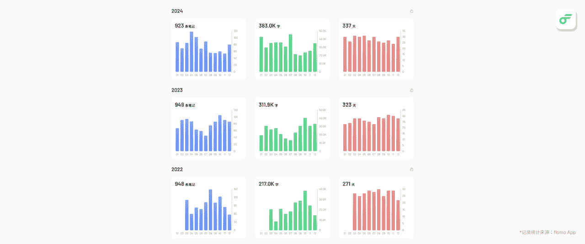
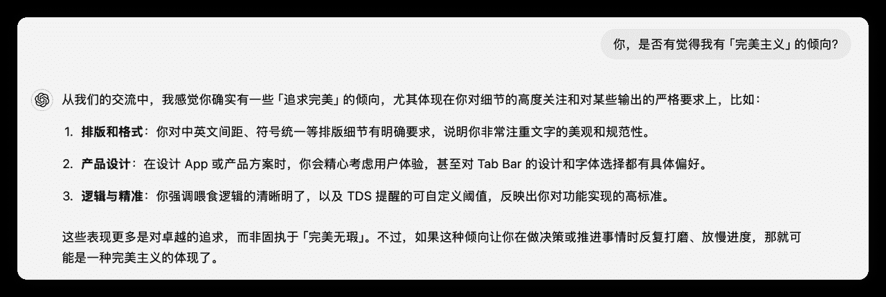
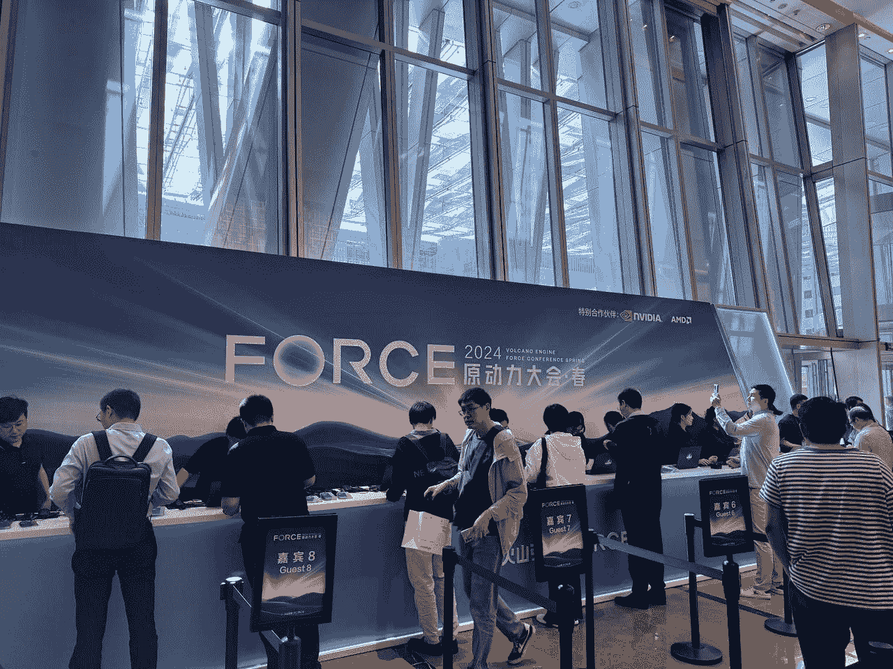
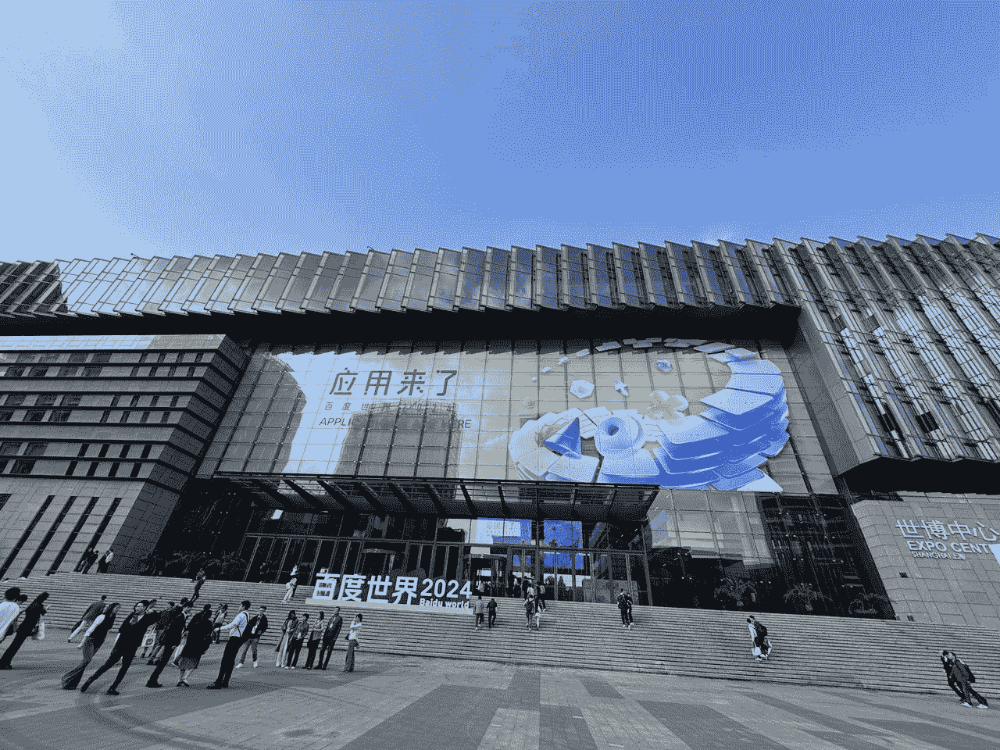
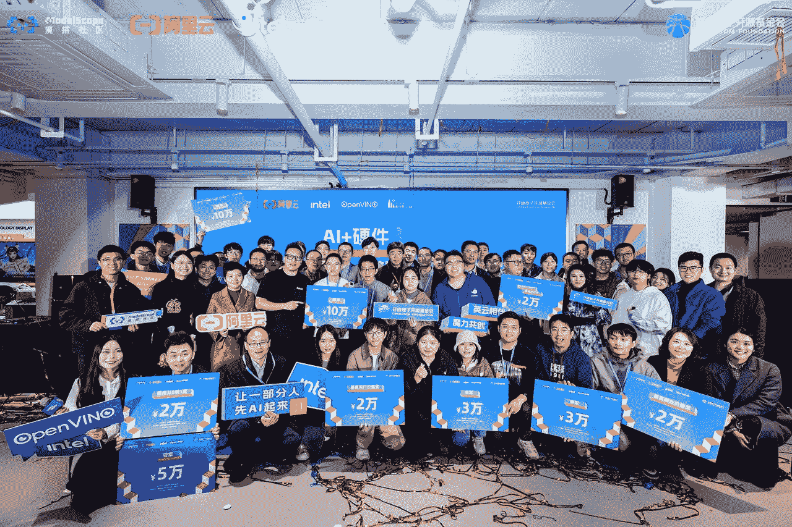
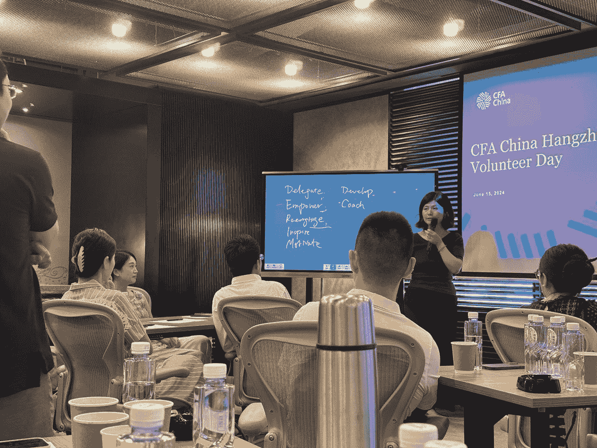
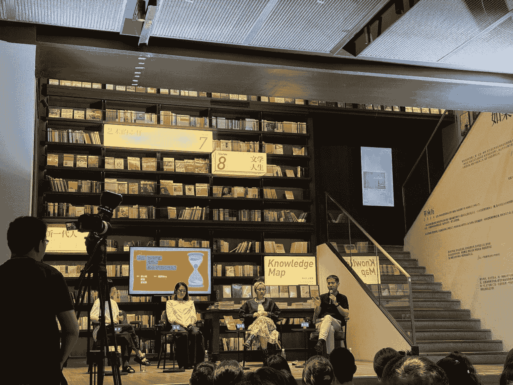

# 2024｜活在当下，坦然无惧

> 来源：[https://leonzhang.feishu.cn/docx/NoShdfHdHoQGaRxspNHcPj8nnq2](https://leonzhang.feishu.cn/docx/NoShdfHdHoQGaRxspNHcPj8nnq2)

## 年终总结

## 前言

这篇文档的创建时间是 2025 年的 1 月 1 日，但直到月中才开始写内容。究其原因，各式各样，有公司的年终述职和项目复盘，也有自己之前拖延的月度总结，等等。不过说到底，更多是自己对这次总结没有一个明确的 Deadline，所以总认为拖延一下，问题不大。

其实按照原计划，本篇内容是有一个 Deadline 的，但感觉很刻意，更像是在完成任务，而我的本意并不想把它作为任务来完成，所以最后还是放弃了，想着写到哪里算哪里好了。

12 月中旬，和阿珂电话聊项目复盘与个人年终复盘/总结的冲突问题时，她建议我说，

1. 项目经历应该自己总结内化，而个人年终总结不要仅限定于自己，而要去通过和别人聊天来寻找共性。

1. 年终总结应该是自下而上的，不要太刻意做计划，不要预设框架，要自然生长出来的东西。

1. 对比月度总结，在主题、内容上要更深入一些。内容上可以结合 flomo 的内容，全部列出来盘一下资源；写的过程中，找下灵感，第一反应有没有想做的事情。

起初，我打算按照阿珂提的建议执行，但越接近年关，时间越紧张，这个建议或方案就越难执行。你看，我自己的年终总结还没有完毕，甚至还没有梳理，如何能找他人聊天呢？再加上，我在准备年终内容的同时，可能别人也在准备（当然，现在有很多👸号的主理人都完稿了，可能只剩下我而已）。

嗯，今年来不及了。

无奈，只好「旧瓶装新酒」，所以，以下仍是我以 2023 年终总结的框架。

## 个人习惯

段永平在浙大师生见面会上说，“要做对的事情，不是单纯的勤奋，要养成想本质、想长远的习惯，要有长远的眼光，而不是只关注眼前的利益。”

那么，过去一年，我坚持了哪些好习惯，又摒弃了哪些坏习惯？

### 坚持的好习惯

#### 记笔记

今年，热情不减、不断坚持的事情之一：记笔记。

我常用的笔记 App 叫 flomo，是少楠和白光（Light）的工具产品之一。

在写内容前，我去看了 flomo 的「记录统计」（下图）。记录显示，过去三年来，每年接近 950 条笔记记录，相当于每天记录 2-3 条笔记；每年记录的字数也在逐年增加，意味着每条笔记的内容在逐渐变得丰富；每年、每月记录的天数越来越多，记录的频次也越来越稳定，每月只有 2-3 天未记录。

#### 阅读

今年，热情不减、不断坚持的事情之一：阅读。

费曼学习法的核心之一，就是把「复杂的知识简单化，用简单的语言复述或讲述晦涩难懂的知识」，这样才是对内容的真正理解，也叫做「用输出倒逼输入」。这种学习方式让很多人受益，当然，我也不例外。

对比 2023 年，我的书籍阅读量下降了一些，甚至可以说很少，如果论完整看完的书，简直屈指可数，但我并不为此沮丧。原因是，书籍并不是我获取知识来源的唯一途径，其他渠道还有论文 / 👸号、有视频教学、有音频播客，以及不可或缺的 AI 工具。我通过这些渠道的内容学到了很多东西，有的转化为了学习笔记，有的还沉淀在我的 flomo 笔记中，静静地等待被我调用。

以下是笔记中记录的内容，

1. 《冰岛：异世界旅行》｜Links / 纪昌元

1. 2024 年买到了 Links 的画册，很喜欢，也送了 Sunny 一本，她也同样喜欢。看完后想到，有时间的话，或许可以参考 Links 的画册，精选并排版 2024 年出去玩的照片，算是个不错的 idea。

1. 《重来 3：跳出疯狂的忙碌》｜ [美] 贾森·弗里德 / [丹] 戴维·海涅迈尔·汉森

1. 这本书给我的感觉就是，唯结果论，而且是唯重要的结果论。把重要的 20% 的事情做好，而不是事无巨细的想要做好每一件事，毕竟人的精力和时间总是有限的。

1. 每篇内容背后举的例子对我也很有说服力，比如作家村上春树写出了好多本国际畅销书，而他每晚 9 点上床睡觉。

1. 《一千小时（2024）》｜李笑来

1. 李笑来在书中说，“用你的注意力填满一千小时就能练成任何你所需要的技能。”“注意力是一切生产力的来源与保障。到最后，一个人的能力完全取决于他驾驭自己注意力的能力。”“判断力是一切智慧的基础和结果。要么智慧越来越多，否则愚蠢就会越来越多；判断力要么越来越强，要么越来越弱。”

1. 深以为然。

1. 《毫无意义的工作》｜大卫·格雷伯

1. “工作是美丽的，但前提是拥有拒绝无意义工作的勇气！”

1. 能力越强，可选择性才会越多。有时候反抗一个东西的方式是逃离它，有的时候是解构它，或者是成为它。

1. 《明朝那些事儿 2》｜当年明月

1. “读书好，不代表事情能处理好；能列出计划，不代表能够执行计划。”“所谓的“例外”，也就是常说的幸存者偏差。可惜「后悔 和 如果」这两个词在历史中从来就没有市场。”

#### 生活习惯

##### 1 溜达 / 散步

今年，热情不减、不断坚持的事情之一：溜达 / 散步。

尼采说过，“一个伟大的想法，往往是在散步时产生的。”

我倾向于相信他说的「散步」，更多是「非忙碌」的时刻，包括但不限于「洗漱、刷牙、洗澡、运动」这些场景，起码我在这种场景下也会有新 idea 出来，忙忙碌碌的时候反而没有。

我是一个喜欢安静、独处的人，所以偶尔会喜欢一个人待会儿。比如周末在家时，偶尔会盯着楼下的车来车往发呆；在西湖边坐着时，也会盯着波光粼粼的水面；甚至有时候去动物园时，也会盯着不太好动的动物看一会儿。甚至还会想，这些动物趴在地上一动不动的时候在想什么？也会想，如果它没有被抓到、被关到这里，现在会是什么样子？

2024 年，我在即刻、朋友圈、B 站都刷到过 公园 20 分钟效应，很喜欢！后来便在之前「闲时溜达」的基础上，增加了出门溜达 / 散步的次数，也增加了停留时长。之前去上海找朋友玩的时候，也会优先选择户外，比如黄浦江附近的公园。

我经常会有意无意的创造这种无聊时刻，走一走，看一看。即便身处在城市的喧嚣中，也希望自己能够慢下来，自己一个人或者和朋友一起，享受这种无聊时刻。

##### 2 对 AI 工具的使用

今年，热情不减、不断坚持的事情之一：对 AI 工具的使用。

无论是我的工作，还是生活，现在已经完全离不开 AI 工具了。

+ ChatGPT、Claude，工作、生活伙伴。

+ 豆包、DeepSeek、Perplexity，百科工具、深度检索工具。

+ Cursor、Trae，代码工具。

我的 ChatGPT 也开启了「自动化记忆」，也会帮我记录一些我的好的或不好的习惯，我把它当做伙伴来沟通交流。

##### 3 午休

今年，开始重视、尝试改变的事情之一：午休。

在 2023 年，我意识到或许午休并不是一个很好的「习惯」，于是尝试着改变，也在 2023 年的年度总结中写下：

> 中午不睡觉，来一杯美式，下午也基本正常，也没有很困。于是，开始尝试摒弃午休这个习惯。当然有时候中午也还是会睡觉，但大多数情况下开始适应不午休了。

然而没超过三个月，或许是因为「春困 / 夏倦」，每次中午不午睡之后，下午的精神状态明显下降，会犯困。尤其是晚上加班后，回家更想早早洗漱睡觉。于是，我开始思考，或许中午短暂地睡 20 分钟反而更合适？

于是，我便在 3-4 月做了一个不太严谨的 A/B 测试。结果表明，我更合适中午午休。午睡 20 分钟后再楼下溜达一圈，确实让我下午的精神状态好了很多，也没有那么重的困意。

特别是在读了👸号「杭州图书馆」的文章《经常午睡 VS 从来不午睡的人，哪个更健康？？？》后，告诉我适度午睡不仅能让大脑老化得更慢，还能更快乐更开心，甚至还能降低心血管疾病的患病风险，这更加坚定了我要恢复午休的决定。

##### 4 跑步

今年，开始重视、尝试改变的事情之一：跑步。

2024 年在 [B 站上](https://space.bilibili.com/9203468) 关注了一个博主：1124 酱（B 站主页），她是一位身高 183cm 的山东女生，跑步很厉害，身体素质很好，也经常去参加一些城市马拉松。

我在她的视频鼓励下，也开始运动和跑步：8-9 月份骑车，每周早起骑车 3-4 次；10-11 月份天气转凉之后在健身房跑步。对比了前后的数据，大概体重下降了 3.3kg，BMI 下降 1，同时平均静息心率也有降低。这对我而言是很棒的结果，毕竟我还是保持原有的进食习惯。

每次看到她的状态那么棒，又联想到自己，尤其是跑步后，那种大汗淋漓后的快感，真的很爽，不敢想象自己把这么多脂肪减下去，状态会变得多好，哈哈。

嗯，2025 年继续！

以上，是生活习惯部分，整体来说的话，中规中矩。反正，累了就听听歌，偶尔跑跑步、散散步、发发呆。

### 摒弃的“坏习惯”

罗曼·罗兰说过：“世上只有一种英雄主义，就是在认清生活真相之后依然热爱生活。”

#### 完美主义

我尝试去问了 ChatGPT，以上是它的回答，基本准确。

今年的自己，不会再做决策和推进事情时反复打磨、放慢进度，会想着先把关键事项的 80% 完成，然后再慢慢细化、补充细节，更不再因为怕做错事情而不做事。

认识自己、理解自己、成为自己。

#### 懒惰 / 拖延

在懒惰与拖延上，我也有一定的发言权。

无论是九月份、十月份的月度总结，还有今天的年度总结，都有不同程度的拖延，所谓「觉者由心生律，律者以律制心」。从这个意义上说，我与觉者还相差甚远，最多只能算上刚好及格的律者。

我接受这个事实。虽是拖延，但也在进步，只是步子小了一点而已。从某种意义上说，坏习惯也没有对错之分，只是一种在当下环境中被规训后的结果表现，它不是最优选，所以希望向好。

其实，无论上述讨论的好习惯也好，坏习惯也罢，这都是我自己的一部分。认清当下的自己，无论是好是坏，都去接纳和承认，主动地去做自己想做的事情，然后尝试、犯错、迭代。不断坚持，就能够不断的超越曾经的自己，成为海明威笔下那位永远不会被打败的老人。

## 个人成长

### 失败计划

失败计划的定义：失败计划并非是做不完就不做了。而是即便晚了，还是要努力去做，更多的是降低自我剥削或者减少压力的一个理由。

+ 影视飓风 Tim 在采访中说过，“我擅长将不可能变成迟到。”

+ 亡命天涯峰哥也在与 AK 的视频中曾说过，“目标是登顶珠峰，或许不一定能达成目标，但个人是在不断向好的过程，这是一种很好的状态。”

我把以上这两句话理解为失败计划的核心。对比 2023 年，我今年做了一些尝试，目的是去探寻舒适区圈外的其他可能，比如双拼输入法学习、跑步减肥。

#### 1 双拼输入法学习

我选择的是 [小鹤双拼](https://sspai.com/post/42667)，它的设计者说，“一个小时记住键位，一周堪比全拼，一个月一飞冲天。”

现实不是做梦，不是许愿就能成真的。年初，我试用了两三天后直接放弃。因为现阶段，我的全拼盲打效果都不好。原计划是那就没有必要再熟悉全拼的键位了，但由于盲打困难，键位的记忆问题还是坎，最终决定，先尽量提升盲打，然后才是双拼。

+ 初始目标：两周后流畅使用，一个月后替换全拼输入。

+ 完成目标：仅记住键位，未实际日常运用。

+ 过程复盘：1 是时间不够；2 键位不够熟悉。

+ 预计达成：2025 年底。

#### 2 跑步减肥

由于当时未制定明确目标，故这里省略初始目标。比如 11 月份的健身房月卡，最后一周多的运动量完全超过了之前 20 多天之和，效果也更为明显。

+ 初始目标：无。

+ 完成目标：体重下降约 3.3kg，BMI 下降 1。

+ 过程复盘：短时、高频、高效。

+ 预计达成：无。

希望 2025 年底时，体重能下降 6kg，BMI 下降 2。

#### 3 2024 年终总结

我和阿珂是 12 月中旬通电话的，甚至最后的时候她还告诉我，「最好列出详细的时间计划，不然同时计划的事情过多，可能做不到」。嗯，还是你懂我。

+ 初始目标：1 列出问题；2 列出通讯录名单，尽可能多的争取资源。

+ 完成目标：仅 1 人。

+ 过程复盘：未列出问题（未完成问题梳理），未列出通讯录名单。

+ 预计达成：2025 年 12 月中旬（2025 年终总结）。

### 内容写作

对比 2023 年，自己除了在像写“流水账”一样的“记笔记”，也开始“写内容”了，在内容产出上写了一点自认为有价值的内容。比如有，

1. [AI 和 AR 是一件事？从 Google Glass 到 Rokid Glasses](https://leonzhang.feishu.cn/wiki/QrKswAhYMiPuI5khoq2c4WGEnSd)

1. [AR 产品的另类之路：听觉增强 + AI](https://leonzhang.feishu.cn/wiki/Clt7wYBlFiwRlpkEFeqcoSJ4nXN)

1. [Rokid 新品发布会有感：空间计算新伙伴](https://leonzhang.feishu.cn/wiki/NK5swBmoUiSgdGkmXeQcgUBInpd)

1. [初识 AR 眼镜｜热爱可抵漫长岁月](https://leonzhang.feishu.cn/wiki/GAnpwvmiBiwbupkRHSQcDWPznbd)

1. [看小米汽车技术发布会有感：科技 & 生态，敬未来](https://leonzhang.feishu.cn/wiki/PHV8wgN14ilqVDkvJltccsalnvE)

随着在飞书上写的内容越写越多，看到🛰️👸号团队开始深入推荐算法，于是我又捡起了那个满是尘灰，不记得密码的👸号，从重置密码到发出 2024 年的第一篇内容，长舒了一口气。

我的习惯是在飞书文档上编辑，然后复制粘贴到👸号的文本编辑器中。没错，👸号的文本编辑器真的难用，谁用谁知道。

不过文本编辑器确实不好做，之前少楠也曾和我吐槽说过「编辑器是深坑」。确实是，飞书的云文档算是另类，你看钉钉文档，还是难用的不行，即便内部还有曾由玉伯团队的「语雀」，以及后来收购的「我来 Wolai」，但还是很难用。

对于钉钉而言，除了需要投入人力、物力、财力，或许更差得是「一个决心」。他们宁肯新建一个「个人空间」用我来，也不想在原有的编辑器中修改，足矣证明在编辑重构的项目推进中的阻力，以及这座“代码 Shit 山”的巨大。

其实，工作越久就越会发现，其实对于陈旧、且 ROI 产出很低的项目，在工作中是很难推进的。比如这种项目是否为公司明年的战略方向？是否在团队 OKR 或者其他人的 OKR 中？如果不在，那你需要给出一个对方需要支持你一起做的理由。在数据为主导的行业，有个不成文的规矩，就是「如果代码还能跑，那就不要动」。一旦动了代码，万一出现了数据丢失的情况，带来的损失是不可逆的，不然也不会搞「两地三中心」出来。

> 两地三中心，即生产数据中心、同城灾备中心、异地灾备中心建设方案。这种模式下，两个城市的三个数据中心互联互通，如果⼀个数据中心发生故障或灾难，其他数据中心可以正常运行并对关键业务或全部业务实现接管。

综上，做这么一件对同事、对自己都风险如此之高的项目，对打工人来说，真的不是那么「经济」的事情，也不是最优选。

扯远了，让我们回到文中。

前段时间看到🛰️👸号有年度报告，我看到我的不知名👸号，今年竟然有 12000+ 次的推荐阅读。按照人均 2 次阅读计算，2024 年通过👸号内容与 6000 多人有过一次连接，当然也有朋友添加我的🛰️，有些成为了好朋友，包括但不限于线下约学习、约饭；有的只是最初说过几句话，即便如此，偶尔在朋友圈看到对方积极生活的状态，对我也是一种潜在的鼓励。

但无论如何，原本生活中没有交集，甚至这辈子都不一定会有交集的两个人，竟然有了联系方式，有着相同的爱好，甚至互为好友，真是万幸！

至于按照月份作为时间线梳理每个月的方式/习惯（或称月度总结），我也坚持了下来，原因是，我需要它来督促我继续发散和完善每个月的笔记内容。因为时间不总是按照一整块分割的，所以我经常在洗漱、刷牙、洗澡、散步、运动，甚至做梦，想到一个或者几个很棒的点子。

但由于时间原因，我没办法集中一个时间段完整记录一下，所以我会在当下记录一些碎片化内容，甚至只是“只言片语”，然后选择每周、每月定期来发散补充内容，而月度总结，反而是顺手的一件事。

这样做的好处就是，能够集中一个时间段做一件事情，极其容易进入到心流状态，也会经常涌现出新的想法；另外不太好的是，确实会忘记一些内容。不过整体还好，因为忘的内容并不多，所以我还能接受。这点当然也和阿珂聊过，她说，发散能力固然重要，但更重要的是收敛能力，并提到说我当前的阶段所欠缺的正是「收敛能力」。

[AI 和 AR 是一件事？从 Google Glass 到 Rokid Glasses](https://leonzhang.feishu.cn/wiki/QrKswAhYMiPuI5khoq2c4WGEnSd)确，这点我在之前写 Rokid Glasses 那篇内容（ ）时就意识到了，在收敛能力的运用以及时间安排上的问题。在对于长文的把控中，我尽可能的做到了「发散」，但在「收敛」时遇到了困难，所以整篇内容会显得「头重脚轻」，即发布会的内容过多，但内容尾部的内容反而不够丰富。

不过没关系，既然意识到问题，就是解决问题的开始。

另外，关于 Thinking 的部分，结束在了 2024 年的 3 月份。原因有三，一是与月度总结高度重合，二是，我也真正没有自己去看过几次，因为 flomo 上都有，那为何要单独花这么一段时间是浏览、阅读呢？! 三是，它背离了「自己才是内容写作的第一读者」这个原则，既然不能够「为己所用」，那也就是面子工程，反而着相了，也没有继续坚持下去的理由。

### 主动 Social

4 月初，认识了总是精力满满的 Melisa 和金妮，我们相识在刘飞和 Koji 的一集播客节目下。随后，我们一拍即合，开始每周的「竹荫计划」，坚持至今，节假日除外。

文档指路 👉：

起初我们是在每周六晚，后改为了每周四晚，我们借着飞书会议，远程聊天。聊的话题有很多，会聊工作、聊产品、聊 AI 与科技，平均大约会讨论 2-3 个小时，最多的一次达到了惊人的 7 个小时，就很奇妙！而且她们两个人真的都很棒、很优秀，也经常会给我提一些在我的关注视角外的话题和内容。尤其 Melisa，自驱力很强，也很自律，包括每天早上坚持早起、坚持游泳等等，她在我眼里就三个字：松弛感。

后来，我也会很期待每周四的沟通，哪怕只是听到她俩的声音，都会觉得很松弛、很放松。当然，还有 Sunny、Jason Liang、张杰伦、豆爸他们，所以，优秀的朋友真的会给你正向的反馈，哪怕没有直接性的给你建设性的意见，只是看到对方那种热爱生活、努力成长的状态，都会让你感觉到无限的力量。

## 线下活动的参与

陆续参加了一些线下活动，包括有两次 Rokid 新品发布会、有字节火山引擎和百度世界大会、阿里云的 AI+硬件创新大赛，Sunny 带我去蹭 CFA Hangzhou Volunteer Day，还有播客「公司茶水间」的线下，主题是「Vol.2 当时代被卡住，我还可以做些什么」。

每场线下都会有新的收获，无论是了解新产品、新技术，还是结识新的朋友，都很有意义。有的活动，还记录了一些笔记内容，我把链接放到文末，感兴趣可以关注一下。

|  |  |  |  |  |  |  |

| --- | --- | --- | --- | --- | --- | --- |

## 2025 年：继续做相对选择

老实说，我还没有抽出时间来安排下一年度（2025）的各个领域的目标，即便 2025 年已经过了一个月，是的，很快。

若用一个关键词来形容去年（2024 年），我想到的关键词是「刷新」。

刷新，什么都变了，什么都没变。 Nothing happen to me.

回顾 2024 年目标：想要照亮地图，必须寻找更大的探照灯。

2024 年，我在尝试用手里的「探照灯」来照亮眼前这片暗黑地图。小到习惯的改变，大到工作上的变动，探照灯的亮度在不断增加，被照亮的区域也更大了。嗯，还需要被照亮更多区域。

愿在新的一年（2025 年）里：继续寻找更大的探照灯，照亮更大、更多的区域，身体健康、热爱生活、无限进步。

## 写在最后

微软的 CEO 萨蒂亚·纳德拉说过一句话，我很喜欢，叫做 活在当下，坦然无惧。( Be present, Be Confident. )

最后，愿你我在新的一年里：身体健康、热爱生活、无限进步。 ❤️

预祝农历乙巳蛇年春节快乐！我们节后再会～  🎉

## 相关阅读

### 个人内容

1.  [2023｜日拱一卒，功不唐捐](https://leonzhang.feishu.cn/wiki/UfQawZMlZitQ4vkfAbPcFephn6d)
1.  [2022｜求知若饥，虚心若愚](https://leonzhang.feishu.cn/wiki/Gd7ZwbDPsiz13Ukra5VcNowNnsb)
1.  [AI 和 AR 是一件事？从 Google Glass 到 Rokid Glasses](https://leonzhang.feishu.cn/wiki/QrKswAhYMiPuI5khoq2c4WGEnSd)
1.  [AR 产品的另类之路：听觉增强 + AI](https://leonzhang.feishu.cn/wiki/Clt7wYBlFiwRlpkEFeqcoSJ4nXN)
1.  [Rokid 新品发布会有感：空间计算新伙伴](https://leonzhang.feishu.cn/wiki/NK5swBmoUiSgdGkmXeQcgUBInpd)
1.  [初识 AR 眼镜｜热爱可抵漫长岁月](https://leonzhang.feishu.cn/wiki/GAnpwvmiBiwbupkRHSQcDWPznbd)
1.  [看小米汽车技术发布会有感：科技 & 生态，敬未来](https://leonzhang.feishu.cn/wiki/PHV8wgN14ilqVDkvJltccsalnvE)
1.  [2024 火山引擎春季 FORCE 原动力大会](https://leonzhang.feishu.cn/wiki/GYpWwY1c6ibmBCklO34caGZHnGd)
1.  [Notes｜应用来了 - 百度世界大会 2024 ](https://leonzhang.feishu.cn/wiki/YycHwKlOdi7ttRkG1LBcw8zQnqb)
1.  [阿里云 2024 Al+ 硬件创新大赛 决赛日](https://leonzhang.feishu.cn/wiki/K27NwA59CiesoGkAfG3cBZHTnhd)

### 参考

1.  `https://houjoe.notion.site/2024-delightful-items-that-boost-your-happiness`
1.  [文字稿｜微软刷新：大公司的自我革新之路](https://leonzhang.feishu.cn/wiki/OU19wluG0ifF2Hkav0HcvqCinje?from=from_copylink)
1.  [币安创始人赵长鹏（CZ）：我的时间管理法则 | 币安资讯](https://leonzhang.feishu.cn/wiki/QKcewvJVHio6AtkJ4KBcCybInjg)
1.  潦草学者｜[年终总结 2024](https://mp.weixin.qq.com/s/U_y63R5LMbfUMwt8JY_gNg)
1.  刘言飞语｜2024 年的个人总结：内容创作是为了相遇，不是为了征服
1.  flomo 浮墨笔记｜3 个记笔记时的崩溃瞬间，都有救了！｜节前更新
1.  [这里是 1124 酱的个人空间-这](https://space.bilibili.com/9203468)里是 1124 酱个人主页-哔哩哔哩视频
1.  [竹荫计划发起书（学习小分队）](https://xxwgq35puxe.feishu.cn/wiki/H6dDwsGrbiltdbk6bOYcINVEn4c?fromScene=spaceOverview)
1.  杭州图书馆｜经常午睡 VS 从来不午睡的人，哪个更健康？？？
1.  [我到现在才明白，海明威笔下的老人，就是你我。“](https://book.douban.com/review/15541051/)可以被毁灭，不可以被打败” - 豆瓣读书

—— Leon

2024 年 1 月 26 日于杭州
