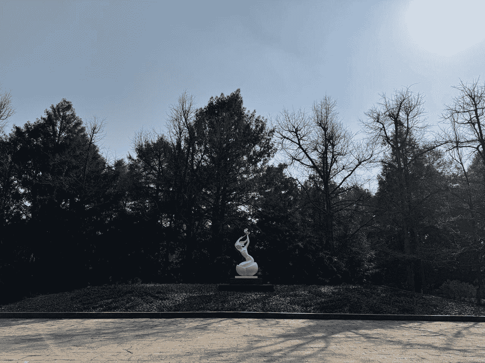
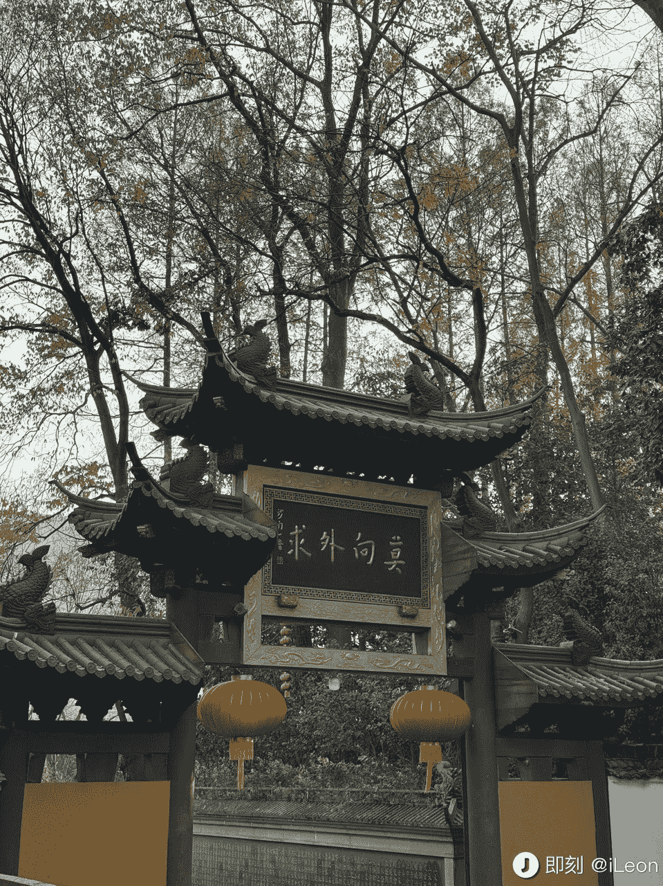
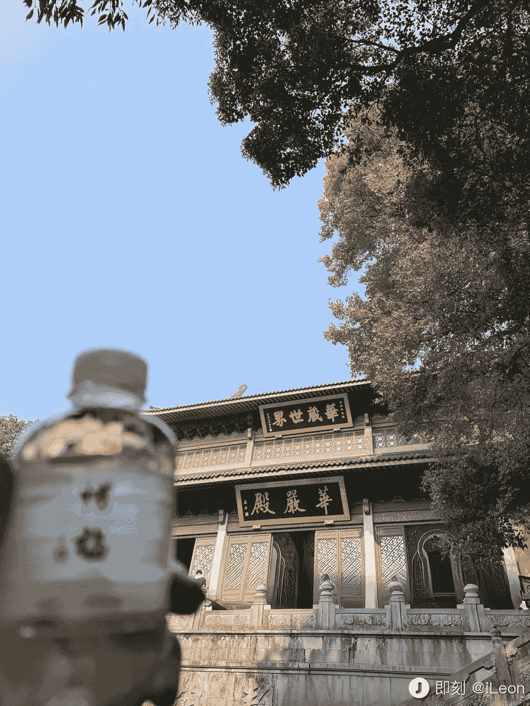
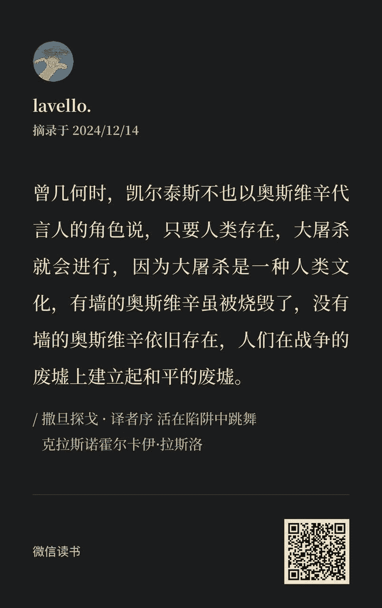

# 202412｜莫向外求

> 来源：[https://leonzhang.feishu.cn/docx/KShldrXPuoRCLmxnnQRcWDFyncd](https://leonzhang.feishu.cn/docx/KShldrXPuoRCLmxnnQRcWDFyncd)

> What doesn't come from the heart can't bring about real change.  发自内心的改变才能成真。

### 最近经历

#### 生活

**1**

真正的自爱不仅仅是短暂的物质享受或表面上的心理安慰，而是更全面的自我接纳、成长与呵护。

**2**

阿珂：其实反倒是很多没有上院线的小众非商业片，更值得反复看，写一些感想，如果能养成习惯也不错，但是那需要花很多时间慢慢积累了。

> 阿珂的《不科学观影手记》：

1.  《周处除三害》｜2024.12.09

1.  《模仿游戏》｜2024.12.11

起初是和阿珂聊起电影《周处除三害》，后面扩展到写观影后记，我之前很少主动做这样的行为，即便有也不多，内容也很浅，但是执行力强的阿珂就很快的写完了 《周处除三害》｜2024.12.09  ，这里 Mark 下。

**3**

**Procrastination is the thi**ef of time. 拖延会盗走时间。

#### 工作

**1**

减少解释，就能减少冲突。

**2**

脑子乱的时候，真的很难想清楚事情，感觉大脑是空白，是别人的！

### 最近观察和思考

**1**

莫向外求。

|  |  |  |
| --- | --- | --- |

**2**

|  |
| --- |

有次阿珂告诉我说，“有时候读读一些晦涩的东西还是很能刷新认知的”，然后我便联想到不知道从哪里看到的一句，“读书就是读自己，是自己认知在书本上的映射。”

在工作中，经常会遇到一些人，不知道从哪里听到的烂大街的一句没有上下文的话，然后就被他奉为“真理”，并在工作中不断强调。比如“把用户当做小白”，

当然，不仅局限于工作上，生活上也适用。

**3**

看 AK 的视频，我在想，“有没有可能，字节会重新重视起手机业务？”

另外，老罗他们的明显感受应该是，如果没有硬件（手机）入口作为支撑（唤醒、网络、算力等），单靠类似 AI 眼镜、AI 耳机形态的「配件」，很难有更好的体验。当然，我相信这点是他们团队的重点考虑项之一，也是 JARVIS ONE 存在的重要原因之一。

这么感受下来，老罗还真有可能重新做手机。嗯，希望如此。（这么重视体验怎么可能会放弃硬件？!

> 【贼高效的 AI 用法 你不会就落伍了！】 贼高效的 AI 用法 你不会就落伍了！_哔哩哔哩_bilibili

### 最近在听、在看

#### 播客

**1**

> 不合时宜 X 李翊云：在中文与英文之间，在中国与世界之外

如果你发现写作中，有多余的文字，可以尝试去掉它，或者尝试换一种句式表达。

1.  写作是无限接近完美，但永远无法抵达的过程。

1.  写一本书不难，难的是写一辈子书。

1.  写作是无法教会的，但可以教阅读，教如何“写句子”。

1.  “你每读一个在世作家的作品，就也得读一个已经死去的作家的作品。”

#### 文章

**1**

> **投**资人黄海｜从内卷到创新：2024 中国商业洞察 | 对话梁宁： https://mp.weixin.qq.com/s/bh5D0cQaA2nqzWRsJE2l2A

1.  关注「系统思考」，不同的系统目标会导致截然不同的结果。

1.  世界有序运行的三大系统

1.  法律，设定底线。

1.  市场，主导资源分配。

1.  金钱，以获得钱的目标导向去做事。

1.  流量和数据，更为复杂的驱动力。

1.  牧羊人，“逐水草而居”。内容创作者也是一样，随时根据流量的变化而调整自己的内容方向。他们不会停留在没有流量的地方，而是不断追逐热点话题。

1.  拼多多的市场有效性。

1.  拼多多以「成交转化率」为核心的排序系统来优化平台的运营，让商家适应平台的规则，最终促成了以价格为唯一竞争标准的市场环境。

1.  为何中国的企业往往倾向于通过价格战来竞争？因为当前中国商业最突出的现象之一就是同质化和高度内卷。标准化商品在市场上的差异较小，而价格的变化就能直接影响购买决策。

1.  胖东来商业模式是，精心经营超市作为引流，然后通过商业地产模式变现。这种情境下，供给和需求哪个更为重要？

1.  **供给重要。因为**需求是公共的。关键在于胖东来供给侧的独特性，所以消费者放弃了淘宝、京东、抖音。

1.  《真需求》中对“关系”的层次区分为需求、喜欢、认同和归属四个层级，。

1.  《真需求》一书的扉页写道：“市场中的万物，无非是世人的需求”

1.  创造功能价值需要工具思维，但如果要创造情绪价值，就必须具备玩具思维。

1.  工具思维是客观的，价值在于解决实际问题，而玩具思维则是主观的。

1.  一个问题：你做手机，是在做一个工具，还是在做一个玩具？

1.  此处可以类比国产安卓手机和 iPhone，英伟达与泡泡玛特，甚至安克的充电宝（收藏价值）。

**2**

> 范米索｜入坑养猫： https://mp.weixin.qq.com/s/Lnv3XQgGjNNe29WCaTLTYA

**当**你没有开始的时候，你能找到无数个理由不做那件事，可是当你选择开始的时候，你能找到无数种方法去解决过程中的困难。

你会发现真正选择开始的时候，那一刻，你的思维会跟着彻底发生扭转，而你的生活也会因为你的某种「开始」而产生改变。

**3**

> 刘言飞语｜多维表格，从点子到产品的新范例：  https://mp.weixin.qq.com/s/nmnJ0YJXiibieSqXVRRW_g

“不像有的职位，名字里有经理，其实也不管人也不管事儿，就是写文档的。”——刘飞

**4**

> 产品沉思录｜SP04。放弃焦虑，意味着忽略来自未来的信号：https://mp.weixin.qq.com/s/5sCE5KzHwJnGO92AVUaSQg

放弃焦虑，意味着忽略来自未来的信号

焦虑不是敌人，是提醒我们关注来自未来的信号。提醒我们注意未来的不确定性，并促使我们行动。

#### 视频

**1**

> [一切文学，余爱以血书者！鲁迅为何最爱](https://www.bilibili.com/video/BV1Us1MYZEW8/?share_source=copy_web&vd_source=672ec070780ce29c890256a5fabe799b)《孔乙己》？_哔哩哔哩_bilibili

1.  “世上本没有路，为之牺牲的人多了也便成了路。”

1.  “绝望之为虚妄，正与希望相同，于无所希望中得救。”

1.  “自己被人凌虐，但也可以凌虐别人；自己被人吃，但也可以吃别人。一级一级的制驭着，不能动弹，也不想动弹了。”——《灯下漫笔》

看这个视频学到一个新词，叫「叙述性诡计」，是推理小说的写法之一，而且这个博主很厉害，给了我一个新视角，我很小时候看，根本没有意识到，比如是跑堂小二的第一视角，这就造就“我”的观点是很片面的，“我”作为第三人称视角叙述的孔乙己，而作为看书的读者也是如此（牛哇，很高级的手法！！

**2**

> [堵住祥林嫂诉苦的嘴，然后呢？细读](https://www.bilibili.com/video/BV1LAmtYaEci/?share_source=copy_web&vd_source=672ec070780ce29c890256a5fabe799b)鲁迅《祝福》_哔哩哔哩_bilibili

祥林嫂每一次被伤害都源于她曾极其信任的一方，有夫权、族权、神权，被人害，在他人的利益关系间游走，直至遍体鳞伤，甚至被摧毁。

1.  **夫权**：祥林嫂第一任丈夫去世后，她她被逼改嫁，成为被买卖的“工具”，完全没有对自身命运的掌控权。她的信任建立在传统婚姻制度上，却也最先被婚姻制度伤害。

1.  **族权**：她的改嫁就是族权强加的结果之一。族权不仅决定了她的婚姻，更在社会舆论的裹挟下，将她的生活一步步推向深渊，即便她竭尽全力劳作、试图融入族群，也难逃被看作异类的命运。

1.  **神权**：在她失去儿子后，唯一的精神寄托变成了宗教，希望通过捐门槛来洗刷自己的“罪孽”，但无论是捐门槛还是忏悔，都未能带给她救赎，反而让她更加绝望。

所以，你能说祥林嫂只是在抱怨，没有思变、求变嘛？她的每一次信任、每一次付出，都是她想要尽全力抓住的希望，可每一次信任都在这种权利结构中被无情的辜负，而过程中她曾信任的对象，无论是家庭、族群、宗教，这些本应庇护她的对象，都在不断地向她索取利益，然后假惺惺的递上她以为的希望，实际却是稻草，让她摔了一次又一次。

“‘神权’许诺的赎罪券，从来只是信奉实利的规则制定者们，为自己方便行事留存的‘后门’，而不是为了真的给这些被统治者们，找一条脱离苦海的生路。” 视频中的这一句，好像是祥林嫂那双在冬天街里游走的冰凉的手，给了我一巴掌，她想要打醒我。

上学时期也曾学到这篇内容。我是真的笑不出来，她已经被迫害这么惨了，我们为什么还要嘲笑她？她的几乎每一次求变都能要了她半条命，可她还是扛住了，最后的她是真的没有希望了，她不知道还能怎么样做，我也不知道还能怎么样做。

当时一直想不通，为什么大家都不愿意帮她，反而加害这位受害者，甚至说她有罪？后来的一句「受害者有罪论」，更能看出作为看客的用心险恶，不这样做，怎能衬托他们的“高尚”？怎能减轻他们作为看客没有伸出援手而导致的罪恶感？

无论如何，清醒的死都比糊涂的活更重要吧。

**3**

> [5](https://www.bilibili.com/video/BV1tY6wY8Ebp/?share_source=copy_web&vd_source=672ec070780ce29c890256a5fabe799b)2 岁农民工冲上热搜！耗时 15 年，走访 18 国，多位科学家揭示最残酷社会真相：我们为何无法摆脱贫穷？_哔哩哔哩_bilibili

废掉一个人最快的方法就是让他**闲着**，另一种隐蔽的方法是让他们**忙**到没有时间成长。

延迟满足：一个有自控能力的人能够抵挡眼前的诱惑，则更容易成功。

**稀缺心态与思维带宽**

贫穷的本质是消灭一个人的未来。 —— 乔治奥威尔

1.  稀缺心态** **让他们忙于眼前的窘迫，进而无力思考未来，更无力为未来布局。

1.  人的意志力一旦耗尽，就会想要把轻松的事情留给今天，把困难的事情留给明天。—— 这不就是拖延症！！

1.  思维带宽是指，一个人能够关注的事情也是有上限的。

1.  有趣的实验。非洲蔗农在收获前的智商对比收获后降低了 13 IQ 点（背景：一次甘蔗的收入占比全年营收 60%）

相对贫穷，单向度的人 ｜《单向度的人》马尔库塞

+   **单向度的人：**发达的工业技术，利用技术创造并满足了人们的物质需求，为大众创造了一个不自由但舒适的生活环境。人们的个性和认知被限定，批判力丧失，物质水平成为了衡量一切的标准，人人都成为了单向度的人。

+   **虚假需求**：指发达工业社会，利用媒体、广告等手段对大众进行有道和洗脑，让他们产生并非真实、及必须的需求。

马尔库塞：发达工业社会已蜕变为一个新型的集权主义社会。

**因**为真正让我们感到痛苦的不是贫穷，而是对比。人的欲望是无止境的，富裕就像吊在毛驴面前的萝卜，让人永远心存希望又永远可望而不可及。

“贫“与”穷“是两个完全不同概念的字。

1.  贫，分为”分“与”贝“，代表分配金钱的能力。家徒四壁、衣不蔽体，是为贫。

1.  穷，分为”穴“与”力“，表示的是有限的空间内无法施展拳脚。有德行无法施展是为穷。

世界上最为快乐的事情，就是为了爱和理想而奋斗，而不是金钱而奋斗。哪怕是贫穷，也是贫而不穷。

**4**

> 【 听听这些歌，看你的眼泪能坚持到第几首？（下架重传）】https://www.bilibili.com/video/BV13t411s7WU/

都是青春的印记呀，几乎每一首都听过。

#### Live 现场

<https://leonzhang.feishu.cn/sync/Iv7ZdMGaBsyuHLbBRRDcqS2InBc>

1.  【【张学友】4K 重制【2004 活出生命演唱会】最新修复技术 无瑕疵和人工痕迹】 https://www.bilibili.com/video/BV1nK4y1R7cr/

1.  【【梦幻联动】-林俊杰&李健《传奇》神级现场！】 https://www.bilibili.com/video/BV1HrzZYBES2/

1.  【【4K60FPS】邓紫棋《手心的蔷薇》全场大合唱现场！还有神秘嘉宾亮相观众席？】 https://www.bilibili.com/video/BV12f4y1u7TL/

1.  【【4K60 帧】单依纯《永不失联的爱》｜全网最高画质】 https://www.bilibili.com/video/BV16emtYgEVP/

1.  【【如果爱忘了】战歌起！汪苏泷+单依纯=神级 rap+神仙转音】 https://www.bilibili.com/video/BV1hmyUY3Ex6/

1.  【【4K60 帧】单依纯《let me go》｜全网最高画质】 https://www.bilibili.com/video/BV1yp2JYQEWn/

### 相关阅读

1.  [阿里云 2024 Al+ 硬件创新大赛 决赛日](https://leonzhang.feishu.cn/wiki/K27NwA59CiesoGkAfG3cBZHTnhd)