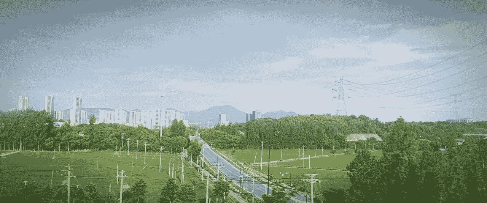
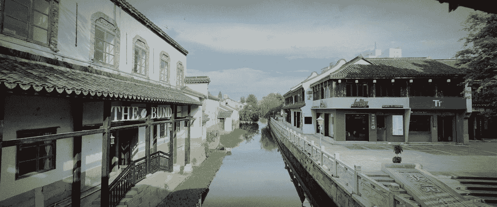
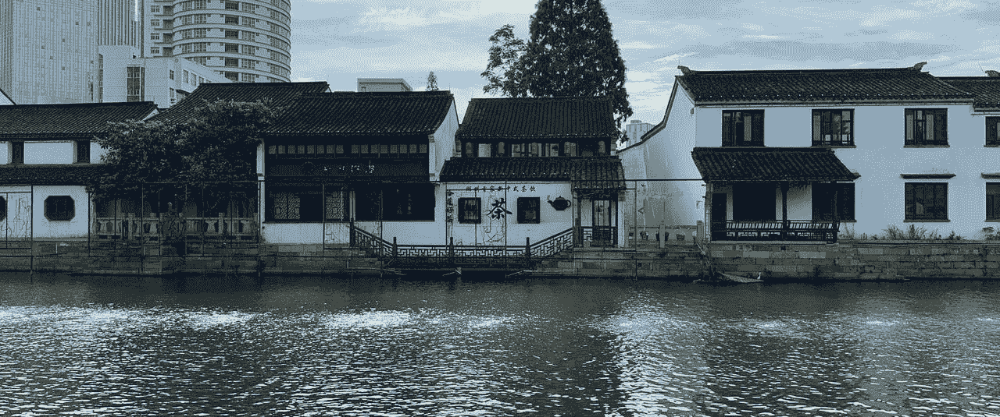

# 202407｜静下心来，去做你该做的事情

> 来源：[https://leonzhang.feishu.cn/docx/Ub7OdaNNdojzJuxPLYZcAZ0onfg](https://leonzhang.feishu.cn/docx/Ub7OdaNNdojzJuxPLYZcAZ0onfg)

Leon Zhang, Sep. 10, 2024

#月度总结 #个人成长 #Life Blog

> 如果有事情放着，那就立刻去做，不要让烦恼和焦虑，毁掉你本就不多的热情和定力！

## 最近经历

> 成年人和未成年人最大的区别是，**成年人得自己收拾烂摊子**。为什么觉得自己活得累？因为一直不收拾自己的烂摊子。

### 生活

**1**

史铁生：“**拖延最大的坏处还不是耽误，而是会使自己变得犹豫，甚至丧失信心。不**管什么事，决定了，就立刻去做，这本身就能使人生气勃勃，保持一种主动和快乐的心情。”

**2**

**三个数字快速入门中国茶：126**

1.  **1 棵茶树**：一棵茶树的鲜叶可以制作任何茶类，茶叶的颜色取决于制作工艺，而非叶子的嫩度。

1.  **2 种茶树品类**：

+   **茶种（小叶种）**：叶长 3-5cm，主要分布在中国，特点是香气高扬、滋味柔和。

+   **阿萨姆种（大叶种）**：叶长 10-30cm，分布在云南、印度、斯里兰卡，特点是滋味浓强、内含物质丰富。

1.  **6 大茶类**：

+   **绿茶**：普洱生茶、龙井等。

+   **白茶**：福鼎白茶、政和白茶等。

+   **黄茶**：蒙顶黄芽。

+   **青茶**：闽北乌龙、岩茶等。

+   **红茶**：正山小种、滇红、祁门红茶。

+   **黑茶**：普洱熟茶、安化黑茶。

**茶类特点**：

+   绿茶和红茶是两个氧化程度的极端。

+   白茶、黄茶、乌龙茶发酵程度不同。

+   黑茶是独特的发酵茶，口感醇厚柔和，主要以木质调、陈香调为主。

**茶品牌命名规则**：

+   以地名、茶外形、茶品类或茶树栽培品种命名，如六堡茶、黄山毛峰、大红袍等。

**3**

想寻求帮助？**你得证明自己值得别人的帮助。**

**真正帮到你的也不是你的“贵人”，而是在兴**趣驱动下，你不计回报的，持之以恒的投入。

**4**

龙哥（李尚龙）说过：“在大城市里，搞废一个人的方式特别简单，给你一个安静狭小的空间，给你一根网线，最好再加一个外卖电话。好了，你开始废了。”

**亚里士多德曾说：“在追求快乐上和动物**相比，人追求的快乐应该更高级和伟大。” 多巴胺是动物性的爽感，但久而久之只会消磨你的时间，让你的人生变得空洞乏味。 内啡肽是痛苦后的补偿，需要你费尽心血才能得到，却能为你带来脱胎换骨的改变。

**5**

**有时候我们会面对没有好选项的情况，怎么选都错，所**以你就做出当下最好的选择，然后别再懊悔。

每段关系中都会有人犯错，你能做的就只有道歉，希望自己学到了这一课，然后往前看，人不能走回头路。

**深呼吸，不冷静**就会犯错，眼前的事情也看不清楚。别着急，慢慢来。

**6**

余华：“在夜深人静的时候，把心掏出来，自己缝缝补补，然后睡一觉起来，又是信心百倍。” 无人问津也好，技不如人也罢，你都要安静下来，去做自己该做的事情，而不是让烦恼和焦虑，毁掉你本就不多的热情和定力。

### 工作

**1**

周末的时候想到，想要找一个类似大学用的超级课程表一样的东西管理每天、每周的工作，测试了好几款应用。发现，不是要求不符合，就是 UI 不喜欢。

本来打算妥协到用日历。结果最后发现，飞书日历就是最合适的产品！！感谢飞书！

**2**

作为一名作家，当你笔下的人物和你一起生活、不陌生，你的写作就比较称职了。 —— 崔永元

对每一个讲者的态度，都抱有足够的怀疑态度， 不是针对一人一事。而是针对世间万物的规律、节奏，甚至秩序，这样才能建立独立观察、独立表达的心态。

**3**

人**会由于无知，每天会活在极度的幸**福中。人在知道很多事情以后，幸福感就没有那么强烈了。虽然是可遇不可求的幸福，但终究是“无知导致的无畏”。注意，“无畏的精神”还是要有的。 —— 罗永浩

## 最近观察和思考

> 深呼吸，不冷静就会犯错，眼前的事情也看不清楚。别着急，慢慢来。

**1**

想要买电纸书，看了好久后发现，总有些需要不能被满足。比如想要记录想法的时候没办法通过键盘来记录，打字的话，我还是比较喜欢使用实体键盘打字并记录。

我试过微信读书的 Web 端，不尽如人意，最后发现，微信读书从 Mac 下载 iPad 版本看几乎是最好的解决方案。

**2**

失败计划 +1：减肥之「生酮减肥法 + 间歇性禁食（16/8）」

1.  生酮饮食（也称为生酮减肥法）是一种低碳水化合物、高脂肪的饮食方式，旨在使身体进入一种叫做“酮症”的代谢状态。在这种状态下，身体主要依靠脂肪而不是碳水化合物来提供能量。

1.  16/8 模式为间歇性禁食方法的一种，即每天 8 小时进食，其余 16 小时禁食。

我按照要求（每天有 16 小时禁食**，8 小时进食）设定好了进食与禁食时间：选择上午 **10 点至晚上 6 点为进食时间段，晚上 6 点到次日上午 10 点为禁食时间段。

但是生酮饮食，除非自己带饭，否则很难做到每顿都是高脂肪（坚果）、中等蛋白质（鸡肉、牛肉、鱼和鸡蛋）、低碳水蔬菜（西兰花、菠菜、甘蓝），然后我就选择尽量吃快餐的时候，吃这些。

最后放弃是我发觉自己的胃出现了问题，开始拉肚子，被折腾到受不了，先放弃，等胃好些的时候再开始。

**3**

“产品交付的是体验，不是技术。” —— 看到这句话，心中便五味杂陈，身边有太多这样的例子。

拿苹果 AI （Apple intelligence）和微软 AI（Artificial intelligence）举例，一个是「具体的、确认性」的场景深度整合，另一个是「大而全，能给你就都给你」，看起来微软给的更多，用户能做的事情更多，但结果你会发现，前者可能是你未来会重度用，而后者只有少部分人在用，毕竟后者的使用门槛更高。

微软之前发布了 AI Copilot，“大而全”，给你的选择更多，比如举例是在你写邮件的时候旁边给你贴个对话框，但是邮件这种东西是很个性化的东西，当你发现你本想用它来提升效率，结果却发现它不仅没有让你提升效率，反而带来了更多的麻烦，比如修改、多次 Prompt 输入等等。有那个时间和精力，自己早就写完了不是？!

WWDC 上，苹果介绍了自己的 AI（Apple intelligence），苹果对它做了足够多的限制。同样的场景举例，苹果做的是，通过选择你写好的邮件，可以选择通过 AI 进行润色或者修改语法等等。你看，明显苹果这个处理方式就好很多。

当然，你可能也会说，虽然这种没什么高明，国内很多 AI 都能做到，比如豆包的 Mac 端。但不可否认的是，这种使用效果和结果，就是会优于前者微软所描述的场景，同样的，苹果 AI 的使用频次也会增加。

在大模型不是那么可控的前提下，让它做更确定的事情，反而是一种高明的选择，正所谓 Less is more。

## 最近在听、在看

> 人最大的痛苦，就是无法跨越知道和做到的鸿沟。——罗翔

### 视频

**1**

【一口气看完 4K 画质神作《拉布雷亚》【第 1-2 季节】讲述一家人因为一场突如其来的意外被迫分离，努力获取新生的故事！】 https://www.bilibili.com/video/BV1no4y1J7hr/?share_source=copy_web&vd_source=672ec070780ce29c890256a5fabe799b

我是想要帮你 xx，但你干坐在这里可帮不上一点儿忙。

我只需要知道，你是否真的准备好面对自己的恐惧了？

我觉得，如果你将一个人痛打一顿，但他却还愿意回来帮你。那你就得相信，那个人真的很在乎你。

**2**

https://www.youtube.com/w**atch**?v=MK_DInt6hAM  罗翔老师

**人要接受自己的有限性**。人承认自己是有限的。于是成为你的逻辑、理性、阅读都是有限的，承认整个人就是在偏见之中。人的一生就是在走出偏见。

**人最大的痛苦，就是无法**跨越知道和做到的鸿沟。虚伪是肯定的，每天活不了那么清澈。行动能在言语之前多一步，在一定程度上就可以摆脱这种虚伪的自我控诉。

从某种意义上讲，人能真正影响的人，其实很少很少。很多人被你影响，其实是片刻感动了，最后还是投入到自己的以前的生活。人多数是在片刻的感动，而不可能持久的感动。你能真正影响的人，一定是愿意在他身上，投入大量时间的，与你有真正的接触的。

苏格拉底，“对你真正懂的东西，你才会真正地认同；对于你不懂的东西，你不可能会真正地认同。”

理念上的乌托邦是有意义的，现实上的乌托邦是没有意义的。我们画不出绝对的圆，无法追求到绝对的美，但是你不能推导出，“这个世界没有美、这个世界一切都没有意义、人的存在是没有意义的”这类命题。复杂是一定存在的。只不过当人们无法理解这个复杂的世界的时候，更喜欢理解为是一个简单的世界。

苏格拉底唯一的智慧是否定性的智慧，承认自己的无知。

**3**

深扒 AI 帝国 Nvidia 崛起的真相，黄仁勋是如何一次次言中未来的 ：https://www.youtube.com/watch?v=WrMSc5dlWNs

**黄仁勋**

1.  “整个世界是相当复杂的，如果你把世界定义窄了的话，你的战略布局就已经窄了。”

1.  “自己的期待值很低。期待值很高的人，往往韧性比较低，不幸的是，韧性对于成功来说至关重要。”

1.  跑起来别用走的。不管是为了寻找食物而跑，还是为了避免成为猎物而跑，无论什么原因都要跑起来。

**4**

https://youtu.be/scA1qYR0krU?si=YSFIFN8_IIS5d2V3

当前社会，民营经济占社会发展的比例，超过 50% 的 GDP 比例，超过 60% 的投资，超过 70% 的税收，超过 80% 的就业，超过 90% 的科技。

为了维护社会的进步，企业家要做大量的公益，原因是要消除贫富差别。洛克菲勒 · 卡内基说，当富人变富之后发现，穷人没有同时富起来的时候，就会破坏富人富有的社会条件，比如革命、战争。

让穷人也富起来，才会让这个社会平和，至少让穷人有机会。他们在向穷人“授人以鱼”到“授人以渔”，让他们有生存和上升的条件，因此企业家群体在创造另外一种社会制度和社会存在方式。比如美国福特、洛克菲勒、巴菲特、比尔盖茨都是在疯狂的做社会公益。当特朗普在 2017 年宣布给富人减税的时候，甚至富人联名告诉特朗普政府，不要给富人减税，因为他们认为如果不能建立一种良好的社会制度的时候，富人既有的财富就会随时发生危险。

有时候知识对于一个人的意义和价值就在于，因为了解更多知识，知道自己在这个世界上的位置，然后整个世界都会宽广。

### 播客

**1**

**42 章经｜** 拒绝三亿美金 offer 的人｜对谈音遇创始人 Albert

https://www.xiaoyuzhoufm.com/episode/6505cb5496875579717a1369

1.  最好的创始人是不会输的，除非他们自己认输。

1.  华为说的以用户为中心，说的是交付的问题，商业化就是交付，交付就**是解决用户的问题，就是让用户掏钱。—— 这句话让我想到之前华为余承东说过类似的话，大意是华为的**考核从来不是靠 KPI，而是 NPS（净推荐值）。 NPS 体现了用户行为和整体感受，同时又反映了用户的对品牌的忠诚度。

1.  **稀缺是人类进步的动力**。

**2**

**于无声处 InSilence｜**德鲁克管理学：一个美国人的成圣之路 E.12

https://www.xiaoyuzhoufm.com/episode/6674007cc26e396a3629f097

德鲁克强调，我们要做正确的战略决策，而不是令人眼花缭乱的战术决策。

1.  德鲁克的回忆录：7 件小故事

1.  **如果我能长寿，我将永不放弃，同**时我还会**追求完美，尽管非常清楚**，完美总会躲着大家。—— ”生命不息，折腾不止“

1.  当有人问起德鲁克哪本书最好的时候，德鲁克一般都会回答是下一本。

1.  **持续学习，构建自己的知识体系**。每隔三年，就会再去研究一个新领域，过程并不断内化为自己的知识。

1.  **按照周期去制定计划、复盘计划**。递交自己未来 6 个月内的工作和学习计划。

1.  在一个新岗位上，要做出哪些改变、哪些新的事情，才能取得成效？理论上每次你要做的事情其实都是不同的，不要沿用过去的那一套认知来做事。

1.  不断复盘，不断强化自己的长处，规避短处。当要做出一个重要决策时，先把自己预期的结果记下来，在 9 个月后再用实际结果进行对照。

1.  第一，我们必须问自己到底想要留下一个怎样的名声。第二，答案会随年岁增长而改变，它会随自己的成熟以及外部世界的变化而改变。第三，只有改变了别人生活的东西才是值得纪念的。

1.  **德鲁克管理学概述：**管理学是什么？管理是关于人类的管理，使人之间互相协调、扬长避短，发挥最大的集体效益。

1.  **什么是管理者**？一位知识工作者能够凭借他的职位和知识对组织有贡献，因而能对组织的经营能力和达成的成果有实质性的影响，那他就是一位管理者。

1.  **卓有成效可以学习吗？****首先全才是少之**又少的，因此我们只有通过改进工作的手段来发挥人的能力，而**不应该寄希望于人的能力突**然提高。有效的管理者各不相同，但他们唯一的共同点，就是具有做好该做的事情的能力。

1.  卓有成效的 5 点要素（需要**勤奋的练习**）

1.  **善用有限的时间**，重视对外界的贡献，为成果而工作。

1.  善于利用长处，包括了自己、同事、下属甚至是上司的长处。

1.  不要把工作建立在自己的短处上，也绝不会去做自己做不了的事。

1.  把精力集中于少数重要的领域。

1.  善于做有效的决策。有效的决策是在不同意见的基础上去做判断，不存在所谓一致的意见。

**3**

十字路口｜[“我想击碎你们对于 AI 不切实际的幻想，并重建一个正确的认知](https://www.xiaoyuzhoufm.com/episode/6692529b37236c546edd4b2f)”| 对谈李乐丁，战壕里的百度主任架构师

https://www.xiaoyuzhoufm.com/episode/6692529b37236c546edd4b2f

只有在战壕里面的人，才能听得到炮火的声音；并且，只有经历过同等规模战役的指挥官和架构师，才听得懂炮火声中的深意。

关于 Al 的幻想太多，理性太少。不被击碎的幻想是泡沫，击碎的幻想就可能是机会。

**4**

**出海相对论｜**[#](https://www.xiaoyuzhoufm.com/episode/6498731bd6cdb59728575bc9)7 苹果 Vision Pro 发布，空间计算时代来临？对话全球销量第一 AR 眼镜品牌 XREAL（原 Nreal）联创金鹏

https://www.xiaoyuzhoufm.com/episode/6498731bd6cdb59728575bc9

**5**

一席｜[把孩子培养得那么有独立观点，他会](https://www.xiaoyuzhoufm.com/episode/669a1c3a37236c546e475d8f)不会成为不合时宜的「杠精」？｜蓝方 一席

https://www.xiaoyuzhoufm.com/episode/669a1c3a37236c546e475d8f

**批判性思维****（Critica**l thinking）：质疑、理解、建设

强势的批判性思维，遇到问题后，不仅停留于去抱**怨、去发**泄、去质疑、去批判别人，而是能够**就事论事，**从事实出发、从逻辑出发，形成自己的判断和观点，用一种积极的姿态，参与到问题的解决。

遇到堵塞问题时，重新审视行为的目标后，有可能想出更多可能的手段，也更有可能从中找到更好的解决方案。

**批判性思维的训练路径**

1.  方法论为导向

1.  在学科教育、项目式学习、或议题讨论的场景（与书籍相结合）

家长担心：把孩子培养得那么有独立观点，他会不会成为不合时宜的「杠精」？

混沌而快乐的猪 VS。 清醒而痛苦的苏格拉底？ 幸运的是，在现实生活中，我们并不必然需要去做一个非此即彼、非黑即白的两难选择。

批判性思维更提倡的是一种明亮的对话，选择恰当的时机、恰当的方法、有理有据地去表达自己的观点，并提出自己的诉求。

**讨论的目标和意义**

说理这件事情是有前提条件的，意味着双方都把对方放在一**个平等的地位上，用一种开放的**谦逊的姿态，尊重事实、尊重逻辑、就事论事，承认自己是可以被说服的，承认自己的有限性。

在日常生活中，确实是对我很重要的人，在很重要的事情上蛮不讲理、**固执己见，应该如何**说服他？此时，应该要 抽离出来去思考一下，为什么他明明知道我说的是对的，但是却不愿意改， 也不愿意认错呢？他是卡在怎样的情绪里？有怎样的心理诉求呢？

尽可能地去尊重对方的感受，理解对方的情绪，再让对方感到被肯定、被接纳的基础上，再用非暴力沟通的方式去说服他。即便最后我失败了，但我非常清醒的知道这不是我的错，不是我的问题，而是对方他有他的课题需要去处理。

**“精致的利己主义者”**

永远都是在一个社会比较 和社会竞争的框架下 去确认自己的价值 害怕被比下去 行动的动力 总是来自于卷赢他人的冲动 而不是源于自己内心真正的渴望 真正的热爱 那最终的结果是什么呢 焦虑 倦怠 意义缺失

**6**

三五环｜No.155 对谈评论尸：「奶头乐」并不应该被批评

https://www.xiaoyuzhoufm.com/episode/669e67e38fcadceb90233099

内容平台三阶段：**文字、图文、视频**

过度依赖于已经结构化的信息来源，可能会错过一些非常有价值的内容。

“没必要批评「奶头乐」，人从动物进化到现在就不是为了吃苦。” 让一个没有疼过的人/公司，去预知未来可能会痛的经历是不现实的。

企业社会责任发展阶段：CSR - ESG - CSV

知识付费是一个纯粹的消费行为，消费者从中获得更多是乐趣，而不是知识。

关于 AI 发展，当前处在生产关系落后于生产力的过程中。

在工作之前，想清楚自己为什么工作？

如果公司没有上市计划，或者有上市计划，但没有股票及上市后不会破发。否则就不要轻易 996。钱给够了，对方就是你老板，没给够，你就是他老板。

如果公司没有给你除了钱以外的其他资源，以及钱还没有给够，那就是公司再求你办事。

“重新定义「顶层思维」”：即便是你在从事一个底层工**作，如果你觉得 CEO 不行，该走就走。不要在一个你无法**改变的系统里，为了保住工作而付出超额的努力，因为这个会让所有人的工作都更难被保住。

行业发展不行时，将把问题传达给基层员工，证明这个公司不行（最多传导到公司战略需要调整）。在公司战略没有调整，且没有验证战略是否有效的时候，让下属都把工作干满，首先是公司领导层不行，其次对员工也是更大的消耗。

### Live 现场

> 温馨提示：建议搭配降噪耳机，音量调至 50%-80%，尽量感受现场环境。若为夜深人静，更佳，enjoy～

1.  【【官摄】JJ20 苏州站丨林俊杰×胡彦斌《黑夜问白天》】 https://www.bilibili.com/video/BV1ry411q7zQ/?share_source=copy_web&vd_source=672ec070780ce29c890256a5fabe799b

1.  【【4K】林俊杰 -《愿与愁》《Like You Do》《不为谁而作的歌》新编曲 LIVE | 20240704】 https://www.bilibili.com/video/BV1wS411w7Qr/?share_source=copy_web&vd_source=672ec070780ce29c890256a5fabe799b

1.  【【4K 60FPS 修复】林俊杰《Lemon Tree》！EnJoy!  JJ20 演唱会兰州站-超清官摄】 https://www.bilibili.com/video/BV1qx4y1x7QU/?share_source=copy_web&vd_source=672ec070780ce29c890256a5fabe799b

1.  【仅此一版！李健&郎朗纯钢琴伴奏版《假如爱有天意》！】 https://www.bilibili.com/video/BV1u6421g7xC/?share_source=copy_web&vd_source=672ec070780ce29c890256a5fabe799b

1.  【【𝟖𝐊/𝟔𝟎𝐅𝐏𝐒】HDR 《疯狂动物城》主题曲 夏奇拉《Try Everything》4320P！】 https://www.bilibili.com/video/BV1cY411L7ws/?share_source=copy_web&vd_source=672ec070780ce29c890256a5fabe799b

1.  【【𝟒𝐊/𝟔𝟎𝐅𝐏𝐒】HDR《冰雪奇缘》主题曲《Let it go》Idina Menzel 版 2160P！我的手机有点卡！】 https://www.bilibili.com/video/BV1RR4y1L76K/?share_source=copy_web&vd_source=672ec070780ce29c890256a5fabe799b

1.  【国外声乐老师点评 林俊杰《不能说的秘密》REACTION】 https://www.bilibili.com/video/BV1CV4y1a7mc/?share_source=copy_web&vd_source=672ec070780ce29c890256a5fabe799b

## 延伸阅读

+   [三个数字带你快速了解茶的品类](https://leonzhang.feishu.cn/wiki/PIWJwtSCMi8qx7k3qMtclBxvnHg)

+   [AR 产品的另类之路：听觉增强 + AI](https://leonzhang.feishu.cn/wiki/Clt7wYBlFiwRlpkEFeqcoSJ4nXN)

+   [《如何成为一名优秀的设计师》 - 罗子雄](https://leonzhang.feishu.cn/wiki/Hjk5wdQNMi2O9ek6J6ccHvgYn4g?from=from_copylink)

+   [Notes｜罗子雄眼里的 VR](https://leonzhang.feishu.cn/wiki/WxR4wq9Rli8VAIkXqn2crV1GnRg?from=from_copylink)

以上，祝你早安、午安、晚安～