# 三个数字带你快速了解茶的品类

> 来源：[https://leonzhang.feishu.cn/docx/PdewdSyhLocM5AxkbpfcuinGnih](https://leonzhang.feishu.cn/docx/PdewdSyhLocM5AxkbpfcuinGnih)

Writer: Leon

Date: 2024/07/07

#个人兴趣  #茶 #Life Blog

> 本篇文档是学习茶文化的笔记，亦或是文末视频的图文稿。

> 126｜一棵茶树、两种品类、六大茶类

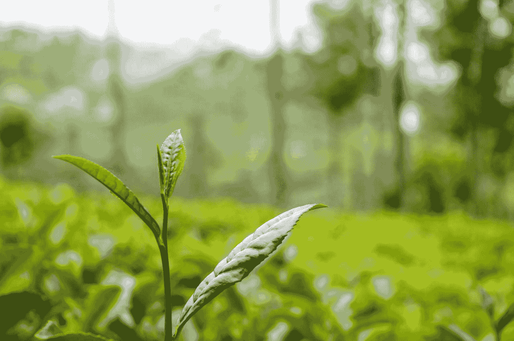

## **一棵茶树**

一棵茶树上的鲜叶可以做成任何茶，茶叶颜色不同，是不同工艺造成。

> 制茶讲究看茶做茶，并不是越嫩越好。根据想要的品质特征来选取相应的茶，而并不是稀缺越好。

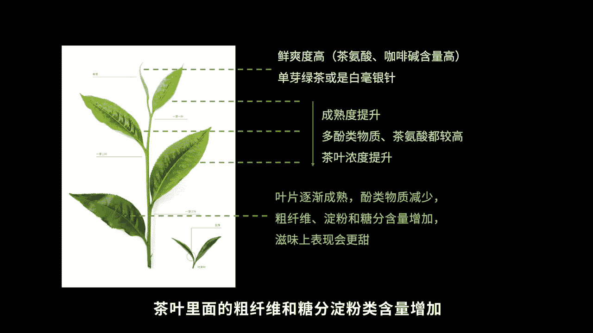

## **两种品类：茶种、阿萨姆种**

> 不同品种的茶树，茶叶的滋味和风格有非常大的差别。

1.  茶种（叶长 3-5cm，“小叶种”）

+   世界上种植面积最大的茶树品种（包括龙井 43 号）

+   特点：香气高扬、滋味柔和

1.  阿萨姆种（叶长 10-30cm，“大叶种”，生存环境怕冷）

+   原始品种，分布在云南、印度、斯里兰卡

+   特点：滋味浓强，内含物质丰富

滇红（大叶种，又称为“红茶味精”）、祁门红茶（小叶种）

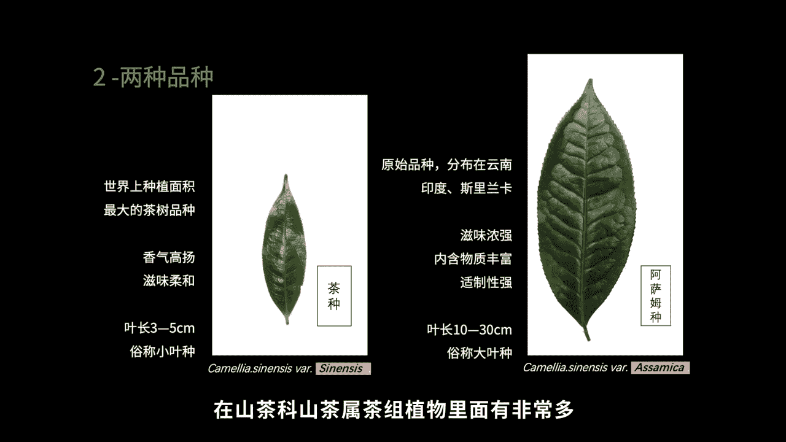

## **六大茶类**

1979 年，茶学大家陈椽先生正式提出将茶分六大类。既表明品质的系统性，也表明了茶叶制法的系统性。

1.  **绿茶**：普洱生茶、龙井、竹叶青、六安瓜片

1.  **白茶**：福鼎白茶 政和白茶 云南白茶

1.  **黄茶**：蒙顶黄芽

1.  **青茶**：闽北乌龙 岩茶 东方美人

1.  **红茶**：正山小种 滇红 祁门红茶

1.  **黑茶**：普洱熟茶 安化黑茶

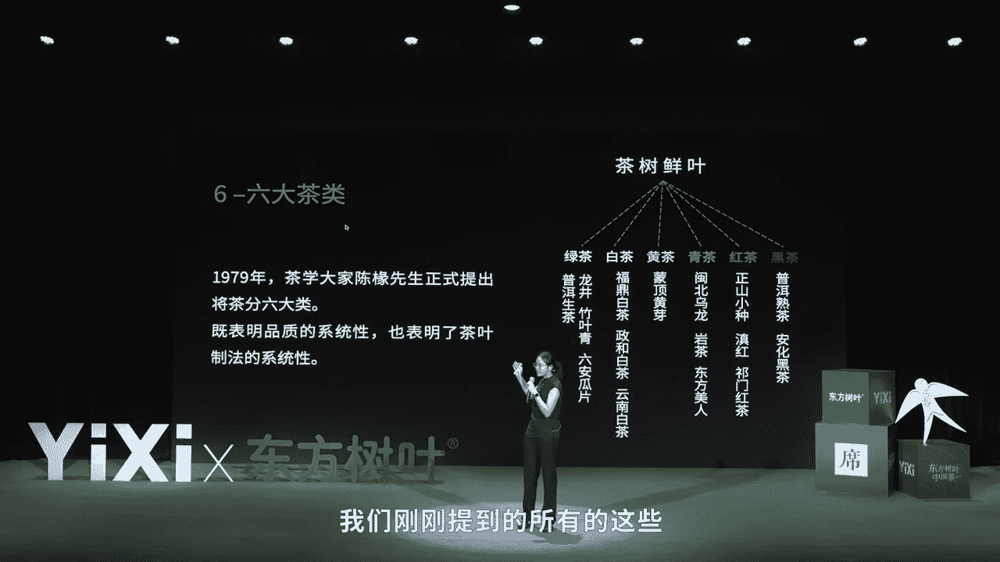

### 绿茶

> 清爽鲜甜，带有茶树本身的自然气息。

+   茶多酚

+   多酚氧化酶

+   高温 **阻断 **酶促反应

不同的干燥方式带来滋味上的区别。

+   **炒青**：豆香、板栗香

+   **烘青**：淡淡花香

+   **晒青**：茶香更内敛，森林清香

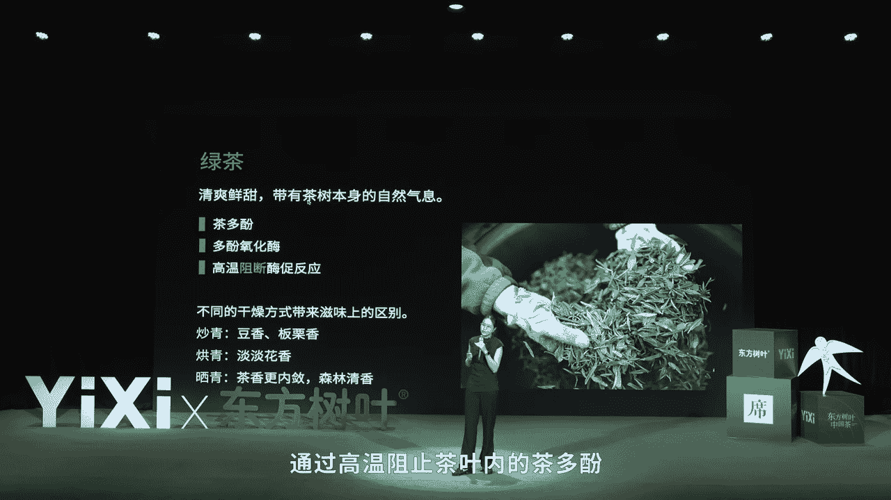

### 红茶

香甜，以 **正山小种、祁门红茶、滇红** 为代表。

> **绿茶 **是让茶多酚和多酚氧化酶 **永世不相见**，**红茶 **是让茶多酚和多酚氧化酶 **手牵手**。

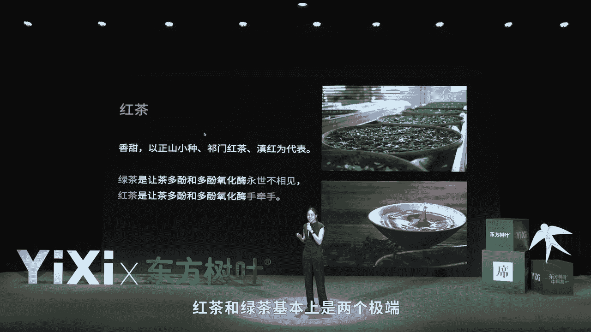

### 白茶

> 采摘下的新叶，摊放在温度和湿度都均衡的地方，自然风干。

在合适的情况下会有迷人的 **花香和奶香**，控温控湿不当，则会有**不愉悦的青草味**。

### 黄茶

> 在杀青后多了一道闷黄工艺。

**滋味比绿茶甘润，少了鲜嫩**感，有时呈现 炒豆香、锅巴香或是焦糖香。

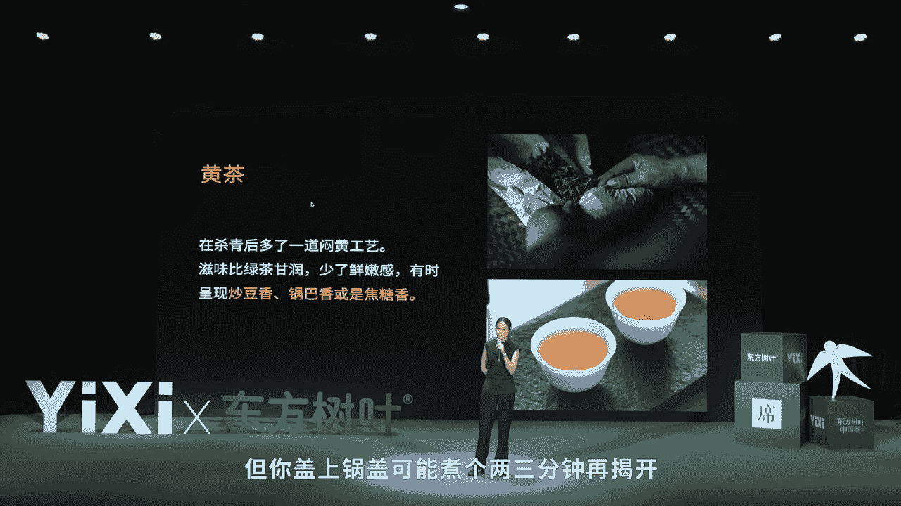

### 青茶（乌龙茶）

> 六大茶类中工艺最为繁复，香气也最丰富的茶类。

代表有 闽北岩茶、闽南铁观音、广东凤凰单丛（蜜兰香、鸭屎香）、台湾冻顶乌龙

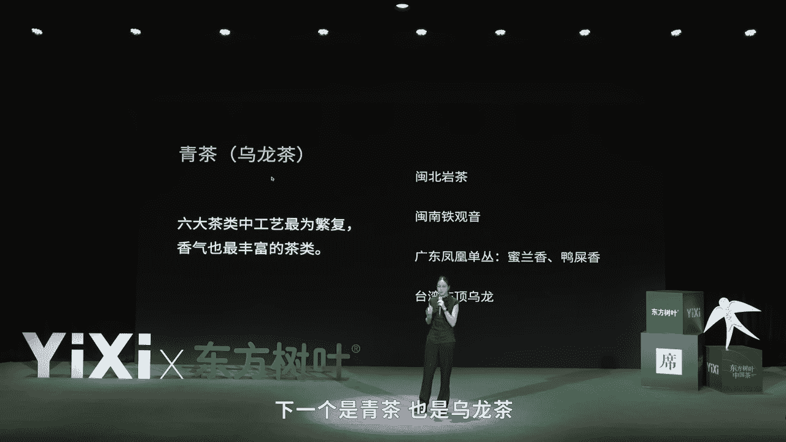

### 黑茶（发酵茶）

> 与其它茶类相比，是完全不同的感官体系。

黑茶（发酵茶）是不在氧化程度表里的一种非常有特点的茶（会长霉），与其它茶类相比，是完全不同的感官体系。比如有湖南的安化黑茶、普洱熟茶、四川的边茶。

+   **渥堆、发酵 **是形成风味的关键。因为渥堆、发酵工艺的加入，让黑茶更加地化物。

+   滋味醇厚柔和，香气不张扬，以 **木质调、陈香调 **为主。

+   热销于西藏、俄罗斯、东南亚、香港等地区

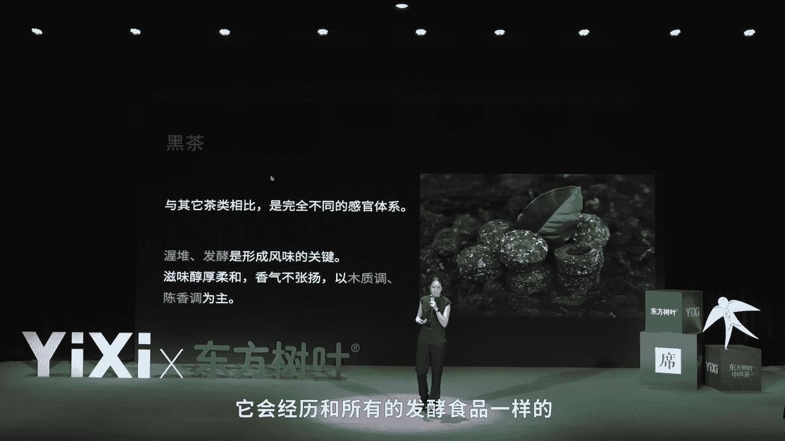

## 分类及茶命名规则

### 按氧化程度

根据 **氧化程度 **分类，绿茶、红茶是两个极端，而白茶、黄茶、乌龙茶，发酵是黑茶。

+   清淡口味：绿茶、白茶

+   茶味重：乌龙茶、红茶；更沉稳的木质调，选黑茶。

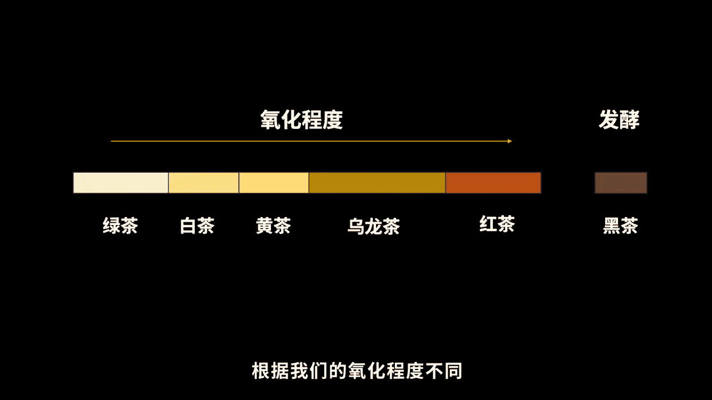

### 茶类风味地图

> 一杯茶的风味与哪些因素有关？品种、风土、工艺、冲泡

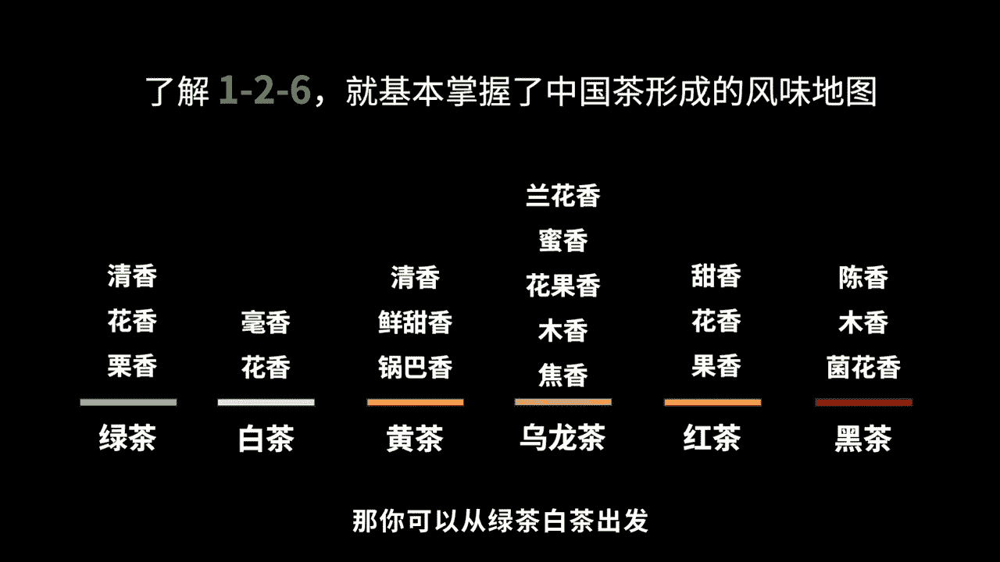

### 茶品牌部分命名规则

1.  地名 + 茶：六堡茶、龙井茶、普洱茶

1.  名称 + 茶外形：黄山毛峰、君山银针

1.  地名 + 茶品类：滇红、福鼎白茶

1.  茶树栽培品种：大红袍、鸭屎香

1.  特殊命名规则：安吉白茶（绿茶，因研制品种为白化品种）

## 最后

茶无法成为时代的解药，喝茶却是一次小小的胜利。

每个人都可以探索自己的饮茶方式，在大洪流中选择停下来，与土地重新联结，与人开始联结。茶作这块土地的原生作物，和中国人也有更为强烈而深厚的根基感，或许会成为另一个开端的可能。

+   茶 - 维基百科  https://zh.wikipedia.org/zh-cn/%E8%8C%B6

+   **【**一席】安然：给年轻人的喝茶第一课  https://www.youtube.com/watch?v=bvKp7KoCPWU

+   【央视纪录片《茶，一片树叶的故事》【共六集】】 https://www.bilibili.com/video/BV14W411u74B/?share_source=copy_web&vd_source=672ec070780ce29c890256a5fabe799b

+   【CCTV9 纪录片《茶叶之路》——了解”茶叶之路“的兴衰【全 6 集】1080P+】 https://www.bilibili.com/video/BV14Z4y1a7zu/?share_source=copy_web&vd_source=672ec070780ce29c890256a5fabe799b