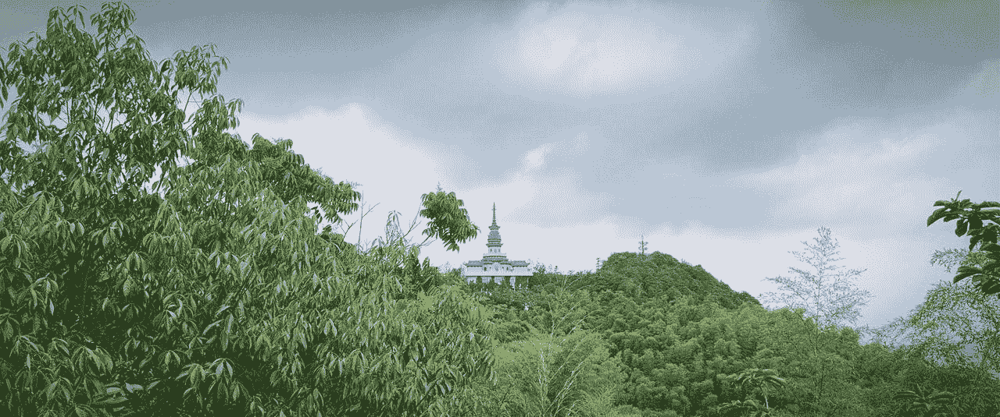
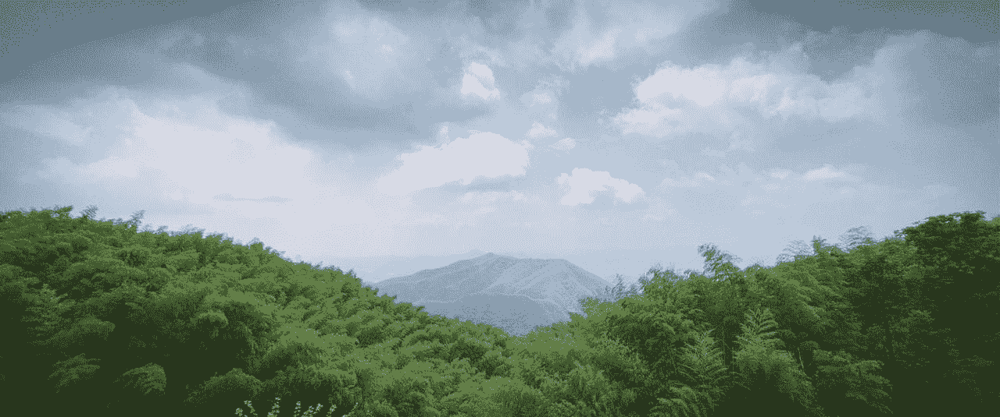

# 202405｜想清楚，做明白

> 来源：[https://leonzhang.feishu.cn/docx/VUPmdec9doHkeYxkp59c1yPqn6g](https://leonzhang.feishu.cn/docx/VUPmdec9doHkeYxkp59c1yPqn6g)

Leon Zhang, July 8, 2024

#月度总结 #个人成长 #Life Blog

> 人生没有一种经历是毫无意义的。

## 最近经历

> 当你没有选择的时候，没办法就是没关系，大胆去面对就好。

### 生活

**1 **

**上二休五**：或许对 Melisa 来说，上班才是休息，周末疯狂忙碌两天。

晚上洗澡的时候在想，或许自己的精神状态也应该是”上二休五“，即周末疯狂忙两天自己的事情（无论是学习、运动、社交），然后工作日才是换脑子、才是休息。

**2**

月中的时候整理下前半月的 Memo 内容。

1.  内容不完整，需要补充。很多内容只记录了关键词，并无详细记录，需要二次补充。

1.  减少工作量堆积的情况出现。防止不完整信息堆积太多，月底梳理时，工作量过大（之前一直有这样的问题，经常将问题堆积到月底统一去搞）。 #三省吾身

**3**

最近很喜欢用 Google Gemini，无论是我超喜欢的「Google 核查回答」，还是通过 Chrome 地址栏快速问答的快捷入口，都极大地提升了效率，增加了我的使用频率，前者保证正确率，后者支持快速打开。❤️

**4**

当你没有选择的时候，没办法就是没关系，大胆去面对就行。既然自己的努力无法左右结果，那就想做就做，不想做就不做。

**5**

雨珂  一个挺有意思的事，真的每个人只能看到自己眼中的世界。

> 杨天真做的那款节目，《展开说说》，邀请的 4 个嘉宾分别是易立竞、杨天真、傅首尔、杨笠，我那天看视频的时候有个弹幕说，怎么不管什么嘉宾来都是聊婚恋话题。

**6**

《北京折叠》 月中去北京出差，雨珂说，你是不是被“折叠”了。

**7**

看到 KK 每年在自己生日的时候写人生建议。我也在想，也许未来某年也会根据生日开始写自己的复盘？

毕竟，按照年份复盘是以一年为一个周期，按照自己生日复盘也是一个周期。

+   翻译：https://justinyan.me/post/5968

+   原文：https://kk.org/thetechnium/101-additional-advices/

**8**

5 月一个周末，与 Melisa 一起参加线下活动，活动是播客「公司茶水间」的线下分享会，主题是：被“卡住”的我们，还可以做些什么？

> **主持人及嘉宾介绍如下**

+   袁梦｜主持人，播客《公司茶水间》主播，辉瑞中国雇主品牌和校园招聘负责人

+   库索｜青年作家，资深媒体人，前《新周刊》记者。毕业于武汉大学新闻系，著有《纵身入山海》《离岛》等作品

+   翟志勇｜北京航空航天大学教授，博士生导师，社会法研究中心主任。看理想《法律通识》系列主讲人

+   安小庆｜彝族，记者、写作者，《人物》前主笔，毕业于南京大学中文系

老实说，当我第一眼看到这个主题的时候，就觉得有些「压抑」，虽然直面意思上感觉可能会提供一些新的想法/解法，想着人不仅要低头关注自己，还要关注世界。毕竟人在世界上生存，但又不想了解世界，这怎么能够呢？! 我也想知道大环境不好的情况下，大家的反应都是如何？应对措施又有哪些？

于是，打算过去参加学习一下，与 Melisa 一拍即合，过去学习一下～

当我现场听完之后，我的个人体感是好像有些传播/制造焦虑 🍌🟢 ，以下是我记录在 flomo 上的内容，

问题 1：被卡的时候，我们应该怎么做？

**翟志勇**

1.  **更多时候是与当下社会断层的（**或许很多老师都是）。“不做人生导师，只能做学术导师。”

1.  认清现实，确定自己与目标的差距，准确定位自己。去尝试更多的可能性（比如周末多出门社交）。

**库索**

1.  “被卡住”的时候，或许是你一个能够改变自己的机会。

1.  《你想活出怎样的人生》 宫崎骏

1.  寻找你想要的东西，“不要只看水面，多看自己”。

**安小庆**

1.  多见人。见人多之后体感会更强烈一些，尤其是对当前社会。

1.  被异化后的状态。疗愈自己。

1.  多爱自己，支持“啃老”。

1.  即便被自己孩子啃老（也是我们让孩子出生的，他们甚至是被迫来的）

关于“啃老”这点，我不清楚对方（安小庆）的想法，但我认为“无偿/自愿”才更合理，即“父母的爱是伟大的，同时也是不求回报的”，但如果父母对儿女抱有更高的期待，或者直接期望未来有“回报”，或许应该慎重做“啃老”这件事。不要让自己背上太多“债务”。

问题 2：如何管理失落感？管理预期？如何做预期管理。

> 又想到丁元英提到的，沉没成本。

**翟志勇**

1.  法律逻辑是，预想所有的人都是坏人，即犯罪嫌疑人。

1.  孩子与父母双方都应该降低预期。除了年轻人的预期，上一辈人（父母辈）也更应该管理好自己的预期，不要对孩子有太高的预期。

**安小庆**

1.  **发现身边很多朋友、网友都**是 “1+1”（肉体疾病 + 精神疾病）

1.  疗愈自己，大家都不容易。

1.  降低预期和调低期待。认清现实，平衡好自己的生活，对自己诚实。

**库索**

1.  不要让预期失落的最好办法，就是降低预期。

问题 3 ：被“卡住”的我们，还可以做些什么？

**翟志勇**

1.  **保持独立思考**。别人的建议（偏颇、片面）只是基于对方的体感，更不是基于你的体感。

1.  **保持批判性思维**（辨别力）。对方为什么这么讲？适用范围有哪些？

1.  大量的阅读，对真实世界的理解（警惕偏差/错觉/假象）

1.  真实的世界，或许不是我们想象的这么美好。

1.  围城。在外人看来很有意义的事情，在当事人看来可能毫无意义。

1.  意识到，对自己真正有意义的是什么。

1.  **我们不可能做的每一件事都**是有意义的，而且 有意义的事情一定是稀缺的，更不要把别人认为有意义的事情，当做是自己有意义的事情。

**安小庆**

1.  东莞图书馆 2020 年 吴桂春

1.  自己做自己生命中的作者，大胆去做。

**库索**

> 人生没有一种经历是毫无意义的。

1.  不要太关心别人的“危言耸听”，需要一些勇气。即便失败了，又怎么样？

1.  去感受/触摸真实的社会。

**扩展内容**

1.  沉没成本：经济学和商业决策概念之一，指已经发生且不可收回的成本。

1.  **东莞图书馆 2020 年 **吴桂春（2020 年 54 岁）

1.  书能明理，对人百益无一害的，唯书也。

1.  虽万般不舍，然生活所迫，余生永不忘你！

### 工作

**1**

月中有一次北京出差的机会被我拒绝了，但当我凌晨看完 OpenAI 的发布会，还是打算去北京参加下字节跳动「2024 春季火山引擎 FORCE 原动力大会」，原因是当天晚上和雨珂又聊了很多，最后决定去！

决定之后，开始安排行程看机票，确认没问题后，开始收拾东西，第二天背包去公司，如果同意了，我就直接飞北京，没有同意，也不影响什么。最终的结果是，可以去！

虽然过程有些小插曲，来回的时间也很紧张，但丝毫不影响我想要去北京的心情。

“还是喜欢特别有勇气的人，决定了就去做，勇于尝试不怕失败，会散发一种很正面的充满活力的能量场，我觉得自己也算这样的人，就算做失败了也没什么可后悔遗憾的。”

**2**

最好的人才，应该给他更多的压力，让他不断成长。 —— 分清楚是 PUA，还是成长机会。 #雨珂

**3**

如果在与人对接过程时，发现在对接同样的**问题，又怕自己错过不知道的信息。可以说：抱歉我打断你一下**，你想说的是 xxx（概括），对嘛？是我理解的这样嘛？除了这些，你是否还有补充？

*少用否定句，多用反问句（能够增加信息交互） #雨珂

## 最近观察和思考

> “磨刀不误砍柴工”，一个趁手的工具，会让你在用的时候倍感欢喜、心情愉悦。

前段时间在向身边的朋友安利一款 App，是一款浏览器软件，名叫 Arc，是希望能够帮助身边更多朋友了解到它，也许它就是别人在苦苦等待的趁手的新工具。

过程中遇到一些问题，有人听着很感兴趣，也有人压根儿不想关注，甚至还有感兴趣的朋友没办法注册账号而放弃等等，各种情况都有。

不过，这种事情有人无感很正常，而且原因多种多样。或许是因为当前用的工具够用，又或者他们的习惯里不怎么用这样的工具工作，自然而言也就没有什么兴趣，都有可能。

浏览器也只是我们实现目的的一个工具而已，比如圆头锤、羊角锤，同样是锤子，前者的主要作用就是敲击，而后者除了敲击还多了拔钉的功能。有人不需要拔钉，那羊角锤就是多余的，但如果只是为了敲击，反而前者的优势更大些，因为不需要看是哪一面，可以直接用来敲击。

无论他人是否关心和喜欢，出于自己的兴趣，干脆自己就写了一篇关于 Arc 浏览器的内容介绍，这样下次就可以直接丢文档过去了～

这里是地址：[Arc｜重新定义下一代浏览器？](https://leonzhang.feishu.cn/wiki/AVvowqutpiI53ckd4ikcbjIAnaf)

是不是下一代浏览器不重要，但趁手的工具很重要。 ❤️

## 最近在听、在看

> 超越别人并不高贵，真正的高贵是超越曾经的自己。—— 海明威

### 播客

**组织进化论｜ **E76｜跳海梁优：开一家年轻人都喜欢的酒馆

小宇宙：https://www.xiaoyuzhoufm.com/episode/663ca20801fd55b008ae73ce

Melisa 推我的播客，因为这档节目，我俩相约在杭州最近的跳海酒馆喝了次酒。她早我先到，在我还在路上之际，她甚至还报名了打酒师，动作快的不行。

对了，听说打酒师可以请朋友喝酒，也可以给朋友打折。期待一下～

### 视频

**1**

**《王牌特工：特工学院》**

牛津鞋，不雕花。

王牌特工应该深藏功与名，身为王牌特工，首先是一名绅士，是不是绅士和一个人的出身毫无关系，成为一名绅士，是后天形成的。

绅士和一个人的口音没有任何关系，而是在于能够坦然接纳自己的真我。海明威说过，超越别人并不高贵，真正的高贵是超越曾经的自己。

**2**

**《王牌特工 2：黄金圈》**

只有等工作完成，也只有那时，你才能偷偷地抹眼泪。

**3**

极简主义者：一种内在的生活态度和哲学。

极简主义者的技巧之一就是「扔」，所有收纳技巧的前提也是扔。对自己认为可能会用的东西，设定一个时限。如果时限到了，还没有用到，那就果断丢掉。

收纳是极简主义最大的天敌。因为收纳就看不到了，然后就没有机会丢掉了，它就永远占据了你的一个物理空间。收纳实质上是掩饰了垃圾的存在，对于极简主义，对于整理自己的人生是没有任何意义的。没有扔的收纳就不是收纳，就是藏而已。不要在所谓的收纳技巧上浪费时间和金钱。越大的东西，越应该考虑丢掉。

成为一个极简主义者，将会是你走出人生泥潭的第一步。扔东西，本质上是一种人生态度，更是一种人生整理的过程，可以帮助我们找到人生真正重要的东西，找到真正重要的人。这样就可以把时间和精力，放在对我们有用的东西、人身上。

請立刻扔掉你家裡的這些東西，因為它們可能嚴重阻礙你人生的發展，甚至影響你的運勢 | 老高與小茉 Mr & Mrs Gao

**4**

老梁：**什么是新闻评论**？眼里有乾坤，背后有事实，胸中有正气，心里有温暖。不冲动，不盲从，用冷静的理性温暖世界，冷静是第一步的。

新闻评论家三大基础学科：社会学、法学、经济学。因为所有的新闻背后都是经济，所有新闻的背后都是法律，新闻的法律沉下来与仁义结合，就是社会学的内容。

新闻评论是术不是道，只是方法问题。获取的方法越多，越容易变成奇技淫巧的奴隶。所谓“艺术”，艺是能力、能耐，术是用来挣钱的方法。

一厘米良心。因为柏林墙推倒之前，有一个看护柏林墙的士兵，把一个东德越墙的翻到西德的一个年轻人给打死了。**后来审判这个士兵的时候判他有**罪**，士兵感到很冤（军人天**职是执行命令，为什么被判有罪？) . 法官说，你举起枪是你服从命令，但是你完全有抬高一厘米的权利，你可以不打死他。外部环境尽管有时候很严肃，但作为传媒人应该有这一厘米的良心，这是自己应该恪守的原则之一。铁肩担道义，威屈敢于言。

法律之上，还有良知和道德存在。当你有自由裁量权的时候，如何与人为善，如何本着良知与良心的角度来处理问题，这是考验一个人道德水准，乃至良知非常重要的一个层面。

### Live 现场

> 温馨提示：建议搭配降噪耳机，音量调至 50%-80%，尽量感受现场环境。若为夜深人静，更佳，enjoy～

+   【《Catch My Breath》低谷期已过！下一站热爱生活！】 https://www.bilibili.com/video/BV1wu4y197uz/?share_source=copy_web&vd_source=672ec070780ce29c890256a5fabe799b

+   【【4K 收藏级画质】霉霉《Clean》1989 World Tour 现场！！！】 https://www.bilibili.com/video/BV1mA411A7cL/?share_source=copy_web&vd_source=672ec070780ce29c890256a5fabe799b

### 延伸阅读

+   [马云：有梦想不容易，坚持梦想更不容易](https://leonzhang.feishu.cn/wiki/TMOHw6IvNimyyBks1Ytc0sHunWg?from=from_copylink)

+   [Arc｜重新定义下一代浏览器？](https://leonzhang.feishu.cn/wiki/AVvowqutpiI53ckd4ikcbjIAnaf)

以上，祝你早安、午安、晚安～