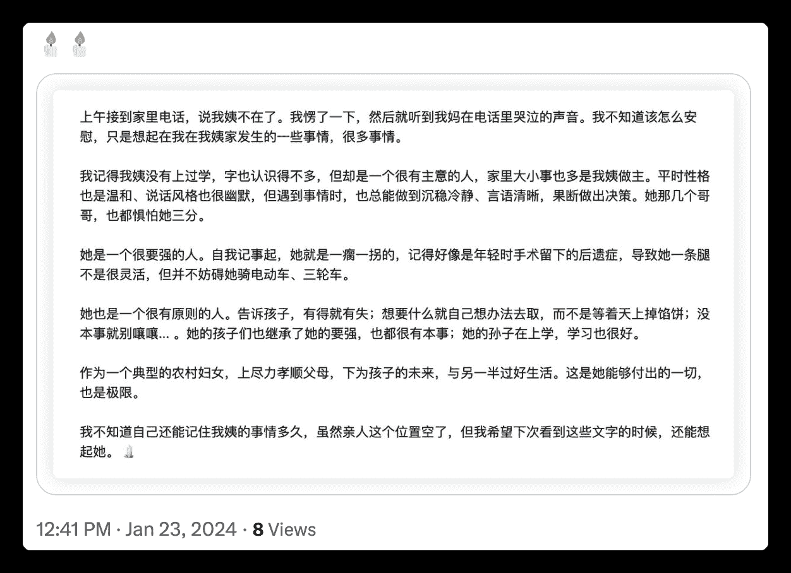
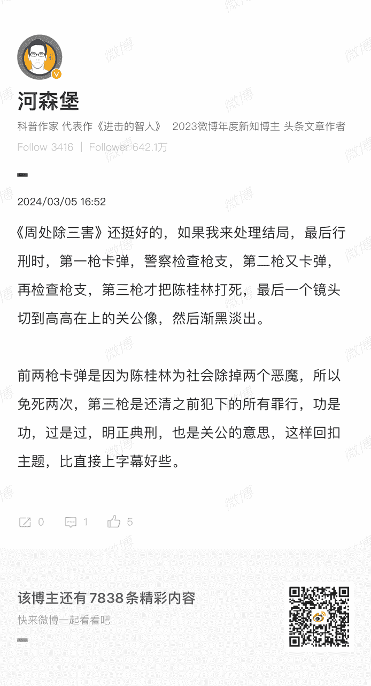

# 202401 - 02｜充分的去经历，才有可能知道自己真正想要什么

> 来源：[https://leonzhang.feishu.cn/docx/Gcf6d4DjgoPSIhxmCtAcT8VfnXc](https://leonzhang.feishu.cn/docx/Gcf6d4DjgoPSIhxmCtAcT8VfnXc)

Writer: Leon

Date: 2024/03/03

#月度总结 #个人成长 #Life Blog

> One fire burns out another's burning, one pain is lessened by another's anguish.

> 新火可烧熄旧焰，新苦可减轻旧苦。

## 最近观察和思考

> 【天使的声音 开口跪！单依纯《萱草花》催泪演绎真挚母爱】

<https://player.bilibili.com/player.html?bvid=1yu411V7jE&share_source=copy_web&vd_source=672ec070780ce29c890256a5fabe799b>

### 生活

**果然计划赶不上变化**。

原计划 2 月初的时候要更新 1 月份的内容，但因为过年回家抢票以及一年一次的春运，然后我搁置了。

回家后，发现我妈的白头发和皱纹也越来越多了，我爸的腰好像也没有原来挺了，岁月还是在我没有留意的时候，一点一点留下了它的印记，仿佛在向我证明它来过。当时毅然决定：在家这几天，好好陪陪他们，哪怕只是逛个街、碎碎嘴、刷个碗、说说话。我舍弃掉了原计划在家要做的所有工作，当然也包括要更新的内容，甚至过年在家，连微信朋友圈都没有打开。

**活着的人要更坚强的活。**

今年过年出门拜年，意识到有两位亲人，我再也见不到了。

**1**

迈入亲人 A 的家门时，一切如故，对比我上次来，没有感觉到有什么不一样，甚至下意识还想要叫他，可是我心里清楚，这不是愚人节的玩笑，而是无法改变的事实。她作为一位中老年的农村妇女，从“中年丧夫”到“老年丧子”，从“相依为命”到“孤独一人”，真的算是老天爷给她开的最大的玩笑了。每逢节日时，本应是欢聚一堂，但现在却空了一个位置，甚至家里处处都有他的影子，她又怎能轻易忘记呢？

走时，她送我到门外，我走在前她在后，我余光瞥见她在用袖子擦眼泪，我不知道说些什么，“别送了，回去吧，天太冷”。

**2**

“进庙拜神，进屋叫人”。之前去我姨家，在大门口就会叫人家，她的爽朗笑声是在大门口就能听到的，倘若她在，也肯定会多聊很多我们自己的事情，可再也没有这样的机会了。

我姨在世时，家里大小事都是她来张罗，今年家里冷清了许多，也许更多是主心骨不在后的不知所措吧。试想一下，之前几乎什么事情都不用做，或者听安排来告知如何做，但现在什么事情都要自己主动做。又怎能习惯？

**今日复明日，明日何其多。**

每年过完年，就感觉一年好像已经过去四分之一了（现在是三月初）。年后回来和我老大聊天，他说重视农历年的话就是这样，之后可以考虑以阳历 1 月份（2024 年 1 月 1 日）为起始。

从家里回来之后，发现自己也带来了一些坏习惯，比如拖延，然后我就开始疯狂提醒自己 “事情不会因为拖延而解决，只会因为拖延而堆积和恶化。”

### 工作

最近自己在面试，也有一些想法，这里说一下～

关于职位描述（Job Description）

结合我之前刷即刻或 Twitter，以及我前老板的一些反馈，他们（招聘方/面试官）最希望看到的是一份排版清楚，没有明显错字，关键部分有加粗显示的一份的简历。没错，即便是最基础的工作，但也很少有人能真正做好，更不要提项目数据和关键成果前置这些。

同样的，多数候选人可能也希望到一份有着清晰描述的 JD，而不是简单复制或者直接 OCR 其他公司的 JD 内容，甚至都不排版。我有时看到写的很清楚的 JD，就特想点个赞，看到 Markdown 格式的手敲文本更是感觉亲切。

一份“逻辑清晰、用词准确”的简历背后可能隐藏着一位对自身要求严格的互联人，而一份详细的 JD 背后也往往能折射出招聘方对候选人的关注和态度。

**关于合作伙伴**

除了关注公司和业务外，未来的直接合作对象也是我所关注的重点项之一。通常，面试过程中也会获得一些信息，比如对方的职业经历和经验、对当前业务的了解程度，侧重点是什么，最近在观察哪些新的、好玩的东西，对方对新事物是如何看待，对待失败的态度是否积极等等。

当然，还有些面试官会优先介绍自己，之后才进入正常的面试话题，如果对方没有主动说的话，多数情况下，我也会主动询问。因为我希望能更多的了解对方，通过他也能间接了解到团队的风格，这样才不至于因为与对方或团队的合作不愉快而导致自己的专业能力打折扣。

**关于团队协作工具**

团队对协作工具的使用也是我关注的一个因素之一。我认为，这是团队开放心态的一种外在体现，体现在他们是否愿意尝试新的工具来提高工作效率，更好的分工合作、共享信息。在快节奏的工作环境中，采用更加好用的协作工具也能反映出团队对于适应变化和学习新技能的能力。

我之前的工作习惯是，Mac 办公、飞书云文档、工具用 Figma 或 Sketch、随手记用 Obsidian，整体用着还算顺手。之后有更新的话，再做补充。

## 最近在听、在看

### Podcast

1.  Vol. 97 把中国车卖到海外，总共分几步？

https://www.xiaoyuzhoufm.com/episode/63e42ade4663224b4abe0a61

中国汽车出口就是一个顺势而为的故事。

国内产能过剩、新车销量增长缓慢，再加上疫情影响，造成产能过剩、库存压力大。此时，欧洲市场新能源市场发展不及国内，且处于新能源窗口期（出台政策补贴 + 确定燃油车退出市场时间线）。

**汽**车出口的根本动力是国内产能过剩。2018 年中国新车销量负增长，叠加疫情影响，造成产能过剩、库存压力大。

+   **国际竞争：**欧洲新能源窗口期，欧洲新能源车发展目前不及国内，疫情造成海外制造业冲击，欧洲出台政策补贴+确定燃油车退出市场时间线。

+   **全球物流：**主要是海运，通常一艘汽车运输船会涉及很多品牌、物流公司、多个港口的交叉合作；其次是火车运输，虽然方便快捷，但运力相对较小。

+   **软件服务：**软件服务需要本地化和效率的平衡，寻找可靠的当地合作方。( eg. 印度车主想知道司机会把车子开到哪里去，MG<英>）

+   **行业展望（发达市场、落地生根）**

+   **发达市场：**如欧洲（甚至西欧发达市场）、日本。很多车企进入欧洲，并没有长远考虑。进口只是敲门砖。若想长期发展，最好还是建立本地销售渠道，甚至建厂。日本市场，消费者注重使用体验和性价比。谨慎乐观态度

+   **落地生根**（出海的关键是形成**规模效应**）：中国汽车出海，还处于初步阶段。尽量多地融入当地，**而不是简单**出库存，这样才能更有助于在当地「落地生根」。

1.  奇想驿 & 产品沉思录｜和老爹聊聊：读书如何影响了我们的命运（方言版）

https://www.xiaoyuzhoufm.com/episode/65c839a90bef6c2074d27174

**三点共鸣：**

+   **南北方的教育问题。**”先上海后南京，先江南后江北，哪怕在江北上技校，也不在北方上大学。“

+   工作后学会理性思考、基于实事求是做决策。

+   大道理说教，轮到自己的时候就非常保守。

1.  问题不大｜23 聊聊心理咨询：我们如何改变？在与他人的相处之中

https://www.xiaoyuzhoufm.com/episode/63748a8e165a4944db497d5a

借助求助的力量，让自己的人生发生变化。

求助是强者的行为。将自己脆弱的一面完全暴露给对方。

凝视。很在意他人的评价，而忽视了自己。

「进入」心理咨询很像是拐棍，健步如飞的时候无法想象，等到康复之后就好好挥手告别。

摆烂文学 --> 发疯文学

不想被规训，不想被限制在规则中。

1.  半拿铁｜No.68 互联网泡沫：蒸发掉 75%市值的狂欢

https://www.xiaoyuzhoufm.com/episode/6500662d1bc87acb74fac66f

身在其中的人，会告诉质疑的人说，“你不懂，这次/我们不一样”。

当年明月：人类从历史中学到的唯一教训就是，人类从来不会从历史中学到任何教训。

退潮之后，才会知道谁在裸泳。

1.  Bill Gates｜我与萨姆·奥尔特曼的对话

https://mp.weixin.qq.com/s/UqfuCxhZ7cbpCh234Gob6w

Bill 让 Sam 展望未来两年，有哪些重要里程碑。Sam 回答，

+   **第一，多模态**。语音输入、语音输出，图像和视频。当前 GPT-4 的推理能力和可靠性有限，可能回答一万次中，只有一次回答是最好的，但它不一定知道是哪一次，所以可靠性提升很重要。

+   **第二，可定制性和个性化以及联网**。人们的需求各不相同，**不同的风格和侧重点**，以及还要能够接入用户自己的数据「Email、日历」，并互联网连接。

**GPT 提高生产力的领域**

+   **编程领域**。让程序员的工作速度/效率提升三倍。通过 Agent 的方式，让 GPT 写一个 App。

+   **医疗保健和教育**。

+   **机器人领域**。首先需要的是**智能和认知**，然后才能想办法让它适应物理特性。

+   **创造性工作**，GPT 模型的幻觉是一种特性，而不是缺陷，它能让你发现新事物。

**关于个人选择的建议**

+   Bill ：才能的混合。一个拥有正确技能组合的个人/团队是如此重要。

+   Sam：大多数人对风险的误判。他们害怕离开舒适的工作，去做他们真正想做的事情。 去从事一份让自己感到有目标的工作，会更棒！

1.  **提钱退休｜小红书**

https://www.xiaoyuzhoufm.com/episode/6460efc77d934b85057ace19

+   保证在场：搜索笔记是否在流量池里，零客查词

+   内容生态并不是第一位，善用写作的复利

+   简单、低门槛的内容

+   15Min，一条笔记

+   流量密码：

+   别人关注你的理由：简介（专业度）

+   不能归因、复现的爆款没有意义

+   多个小账号，还是一个大账号

1.  **商业就是这样｜Vol.142 串台《**晚点聊》：安利 2023，挖坑 2024

https://www.xiaoyuzhoufm.com/episode/659611587658199f8cf0b160

创作的结果不是创作本身，而是过程。

### Movie

[**《怒潮》**](https://movie.douban.com/subject/35572588/)[**《周处除三害》**](https://movie.douban.com/subject/36151692/)

我自己先看了《怒潮》，感觉阮经天的演的很自然，直到看了《周处除三害》...

[陈桂林（阮经](https://movie.douban.com/subject/24405378/)天饰）在灵修堂屠杀坏教徒的那场戏，让我想到了《王牌特工》中的教堂屠杀，能播也是我没有想到的。「我不是怕死啊，我是怕死了都没人记得。」不剧透了，如果有排片，要去看！！

后来微博推我关注的博主发的动态，看完之后，简直神来之笔！！Cool

**《年会不能停》**

真的很热血沸腾，“世界这么大，我想要叛逆一下。”

最后一句，把我打回了原型：“本故事纯属戏谑，如有雷同请谨慎对待。” 现实就是现实，别乱来

**《热辣滚烫》**

看点高燃，给新一年鼓鼓劲儿。

联想到自己的现实生活，谁还没有遇到过不公平的时候。从商业角度上说，确实很成功。

### Music Live

> 温馨提示：建议搭配降噪耳机，音量调至 50%-70%，尽量感受现场环境。若为夜深人静，更佳，enjoy～

> 推荐唱片 《新四季》

> The New Four Seasons - Vivaldi Recomposed by Max Richter

洗脑循环【纯享张靓颖《你要的全拿走+如果有来生+就这样好了+学不会》】 https://www.bilibili.com/video/BV1Sb411i7XX?share_source=copy_web

男爵太帅【凤凰传奇赵露思吉祥三宝既视感】 https://www.bilibili.com/video/BV16p4y1R74g/?share_source=copy_web&vd_source=672ec070780ce29c890256a5fabe799b

【凤凰传奇魔动闪霸合作就是蹦迪感】 https://www.bilibili.com/video/BV1yC4y1N7ig/?share_source=copy_web&vd_source=672ec070780ce29c890256a5fabe799b

【张天爱孙怡乔欣跨年劈雷舞台】 https://www.bilibili.com/video/BV1NN4y1B713/?share_source=copy_web&vd_source=672ec070780ce29c890256a5fabe799b

【李荣浩八分钟唱了十首歌】 https://www.bilibili.com/video/BV1Ka4y1q7mY/?share_source=copy_web&vd_source=672ec070780ce29c890256a5fabe799b

## X

好奇心是进步的关键，如果你看不到未来，这很正常，没有人看到的，但保持好奇心总是不会错的，去了解那些你不曾知道的事物，去你不曾去过的地方，要让自己的路越早越宽，才能「适应」这瞬息万变的世界。

**想到乔帮主在斯坦佛大学的演讲**：

人生就是这样，你不可能有先见之明，所以你必须要相信，相信你现在用心在做的一些东西，将来会在某一时刻串联到一起。

你不能预先把点点滴滴串在一起；唯有未来回顾时，你才会明白那些点点滴滴是如何串在一起的。所以你得相信，你现在所体会的东西，将来多少会连接在一块。你得信任某个东西，直觉也好，命运也好，生命也好，姻缘也好。这种作法从来没让我失望，也让我的人生整个不同起来。

唯一获得真正满足的方法就是**做你相信是伟大的工作**，而唯一做伟大工作的方法是爱你所做的事。如果你还没找到这些事，继续找，别停顿。尽你全心全力，你知道你一定会找到。而且，如同任何伟大的关系，事情只会随着时间愈来愈好。所以，在你找到之前，继续找，别停顿。

## 相关阅读：

<https://leonzhang.feishu.cn/sync/Et9Rd2dC4s6IDUb13C1cdNqBnwd>

一些短视频（Short Video）

+   【拆解对比结构用料！问界 M9 遥遥领先于理想 L9？】 https://www.bilibili.com/video/BV1SW421F7aK/?share_source=copy_web&vd_source=672ec070780ce29c890256a5fabe799b

+   【【享拆】魅族 21 PRO 拆解：第一次拆 AI 终端～】 https://www.bilibili.com/video/BV1Kr421W7Y4/?share_source=copy_web&vd_source=672ec070780ce29c890256a5fabe799b

+   仰望 U9，我飘了【仰望 U9 | 309.19km/h， 中国百万级最高极速纯电超跑】 https://www.bilibili.com/video/BV1eC411W7Zj/?share_source=copy_web&vd_source=672ec070780ce29c890256a5fabe799b

+   【仰望 U9 | 电动化时代超跑驾乘新体验】 https://www.bilibili.com/video/BV181421f7md/?share_source=copy_web&vd_source=672ec070780ce29c890256a5fabe799b

+   【[MKBHD 熟肉] 苹果 Vision Pro 开箱！- 3900 美刀的 1TB 版本】 https://www.bilibili.com/video/BV1h7421K7Dp/?share_source=copy_web&vd_source=672ec070780ce29c890256a5fabe799b

+   【使用苹果 Apple Vision Pro 的真实情况和体验｜作者 MKBHD｜机翻中字】 https://www.bilibili.com/video/BV197421P7r3/?share_source=copy_web&vd_source=672ec070780ce29c890256a5fabe799b

以上，

祝你早安、午安、晚安～

2024 年 03 月 12 日 于杭州