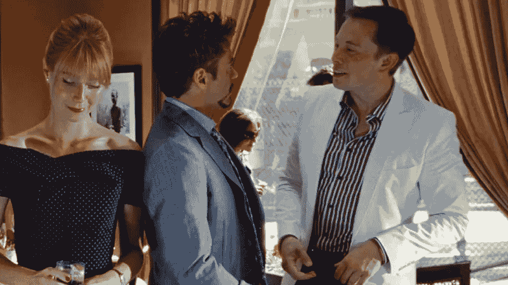

# 读《马斯克传》后记：人生不设限，成功无上限

> 来源：[https://leonzhang.feishu.cn/docx/PgS8dFpy1oQPa0xgMZBcmRRdnvf](https://leonzhang.feishu.cn/docx/PgS8dFpy1oQPa0xgMZBcmRRdnvf)

> Day one 愿景：**让人类成为跨行星物种。**

马斯克（Elon Musk）是一个性格非常复杂的人，时而偏执、疯狂、暴躁，时而宽容、理智、平静。他有着对技术的热爱、对创新的执着以及对梦想的坚定信念。

被称为“硅谷钢铁侠”的他和漫威电影中的钢铁侠一样有着多重身份：天才、企业家、慈善家、亿万富翁（千亿级别的那种），同时也是个“花花公子”。当然，多重身份也必然使他成为了一个争议人物，但这些都无法掩盖他的成就。

### 童年经历：不幸的童年

有句话说，“幸运的童年可以治愈一生，不幸的童年需要一生来治愈。”

朋友对他肉体的虐待（因为他的“厌蠢症”），父亲对他精神的虐待。肉体和精神，双重意志的虐待。这种经历塑造了他向内探寻的习惯，他不需要世俗的激励或外在的认可，所以一定程度上可以说，马斯克不幸的童年，塑造了今天拥有宏大信念感的他。

那他在教育上是否会延续他父亲对他的苛责，幸运的是他并没有。他的第一任妻子贾丝廷说，“埃隆对孩子充满了感情，这是与他父亲根本性的不同。”

比如他 2020 年 5 月的孩子 X 。他们珍**惜对方**在场的时间，又尊重对方的个人空间。马斯克就像他的父母一样，对孩子没有过度保护，也没有寸步不离。X 也从来不黏人、不依赖父亲。

### 个人特质：效率至上

在读书的过程中发现马斯克这个人的时间管理能力很强，效率很高。

从生活和工作两方面来说，

+   在生活上，他有两任妻子、两个女朋友、9 个孩子，书中描写了马斯克如何花时间陪伴他们，带女朋友、孩子去不同的地方玩，体验生活等等。

+   在工作上，他几乎同时管理着 6 家公司（不包括曾参与管理的公司，比如 OpenAI），SpaceX、Tesla、Neuralink、Twitter、xAI、The Boring Company，忙碌程度可想而知。

再加上他业余时间看的很多书、电影、研究很多新知识。

**当时想到这些，脑海**里就出现了一个关键词：Focus（专注）。时间是一样的，那只有提升效率，而效率提升，无非就是专注力的提升。

### 天才的共性：**Focus（专注）**

想到之前看纪录片《成为巴菲特》中，Bill（Bill Gates，比尔·盖茨）的老爸问巴菲**特和比尔盖茨，让他**们分享自己取得成功的关键因素是什么。他们两个给出了同样的答案：Focus（专注）。

写到这里又想到乔布斯，其实乔布斯也是如此，他喜欢冥想，为此还**专程去印度学习**了半年。而冥想的核心，就是专注力、自制力。

这些所谓的天才，是常人眼里的疯子，他们偏执、自大、狂妄，对世俗的不屑一顾，然而却往往能做出常人做不到，甚至都想象不到的事情来。

### 总结

1.  **马斯克的成功是否有普适性？**

难，几乎不可能。举几个书上提到的例子，

+   13 岁时自学 C++，并开发了一款电子游戏“导火线”。

+   大学时年纪就陆续开始创办公司 Zip2、X（后合并为 Paypal）。

+   SpaceX 在创立之初，他就提出了将火箭回收再利用的目标，这在当时被认为是不可能的。但马斯克坚持不懈，最终实现了这一目标。（基于他“火星殖民”的想法，要把人送过去，再把人接回来）

1.  **马斯克对世界的影响？**

+   推动科技创新，比如 SpaceX 的火箭是世界上最先进的火箭之一，特斯拉是世界上最受欢迎的电动汽车之一。

+   改变人们的生活方式，比如特斯拉间接带动了其他新能源汽车厂商的重视与研发投入。

+   **激发人们的梦想，他跌宕**起伏的故事，让我们相信：人生不设限，成功无上限。

### 部分摘录（有修改）

+   经历一定程度的「逆境」，会拉升自己的痛苦阈值。

+   只有疯狂到认为自己可以改变世界的人才能改变世界。——史蒂夫·乔布斯

+   有人曾说，每个男人的一生都在努力满足父亲的期望，或者弥补父亲犯下的错误。

+   人生在世不能只是为了解决问题，人必须追求伟大的梦想。“那个值得追求的东西，是能让我们从睡梦中醒来去迎接崭新一天的东西。”

+   保持快速迭代，勇于承担风险，行事风格粗暴，接受阶段性失败，再次发起尝试。

+   莎士比亚教导我们的，所有英雄都有人格缺陷，有些英雄为缺陷所困，有些英雄以悲剧而终，而那些被我们视为恶棍的角色可能比英雄更加复杂多面。他教导我们，即便性格最为良善之人，他的人格也“由他的缺点所塑造”。

**风险与决策**

+   真正的冒险伴随着风险和隐患，但风险给了他激情和动力，当他做出决定的时候绝不会被恐惧感所控制。

+   当他要投身互联网浪潮的时候，「**没有孤注一掷，而是留了后手」**。“我可能会失败，如果失败，希望能回来继续读书。”

+   **马斯克**可以在情况发生变化时改变心意，而且他比任何人都愿意承担更多的风险。

+   **“不要**惧怕失败。“你总会输的，”马斯克说，“前 50 次都很痛苦，但是当你已经习惯失败，你就会带着更少的负面情绪参与每一次游戏。”更无畏的人会愿意承担更大的风险。

**阅读与研究能力**

+   埃隆渐渐成了夜猫子，总是看书到天亮。

+   有时候他会用一整个下午加上晚上的大部分时间阅读，一看就是 9 个小时。

+   课时 60 小时的 BASIC 语言编程，埃隆三天就学完了（几乎没有睡觉），并在学校编程技能测试中取得了优异成绩，此时他 12 岁。13 岁自学了 C++，并开发了一款电子游戏“导火线”。

+   埃隆经常口出狂言，但每过一段时间，你就会对他刮目相看，因为他对你专业的理解比自己还深刻。

**产品设计**

+   真正做产品的人都有强迫症，一定要把东西直接卖给消费者，不给中间商搅合的机会。

+   工程师与产品经理通力合作。

+   **马斯克**说，“没有人会为看起来像垃圾一样的东西买单。”

+   超级铸造，6000 吨重的铸造机，80 秒一个车底，之前要焊接铆接 70 多个零件，现在只需要 2 个。整个车底被压住成了一块金属的 Model S 的玩具车模。从乐高玩具中找灵感【功夫在诗外】

**营销策略**

+   新品牌，想要登堂入室的唯一办法就是推出一款令客户惊叹的产品。 【引起关注，一鸣惊人】

+   “真正了不起的产品能实现销售增长靠的都是口口相传。”

**企业管理**

+   伟大的东西永远不会在风险投资人和职业经理人的手里诞生，因为他们既没有创造力，也没有洞察力。

+   他认为如果对方不愿意躬身入局，用金钱和智慧去投资一家公司，就没有资格成为创始人。要想成为联合创始人，必须在付出聪明才智、辛勤耕耘的同时还要勇于承担风险。

+   给员工灌输的企业文化是，要质疑每一条规则、预设每一项要求都很愚蠢，直到他们证明事实并非如此。

+   “对编程一窍不通的产品经理不断提出需求，要求创建一些连他们自己都**不知道**如何创建的功能，”詹姆斯说，“就像一支骑兵部队的将军不知道怎么骑马。”这是马斯克经常挂在嘴边的一句话。 【别骂了别骂了，😭】

+   五步工作法的延伸

+   犯错没关系，但错了还不肯低头就不行。

+   永远不要要求你的团队做你自己都不愿意做的事情。

+   每当有问题需要解决时，不要只与你直接管理的相关负责人聊。深入调研就要跨层级沟通。

+   招聘要招态度端正的人。技能是可以教的，但要扭转一个人的工作态度可就太费劲了，得给他“换个脑子”。

+   疯狂的紧迫感是我们公司运作的法则。

+   唯一要遵守的规则就是物理学定律能推导出来的规则，其他一切都只是建议。

+   **马斯克**说，“我批评的时候对事不对人，谁都会犯错，重要的是一个人是不是具有一条完善的反馈回路，能够吸收他人的批评意见，还能有所改善。物理学并不关心你心里是不是难受，它关心的是你做出来的火箭是不是真能飞上天。”

+   **马斯克**说留下来的工程师必须满足三个标准：出类拔萃、值得信赖，以及自我驱动。

**工作习惯**

+   喜欢把事情安排得非常紧凑。

+   与乔布斯、盖茨、贝索斯一样，他们不会在乎有没有冒犯别人，因为他们不屑于与懒虫和糊涂蛋为伍。

+   如果提出技术问题，负责的对方答不上来时，埃隆就会怒火中烧，就像一台轰鸣的发动机。

+   决定录用/提拔一个人时，认为：一个人的态度比他的简历、他所掌握的技能更重要。对”工作态度好“的定义就是一个人渴望疯狂工作、拼命工作。

+   **“干活**的第一步就应该是质疑你接到的任务要求。”马斯克说，“因为所有要求或多或少都包含着愚蠢和错误的成分，所以一定要砍掉它们、砍掉它们、砍掉它们。”

+   **人生中**失败带来的经验教训都是最宝贵的。马斯克：“如果有的选，我宁愿从成功中学习这些经验。”

+   快快快，为什么不能更快完成？!

+   “快点！快点！请不要浪费任何一天！有什么坏消息都要大声地讲出来。好消息悄悄地说一次就行了。

+   **白痴指数**：用来计算某个制成品的成本比其基本材料的成本高多少。

+   如果一个产品的“白痴指数”很高，那么一定可以通过规划设计出更有效的制造技术来大幅降低它的成本。

+   **五步工作法：**质疑所有要求，删除不必要的部分和流程，把问题筛出来、处理掉，最后推进自动化。

**思考方式**

+   言论自由与传播自由之间是有区别的。任何人都可以走到时代广场中央，说什么都行，但这并不意味着这句话应该传播给数百万人听。

+   **马斯克**的座右铭：永远不要用导弹打苍蝇，你应该用苍蝇拍。

### one more thing

对了，如果你也喜欢马斯克，同时也是漫威迷，那相信你一定也注意到了马斯克在电影《钢铁侠 2》中的客串，见下图。

|  |
| --- |

---

一个 PM 在这里写他看到的、听到的和想到的事情。如果你感兴趣，交个朋友吧～

+   WeChat ID: thinkinghunt

+   Email: thinkinghunt@163.com

+   Homepage: [张帅的个人说明书（对外）](https://sm84lfdag7.feishu.cn/wiki/wikcnvVUZ7NmWg31mUgnpvXwsie)