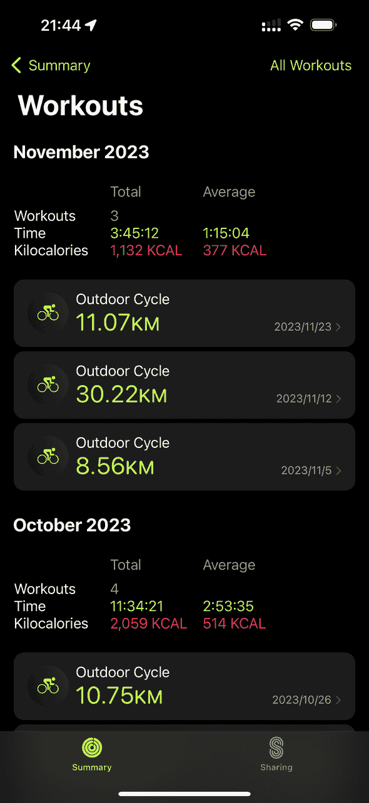

# 202311｜生活无常，云烟成雨

> 来源：[https://leonzhang.feishu.cn/docx/PvOTdBXsvoN3z5xIERPcZ2HSnee](https://leonzhang.feishu.cn/docx/PvOTdBXsvoN3z5xIERPcZ2HSnee)

> #月度总结 #热爱生活 #个人成长

> 如果你想要什么，勇敢地去争取去把握。 If you want something in life, reach out and grab it.

## 最近经历

### 生活

距 2023 年结束，还有 29 天。

本月单车骑行破纪录，两小时骑行 30 公里，骑自行车追公路车。

虽然没追上，但很爽呀～

[浙江 - 杭州](https://sm84lfdag7.feishu.cn/wiki/🐧QEwSAn4isGBCkFsb7cEixpnFh)便路上也拍了一些杭州的碎片，更多杭州照片请移步至

<https://my.feishu.cn/sync/MaOedexETsm0OZbMzRjcDi71nOh>

还有一些糗事...

原定安排是 23 号去献血，洗牙、补牙，回家，结果仿佛被开了一个玩笑。

1.  上午献血，发现自己吃了阿莫西林，医生说得一周后，现在不行...

1.  因被停缴医保，医保卡无法使用。不得已，选择自费挂号（当然后续也要自费洗牙和补牙），排了半个小时队，结果又发现挂错号了。我以为补牙应该算口腔修复科门诊，但实际应该挂口腔科门诊... 结果我去退号的时候，当天的门诊号已经没有了，而且更关键的是，专家号也没有了... （起个大早，结果连晚集都没赶上）

1.  回家前，物业维修师傅给我打电话，说少买了一个感应灯...

但也算有好消息。一，在献血处蹭了一杯八宝粥喝；二，晚上把 Wiki 简单归类了一下，看起来相对清爽了一些。

**距 2023 年结束，还有**

### 学习

**AI Paper**

[OpenAI 开发者大会｜2023 年 11 月 7 日](https://sm84lfdag7.feishu.cn/wiki/GhBJwptEpiW6Sjk584OcA8hNn8f)

[What is OpenAI, Really?（OpenAI 到底是什么？) ](https://sm84lfdag7.feishu.cn/wiki/CJCgwzTELiS2kFkaliAcUdf8n6k)大新闻都在推 OpenAI 的宫斗戏，大家都坐等吃瓜。这篇    梳理的很清楚，以及张小珺的播客 48。 OpenAI 的权力游戏：脸谱、硅谷精英政治与讽刺意味 ，这期聊的内容很多，其中提到的“乔布斯时刻”的观点也很有趣，感兴趣的朋友可以收听一下。

保罗·格雷厄姆的最新文章 [超线性回报（Superlinear Returns）](https://sm84lfdag7.feishu.cn/wiki/Nz3ywPX2Ui7MDOkmi0zcQVlxn3c) ，同时也感谢宝玉大佬的翻译，中文链接和英文原版链接都在文档中。

iPhone 的 promotion 用习惯的之后，真的觉得 Mac 有些卡，所以新入手了一台 Macbook Pro，开心 😆

作为一名 Blogger，我一直很羡慕一些拍视频的数码博主能经常性的更新自己的设备，真的好羡[聊聊这台 2023 款 M3 Pro 的 MacBook Pro](https://sm84lfdag7.feishu.cn/wiki/GADPwF2k0i9YqckURbWcZUdZn0c)，但拍视频确实不是我的强项，所以还是打算以文字的方式聊一下购买前的心路历程：

+   继 [大白话聊 Apple Silicon（苹果芯片）](https://sm84lfdag7.feishu.cn/wiki/QfffwdAQ3ipzuIkYqnrcgWwNnqg)之后，大白话系列来了第二期，即[大白话聊 Apple Vision Pro](https://sm84lfdag7.feishu.cn/wiki/NmYZw9U4uiwHnYkDE1RcvOEPnNh)

+   [My App Defaults 2023 ](https://sm84lfdag7.feishu.cn/wiki/HEwMwDZheiHjTkk1v7Zce7LrnBb)着别人的思路，捋了一下自己的 App Defaults 2023：

## 最近观察和思考

世界这么大，确实不缺厉害的人，也确实有很多厉害的人我不了解、不认识。

可这些老家伙们，是我自己还在一张白纸的时候认识的，在我心里的位置独一无二，空了就是空了，永远不会再补上了。  🕯

两个囚犯同时望向窗外，一个看到的是星辰，一个看到的是泥泞。

+   你的处境一样，是你可以决定你要仰望永恒的星辰，还是要颓丧地低头沉浮，看到满地污秽的泥泞，这其实是我们自己可以决定的。

+   一个人真的可以决定你要做怎样的人，孤独有许多不同的姿态，而面对孤独，也有很多不同的方式。那些方式来自于不同的灵魂，不同的性格特质，可是你真的可以决定你要做陈子昂还是要做李商隐。

【【一席】欧丽娟：孤独的多棱镜】 https://www.bilibili.com/video/BV1YW411y72w/?share_source=copy_web&vd_source=672ec070780ce29c890256a5fabe799b

在面对庞大的自然力和社会力量的时候，人是非常脆弱的。

如果放在一个更大的时空里看，没有什么东西是可以持久的。若放在一个更大的宇宙中，什么事物都只是一瞬。

基于以上的东西，联想到蔡国强的作品《天梯》，而天梯又何尝不是一瞬间？

你总是会错过一些东西，但错过就是错过了，后悔也没办法改变已发生的事实。

【山河褶皱里藏着很多古老的人心，是一直吸引我去探野庙的重要原因｜梁硕 一席第 1009 位讲者】 https://www.bilibili.com/video/BV1K8411X7BX/?share_source=copy_web&vd_source=672ec070780ce29c890256a5fabe799b

阅读时，最好的音乐背景声，可能就是自己那颗安静的心。 #Thinking

尝试戴上降噪耳机或耳塞，隔绝身边的一切声源，会更容易进入心流，也会有更多的想法浮现。

若阅读过程中想到某事，不急的话，可以顺手记下关键词，稍后一起处理，因为你不一定只想到这一件事。

**我们自己的观点很少浮出水面。**

我们突然被提问时，第一个想到的观点，通常不是自己的，而是与我们的身份、地位或出身相符的习惯性答案。

视角转换，等价于增加 80 点智商。

回顾看到艾伦·凯（Alen Kay）的这句话，想到前两天听飞哥的播客，苹果系列中某个单集里提到说，发明者和应用者的关系。

在创新和发明过程中，实践和应用一个想法的人通常会得到更多的关注和回报，而原始的发明者则可能鲜有人知。比如现在的 GUI（图形界面），我们都知道是乔帮主将 GUI 引入大众消费市场，同时塑造了在商业上的成功，但是很少有人知道 GUI 的发明者是施乐公司的艾伦·凯。

虽然说发明和应用是个相互依存的过程，但也印证了“发明者伟大，应用者有利”这个不争的事实。

更多，请移步至：[2023 年 11 月｜Thinking](https://sm84lfdag7.feishu.cn/wiki/FsGOw6qmqico92k7KQ4clhRlnwf)

## 有什么好玩的事情发生

> 回顾看到这条打破信息成瘾，联想到大脑的冷启动。

**打破速度成瘾**

人是习惯的动物，朝着一个方向前进刚开始很难，但是后续会越来越容易。但是当我们停下前进的脚步后，再启动就会很困难。

**速度和质量两者的关注点是截然不同的。速度**鼓励我们短视，而增加质量则需要长期投入。

| **关联 Memo：** |
| --- |
| &lt;https://my.feishu.cn/sync/OKbvdVMToshQTmbNKw0c17AwnRe&gt; |

朋友问我，为什么喜欢 Music Live？

我告诉他，是因为不完美。因为喜欢「不完美」，所以才喜欢 Live。

有很多 Live 才会出现的小插曲，很棒，很喜欢。比如小黑（王心怡）的抢拍，就很喜欢呀，很可爱不是嘛 😄

这些小插曲，在“完美”的正式版里绝对是听不到的。而正是这种小插曲，才让我感觉到，啊，原来对方也是人类，也会失误/犯错的。

【【陈婧霏】New Boy -陈婧霏 房东的猫 （谁是宝藏歌手 Live 现场版）】 https://www.bilibili.com/video/BV1dq4y1L7g6/?share_source=copy_web&vd_source=672ec070780ce29c890256a5fabe799b

## 最近在听、在看

### 播客

1.  E733.被 AI 潮「洗劫」的职场人

听完之后，嗯，信息差的💰还是好赚。害

1.  Vol. 102 OpenAI 首届开发者大会，终于要改变世界了吗？、Vol. 101 科技快乐星球 20: 苹果 M3 快得吓人👻

Touch Bar 被取消、MagSafe 回归，真的开心。

1.  No.54 苹果简史 1：嬉皮士、迷幻剂和不洗澡的男人｜硅谷神话④，还有 2、3、4、5，

飞哥和潇磊主理的半拿铁，熟悉我的人都是知道我是飞哥的迷弟，日常推荐，没啥说的。对苹果感兴趣，或者觉得《乔布斯传》这本书太厚还没有看完的朋友可以收听一下，这 5 期的基本上已经很全很全啦。

1.  No.131 对谈少楠：内部一切皆成本，对外才能创造价值

任何用户体验都是有成本的。

发现需求。需求是什么，在哪儿？是不是真的？规模有多大？有没有打电话问过 100 人？

注意力是你的现金。忽略时间价值和注意力控制。

1.  对话李楠：从魅族到怒喵，不变的审美与消费者洞察

我在 B 站上是有关注楠总的，而且在他早期刚开始建号的时候就关注了。因为第一台魅族手机是 MX2，所以当时高中和大学还蛮关注魅族的，当然后来也买过 Pro 7。

另外，因为我不是游戏玩家、也没有多余的💰，所以不是他们的受众，就很难共情他们的产品。个人日常在用的键盘就是 Mac 的物理键盘，耳机是一代的 AirPods Pro。

他们做的产品，比如键盘、耳机，工业设计和技术上来说，有几款还是蛮不错。

1.  33.【职场人性】企业内斗，究竟在斗什么？

依稀记得小时候看《九品芝麻官》里，十三（周星驰饰）的老爸对他说，“贪官奸，清官要更奸，才能对付他们。”

我对职场内斗的印象，仅局限于视频资料（电影电视剧）。因为之前待的都是小公司，虽然也有，但不至于这么严重，听完这期也算是开眼了。

### 书籍

**《卓有成效的管理者》｜推荐**

> 德鲁克的作品，印象最早应该是被 Zara 安利吧，但一直没有看。

管理者及知识工作者应该如何更好的自我管理，以及为什么必须卓有成效，才能创造最大价值。

如何创造最大价值？

1.  以目标为导向，明确组织目标，做好关键决策并将其分解为可执行的任务；

1.  重视时间管理，有效利用时间，集中精力完成最重要的工作；

1.  用人唯贤，无需事必躬亲，充分发挥下属的积极性和创造性；

1.  思虑周全，注重沟通，有效地与他人沟通，达成共识；

1.  持续学习，不断更新知识和技能，适应变化的环境。

在“效能”（doing the right things）与“效率”（doing things right）的观点上，德鲁克和段永平的看法相同。做正确的事情胜过正确的做事情。

[读《卓有成效的管理者》后记：如何更好的自我管理](https://sm84lfdag7.feishu.cn/wiki/CjnrwBM0xiHJkHkgjYmcpfVJnAJ)

**《手机大脑》**

+   大脑特点 1：我们还生活在原始人类的时代。Fouce 才是当下每个人最宝贵的资源。

+   大脑特点 2：情绪是一种（通过化学信号操控行为的）生存指令。大脑会不自觉放大和直接运行恐惧信号带来的反应，

+   多巴胺。是一种精力导向，会影响专注力。

+   内啡肽。多巴胺之后获得满足和奖赏的东西。

+   两个刺激元会导致疯狂分泌多巴胺：新鲜事物、多变的赏酬。

+   **产生的影响：**

+   注意力残留。 手机干扰 = 拿起手机次数*注意力残留（5 分钟）

### 影视作品

**《极速车王》**

学会放弃。人生不仅仅是一场赛车，更是一场与自己的和解。

更重要的是，要清楚自己是谁。

《**荒野生存》**

如果你想要什么，**勇敢地去争取**去把握。 If you want something in life, reach out and grab it.

你必须对你的生活方式来个大改变！You should make a radical change in your lifestyle!

上帝将快乐赐给世间万物，快乐无处不在。我们能从所有事物中体验快乐。God's placed it all around us. It's in everything. It's anything we can experience.

我们要做的是改变我们看待事物的方法。People just need to change the way they look at those things.

《**星际穿越》**

+   一个关于亲情的承诺。

+   《献给阿尔吉侬的花束》中有一句话：如果没有人性情感的调和，智慧和教育根本毫无价值。

+   请把心中的那份爱，保留到最后一刻。

《**楚门的世界》**

+   「自由」多少罪恶假汝之名以行。

+   一个自由选择的假象。

《**盗梦空间》**

+   一个想法就像病毒一样，顽强无比，感染性极强，再细微的念头也会生根发芽。它能成就你，也能毁了你。

+   “过去”也可以成为一个人无法清醒的梦。

+   （kick）：回归现实，向前迈进，才是人生永远不变的主题。

《**hello! 树先生》**

“不在乎”就是一个人最强的铠甲。

### Music Live

> 温馨提示：建议搭配降噪耳机，音量调至 50%-70%，尽量感受现场环境。若为夜深人静，更佳，enjoy～

<https://my.feishu.cn/sync/Q2MgddOFqsK7lpbxm7tc68kvnzg>

【【房东的猫】“我多想再见你，哪怕匆匆一眼就别离”，《云烟成雨》最新现场！】 https://www.bilibili.com/video/BV1EG411L79B/?share_source=copy_web&vd_source=672ec070780ce29c890256a5fabe799b

【《New boy》-房东的猫 MV，听了能够笑着睡觉】 https://www.bilibili.com/video/BV1NY4y1J76A/?share_source=copy_web&vd_source=672ec070780ce29c890256a5fabe799b

【【房东的猫】今夜的江滩公园没有烟花跨年】 https://www.bilibili.com/video/BV1bu4y1L7UE/?share_source=copy_web&vd_source=672ec070780ce29c890256a5fabe799b

【【4K60FPS】许巍《曾经的你》中国鼓大合唱现场！曾梦想仗剑走天涯】 https://www.bilibili.com/video/BV1qd4y1X7XY/?share_source=copy_web&vd_source=672ec070780ce29c890256a5fabe799b

【朴树-《送别》泪撒录音棚，一度哽咽失声】 https://www.bilibili.com/video/BV11W411471S/?share_source=copy_web&vd_source=672ec070780ce29c890256a5fabe799b

## 下月有什么打算

X

## 相关阅读

<https://my.feishu.cn/sync/OPHBdIjAgsiF0kbnRtgcKOvFnoe>

## 延伸阅读

+   关于 OpenAI CEO 被出局的事实、猜测和看法 - 骆轶航

2023 年 12 月 02 日 于杭州

---

一个 PM 看到的、听到的和想到的，欢迎交流～

+   WeChat ID: thinkinghunt

+   Email: thinkinghunt@163.com

+   Time Line: [Time Line｜空间动态](https://sm84lfdag7.feishu.cn/wiki/HF6iwTOFniDoYUkXfzHc8JAXnQb)

+   Homepage: [Leon Zhang's User Manual（对外）](https://sm84lfdag7.feishu.cn/wiki/wikcnvVUZ7NmWg31mUgnpvXwsie)