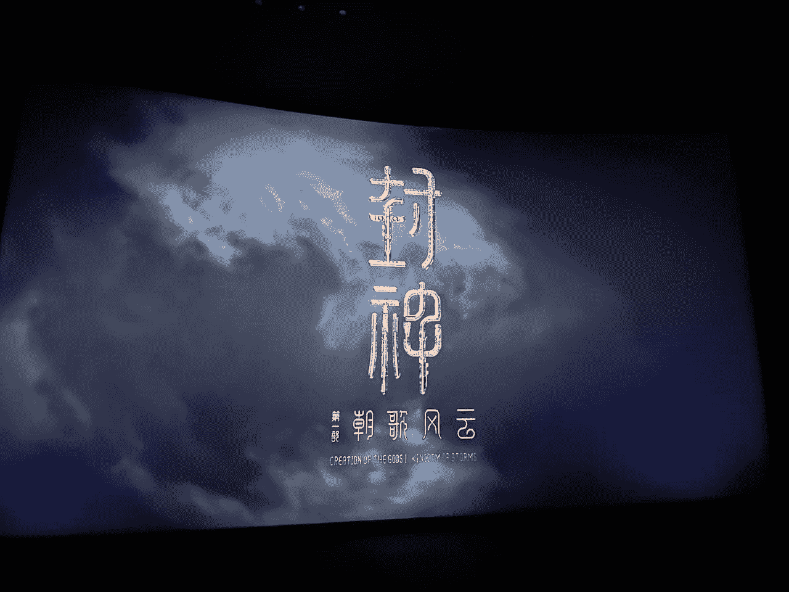

# 202308｜是终点也是起点

> 来源：[https://leonzhang.feishu.cn/docx/Y7hHdy1geoUWJEx7K28cuYHAnTe](https://leonzhang.feishu.cn/docx/Y7hHdy1geoUWJEx7K28cuYHAnTe)

> #月度总结 #热爱生活 #个人成长 #职场

> 当一段生活走到尽头时，不仅意味着结束，同时也标志着新生活的开始。

## 最近经历

### 生活

8 月份末，杭州的气温已经开始逐渐下降了，体感不是很明显，因为用电费用的时间变长了...

我，还是没有躲过新冠的攻击，咩～  🐑 ，没错，二阳了。 😷

本来以为只是简单的感冒流涕，没想到逐渐开始发烧，发烧了两天，都是下午开始烧到晚上，喝完布洛芬，然后就好很多。

也有好消息，就是二阳没有别人那么痛苦，且也没有别人那么多次数。比如我 Leader，经常出差深圳、上海，好像已经三阳了，算上他传染我的这次，应该是四阳了吧，找谁说理。 🥹

### 学习

月中的时候在看吴恩达老师的课程，第一次看的时候就是因为 python，导致中途放弃...

半年后再看，还是同样问题。[果然，问题是躲不掉的](https://sm84lfdag7.feishu.cn/docx/GqP7dKulpoOHC5xwgCPcBKWHnLd#Xn1YdXAuOocQ72xaC3PcC7YlnOh)，只能选择面对，别无选择。

既然要学习 Python，那要学习到什么程度呢？

**了解基本规则、能看懂函数就行**。毕竟我这二把刀，随便一个大模型写的都比我写的要好太多了（毕竟我不会的东西还在问它），比如请教 Google Bard 老师。

+   [Python Learning Notes](https://sm84lfdag7.feishu.cn/docx/QSHwdyjmEoa4RtxLKqDcY3VdnXx#HIZzd8Jdio3wvXxH8DKc75ZYn9d)习 Python 的 Notes：

+   结构化 Prompt：[Prompt Learning](https://sm84lfdag7.feishu.cn/wiki/OUfPwKXGDifiknkeBvScF1GMnFd)

+   还顺便搞了一个证书：[Career Essentials in Generative AI by Microsoft and LinkedIn](https://sm84lfdag7.feishu.cn/wiki/PNXewffByicysMkBsz3cWotCnDd)

### 工作

上周五 Last Day，因为我需要一些不被打扰的时间去思考，思考目的、思考路径，同时也需要大量的输入。

老子说，“福兮祸所伏，祸兮福所倚。”

我不知道此时裸辞会让我变得更好还是更差，但自己的成长绝对不会止步于此。

忘记之前在哪个 Podcast 听过一句话，大概内容是，“人生的绝大多数，我们在做一件事情，以当时的目光去看，都不是做那件事情的最好时刻”。

毕竟大多数时候我们做的事情都是以没有结果告终的，这才是常态。

## 最近感悟

1.  **站在未来看现在。**

前段时间和朋友讨论提到，会读 ReadFlow App 是通过 AI 解析内容并生成摘要，由此便想到了音频，比如播客生成文本摘要。对于新的频道，关注的信息无非是主理人、频道名称、单集节目名称、Shownotes、节目评论，当然英文播客的门槛会相对更高些（想到了 fonter 的小报童），问了几个朋友也侧面验证了我自己的猜想。

于是我便开始搜索相关的产品，用 New[ Bing 搜索，发](https://www.assemblyai.com/)现只有国外一款产品 AssemblyAI 在做，而且做了很久，然后自己开始构思技术实现，比如音频转文字的准确度、文字摘要总结、什么形式的产品、如何 cover 成本，想到讯飞星火，甚至申请了 API...

[以上的种种假想](https://b.jimmylv.cn/)停止在，我又一次看到 @吕立青_JimmyLv 大佬的 BibiGPT ...

|  |
| --- |

结果，好友回复：“哈哈哈，需求点抓得不够有前瞻性，要基于未来去做未来的决策。” 典型的创新者思维，想到了老罗、乔布斯，想到了 Smartisan OS 的 Big Bang、One Step、Idea Pills，想到了 Apple 的 Vision Pro、Promotion、HDR...

好友说的很对，只是我现在还做不到罢了。向前看呀～

1.  **吾生亦有涯，而知亦无涯。**

我一直有个坏习惯，Chrome 会开很多很多的 Tab，原因是信息焦虑，总觉得只要 Tab 在，我就一定会看，然后越来越多。

最近突然意识到，能够获得海量信息不算什么本事，任何人都可以做到，而且信息量再多也比不过 AI，再加上人的精力和时间都是有限的，所以这个坏习惯，也该终结了。

1.  知行合一，二者互为表里，不可分离。

承接上一条。

或学习或研究都很重要，更重要的是要学以致用。知必然要表现为行，不行则不能算真知。

[以门缝中窥世界 👀](https://sm84lfdag7.feishu.cn/docx/GqP7dKulpoOHC5xwgCPcBKWHnLd#WPuud4LQQoN4L3xrToWcY85Onzf)023 年 8 月份的其他思考：

## 有什么好玩的事情发生

1.  **参加了一次创业路演。**

在 Leader 的提示和帮助下，去参加了这场 AI 创业公司的路演。

目的有两个，一者了解创业公司在做什么新的关于 AI 的好玩东西；，毕竟都是创业公司；二者是相对完整地体验一个相对完整的项目的投融资流程。

就结果来看，算基本达成吧。[0810 Notes “AIGC 生成无限”专场路演 ](https://sm84lfdag7.feishu.cn/wiki/KJkAwpKZMiqoIMkA9LLcFk4bnuf)

1.  **早起去虎跑泉接水，扑了个空。**

自古有言，泡茶应用名水，所谓“山水上，江水中，井水下”（《茶经》）。

因为之前买的龙井茶没有喝完，心血来潮想去虎跑泉接点泉水。第二天早上拎着桶就去了，7 点开门，8 点到，结果还是没有排上，因为大爷大妈已经排到了 2 个小时后了... 真的是厉害 👍

检票口的工作人员说，大爷大妈 6 点多就开始排队了，你 8 点才到，怎么来得及？工作日早上的时候人少，你记得早点来排队。

心想：害，这工作日我不也得上班嘛...

> 注：如果你当前是暗光环境，强烈建议你用 Chrome 打开，请感受 HDR 给你带来的视觉体验。 enjoy~

|  |  |
| --- | --- |

## 最近推荐

### 播客

1.  三点下班｜S2E9 丨裁员降薪大盘点：每代人的困局与破局

+   **一个现实的问题：如果你不幸运，30** 岁之前没有成为管理层，今后靠什么生活？

+   判断行业见顶的“三个浓度”，美女的浓度、985 学生的浓度、二代的浓度。

1.  商业访谈录｜38。 和软银愿景原 GP 聊聊，大模型全球降温后，人工智能何去何从

+   边际成本变成固定成本是历史拐点的关键因素。

### 书籍/长文

1.  **《完美主义扼杀效率》**

阐述了完美主义者与时效主义者这两种不同的思维习惯和行为习惯，激发思考并试图希望读者转变思维，并进一步阐述了，工作的目标是成果而不是完美。

1.  **《商业的本质和互联网》**

用通俗易懂的经济学原理讲述，商业的本质是增长，互联网只是一种工具，没有改变商业的本质。

1.  **《上手》 许岑**

培养研究技能，通过“研究”，有选择性地快速上手一门课题或技能，解决当下遇到的问题。

### 影视作品

1.  [《封神第一部：朝歌风云》](https://movie.douban.com/subject/10604086/)

导演：乌尔善｜豆瓣：7.9 分

冲着画面去的，所以买了一张 IMAX，剧情一般，整体画面观感不错，甚至意犹未尽，期待第二部。

还有，黄渤真的自带喜感，还有他的口音。哈哈，忍不住笑场 😂

|  |
| --- |

1.  《环太平洋 2：雷霆再起》、《环太平洋》

> 夜深人静 + Mac + Airpods Pro 降噪，体验真的不要太好

第一部真的比第二部好太多！我是先看的 2，再看的 1，第一部无论是剧情还是画面处理都超级棒！！大红这么棒，竟然被秒，真是遗憾。

强烈推荐第一部。

1.  《头号玩家》

Apple 的 Vision Pro 勾起了我的兴趣。其中电影《闪灵》的片段还是给我吓了一跳，毕竟我是晚上看的，给我吓坏了。

### 视频 / Music Live

> 温馨提示：建议搭配降噪耳机，音量调至 50%-70%，尽量模拟现场环境。若为夜深人静，效果更佳，enjoy～

1.  【国乐大典 第二季：纯享版 4-2 孙楠高欣欣《美丽的神话》】

https://www.bilibili.com/bangumi/play/ep279860/?share_source=copy_web

1.  【国乐大典 第二季：巅峰之夜花絮 1-6 快乐加倍的《百鸟朝凤》！与他们合作的乐队竟然是……】

https://www.bilibili.com/bangumi/play/ep285514/?share_source=copy_web

1.  【2020 最美的夜 bilibili 晚会：前方高能 吴彤 vs 百人乐团《万物笙》】

> 高音笙、中高音唢呐，一整段的灵魂。

https://www.bilibili.com/bangumi/play/ep376291/?share_source=copy_web

## 下月有什么打算

1.  生活状态还需要调整

可能是自己还没有习惯这个状态吧，还需要再调整。

1.  见一下朋友阿珂

既是网友也是好友，生活工作她都给我提供了很多帮助，我俩是通过 Newsletter 认识的，认识半年多了都没有见过面。

**one more thing**

如果你碰到了一些问题，你只能选择面对，不要藏着掖着。

2023 年 9 月 6 日 于杭州