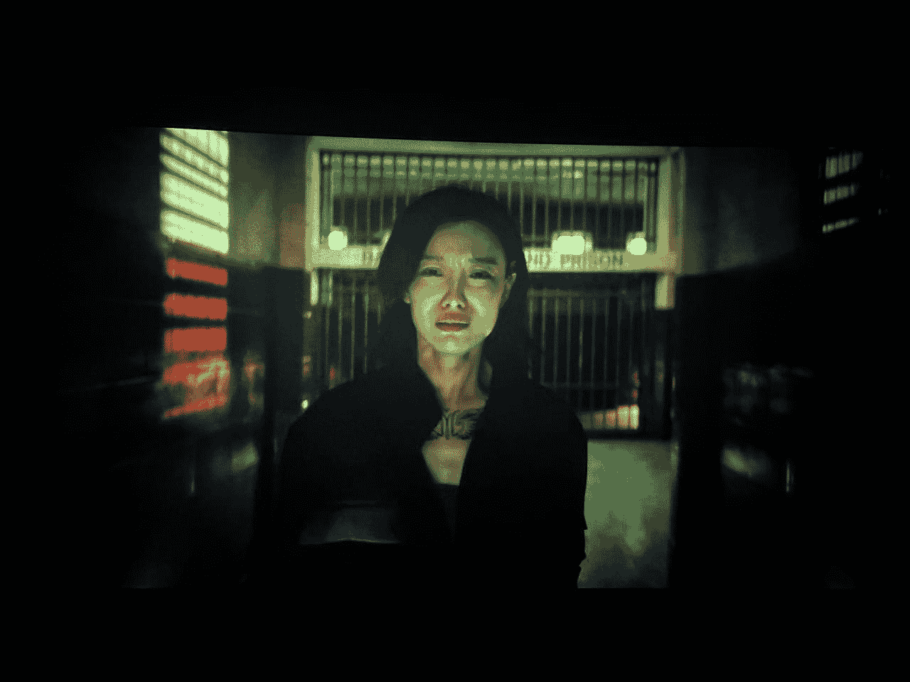

# 202307｜接纳自己

> 来源：[https://leonzhang.feishu.cn/docx/LSMDdGWWNoAxBvxdirfc3GC9nog](https://leonzhang.feishu.cn/docx/LSMDdGWWNoAxBvxdirfc3GC9nog)

> #热爱生活 #成长 #职场

> Be content with who we are.  接纳自己

## 最近经历

### 生活

7 月份，正值梅雨季，杭州连下好几天雨，再加上在屋里老吹空调，肩膀实在难受的很。

7 月中旬，预约去拔火罐，这个习惯是从大学的时候开始的，之前是在校医院，依稀记得是两个体育学院的学姐在学习，我也就充当了小白鼠的角色。虽然对方是在学习，但手法可不比社会上的差。

这个感受也是我毕业之后才意识到的。

当天晚上加完班之后过去，基本流程结束后，师傅还帮我主动“揉开”背上充血的肿胀处。没错，这是我继毕业后，第一次有人师傅主动帮你处理，而不用主动提要求。

结束后也聊了很多。

老哥（姑且如此称呼吧），安徽淮北人，年龄大概 30 岁上下，爱好钓鱼，但最近下雨没去。

我一边喝着他递给我的温水，一边听他聊经历，从他之前在上海如何到了杭州。杭州的生活成本比上海高，但是薪资不高；也提到好的部分，比如政府办事效率高，警民素质相对较高，执法戴执法记录仪等等。

当然，还有一些嘱咐：

1.  已经有颈部有轻微的“富贵包”，长时间久坐低头导致的，需要注意；

1.  关于拔罐的频率以及作用。通常一年是三到四次左右，不宜太多：夏天去湿气，冬天、春天去寒气。

也希望大家照顾好自己的身体，健健康康，毕竟身体才是革命的本钱。

### 学习

买了一本摄影教材，拼多多 ¥9.9，这可是全彩的，真的超级便宜！！

没有器材，那就先用手机拍，练习构图、色彩调整这些，先行动起来～

以下是部分样张

|  |  |  |
| --- | --- | --- |

### 工作

某种情况下，我也很讨厌死记硬背。

工具书其实看过很多，概念也知道很多，但是涉及到实操的时候经常会想不到怎么用，需要再搜索一下。

毕竟工具书的目的就是学以致用，共勉。

## 最近感悟

1.  Being 类型人（学到的新概念）

+   重视 to do（事情）的人在思考问题的时候，会问自己要什么。这样的人拥有明确的梦想和目标。

+   重视 Being（状态）的人重视自己想成为什么样的人，想处于一种什么样的状态。

Being 类型的人应该努力提升自己的两种状态：

1.  提升「自己的状态」

1.  提升自己的市场价值；

1.  从工作中获得乐趣，而不是不信任的抵触。

1.  提升「环境的状态」：

1.  紧张与放松之间的平衡应处于让人舒心的状态；

1.  写下最近半年自己感觉高度紧张的情况，若超过 10 个则需要考虑换个环境。

1.  最近状态不不太好

1.  好友 A 说了我一些，受用很多。比如找她拿建议和帮助这个事情，我经常是接受了建议/帮助就开始忙了，然后乱七八糟一通看和学习，然后就会拖着不反馈。

1.  好友 B：看书很重要，更重要的是学以致用。

1.  有人说，穿越了沙漠就能寻找到自我。

## 有什么好玩的事情发生

1.  **新朋友、新事物**

有幸认识了豆爸、Shadow 和 Micky 两位老师，也学到了很多关于 AI 相关的东西。她们最近也在做一些好玩的事情，我也成功加入了她们 早早聊 AGI 的志愿者行列，后期顺利的话，我会帮忙梳理知识库的相关内容。

[AGI 早早聊 Guide Book](https://zaozaoliao.feishu.cn/wiki/EjVdwm75GiY09tkVlKucq2GUnsf)

豆爸也是个很优秀的产品人，亦师亦友，对我来说，每次聊天都会有新的输入。是我成长太慢了，还需要再进步，加油加油！

1.  **冷知识：🦟 为什么蚊子在下雨天不会**被相当于自身 50 倍重量的雨水击落？

蚊子自身优势：强壮的外骨骼和轻量级的身型，且翅膀和身躯具有疏水性。

倘若蚊子被击中翅膀，蚊子会先下沉并顺势旋转，将雨水摆脱；若被击中身体，则利用自重轻的优势从侧面“滚”出雨滴。所以蚊子从来一旦停止飞行，若不幸被砸中，就绝无生还的可能了。“自重轻，不抵抗，但也不停止飞行。”

## 最近推荐

### 播客

1.  冰镇电波｜范冰：个人 IP 是个坑，你其实可以不卷「抖微快红 B」

+   金句有时候不是救命药，是蒙汗药，要考虑清楚当时场景和使用范围。

+   自己梳理优劣势、行动路径，不要盲目启动。

1.  **商业访谈录｜31。 【趋势 202**3】张小珺对谈老范（高樟资本创始合伙人）

+   老范：不要相信老年人说的，“做难而正确的事情。”

+   去做正确的事情，哪怕是难的，如果简单就更好了，哈哈。

### 书籍/长文

1.  **《5%职场精英的工作习惯》**

1.  在激烈变化中生存，停滞不前本身就是风险。

1.  正确理解目标，按照目标行动，并最终达成目标。

1.  **《统计数据会说谎》**

+   这本书是王局推荐的，从不同的角度去解读或是验证数据的真伪。

+   数字的绝对值没有意义，相对值才有意义。我们谈论数字的时候必须要还原到背景中。甚至要彻查一番，才能知道数字像表达的东西和你一开始理解的是不是一个东西。

1.  [**如何做好工作？｜保罗·格雷厄姆**](http://paulgraham.com/greatwork.html)

1.  找到自己感兴趣和擅长的事情，这是做出伟大工作的第一步。

1.  在选定的领域内全面学习，了解前沿知识。通过发现现有知识中的差距，可以找到有价值的新的研究方向。

1.  勤奋工作和坚持不懈非常重要。伟大的作品需要长期努力积累。保持好奇心和乐观精神有助于持续前进。

1.  找到优秀的同事非常关键。相互鼓励和交流想法可以产生更多灵感。

1.  保持高涨的斗志也是必不可少的。要学会应对失败和挫折，保持根本的兴趣和动力。

1.  制定具体计划不如按照兴趣行事。新想法和发现往往来自意外的方向。保持开放和灵活很重要。

1.  从小事做起，通过持续迭代最终完成伟大的作品。不要一开始就追求太宏大的蓝图。

1.  保持谦虚和真诚的工作态度，不要在意外界的瞩目和评判。专注做好自己的工作。

1.  做有意义的事情，解决重要但被忽视的问题。这样更可能产生原创性的成果。

### 影视作品

1.  **电影《消失的她》**

编剧：陈思诚｜主演：朱一龙、倪妮、文咏珊

我是冲着这三个演员去的。

朱一龙在电影《人生大事》里的表现，大家都是有目共睹的，对方还因此获得第 35 届中国电影金鸡奖最佳男主角。倪妮、文咏珊，这俩人之前都是 baby 的闺蜜，老早前也知道，文咏珊之前在电视剧《风声》里的表现很好，而且《误杀 2》也有她，估计是陈思诚招来的吧，毕竟陈思诚作为编剧的话，大概率要选角儿吧？

关于剧情。差不多三分之一的时候就知道大概率是赌鬼死性不改，但李木子闺蜜（倪妮）做导演弄假成真还是没想到的。不过这样才能串起来为啥陈麦导演获奖，以及看不上朱一龙。

剧情和发哥新电影《别叫我“赌神”》的主线一致，都是赌鬼的故事，最后因为心爱的人离世，然后痛改前非，害。

|  |  |  |
| --- | --- | --- |

1.  **电视剧《天道》**

导演：张前｜主演：王志文、左小青

第一导演和演员阵容很强。导演张前，是抗日剧《亮剑》的导演，能力很强，没什么可说的。演员王志文、左小青，更是名角。

第二，编剧是导演张前和作者豆豆。没错，这部剧正是改编自豆豆的长篇小说《遥远的救世主》，剧本前后用了两年时间改编，整部剧内容情节几乎高度还原。非常非常优秀的一部作品，看完后的对这部剧这本书的感觉就两个字：觉悟。

以下是部分金句：

+   神就是道，道就是规律，规律如来，不容思议。

+   生存法则很简单：忍人所不忍，能人所不能。

+   每个人的立场、观念、心态和思维模式都不一样，获取的信息量和解读信息的方式也不一样。

+   任何一种命运归根到底都是文化属性的产物。强势文化造就强者，弱势文化造就弱者，这就是规律，也可以理解为天道，不以人的意志为转移。

+   《自嘲》：本是后山人，偶做前堂客。醉舞经阁半卷书，坐井说天阔。大志戏功名，海斗量福祸。论到囊中羞涩时，怒指乾坤错。

### 视频 / Music Live

1.  罗翔｜如果一种行为在道德上是被“点赞”的，那就不可能是犯罪

1.  一个成熟的法律人，最重要的是要学会解释法律。这种解释既要探究法条文显明的文字意义，还要探究它背后的精神。

1.  刑法不仅要惩罚犯罪，同时还需要限制惩罚犯罪的权力本身。我们需要用有限的法律，适应无限的社会生活。

https://www.youtube.com/watch?v=eNDEKvgIbLA

1.  **【林俊杰 2020 湖南跨年《曹操+新地球+Wonderland+**一千年以后+修炼爱情+将故事写成我们+不为谁而作的歌+（一小句）对的时间点》】

<https://player.bilibili.com/player.html?bvid=1vJ411L7jF&p=5&share_source=copy_web&vd_source=672ec070780ce29c890256a5fabe799b>

1.  【🎷炸裂起飞！林俊杰《一千年以后》超经典神曲！】

<https://player.bilibili.com/player.html?bvid=14k4y1u7XL&share_source=copy_web&vd_source=672ec070780ce29c890256a5fabe799b>

## 下月有什么打算

提升「自己的状态」，试图改变「环境的状态」，希望一切顺利！

## one more thing

**罗永浩：“事情客观发生对你的影响只占 **20%，80%取决于你如何看待这件事！”

2023 年 8 月 1 日 于杭州