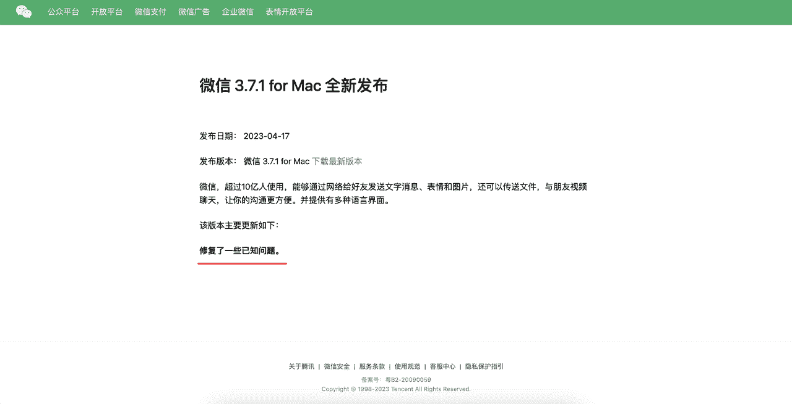
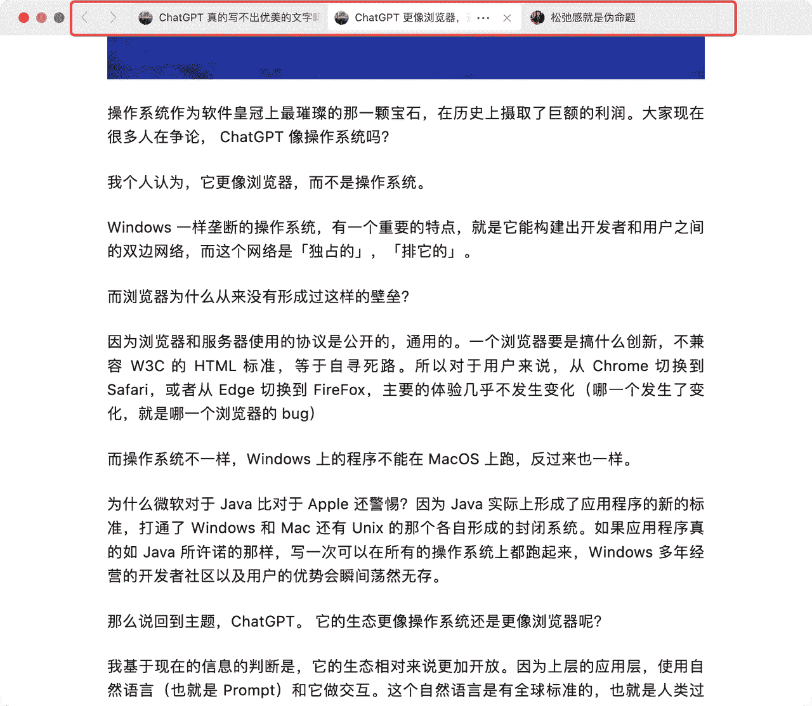
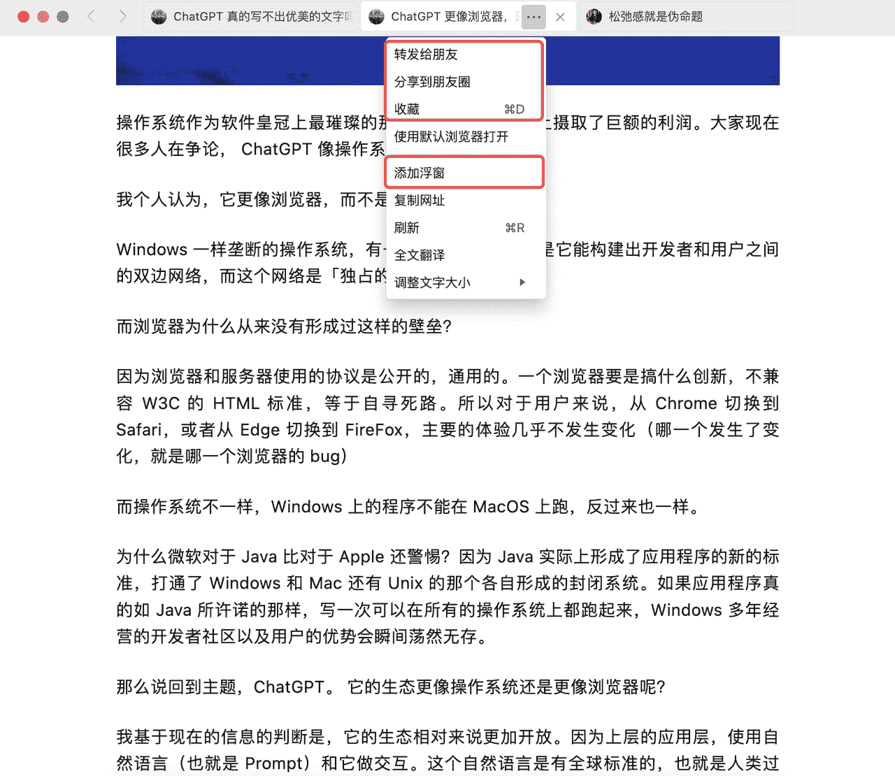
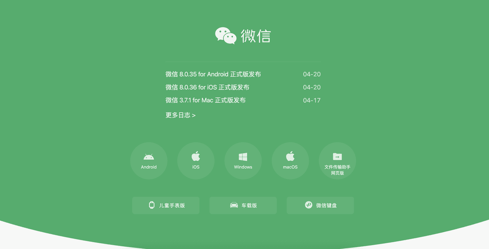
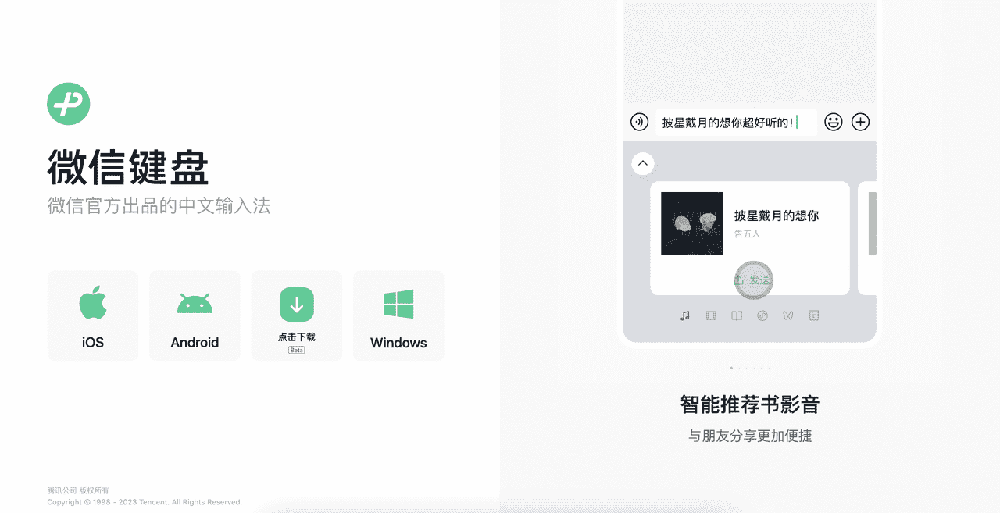

# 20230420 🛰️最近的「新动作」

> 来源：[https://leonzhang.feishu.cn/docx/FdOPdseBoobvVfxC67Ec3MX8nXb](https://leonzhang.feishu.cn/docx/FdOPdseBoobvVfxC67Ec3MX8nXb)

> Vol.20230420

昨天下午收到了 Mac 端的🛰️推送的版本更新，版本号是 Version. 3.7.1 (25668)。下载更新的同时，顺手打开了🛰️的官网，原来 17 号就更新了，又顺手点进去看更新说明，想看都更新了啥，结果......

只得到冰冷冷的一句：**修复了一些已知问题。**

......

基于🛰️经常“夹带私货”，所以每次新版本或早或晚我都会去更新，甚至时常羡慕那些“幸运儿”（被选中内测），比如羡慕他们可以提前使用🛰️👸号的划线功能，这个分享很 Cool，而且很方便！

> 内容框架

> 一、Mac 端🛰️也支持「🛰️浏览器」了

> 二、Mac 端🛰️键盘也来了

> 三、🛰️的「协同网络」

## 一、Mac 端🛰️也支持「🛰️浏览器」了

首先为什么说“也”支持，是因为 Windows 端比 Mac 要领先一个版本。

上次发现 Windows 端领先的 Mac 端一个版本的还是文字识别。同事在她电脑上发现之后，我还特意查看自己的，确实没有。后来更新的时候证实了，是晚了一个版本没错。

也有好消息，虽然是晚了一个版本，但 Mac 端🛰️支持直接提取👸号文章中图片的文字，是不用放大图片的那种。  即刻动态 Version. 3.7.0 (25067)

其次是，在我昨天下午更新的版本里是支持在「🛰️浏览器」中打开的，而且“也”比 Windows 端晚一个版本。

之前🛰️内置的浏览器只支持一个窗口，如果点击多个👸号，只能覆盖你原有正在看的文章。逼得我不得不用 Chrome 新建不同的标签页，效果也还凑合。

但缺点也比较明显。第一，不支持点赞和分享；第二，如果不是自己已经关注的👸号，想要关注的话，会增加难度。比如移动设备🛰️扫码才能关注，而这在🛰️原来内置的浏览器里是支持的。

现在新的「🛰️浏览器」里，也都是支持的。支持多个👸号文章新建标签页，甚至视频号以及聊天中的网址都支持用「🛰️浏览器」打开，也支持「转发给朋友、分享到朋友圈、收藏、添加浮窗」等🛰️生态里的基础操作。

|  |  |  |
| --- | --- | --- |

## **二、Mac 端🛰️键盘也来了**

[继上次写了对自己](https://sm84lfdag7.feishu.cn/wiki/wikcnlnjhaZ1oh98Up4ec2Ld0tj#Ac8Cd8k84oeOIwx2JCIcMuMGnmh)在 iPhone 上使用输入法的体验，昨天浏览🛰️官网的时候发现🛰️键盘还有 PC 版！不过当前仅支持 Mac 端，Windows 版还在开发中。

|  |  |
| --- | --- |

那，🛰️键盘长什么样子呢？

没错，就是上图的「🛰️绿」，我现在在用的这个，Beta 0.9.0 （113）。样式基本和 Mac 端的键盘一致，体验上也差不多，键盘设置里也基本没有什么新鲜玩意儿。

如图，我确实比较喜欢 Mac 端的键盘，打字的时候切个桌面再回来，还能继续，而且够我用了。

## 三、🛰️的「协同网络」

今天很多成功的互联网公司，大家经常称其为平台或生态，但本质都是一张非常复杂的协同网络，核心机制就是在线和互动的不断演化和深化。

上次和瑞哥、Leo、Saki 也聊过类似关于「产品生态」的话题，当时是 Saki 老哥提出的。

**确实，在 Web**2 时代，最牛的产品**形态是什么？**是操作系统、是**生态。生态的特**征之一就是自发的生命力，这似乎是一种永不枯竭的力量。

🛰️这个团队很牛，很厉害，厉害在于他们建立了一个生态系统并吸引其他开发者来🛰️开发功能。

因为他们清楚的认识到，不同的用户会有不同的需求。无论是功能还是产品，这些都是永远也开发不完的，那干脆把🛰️就打造成「乐高、积木」，你们开发者想要建立什么样的规则和建造什么样的城堡，由你们来定，由你们来创造！

在🛰️生态里，有个人🛰️、企业🛰️，有👸号、视频号、小程序，再到现在的🛰️键盘、🛰️浏览器，无不是在建立自己的生态系统。

写到这里，让我想起了 Amazon。Amazon 从最初的卖书到书评，再到电纸书 Kindle，再到先售卖电子书再售卖纸质书。这些举措不仅提高了行业效率，还建立了自己开放生态的护城河。

[张磊](https://baike.baidu.com/item/%E5%BC%A0%E7%A3%8A/8864724)[，这个被](https://book.douban.com/subject/35188914/)媒体称为“腾讯背后的男人”，在《价值》一书中写道：打造动态与开放生态的护城河，但护城河不可能不变，“永恒不变的只有变化”。

**建立动态与开放的护城河需要**企业了解所处的时代背景和生态环境，并具备不断学习、创新和适应的能力。只有这样，企业才能在竞争中获得优势并长期存在下去。换做我们，也是一样！

## 参考

+   [🛰️客户端](https://weixin.qq.com/)

+   [🛰️键盘](https://z.weixin.qq.com/)

+   [张磊 - 百度百科](https://baike.baidu.com/item/%E5%BC%A0%E7%A3%8A/8864724)

+   [价值 - 豆瓣](https://book.douban.com/subject/35188914/)

---

People shouldn't have to live up to other people's expectations.

---