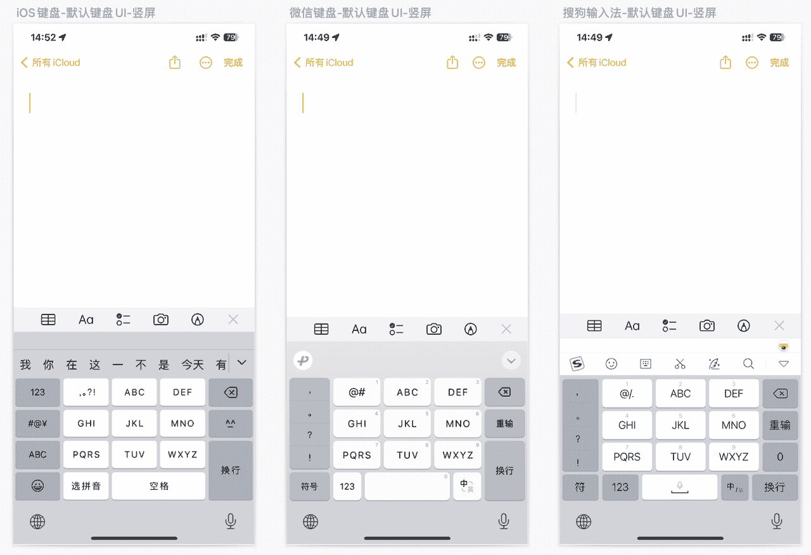
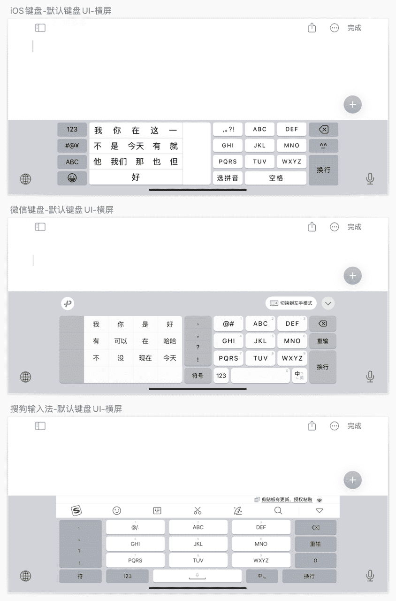
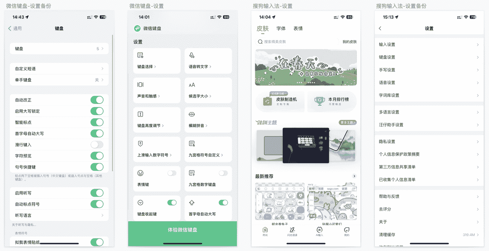

# 20230417 对输入法的观察

> 来源：[https://leonzhang.feishu.cn/docx/GIvvdMRpZomRGUxDtejcv1uhnFb](https://leonzhang.feishu.cn/docx/GIvvdMRpZomRGUxDtejcv1uhnFb)

**20230420 补充**

补充一下我对 iPhone 侧键盘的需求：打字震动反馈、重输、换行、滑动键盘控制光标、剪贴板记录。

---

继上次发现搜索引擎的粘性低之后，又发现输入法的粘性也不是很高，哈哈～

🛰️键盘 iOS 版本已经更新到了版本 1.0.5，随着使用体验的不断完善，我也从逐渐从搜狗输入法切换到了🛰️键盘。

最初使用搜狗输入法的契机是因为当时的 iOS 键盘还不支持触感反馈（iOS16 之前的系统键盘确实差点意思），所以在 iPhone 上就一直沿用下来了。

> 内容框架

+   一、场景

+   二、基本情况对比

+   三、隐私与便利

**一、场景**

键盘输入法工具是我们经常会用到的产品之一。一个趁手的输入法工具，一定程度上还决定着你打字/沟通的效率。

我之前就被吐槽用手机（虚拟）键盘打字慢，额，不过我至今认为实体键盘打字更快…

**二、基本情况对比**

下面针对我在用的 iOS 系统键盘、🛰️键盘、搜狗输入法做一个简单对比。

> iOS 版本：16.4.1

> 🛰️键盘：1.0.5

> 搜狗输入法：11.19.0

1、竖屏 UI 对比

+   iOS 键盘：苹果一贯的简约设计，布局简洁，上手无负担；

+   🛰️键盘：🛰️团队的杰作，风格和 iOS 基本一致；

+   搜狗输入法：中规中矩，功能都给足了；

另外，三者在 9 宫格按键与两侧字符按键的大小处理上有侧重。iOS 的基本一致，搜狗输入法的对比更明显，🛰️键盘介于两者之间（V1.0.4 之前，🛰️键盘的处理和 iOS 是一致的）。

2、横屏 UI 对比

横屏情况下，iOS 键盘、🛰️键盘的处理是比较好的，搜狗只是粗暴（偷懒）的做了拉伸，横屏打字场景下体验尤其差。

3、设置对比

在需求/交互设计中，我们经常会用到的一个原则是「席克定律」，即用户在面对决策时，可选项越多，需要的决策时间就越长。

对比来看，iOS 键盘与🛰️键盘的设置简单明了，路径清，而搜狗输入法会先进入皮肤设置，然后进入我的-设置。如果不考虑商业化，iOS 键盘与🛰️键盘的设置明显更加易用，用户体验也会优于搜狗输入法。

4、基本功能

+   🛰️键盘在🛰️中使用时，可以智能识别并推荐👸号、小程序、视频号、影视内容、音乐、书籍等内容，而搜狗输入法没有这个功能；

+   搜狗输入法有更换皮肤和字体的功能，以及拍照识文字/文字扫描的功能，而🛰️键盘没有这些功能；

+   🛰️键盘在🛰️文本框里，支持有序列表和无序列表；

+   ……

> 因为我确实不太爱折腾这类输入法工具，同时我对这类工具的定义就是「够用就行」，所以只是简单对比 UI，很多功能并未展开。

**三、隐私安全与便利**

这是个永不过时的话题，甚至李彦宏曾公开表示，“中国用户愿用隐私换方便”以及“保障用户信息安全和运用用户数据为之提供更好服务之间，找到更好的平衡点。”

除 iOS 键盘外，🛰️键盘、搜狗输入法，都会保存你的邮箱地址，也许还有信用卡、银行卡、账号/手机号…

（以上请自行查阅各产品的隐私协议）

最后，如果你比其他人更加重视隐私安全，那 iOS 键盘可能是你的最优选/唯一选择。

**延伸阅读**

+   央视评论：谁说“中国人愿意用隐私换便利”？

+   🛰️键盘 - Apple Store

+   搜狗输入法 - Apple Store