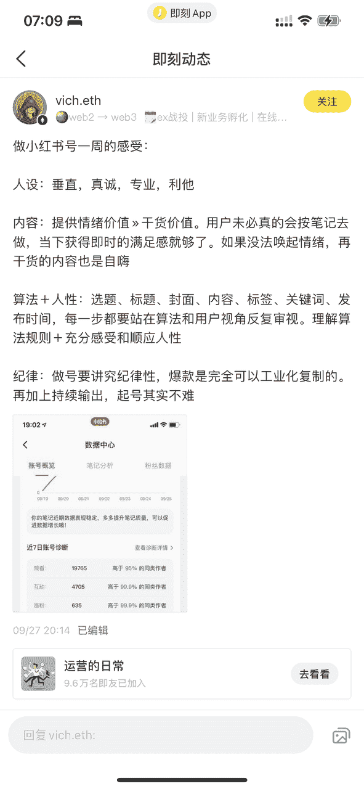
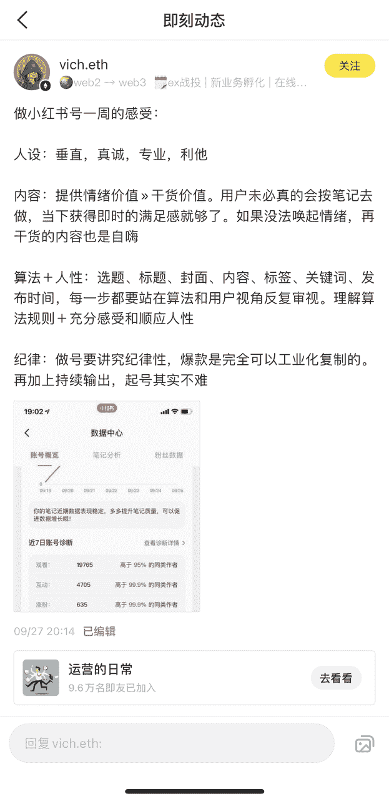

# 20221001 一些观察和思考（小红书篇）

> 来源：[https://leonzhang.feishu.cn/docx/TosndjsAtoZOYhxokLmcTr9nnTe](https://leonzhang.feishu.cn/docx/TosndjsAtoZOYhxokLmcTr9nnTe)

> #一个想法不一定对 #一些野生观察

> 平台：公众号、即刻

一些观察和思考

最近发现身边好像也有很多女生在做小红书🍠账号，但目前知道做的最好的，应该是宁宁吧，刚确认了，30w+关注量！

宁宁真的超棒！最初关注她的时候才2.8w，当时还几次微信说让我给她“第一篇笔记点赞”，后来也去支持了好多次，现在已经是头部了，哈哈！

想说说自己对她的感受：

第一，人设

172、高个子女生穿搭、御姐风、漂亮、好看、真诚

第二，内容，情绪价值+干货价值

最初的她一般是图文笔记偏多，对比视频，两者的比例应该是7:3，大多数笔记还是图文。

还记得她当时每次视频内容的开头，内容很多提到自己最近的一些感受，比如天气、工作，“今天天气如何，你们那边怎么样？”“今天工作日加班好累呀，但是还是想分享穿搭给你们”等等，类似这样的内容。

她推荐的衣服偏平价，而且挑选的款式也不错，大多数女生应该都能穿的那种，可能也会比较有共鸣。

第三，规则，流量/算法

她之前是做小红书运营。比如选题、封面、内容、标签、发布时间、发布频率等等，我相信这是普通玩家一般不太能具有的一项高阶技能了，但是如果没有做过小红书运营，那就不能有这么多关注了嘛？不是的，你会发现还是会有很多人，没有相关经验，但是通过持续输出，过程不断总结、优化、迭代，最后还是有不错的效果或者说回报的。

当然，以上都只是从表面或者是玩法上的分析，可这并不代表，这些都是可以简单、轻松就可以获得的。比如，我有很多次看到她中午不睡觉拿着iPad在剪视频。单从这点出发，可能就有很多人无法坚持，毕竟谁能放弃“吃饭”或者“吃饭+看剧”这种不用动脑的活动呢（没错，我也在列）。

最后，今天是2022年10月1日，“话说金九银十”，希望你我能有“银十”的美好。

最后的最后，祝福伟大的祖国繁荣昌盛，国富民强！也祝福在旅程中的你我，一切顺利！

---

早呀，十月第一天，“话说金九银十”，希望你我能有“银十”的美好。

最后，祝福伟大的祖国繁荣昌盛，国富民强！也祝福在旅程中的你我，一切顺利！

十月你好，希望你我有银十的美好

|  |  |
| --- | --- |