# Rokid 新品发布会有感：空间计算新伙伴

> 来源：[https://leonzhang.feishu.cn/docx/MW1ad3yojoS6XAxHS9QcPD2Inhd](https://leonzhang.feishu.cn/docx/MW1ad3yojoS6XAxHS9QcPD2Inhd)

Leon Zhang, April 25, 2024

> 热爱这件事，让我们乐于比别人多走一步，发现更棒的 Feature，从而设计出更棒的产品。

**AI Summary**

在参与 Rokid Open Day 2024 的发布会中，我们深入了解了 Rokid 如何推动生态系统的构建和开发者计划，同时探索了这一创新技术在文娱与教育领域的应用前景，以及新品 Rokid AR Lite 的发布，为我们描绘了一个充满潜力的未来计算平台的蓝图。

1.  前言

1.  空间计算生态及开发者计划

1.  产品与技术

1.  AR 生态应用

1.  生态内容合作发布

1.  开发者服务计划

1.  空间计算下的文娱与教育

1.  AR 文博文旅

1.  AR 互动娱乐

1.  AR 智慧教育

1.  新品发布 Rokid AR lite

1.  最后

1.  相关阅读

## 前言

上上周（4 月中旬），有幸通过 @张杰伦 老哥获得了参加 Rokid Open Day 2024 的资格。

当时兴冲冲发活动链接给我前老板，还没有来得及问他有没有兴趣，他就说 Gary（生态中心负责人）也邀请他去。也是，毕竟他们现在在合作期，联系合作伙伴一起参加活动这很正常。于是，我俩便约定一起去参加线下。

时间来到 4 月 20 日，原计划要和 @张杰伦 老哥见面，以及聊一些关于他做 AR 的东西，结果当天他真的太忙了，忙到就入场前仓促见了一面，直到会议结束都没有再见面。回头一定约个时间，线下见面。

会议开始前，我还和我前老板聊，我说这个会场比我想象中的要小一些。他告诉我，他参加过的线下最大规模的产品发布会，就是 2018 年锤子科技在鸟巢的发布会。他当时在现场，我在看直播，也算间接同时看了一场发布会。

今天发布会内容主要分为三部分，

第一部分基本是各家发布会的惯例，介绍下自家的往期产品及往期的业绩表现。

第二部分是空间计算生态及开发者计划、文娱与教育。

第三部分是新品发布：Rokid AR Lite。

## 公司介绍与产品回顾

创始人兼 CEO 祝铭明 Misa 致谢并回顾 Rokid 过**去三年，有些关键数据，比如“过去三年营收**复合增长率超过 100%”、“2024 年一季度对比去年同期增长约 150%”、“4 年营收，预计 20 倍的业绩增长”、同时 Misa 还预测说，“XR 行业在未来 10-20 年会保持 50% 以上，甚至连续 100% 的增长”。

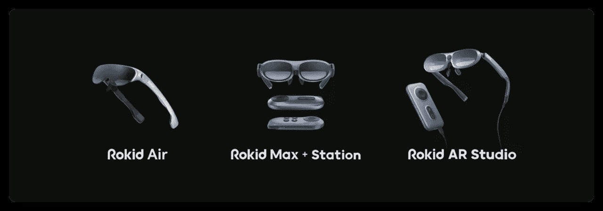

**接着进一步介绍说**用户的使用情况，一个数据：“周活突破 40%”。

这个数字确实很有意思，起码在一定程度上代表了普通大众用户对 Rokid 产品在市场中的接受度和用户粘性，一定程度上还代表 XR 的接受程度，代表他们的使用频次，代表除了桌面电脑、手机、平板等设备后他们认可的新设备。虽然对比前三者，XR 类设备的数据还差很远，但起码这是一个代表持续向好的信号之一。

期待未来更好～ ❤️

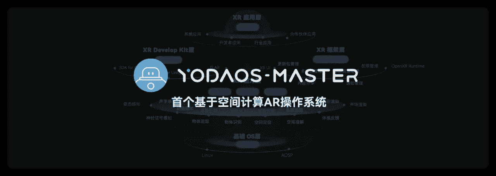

去年，发布了 Rokid AR Studio，宣传口径上被定义为空间计算套装，以及操作系统 YodaOS-Master。关于这个操作系统 YodaOS-Master，是一个基于 Linux 的空间操作系统，是其技术生态的核心。不仅支持 Unity 等主流 3D 引擎，而且通过 Open XR 标准进一步拓宽了兼容性，为开发者提供了一个强大的平台，以创造丰富多样的空间计算体验。

其实构建一个操作系统，虽然技术复杂，但也并非是不可能完成的任务。

相比构建操作系统，更难的则是建立生态。只有拥有更多的软件、开发者、合作伙伴，有了更多的应用和内容，才会有源源不断的用户。“没有生态就没有用户”这一点上，看一下以安全性著称的黑莓（BlackBerry）手机的的历史就知道了，以及还有诺基亚的 Symbian 操作系统。

以上种种，让我联想到了英伟达 NVIDIA，想到了 NVIDIA 如何变得“不可替代”，其中核心原因之一就是 CUDA 生态的建立。

当时发布会还和我前老板聊这件事，Misa 说自己也在与高校合作推出课程，而大学生在一定程度上就是未来。

试想，刚入学的大学生，无论从最初接触就是 CUDA 架构，还是学校学的课程内容，或者做科研，都是基于 CUDA 架构的 NVIDIA，最后毕业肯定是 CUDA 最熟呀，那他入职一家公司后，他肯定说自己用 CUDA 最熟练。从企业的成本出发，采用 NVIDIA 的显卡和设备确实是最优解，也不需要单独再培训员工使用 CUDA。

回到发布会，如果这件事做成了，那 Rokid 的护城河就又加宽了。

除了以上提到生态的建立，还有文旅方面。

Misa 分享说，Rokid 在文旅的市占率是 No.1，与国内 200 家以上的头部博物馆和 5A 景区达成了合作。更关键的是，以上没有一家是 Rokid 直接服务的，全都是来源于生态合作伙伴。

Rokid 就在努力构建一个健康的生态系统，在生态上的战略是“Step Back”（往后站一步），策略包括有对外领投芯片公司、与高校合作培训开发者、以及基于 Linux 的空间操作系统，其目的就是为了培育和支持一个强大的开发者社区，从而推动整个空间生态的发展。

## 空间计算生态及开发者计划

生态中心的负责人蔡国祥 Gary 首先介绍了 Rokid 第二届 AR 应用开发大赛的一些基本情况，并向我们播放了一段视频。垂云翼科技 CEO 密波也介绍了他们自己的应用，以及 Rokid 第一款基于 UE 平台开发的应用（水运仪象台）。

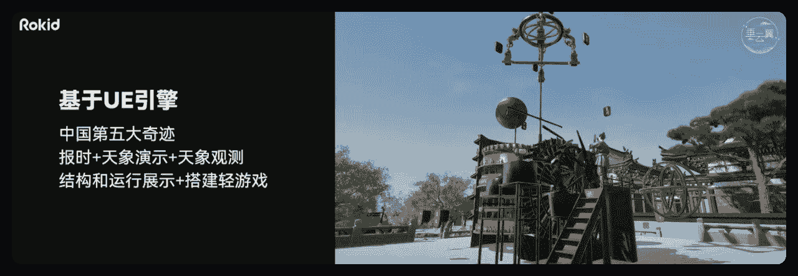

Gary 继续分享说，Rokid 自研 YodaOS-Master 空间操作系统，目前支持最多的 3D 引擎的操作系统，除了 Unity，还通过 Open XR 标准支持 UE、Cocos 等等。

### AR 生态应用

得益于 Rokid Station 的发布，积累了很多安卓 2D 的应用；空间 3D 应用，通过与优秀的生态伙伴进行合作，以及每年的应用开发大赛，也在不断完善着，现在已基本覆盖影视、游戏、学习、运动等场景。至于海外应用的生态，从教育、办公、娱乐，甚至也有 Google Play，想装的 App，基本都能下载到。

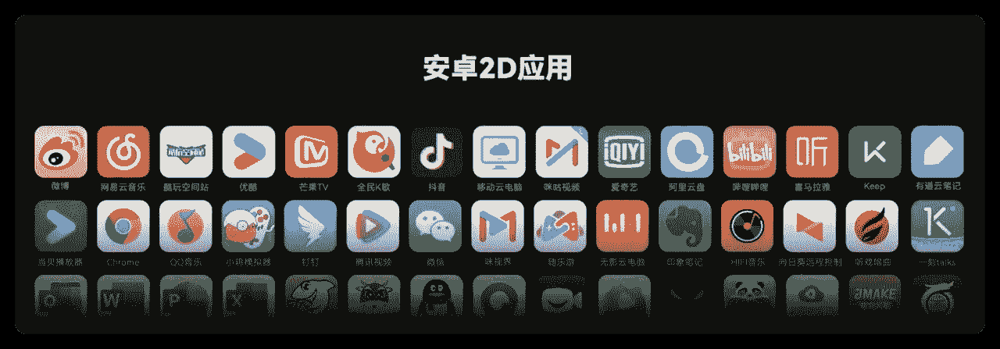

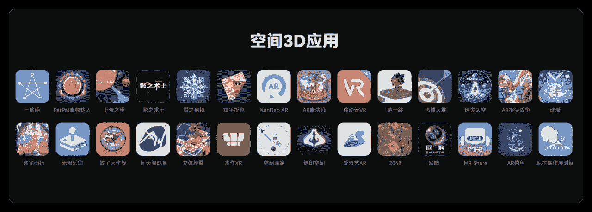

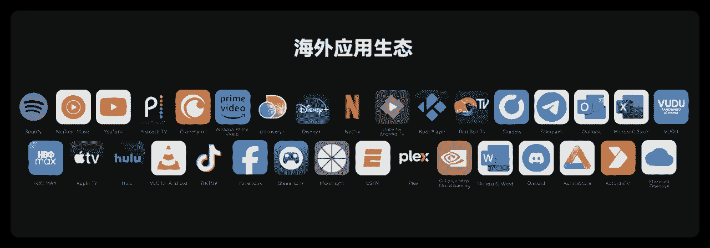

### 生态内容合作发布

第一家是爱奇艺，爱奇艺 AR 定制版 App。

据介绍，会采用空间多屏的方式，实现更好、更方便的交互体验。在字节的 Pico 4 Pro 上，是爱奇艺的 VR 定制版。当然，流媒体应用的核心还是片源问题。注意，不是说应用的交互方式不重要，而是片源直接决定你是否用它。

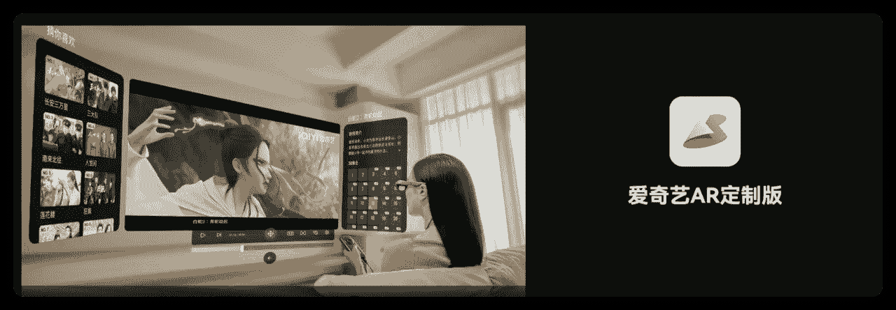

第二家，我确实没有想到会是印象笔记。

这种需要高频打字的应用和场景，又让**我想到了** XR 设备不可或缺的功能之一：语音输入。在我看来 XR 设备是最应该接入语音的设备。我第一次用 Pico 的时候，下意识的想要使用语音与它对话，可它不支持。

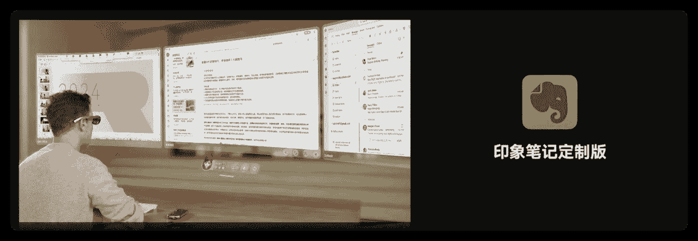

以及，我第一次拿到 Pico 4 Pro，在输入 Wi-Fi 密码的时候，简直是崩溃般的体验，太拉跨，拉胯到我不敢相信竟然会采用这种离谱的方式：用手柄一个一个字母、数字点按输入。每当我想到这种的时候，我就在想，如果有其他设备可以联动它就好了。

刚才敲文字的时候突然想到，用 VR 设备直接扫描手机上分享的 Wi-Fi 二维码不可以吗？VR 设备是 VST 方案，那直接用捕捉现实世界的摄像头，直接去扫描二维码，然后解码不就可以实现连接嘛？

1.  用手机分享 Wi-Fi 网络的 SSID（名称）和密码。

1.  将 SSID、密码和其他必要的 Wi-Fi 配置信息编码成二维码格式。

1.  将生成的二维码显示在手机屏幕上。

1.  用 VR/AR 设备上，支持捕捉或采集现实世界的摄像头扫描二维码。

1.  解码二维码中包含的 Wi-Fi 配置信息，不就完成自动连接了吗？

我暂时没有想到其他的困难点，所以我很想知道厂商没有采用这种方式的原因。🤔

如果有朋友知道，请麻烦告诉我。万分感谢～ ❤️

回到印象笔记 AR 定制版这个应用，老实说，我会觉得噱头大于实用。如果是通常是轻办公的场景，如果打字多，大概率会选择使用电脑；如果打字少，手机基本能够满足。为什么要用你的 AR 版？

为什么要随身带着一个 AR 眼镜 + Station（终端） + 折叠键盘？或者，即便是在家里，有把这些设备准备好的时间，想要记录的内容早就忘记了。因为整个使用的流程太长了，就会造成记录一次内容太重了，这一定会降低使用频率。试想，如果你打开印象笔记，它弹出广告或者增值服务，你会不会突然崩溃？

在线下的时候我没有去体验到这款应用，也没有搜到相关的视频。

第三家，XOSMO，AR 熊猫馆。可以召唤熊猫出来玩，有些手势可以与熊猫互动。如 Gary 所说，确实有可能小朋友会很喜欢它。

**第四家，迪惟科技**。**空间计算结合智慧建筑**

分享人是迪惟科技创始人 & CEO 沈迪科，沈总说，公司是以数字电箱和为核心，来打造全新的数字化生活方式，打造全新的生活模式，打造智能家居领域全新的交互方式。

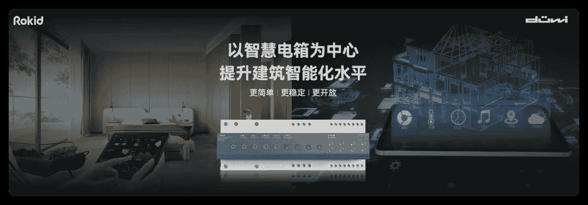

在场景切换的场景下，或许 AR、VR 设备将更有优势些，能够实现同一场景不同模式的切换，这个点还不错，确实线下有很多体验门店需要铺张很大，核心就是展厅的布置，目的就是为了营造不同场景的体验。具体的效果没有试用到，这个场景暂不做评判。

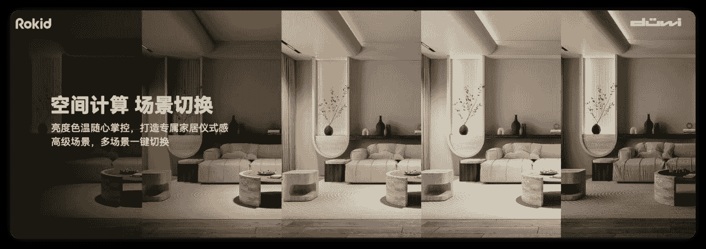

沈总描绘了几个场景，比如数据展示和预警的场景、有“重构空间、虚实结合”沉浸式体验的场景，其中，我印象比较深的，还是关于“AI + AR + 全屋智能”的空间交互场景。

简单说就是，你可以在所处的空间位置上定义你的设备开关，比如灯的颜色开关、自动窗帘的开关等等。使用的操作上，就是当你看向这个位置的操作时，可以通过单手手指捏和，AR 眼镜采集信息的方式获取到指令并执行。

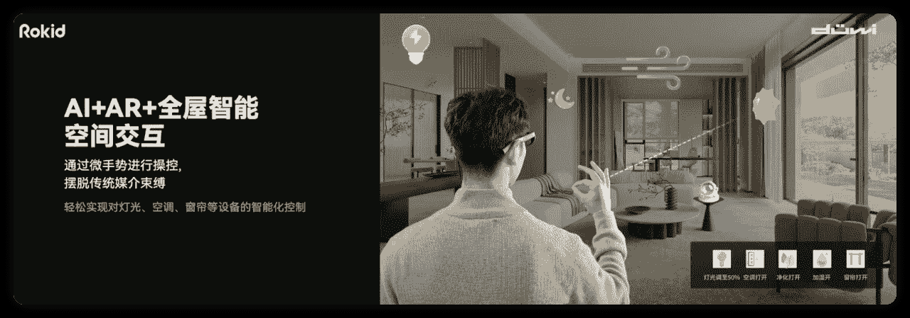

我的第一直觉认为有些反人类。如果现在语音音箱的语音反馈效果足够好，只需要一句话就可以搞定不是嘛？相比而言，找到这个不一定有电且不知道被家人放哪里的 AR 眼镜，开机，然后打开应用，再看向那个固定位置上的开关，然后单手手指捏和，被 AR 眼镜采集到指令信息并执行，然后等 Wi-Fi 延迟并实现预期结果。

前者 3-5 秒搞定，后者最起码 1 分钟以上。所以，这个流程是不是也长了一点...

再假设，如果某个开关在其他屋里，那还需要人走过去操作。如果是智能音箱，只需要放个拾音器或者支持组网的小音箱就可以解决。

举个例子，现在大多数的新能源汽车的车机都能做到很及时的语音指令的响应，比如小米的车机、华为的车机、理想和蔚来的车机，都能满足大多数人的需要。

回到“AI + AR + 全屋智能”空间交互场景。不排除用户最初用的时候很新鲜，使用频次可能相对高一些，可然后呢，还会继续用嘛？

现阶段，无论从交互逻辑还是场景上，我持怀疑态度。

### 开发者服务计划

为了帮助开发者创造出更精彩的应用，提供更完善的消费者服务。包括有面向高校、和面向社会的开发者培养计划，以及

第一，面向高校学生的开发者培养计划，包括有空间计算、AI 大模型、基础知识学习、设计开发培训、项目实战开发。现阶段，已与国内 15 家高校合作推出课程内容。

Gary 说，“培养高校学生就是在培养 XR 行业的未来”。深以为然。

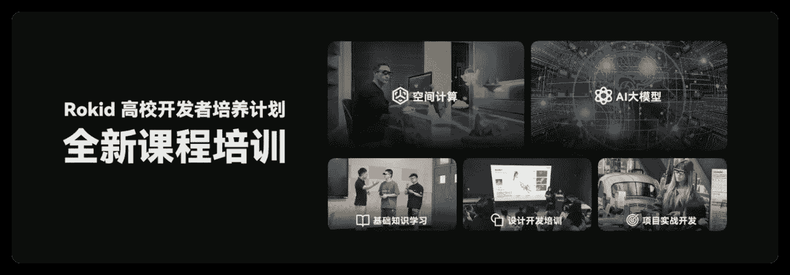

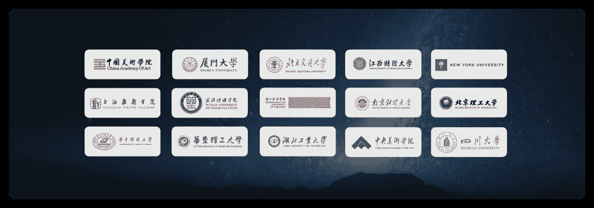

**第二，面向社会的开发者培训体系**，包括有开发者沙龙、若琪学院（视频教程+直播讲课+考试认证）、技术工作坊（DC 面对面、应用挑战赛）。

第三，持续推进与 Unity 的深入合作，包括有 UUG 开发者活动、Unite 大会、Unity GameJam 等。

## 空间计算下的文娱与教育

数字文化事业部的负责人 陈希 说，数字文化事业部创立的初衷就是协助生态伙伴一起去探索商业化的道路，用最新的技术去丰富线下的应用场景，让更多的人享受到科技与文化带来的快乐，通过市场的反馈去反推技术迭代和更新。

升级后的产品矩阵主要会聚焦在文博文旅、互动娱乐、智慧教育三大阵地。

### AR **文博文旅**

新时代文博文旅主要包括有，**新体验（空间导览）、新形态（智能导览精灵）、新玩法**（导览图鉴）、新叙事（大空间 AR 秀）。

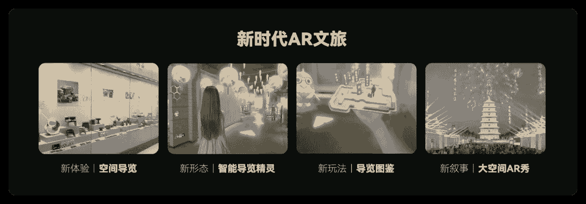

### AR **互动娱乐**

陈希提到，IP 的力量很强大，小朋友喜欢奥特曼的经典 AR 展，同时表示今年（2024 年）也将会引入更多有意思的 IP。

IP 互动的确实是个不错的切入点，比如有合作伙伴拿到奥特曼的版权，然后做学习应用，小孩子一定特别喜欢。或者小叮当的版权，再结合 AI 大模型，那小叮当就是小朋友们最喜欢的、无所不知的老师。

这种所谓的虚实结合，肯定会让小朋友更感兴趣。

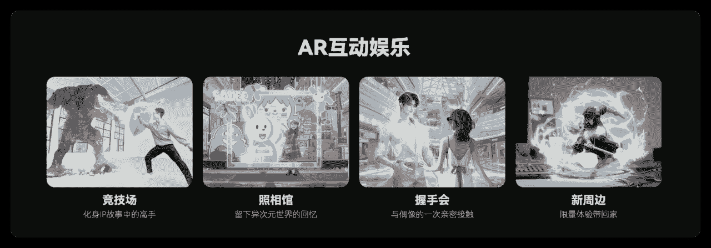

### AR **智慧教育**

学[初识 AR 眼镜｜热爱可抵漫长岁月](https://leonzhang.feishu.cn/wiki/GAnpwvmiBiwbupkRHSQcDWPznbd)能够通过更立体、更直观的课程内容获取知识，提升学习效率。关于智慧教育这点，我也曾在之前的内容中提到过（详细请移步至文档：  ），内容当时也是参考了 Rokid，不过这个场景确实是我之前设想过的画面。

尤其这个多人协作去做一些事情，比如拼一辆汽车、拼一个巨大的拼图，建造一个“我的世界”等等。

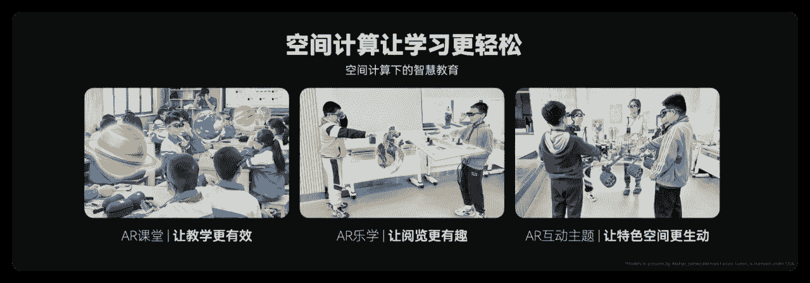

## 新品发布：Rokid AR Lite

Misa 分享说，从桌面计算过渡到移动计算，丢失了展现力。空间计算是有可能将原本的信息与原本的模样几乎 100%的展现在眼前。因为可移动性必然会损失设备体积，牺牲展现力。

在空间计算时代，人们突然发现有一种可能，可以将原本的信息、原本模样的东西 100% 还原到当时看到的画面。

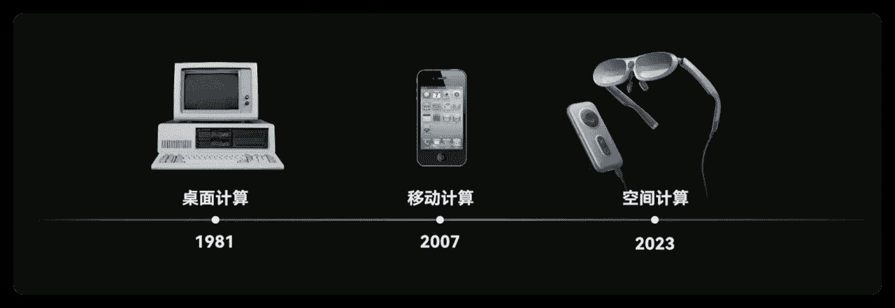

人们对于信息交互体验的追求是无止境的。在空间计算时代，你的面前将展示所有你想要的信息，按照不同层次平铺在面前。

Misa 描绘的这个场景，让我想到了 SmartisanOS 的无限屏功能，想到了多层级平铺的 TNT... TNT 的设计理念真的很超前。

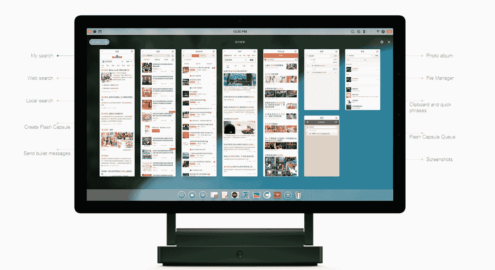

空间计算将成为继手机后的下一代计算平台。

Rokid 有些功能我是非常喜欢的，比如下图的前两个。

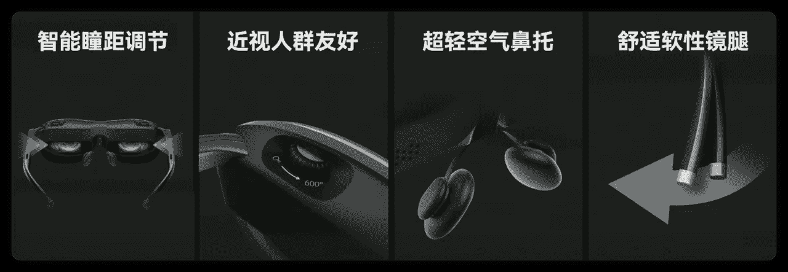

第一，这个智能瞳距调节肯定是大家喜欢的，当然，我也很喜欢，在 Pico 4 Pro 上用的时候，就觉得很爽。

第二，近视人群友好，0-600 度的近视调节。我不否认这个设计初衷的友好，但在实施过程中，可能出现了偏误。发布会结束后我去试用，我发现我自己戴了三四分钟，眼镜就开始痛了，然后一摸发现近视度数调节被调满了，也就是被调节至 600 度，也可能是因为我的近视度数高些，导致我没有留意近视度数，觉得画面差不多就带上了。

其实像这个功能应该有个类似数字的提醒，比如当前矫正大概是多少度，大家在调的时候更方便。还有一个问题，如果是已经调整好度数了，或许可以通过 UI 提示一下，比如简单的 Toast 提示，当前眼镜近视度数矫正为 xx 度。

Misa 总说，理论上任何应用这个传统的安卓应用都可以变成空间应用，且过程并不需要更改任何代码。在试用的设备中，我甚至在设备里看到了 Kimi 和锤子便签。

Misa 分享防抖功能，他说坐飞机、坐车都可以防抖。

坐飞机、坐车场景，不会晕车、晕场合，我能理解，但是跑步机，应该很难，毕竟应用是依托于眼镜的现实，即便是防抖，也是相对的，如果眼镜本体不稳定， 那又如何？

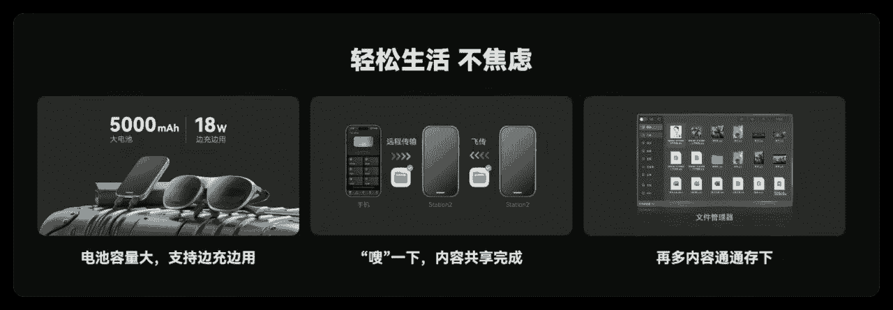

3D 的视频内容从哪里来？由新的计算中心负责拍摄和处理，这也是 Rokid 空间计算的关键硬件之一。

Rokid 希望能将其打造成个人随身伴侣。

Rokid AR Lite 功能展览图

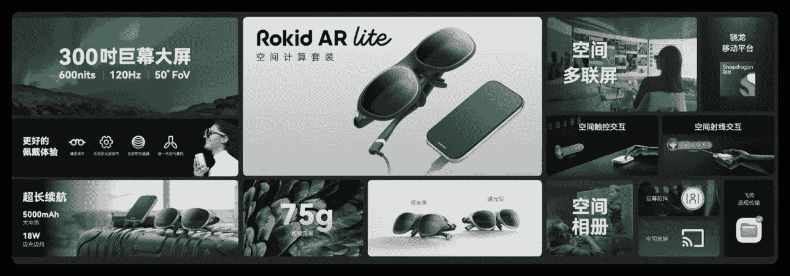

价格暂时没有公布。

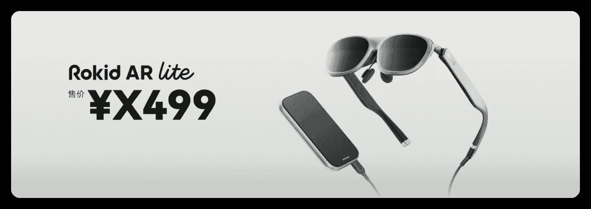

以上是本场发布会的全部内容。

## 最后

9 月份不是老罗细红线他们发新品嘛，我个人还是非常非常非常期待的，但根据老罗当时直播透露的消息，只有 199 美元和 299 美元两个价位。这两个价格，让我蛮担心的，第一是售价，成本的把控能力。第二是生态的建立，理由同上。

无论如何，希望顺利～ ❤️ 🎉

最后想说，因为这期内容中，我主要侧重于我个人参加这场线下的直观感受和体验，也试图去分析是否有应用可能是未来的 Killer App，包括但不限于交互逻辑、使用场景是否合理等，探讨应用或产品如何触动客户和用户。我个人认为，只有日常用的高频应用才有可能被称为 Killer App。

另外，内容和观点或许有些偏激，可能也不一定对，但希望能带来一些启发，如果你感兴趣，也欢迎留言交流～

最后的最后，期待能看到更多创新技术的涌现，以及这些技术如何被应用到日常生活中，还有更多的内容创新。祝 XR 行业发展越来越好～ ❤️

以上，祝你早安、午安、晚安～

## 相关阅读

+   现场录播：https://www.youtube.com/watch?v=hgyuzY01s3w

+   中国 AR 创新力量，引领空间计算新浪潮： http://www.news.cn/mrdx/2024-04/24/c_1310772433.htm

+    Rokid AR Studio: https://arstudio.rokid.com/

+   YodaOS: A modern OS for Node.js community: https://medium.com/@yorkienell/yodaos-a-modern-os-for-node-js-community-1d0c068218e4

+   空间计算定制！YodaOS-Master 系统迎来全方位升级： https://www.nxrte.com/zixun/45372.html

+   [重磅！Rokid Jungle 发](https://we.yesky.com/blog/300327)布新一代人机交互 AR 产品_天极大咖秀： https://we.yesky.com/blog/300327

+   [Cocos 引擎简介](https://www.cocos.com/post/54963e5ec11d76db476ac1c915c76dbf) ：https://www.cocos.com/post/54963e5ec11d76db476ac1c915c76dbf

+   Unity 实时开发平台 | 3D、2D、VR 和 AR 引擎 ：https://unity.com/cn

+   [The World's Most Trusted Gam](https://www.unrealengine.com/zh-CN/free-download/game-development-engine)e Development Engine : https://www.unrealengine.com/zh-CN/free-download/game-development-engine

+   XOSMO:  https://m.weibo.cn/u/7790325842

+   【迪惟带你走进智能家居系统，尊享高端品质生活】 https://www.bilibili.com/video/BV12S4y1A7k3/?share_source=copy_web&vd_source=672ec070780ce29c890256a5fabe799b

+   【大佬说，智能就是不用管！】 https://www.bilibili.com/video/BV1134y1a7P8/?share_source=copy_web&vd_source=672ec070780ce29c890256a5fabe799b

+   【Smartisan TNT go 无线版宣传视频】 https://www.bilibili.com/video/BV1qw4m1d7xs/?share_source=copy_web&vd_source=672ec070780ce29c890256a5fabe799b

+   Rokid AR Lite: https://arlite.rokid.com/

+   Thin Red.Dine: https://thinredline.com.cn/