# 初识 AR 眼镜｜热爱可抵漫长岁月

> 来源：[https://leonzhang.feishu.cn/docx/ZX82d39LMoSR8TxR1x5c9cgcnmd](https://leonzhang.feishu.cn/docx/ZX82d39LMoSR8TxR1x5c9cgcnmd)

Leon Cheung, April 12, 2024

> KK（凯文 · 凯利）说过，“只有写下来，才能知道自己是否真的明白。”

## 前言

你有没有想过拥有一个自己的贾维斯 Jarvis？

我看过的第一部漫威电影是《美国队长 2》，对局长尼克·弗瑞的雪佛兰 Suburban 甚是喜欢，然后疯狂爱上了漫威。最喜欢的角色还是托尼·斯塔克 Tony Stark（Iron Man，钢铁侠）。没错，我就是馋他的私人助理 Jarvis、各种战甲和各种科技产品。

喜欢到什么程度呢？

我自己用 iPhone 的快捷指令做了一个“低配版” Jarvis。第一步，将 Siri 设置成男声（Voice 1），第二步，根据需要创建流程即可，很简单。一切都弄好之后，只需要唤醒 Siri，说出指令「你在吗」，这样你就暂时拥有了一个“低配版”的 Jarvis。

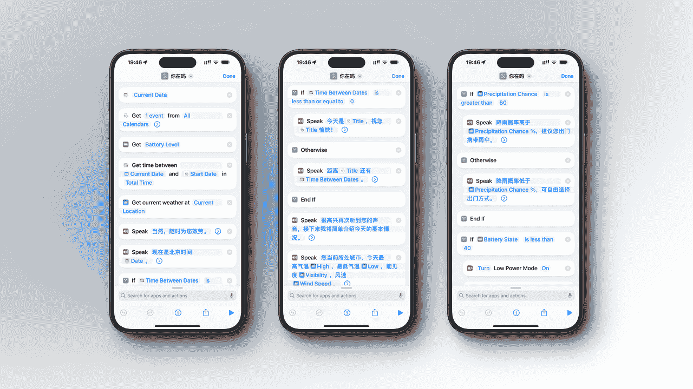

起初我将其设置为早上闹钟，很有用，感觉像 Iron Man 一样，一天都活力满满。

他交给小蜘蛛（Peter Parker，第三代蜘蛛侠）的眼镜 Edith 无疑也是我最喜欢的产品之一。外观和普通眼镜几乎一样，但它可以作为 Tony 的 Copliot，帮他完成实时环境分析、场景感知、信息搜集反馈、实时交互等等操作。

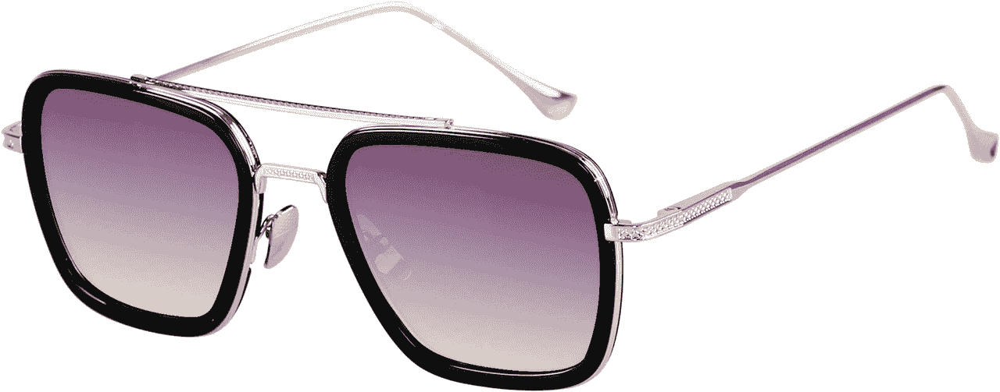

而它，其实就是一款采用增强现实（Augmented Reality）技术的 AR 眼镜。

也就是我们今天要聊的话题，AR。

## 初识 AR

### 那什么是 AR 呢？

维基百科 Wikipedia 的定义：增强现实 （AR） 是一种结合了现实世界和计算机生成内容的交互式体验。内容可以涵盖多种感官方式，包括视觉、听觉、触觉、体感和嗅觉。 AR 可以被定义为一个包含三个基本特征的系统：现实和虚拟世界的结合、实时交互以及虚拟和现实对象的精确 3D 配准。 叠加的感官信息可以是建设性的（即对自然环境的附加），也可以是破坏性的（即掩盖自然环境）。 因此，它是现实-虚拟连续体中的关键技术之一。

**头条百科的定义**：增强现实（Augmented Reality）是一种将虚拟信息与真实世界融合的技术，广泛运用了多媒体、三维建模、实时跟踪及注册、智能交互、传感等多种技术手段，将计算机生成的文字、图像、三维模型、音乐、视频等虚拟信息模拟仿真后，应用到真实世界中，两种信息互为补充，从而实现对真实世界的“增强”。

其实简单说，AR 就是一种将虚拟信息叠加到现实世界中的技术。通过生成虚拟信息，并通过光学技术将虚拟信息与现实世界进行融合。

说人话就是，“既能看到真实的外部世界，也能看到虚拟信息。”

应用场景如商品识别，或者文物识别，通过 AR 眼镜识别文物，获得文物的相关信息，比如朝代、历史故事等等，甚至还可以将生成文物的 3D 模型，可以更直观的了解文物。

### VR、MR 和 XR 分别是什么？区别是什么？

简单来说，AR 就是一种将虚拟信息叠加到现实世界中的技术，既能看到真实的外部世界，也能看到虚拟信息。品牌有 Google Glass、Rokid、XReal、雷鸟等。

+ VR（Virtual reality，虚拟现实）就是一种完全虚拟现实世界的技术，看不到真实的外部世界，画面都是虚拟信息，可以通过头戴显示器让你获得一种身临其境般的体验和感受。产品品牌如 Pico、Meta Quest、小派。

+ MR（Mixed Reality，混合现实）就是一种介于 AR 与 VR 之间，通过头戴显示器与摄像头实时捕捉现实世界画面，并进行融合，让你获得一种虚拟和现实结合的体验。产品品牌如 Apple Vision Pro。

+ XR（Extended Reality，扩展现实）就是 AR、VR、MR，这三种技术的统称。

VR、MR 和 XR 的主要区别是虚拟世界与现实世界的融合程度：

+ AR：虚拟信息叠加在现实世界中。

+ VR：完全虚拟现实世界，与现实世界区分开。

+ MR：虚拟世界和现实世界融合在一起，虚实结合。

+ XR：所有可以将虚拟世界与现实世界融合的技术。

### 我了解/接触 AR 的过程

印象第一次了解 AR 是淘宝的虚拟试衣间，我记得很清楚，当时铺天盖地的新闻。

因为我不太喜欢门店买衣服，高中也是很早一批在淘宝上购物的学生之一。还记得第一次网购，买的是鸿星尔克的运动鞋，150 左右，当时还怕买到假货，花时间研究店铺、研究评价，因为村里没有快递点，所以在学校的时候寄到了市里同学的家里，并委托他帮我带到了学校。

体验过一次之后，就很少在线下买商品了，甚至鸿星尔克一度成了我高中时期最喜欢的牌子，因为性价比高，便宜、耐造。所以当时淘宝要出 AR 试衣间的时候，我很开心，希望能买到自己喜欢的衣服，遗憾的是，至今我也没用过。

原因可能是，我并不像很多女生一样，不太需要经常买不同款式的衣服。我高中、大学，以及工作后，还经常买同款、甚至同色的衣服，只是因为穿着舒服。之前的时候，我给这种行为冠上一个“懒”字，真的就是懒的不想挑，不想承担过多的试错成本，网上买衣服经常遇到不合适的（不是颜色问题就是尺码问题）。

直到老罗分享过他的故事，比如常年就那几件衣服，包括读《乔布斯传》也是，乔帮主也是经常黑色高领衫 + 牛仔裤 + New Balance 990，因为他们都有着更重要的事情去做。自此，我开始借助老罗或乔帮主的形象去合理化我自身的一些标签。

熟悉我的人都知道，确实我常年就那几件衣服，但我和老罗也不是完全一样，他可是有《时尚先生》年度时尚先生称号的“时尚先生”，而我被吐槽衣品一般，哈哈。

印象第二次了解和关注 AR，应该就是小扎（马克·扎克伯格 Mark Zuckerberg ，Facebook/Meta 创始人兼 CEO）描绘的“元宇宙”。

无论是高中还是大学期间，总觉得 AR、VR 这类产品离自己比较远，所以关注的手机比较多些，毕竟这可是自己唯一能接触到的数码产品了。

直到工作后遇到“元宇宙”这阵“妖风”。为什么说是“妖风”呢？因为市面上听太多公司/创业者、太多人聊元宇宙了，一说是做啥的，就说“我是做元宇宙的。” 我看不懂，是真的看不懂。

然后喜欢的博主 AK（电丸科技 AK）又恰好在做这方面的内容，便开始关注。

## AR 眼镜

### AR 眼镜的硬件构成

目前消费市场上支持 AR 的硬件有很多，比如汽车上的抬头显示 AR-HUD（Augmented Reality Head-Up Display），可以显示车速、ACC 自适应巡航、车距警告、前车预警等基本导航信息到汽车的前挡风玻璃上；智能手机（如 iPhone）也能够通过内置的摄像头和传感器，借助于 AR App 在触摸屏上体验 AR；AR 眼镜也差不多，同样集成了摄像头、处理器、传感器和光学模组等，不同的是，AR 眼镜能够在用户真实物理环境的视野中叠加虚拟信息。

当然，若想要获得更良好的 AR 体验，AR 眼镜肯定是必选项。其实，从组成原理的角度，AR 眼镜的构成也很好理解，无非是硬件、软件、操作系统。由于 AR 眼镜的发展受限于硬件技术的发展，比如光学模组、芯片、、传感器、电池等技术的迭代更新，以及这些模组带来的，无法避免的设备重量等等。

为了更好的了解 AR 眼镜，那我们接下来就来拆解一下 AR 眼镜，从它的各部分硬件组成及相关的硬件技术开始聊起。AR 眼镜主要由以下几部分硬件组成：

1. **光学显示系统**。这是 AR 眼镜的核心模块，占据了整个硬件成本的大半个部分。包括有 OLED、Micro OLED 等构成的微型显示屏，以及由 BirdBath、光波导、自由曲面、棱镜等光学模组构成的成像元件。

2. **计算处理系统**。负责对采集到的图像和数据进行计算和渲染处理：图像识别、跟踪、定位、渲染等。硬件设备包括 CPU、GPU、内存、存储等。

3. **信息采集系统**。负责采集现实世界的信息，包括图像、视频、深度信息等，硬件设备包括摄像头、陀螺仪、加速度计、磁力计和深度传感器等。

4. **交互系统**。负责与用户与 AR 眼镜的交互，包括手势识别、语音识别等，硬件设备同信息采集系统。

5. 其他，构成 AR 眼镜的其他硬件设备，有电池、眼镜外框架等。

### 光学显示系统

如上所说，光学显示系统是 AR 眼镜的核心模块，也是其头部成本所在，核心负责将虚拟信息叠加到现实世界中。主要包括两部分，光学系统和显示系统。光学系统负责传递内容信息，而显示系统则负责显示内容信息。

目前主流光学显示系统方案包括：棱镜、Birdbath 方案、自由曲面方案、全息透镜方案、光波导方案。

第一种，**棱镜方案**。主要由投影仪和棱镜组成。投影仪将图像投射至棱镜，人眼在捕捉现实世界画面时，棱镜将虚拟信息反射到人眼视网膜中，从而叠加在现实世界的画面中，比如 Google Glass。这个方案的优点很明显，那就是结构简单，同样，缺点也很突出，由于棱镜的尺寸或体积较小，导致视场角也比较小，而且亮度也不足，从而也导致在户外烈日下几乎不可用。

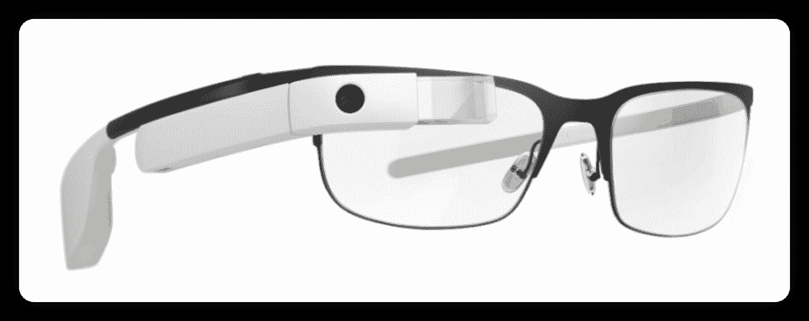

第二种，**Birdbath 方案**。通过一个 45 度角的分光镜将图像反射到用户的眼睛中。这种方案可以实现较大的视场角，但同时也会增加设备的体积和重量。如下图的联想 Mirage AR 头显以及 ODG R9 头显，其中 ODG 有 50 度的视场角，其厚度则超过 20mm。

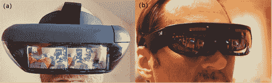

第三种，**自由曲面方案**。通过使用特殊设计的反射镜来引导光线，这种方案可以提供较大的视场角和较好的图像质量，缺点是设计和制造过程复杂。美国梦境视觉公司的 Meta2 系列 AR 眼镜虽然有 90 度的视场角，但是其厚度超过 50mm，仅光机系统重量就约为 420 克。

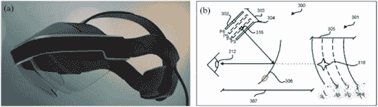

综上所述，以上三种方案（棱镜方案、birdbath 方案、自由曲面方案）均存在一个视场角越大，就越会导致光学镜片越厚、体积越大的问题产生，而全息透镜方案与光波导方案的出现解决了一部分体积大的问题。

第四种，**全息透镜方案**。采用全息技术来衍射和引导光线，可以实现较大的视场角和较薄的光学显示系统，体积小、功耗小；缺点是视场角小，对比度低，透光率高，亮度不足。如 North 公司的 AR 眼镜。

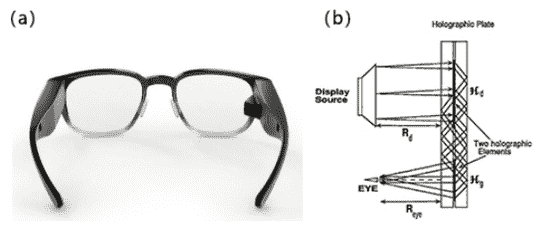

第五种，**光波导方案**。无论从光学效果、外观形态，和量产前景来说，都要优于前四种方案。一般来说，基于光波导方案的 AR 眼镜，一般由显示模组，光波导和耦合器三部分组成。根据耦合器原理，采用光波导方案的 AR 眼镜从光波导技术上大抵分为两种方案，分别是几何式波导方案和衍射式光波导方案两种。

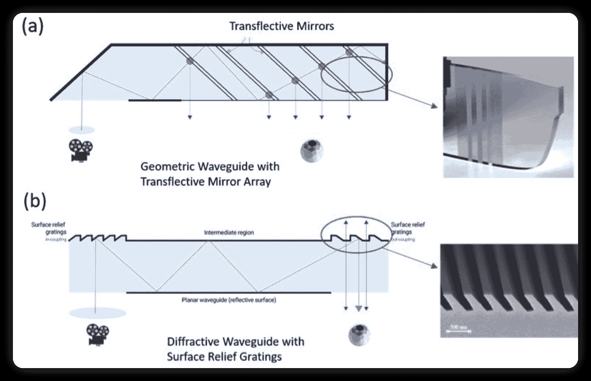

光波导方案简单说，就是利用光学原理通过光波导和耦合器将虚拟信息展示在显示模组上，进而被人眼捕捉。优点是亮度高、视场角大、分辨率高且功耗小；缺点是由于透光率高导致的显示色彩和对比度稍差。比如 Microsoft HoloLens 与 Rokid Max。

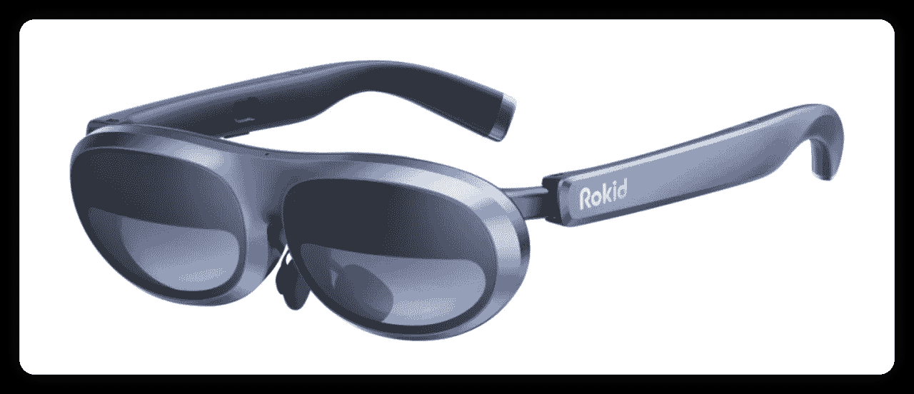

### 计算处理系统

计算处理系统负责对采集到的图像和数据进行计算和渲染处理：图像识别、跟踪、定位、渲染等。硬件设备包括 CPU、GPU、内存、存储等。

第一，处理器（CPU/GPU/NPU）：AR 眼镜需要强大的处理器来执行各种密集型任务，如图像渲染、空间定位、物体追求和传感器数据的处理。通常是集成在专用芯片上的多核 CPU 和 GPU，能够并行处理多个任务，以确保设备系统的流畅运行。比如高通第一代骁龙 AR2，专为 AR 打造的高性能、低功耗（低于 1W）的 AI 处理器，同时采用多芯片分布式处理架构，方便将处理任务分配给同样搭载骁龙芯片的智能手机等设备（生态这不就建立起来了嘛）。

第二，**内存（RAM）**：即设备的“运行内存”。为了支持高效的数据处理和流畅的多任务操作，堆积足够的 RAM 是很有必要的，就像同等流畅程度的情况下，Android 手机拥有比 iPhone 更大的 RAM，除直接影响设备能同时处理的数据量之外，还有系统和内存架构的不同，比如像 UMA（Unified Memory Architecture，统一内存架构）。

第三，**存储（ROM）**：因为多数 AR 眼镜是采用安卓 Android 深度定制的系统，存储不仅要存储操作系统，还有未来越来越复杂的 AR 应用，所以大内存/存储也必不可少。

第四，**操作系统（OS）**：通常负责协调管理硬件资源、调度任务，以及支持 AR 特有的功能，比如空间感知、用户界面和多传感器的融合。同存储部分，多数 AR 眼镜都是采用安卓 Android 深度定制的系统，比如 Microsoft HoloLens 2。

也有一些特例，比如我之前关注的品牌 Rokid，其全栈开源的 YodaOS 是采用基于 Linux 内核的 OS。（对了，下周末去参加 Rokid Open Day 2024，到时候关注下最新的进展以及还有新品，期待一下～ ❤️）

第五，**传感器数据采集**：AR 眼镜集成的传感器类型与 iPhone 上集成的传感器类型差不多，比如都有摄像头、陀螺仪、加速度计、磁力计和深度传感器等，在数量和功能上也比较接近，比如 iPhone 上的四麦克风阵列，除通话拾音外，还有通话降噪和视频录制。在 AR 设备上也基本相同，通话拾音、降噪和视频录制，这也是做麦克风阵列的主要目的之一，而摄像头也可以做头部追踪、手势识别和环境理解和捕捉等等。

第六，**图形渲染**：高质量的图形渲染对于 AR 体验很重要，尤其是在沉浸式的场景下。计算处理系统需要融合各部分硬件，实时渲染复杂的 3D 模型和动画，并将它们叠加到现实世界的视图上。

第七，**无线通信**：大多数 AR 眼镜会通过 Wi-Fi Direct、蓝牙（经典蓝牙/BLE）、蜂窝网络与智能手机、电脑等外部设备通信，用以接收和发送数据。比如 Meta 的 Ray-Ban（又称 Meta Smart Glasses）就是采用 Wi-Fi Direct 与蓝牙，其中，Smart Glasses 在眼镜充电盒里可以通过蓝牙传输已拍摄的视频给智能手机。

第八，**电池续航**：部分 AR 眼镜需要在移动状态下使用，为了延迟设备的使用时间，低功耗芯片和光学显示系统是必选项。比如之前在听 AK（电丸科技 AK）分析 Ray-Ban 的时候，他提出的一个观点就很好玩，即采用 Pogo Pin 更换电池配件的方式。

嗯，有道理，相当于是 iPhone + MagSafe 外接电池了。当时听到就觉得是个很棒的点子，甚至电池配件丢了还可以再购买新的电池配件（配件营业额又增加了）。

第九，**散热设计**：大量的计算处理可能会导致发热，所以还需要有必要的散热设计，防止设备过热导致处理器降频，或设备使用上的卡顿。

### 信息采集系统

信息采集系统，也可以成为是多种传感器的集合。主要负责采集现实世界的信息，包括图像、视频、深度信息等，实现更精准的空间定位、环境感知和交互功能的关键。硬件设备常见有摄像头、陀螺仪、加速度计、磁力计和深度传感器等（同 2.3 部分的传感器数据采集）。

第一，**摄像头**。实时捕捉现实世界画面，支持图像识别、头部追踪、手势识别和环境理解和捕捉等功能。比如 Rokid Max 的单目摄像头，既可以实现手势识别还可以完成空间感知。通常应该是双目摄像头的空间感知和深度信息会更精确，但是 Rokid 做到了单目，嗯，有点东西。

第二，**陀螺仪和加速度计**。手机上也有，但作用是控制屏幕旋转、配合 GPS/北斗提供更精确的导航信息，比如会拿着 iPhone 画 「8 字型」，就有可能是传感器存在误差了。但 AR 眼镜的陀螺仪和加速度计主要是追踪头部和身体的运动，提供六自由度（6DOF）的追踪。

第三，**磁力计**。用于检测设备相对于地球磁场的方向，辅助确定设备的朝向，作用主要是为了提供相对准确的空间定位和导航信息。

第四，**深度传感器**。字面意思，用于测量物体的距离和形状，支持复杂的交互和空间映射。

第五，**环境光传感器**。用于自动调整显示屏的亮度，以适应当下不同的环境光。iPhone 上的自动调节亮度和原彩显示都是依靠这个传感器实现的。

### 交互系统

交互系统主要负责用户与 AR 眼镜的交互，包括手势识别、眼球追踪、语音识别等，硬件设备同信息采集系统。

第一，**手势识别**：通过手指的捏合、滑动实现抓取、拖动控制 AR 设备/应用。比如 Rokid Max 支持手势识别，通过简单的手势来操作虚拟对象，如抓取、拖动或缩放等。

第二，**眼球追踪**：通过人眼的注视点，来定位和落焦在对应的功能位置上。Pico 4 Pro（VR 设备） 虽然也支持这个功能，但几乎是不可用的状态，不可能作为主力的交互方式。对了，它的手势识别也不好用...

第三，**语音识别**[：通过](https://zh.wikipedia.org/zh-cn/%E5%9D%9A%E6%9E%9CTNT%E5%B7%A5%E4%BD%9C%E7%AB%99)声音指令来控制 AR 应用或信息获取。一瞬间又想到了 TNT，不过，也许 TNT 用在 AR 眼镜上也许更适合。题外话，期待 9 月份 Thin Red Line 的新品，老罗直播说预算是 199 美元与 299 美元。 ❤️

第四，**触控板和按钮**：很多 AR 眼镜为了眼镜本体的轻便，便将处理器、内存、存储、电池等集成在外置设备上，通过数据线进行连接。比如 Rokid AR Studio，就是 Rokid Max + 数据线 + Rokid Station = Rokid AR Studio，其中物理按键均集中在 Rokid Station 上。

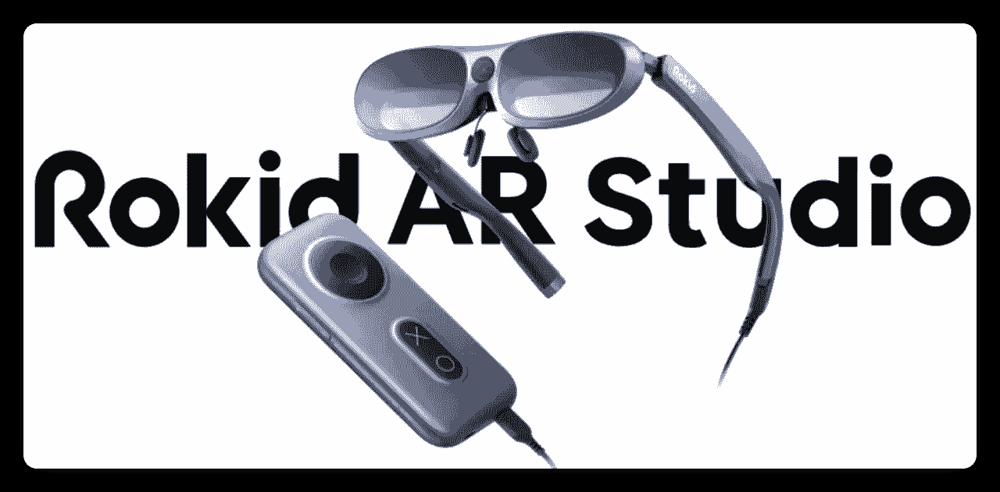

第五、**头部追踪**：通过头部追踪传感器检测用户的头部运动，能够让画面内容随着用户的视角进行调整。

第六、**运动信息采集**：通过集成运动传感器，比如加速度计和陀螺仪，来捕捉用户的头部和身体动作，检测用户的实际动作，增加 AR 体验的沉浸感。

第七、**物体识别**：通过摄像头等传感器自动识别图像中的物体，可以将虚拟信息叠加到特定的物体上。比如 Rokid 的「交互手表」功能，增加更多交互的可能性。

第八、**触觉反馈**：通过震动马达或其他物理刺激来模拟触觉感受，增强交互体验。

经过以上内容的普及，基本了解了 AR 工作习惯。

## AR 的应用

如文章开头介绍的内容，如虚拟试衣间、iPhone 或 iPad 的 AR，当前 AR 的应用范围非常广泛，它正在逐步渗透到我们生活的各个方面，改变我们的学习、工作和娱乐方式。

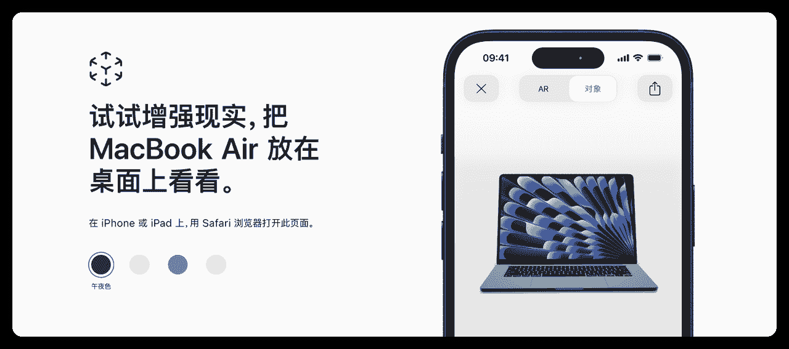

### 零售与营销

利用 AR 技术提供类似于淘宝虚拟试衣间、以及 iPhone 或 iPad 的 AR 看 Mac 这种，更加个性化和互动的购物体验。客户可以通过 AR 应用在家中试穿衣服，而品牌则可以利用 AR 创造吸引人的广告和促销活动。此外，AR 技术还可以帮助零售商优化库存管理和物流流程。

### AR 创新教育

AR 可以将抽象的概念以直观的方式呈现，帮助学生更好地理解和记忆。我想起自己作为一个农村学生，中学时期过得很痛苦。受限于当时农村地区的教学质量，以及自身欠缺的基础认知不足，导致当时的外语、地理、历史等课程要落后于一二线城市的同学。

+   现阶段，可以借助于 AR 设备，通过视觉和听觉，更好地学习外语，比如沉浸式体验各种英语环境，实时翻译、游戏互动等交互式学习；

+   借助于 AR 设备，可以通过视觉和听觉，清楚的看到不同地区的气候、地貌和自然资源，加深记忆；

+   借助于 AR 设备，可以通过视觉和听觉，模拟历史并游览、探索古代建筑，了解历史事件发生的地点和环境，甚至还可以看到各种历史文物和动物。

### 娱乐与游戏

AR 技术在娱乐和游戏的行业中也是比较有潜力的。一种全新的互动体验，可以将虚拟角色和环境融入现实世界中，为用户提供更沉浸式的表演和互动体验。

### 医疗健康

在医疗健康领域，AR 技术的应用正在快速发展。医生可以利用 AR 技术进行手术规划和模拟，通过叠加详细的解剖信息来提高手术的精确度。

### 工业元宇宙

在工业和制造领域（工业元宇宙），AR 技术的应用可以提高生产效率和安全性。工程师和技术人员可以利用 AR 进行设备的维护和修理，通过叠加指导信息和 3D 模型来简化复杂的任务。同时，AR 技术也支持远程协作和设计验证，帮助团队跨越地理障碍进行合作。

### 旅游与文化遗产

AR 技术在旅游和文化遗产保护方面也展现出巨大潜力。用户可以通过 AR 应用获取景点的历史信息和导航提示，使得旅游体验更加丰富和教育性。同时，AR 技术也可以帮助保护和重现文化遗产，让公众在不破坏原有结构的情况下，了解和体验历史遗迹。

以上这些场景，是 Rokid 正在做的事情，比如与博物馆合作，生产更优质的内容。

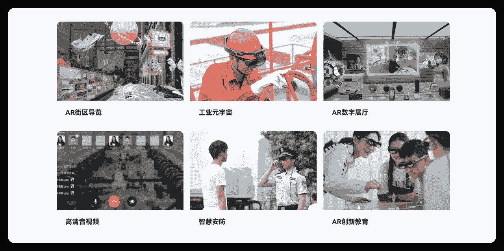

## 写在最后

这篇文章算是我个人短时间学习后的结果，算是给自己一个交代。之前对 XR 行业的关注只是作为个人兴趣爱好，了解的内容都很散，这两天算是“相对系统性”的梳理了一下。

至于为什么说是“相对系统性”的梳理呢？因为分类方式比较多，短时间我也不清楚应该怎么分算合适，但如若不写的话，可能永远也不清楚怎么分会合适，更看不清楚 AR 眼镜/AR 设备的全貌到底是什么？万幸，算迈出了研究的第一步，也算是“盲人摸象”的第一次，完整从鼻子到尾巴，从局部到整体。

受限于时间与个人现阶段认知的限制，本篇文章肯定有诸多不足之处，欢迎行业内的朋友帮忙推荐更多资料，在此首先表示感谢～ ❤️

若有你感兴趣的地方，也欢迎留言交流～

以上，

祝你早安、午安、晚安～

### 相关参考

#### 相关术语

1.  **DSP 数字信号处理**

DSP 是 Digital Signal Processor 的缩写，中文意为数字信号处理器。

DSP 是一种专门用于数字信号处理的微处理器。它通过软件和专门的硬件架构，能够高效地执行各种信号处理任务，如数字滤波、快速傅立叶变换等。

1.  **BLE 低功耗蓝牙**

也称蓝牙低能耗、低功耗蓝牙，是蓝牙技术联盟设计和销售的一种个人局域网技术。

旨在用于医疗保健、运动健身、信标、安防、家庭娱乐等领域的新兴应用。相较经典蓝牙，低功耗蓝牙旨在保持同等通信范围的同时显著降低功耗和成本。

1.  **Pogo Pin 精密连接器**

常应用于手机等电子产品的精密连接器。

广泛应用于各种电子产品中，由针轴、弹簧、针管三个基本部件通过精密仪器铆压预压之后形成弹簧式探针，其内部有一个精密弹簧结构。表面镀层一般都镀金，可以更好地提高它的防腐蚀功能、机械性能、电气性能等。主要用于电流和信号传输，即充电、导电的作用。

1.  **多模态 Multi Modal**

多模态是指将多种感官进行融合，而多模态交互是指人通过声音、肢体语言、信息载体（文字、图片、音频、视频）、环境等多个通道与计算机进行交流，充分模拟人与人之间的交互方式。由此可以看出，多模态 Al 实际上就是计算机视觉和交互式人工智能模型的最终融合，它为计算器提供更接近于人类感知的场景。

1.  端侧存储 Local Storage

端侧也就是我们常说的边缘计算，这种模式可以更好的支持 AloT 场景。

端侧可以第一时间对收集的数据进行处理，不需要通过网络上传到云侧的处理中心，极大加快了系统响应也减少了系统处理的延迟，同时也保护了隐私。

1.  PAN 网络 Personal Area Network

是一种用于在个人工作空间内互连电子设备的计算机网络。

PAN 提供计算机、智能手机、平板电脑和个人数字助理等设备之间的数据传输。PAN 可用于个人设备本身之间的通信，或用于连接到更高级别的网络和互联网，其中一台主设备充当网关的角色。

1.  **Ad hoc 无线随意网络**

又称无线临时网络，是一种分布式的无线网络系统。

这种网络系统是临时形成，由节点与节点间的动态链接所形成。它不需要依赖一个既存的网络架构，像是有线系统的路由器，或是无线系统的无线网络基地台。相反的，它每一个节点，都有能力转送网络数据包给其他节点（这称为路由）。

1.  UMA 统一内存访问（Unified Memory Access）

UMA 内存就是 CPU 和 GPU 共享同一块内存，避免数据在 CPU 和 GPU 之间复制，从而提高性能。

UMA 内存是一种计算机内存访问模式，它允许 CPU 和 GPU 共享同一块内存，从而避免在 CPU 和 GPU 之间进行数据复制。具体来说，UMA 架构下，CPU 和 GPU 共享同一块系统内存。当 GPU 需要使用数据时，它直接从系统内存中读取数据，无需额外的数据复制操作。这种方式减少了 CPU 与 GPU 之间的数据传输开销，提高了应用程序的性能。

1.  **Micro-OLED**

+   [什](https://www.cnet.com/tech/computing/what-is-micro-oled-apple-vision-pros-screen-tech-explained/)么是 Micro-OLED？ What Is Micro-OLED? Apple Vision Pro's Display Explained

Micro-OLED 是一种微型显示器，尺寸小于 1 英寸。它具有自发光、厚度薄、质量轻、视角大、响应时间短、发光效率高等特性，非常适合应用于近眼显示设备如 VR、电子瞄准镜、夜视仪等。

Micro-OLED 的技术原理与传统的 OLED 显示器相同，都是利用有机材料发光。但 Micro-OLED 的制造工艺更加复杂，需要在微小的硅晶圆上构建驱动电路和 OLED 发光层。

Micro-OLED 的优势主要体现在以下几个方面：

+   体积小、重量轻：Micro-OLED 的尺寸可以做到非常小，重量也非常轻，因此非常适合应用于对体积和重量要求苛刻的设备。

+   分辨率高：Micro-OLED 的像素密度可以做到非常高，因此可以提供非常清晰的画面。

+   响应时间短：Micro-OLED 的响应时间非常短，因此可以提供非常流畅的画面。

Micro-OLED 的主要应用领域包括：

+   VR/AR：Micro-OLED 是 VR/AR 设备的关键部件，可以提供高分辨率、高刷新率的画面，为用户带来沉浸式的体验。

+   可穿戴设备：Micro-OLED 可以应用于智能手表、AR 眼镜等可穿戴设备，提供更加清晰、细腻的画面。

+   医疗设备：Micro-OLED 可以应用于手术显微镜、内窥镜等医疗设备，帮助医生获得更加清晰的视野。

#### 技术解析

1.  **Ad-Hoc 是什么？**

Ad-Hoc 是一种无线局域网技术。简单来说，它可以让手机直接通过 Wi-Fi 技术与其他设备进行通信，而不需要依赖无线接入点。

举个例子，如果你想用蓝牙技术直接将文件从手机传输到电脑，但电脑没有蓝牙功能，你可以通过建立手机与电脑之间的 Ad-Hoc 网络，实现通过 Wi-Fi 技术在两设备之间传输数据。

Ad-Hoc 是一种无线局域网技术。它可以让手机直接通过 Wi-Fi 技术与其他设备进行通信，而不需要依赖无线接入点。

所以简单说，Ad-Hoc 就是手机通过 Wi-Fi 直接与其他设备通信的技术。

1.  Ad-Hoc 与 Wi-Fi Direct 的区别是什么？

Ad-Hoc 和 Wi-Fi Direct 都是用于设备直接连接的无线技术，主要区别在于：

Ad-Hoc 是一种较早期的技术，它需要手动配置网络设置。而 Wi-Fi Direct 是一种标准化的技术，它可以自动发现和连接其他 Wi-Fi Direct 设备，配置过程更简单。

简单点说，Ad-Hoc 需要手动设置网络参数进行连接，而 Wi-Fi Direct 支持自动发现和连接，配置过程更简单便捷。

另外，在安全性上，Wi-Fi Direct 支持 WPA2 加密，比 Ad-Hoc 更安全。总体来说，Wi-Fi Direct 相比 Ad-Hoc 而言，配置更简单，安全性也更高，是一种更先进的直接连接技术。

1.  BLE 和 经典蓝牙 的区别是什么？

+   https://en.wikipedia.org/wiki/Bluetooth_Low_Energy

+   https://en.wikipedia.org/wiki/Bluetooth

相较于经典蓝牙，BLE 能在保持同等通信范围的同时显著降低功耗和成本。用于连接耗电较少的设备（如智能手表、健康追踪器等）的话会使用 BLE，而用于连接音频设备或其他需要较高数据传输速率的设备则可能会使用经典蓝牙。

#### 参考资料

+   【【影视片段】神盾局局长尼克弗瑞街头被追杀片段 | 美国队长 2】 https://www.bilibili.com/video/BV11y4y147w5/?share_source=copy_web

+   维基百科 Wikipedia AR ： https://en.wikipedia.org/wiki/Augmented_reality

+   维基百科 Wikipedia VR ： https://en.wikipedia.org/wiki/Virtual_reality

+   维基百科 Wikipedia MR ：https://en.wikipedia.org/wiki/Mixed_reality

+   AR, VR, MR, and XR – what they mean and how they’ll transform lives :   https://www.qualcomm.com/news/onq/2022/09/ar--vr--mr--and-xr---what-they-mean-and-how-they-ll-transform-li

+   [淘宝计划推“360°虚拟试衣”功能，](https://m.36kr.com/p/1647104032769)一大波“虚拟试衣间”正在路上 -36 氪： https://m.36kr.com/p/1647104032769

+   一年过去了，扎克伯格进军元宇宙的努力究竟出了什么问题？-36 氪 ：https://36kr.com/p/1954543139051655

+   扎克伯格「元宇宙」的故事 -36 氪 ： https://36kr.com/p/1377259021514113

+   一文读懂 AR-HUD 技术：https://www.eet-china.com/mp/a178951.html

+   一文看懂主流 AR 眼镜的核心显示技术——光波导 -36 氪 ：https://www.36kr.com/p/1723761885185

+   AR 眼镜中的光学显示方案原理及其工艺全解析 ：http://vr.sina.com.cn/news/hz/2020-06-17/doc-iirczymk7483042.shtml

+   [与迪士尼合作，联想 Mirage AR 头显售 200 美](https://news.nweon.com/35418)元，独占《星球大战》内容 - 映维网资讯 ：https://news.nweon.com/35418

+   ODG 发布全新 AR 眼镜 增加定位追踪和优化视场 - 映维网资讯 ：https://news.nweon.com/25622

+   [高通发布第一代骁龙 AR2 平台，旨](https://www.qualcomm.cn/news/releases/2022/11/releases-2022-11-17-0)在变革 AR 眼镜 | Qualcomm： https://www.qualcomm.cn/news/releases/2022/11/releases-2022-11-17-0

+   苹果 M1 统一内存架构真的很厉害吗？ : https://www.eet-china.com/news/202108190817.html

+   操作系统迭代进行时 YodaOS 或将成为 AI 时代的安卓 ：https://ai.techweb.com.cn/2019-01-29/2722312.shtml

+   [Ray-Ban | Meta smart glasses](https://www.ray-ban.com/usa/ray-ban-meta-smart-glasses) 2024 | Ray-Ban® USA :  https://www.ray-ban.com/usa/ray-ban-meta-smart-glasses

+   [I](https://about.fb.com/news/2023/09/new-ray-ban-meta-smart-glasses/)ntroducing the New Ray-Ban | Meta Smart Glasses | Meta :  https://about.fb.com/news/2023/09/new-ray-ban-meta-smart-glasses/

+   坚果 TNT 工作站： https://zh.wikipedia.org/zh-cn/%E5%9D%9A%E6%9E%9CTNT%E5%B7%A5%E4%BD%9C%E7%AB%99

+   [Rokid AR Studio](https://arstudio.rokid.com/profile) : https://arstudio.rokid.com/profile

+   [W](https://www.cnet.com/tech/computing/what-is-micro-oled-apple-vision-pros-screen-tech-explained/)hat Is Micro-OLED? Apple Vision Pro's Display Explained :  https://www.cnet.com/tech/computing/what-is-micro-oled-apple-vision-pros-screen-tech-explained/

+   【聊聊罗永浩的细红线到底在做什么「SIGNOW」】 https://www.bilibili.com/video/BV1EN4y1H7jo/?share_source=copy_web&vd_source=672ec070780ce29c890256a5fabe799b
