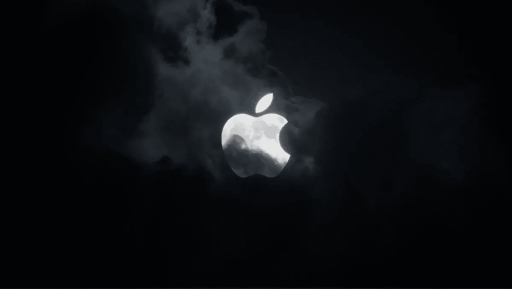
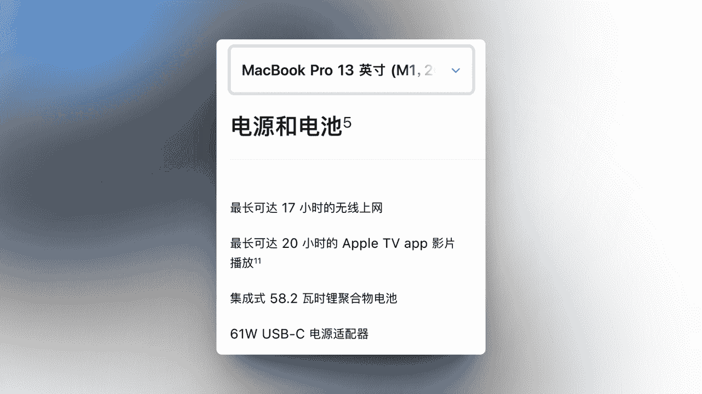
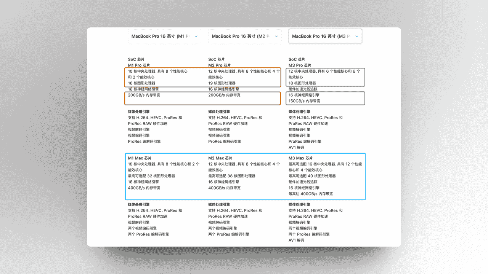
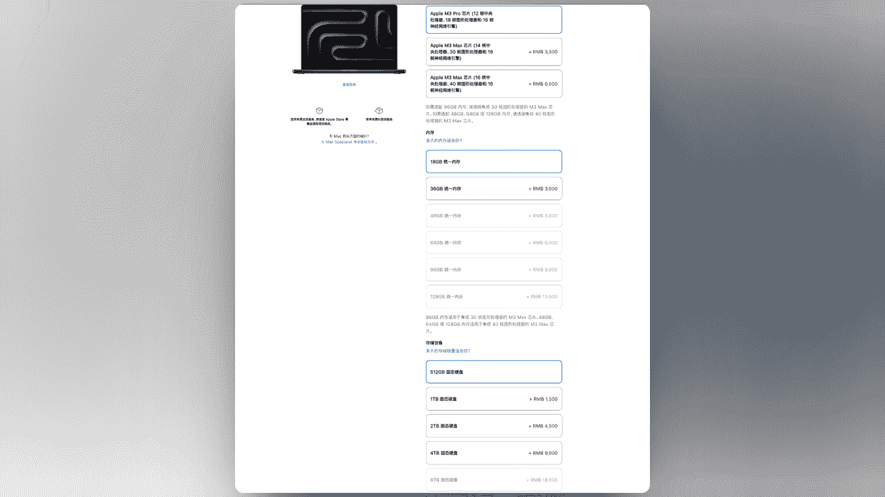

# 聊聊这台 2023 款 M3 Pro 的 MacBook Pro

> 来源：[https://leonzhang.feishu.cn/docx/ZfRcdmOOkouSSyxRxjCczVYenfe](https://leonzhang.feishu.cn/docx/ZfRcdmOOkouSSyxRxjCczVYenfe)

> #Tech #Apple #Mac

### 目录

两年前的双十一，我下单了一台 13 寸 M1 芯片的 MacBook Pro，基础配置 8G+256G，到手之后，嗯，确实是我理想中的电脑，I like it，甚至爱不释手。

而就在几天前， 2023 款 M3 Pro 的 MacBook Pro 到手了，从拆箱到使用，对 Mac 的喜欢又增加了。以下是我选购设备时的一些想法和思考。

|  |
| --- |

## 上台设备的基本情况

其实当时在购买前，也有过纠结，当时问了自己几个问题：

+   为什么一定要选择支持 macOS 的 Mac？

+   为什么不选择 14 寸/16 寸的 M1 Pro 或者 M1 Max 呢？

### 首先，为什么一定要选择支持 macOS 的 Mac？

第一，**Apple 生态**，Apple 有很多我喜欢的 App，而很多软件是仅用 iPhone 和 iPad 是无法发挥能力的。

第二，**外观**，当时的主力电脑是一台 Windows 版本的小米笔电，是当时大学时候和室友的同款，就是冲着那台轻薄本的外观去的。当然，Mac 的设计和审美，自然也没得说。

第三，**续航**，当时我手里的笔电，基本续航时长为 4 个小时左右，几乎随时需要充电，而当时仅采用 Apple Silicon 的 13 寸 MacBook Pro，最长续航是 20 个小时，而当时回看一年前录播发布会的我，晚上激动的睡不着觉。

|  |
| --- |

### **其次，那当时为什么不选择 14 寸/16 寸的** M1 Pro 或者 M1 Max 呢？

原因有二，第一，**配置够用**。关于 Soc，对比之前 x86 的 intel 芯片， i5（还是 i7）的低压处理器，NVIDIA 的独显也不高，换做 ARM 架构的 Apple Silicon，可预见的性能增加；关于内存和硬盘配置，而且我很清楚当时自己就是拿来轻办公，8G 内存够用了（其实当时还不怎么了解 Mac 统一内存架构的优势）；至于选 256G 硬盘嘛，当时的想法就是，如果不够用就开 iCloud，还能与 iPhone、iPad 同步，2T 的 iCloud 也够用了（实际也确实如此）。

第二，**费用问题**。够用的前提下，我几乎不会再多花至少五六千的价格去购买一台更高配置（14 寸/16 寸的 M1 Pro 或者 M1 Max）的设备。当然，其中也有口袋余粮的考虑，但更多考虑的是够不够用，因为我很清楚自己要什么，什么就能满足我，若能满足，就够了。

### 说了这么多优点，优劣势是正反两面，不喜欢的地方有哪些？

当然有。第一，**MagSafe 充电口被取消**。这么优秀的设计，竟然被取消，不理解！也可能是老罗说的，这是设计师的偏执。

第二，**少的可怜的外置接口**。只有一个 3.5mm 的耳机孔以及两个 Type-C 的接口，甚至电源适配器还要占用其中一个，虽然可以通过外置转接器同时外接电源和显示器，但还是很少，起码再配一个 HDMI 呀！

第三，屏幕刷新率是固定 60Hz，没有 ProMotion。要知道同样配置的 Windows 电脑的售价才是它的一半，以及对方有 120hz 屏幕刷新率！不是 90Hz，而是 120Hz！

（内存和硬盘在当时来看，只是觉得贵而已，但还不至于贵到离谱）

## 升级当前设备的考虑

也有几个问题：

+   是否要切换 Apple 生态？

+   当前设备的配置或性能是否真的不够用了？

+   是否有些新的技术或功能，让你产生了购买欲望？

+   升级了新的设备，是否会有些新的、向好的变化？

### 第一个问题，是否要切换 Apple 生态？

不会。第一，**软件层面**。App Store 的 App 并非在 Windows 生态上都支持运行的，比如 Apple 自家的 iWork 三件套，第三方的 Sketch、Infuse、MindNode、GoodNotes 等，这些软件都是在真正使用起来的时候，会逐渐的感受到它们的强大。

第二，**硬件层面**。在工艺设计上，Apple 的 Mac，无论是外观还是内在，总是能发现它设计的精美之处，美学上几乎无可挑剔。2K 的视网膜显示屏、比鼠标还要好用的触控板、同级别里几乎是最好的扬声器素质等等，都是我喜欢的。

第三，从**系统层面**来说，我喜欢 macOS，简洁、优雅的界面设计、Magic Move 的动画设计、超好看的苹方字体、流畅性、稳定性和安全性，以及没有那么多烦人的广告。

第四，**Apple 设备生态层面**，我几乎已经被绑定了，从我自己的设备以及家人的设备等等，对了，还有每月付费订阅的 iCloud。考虑到以上种种，所以我不会选择切换生态。

### 第二个问题，当前设备的配置或性能是否真的不够用了？

是的，**主要是内存**。[我有个不好的习惯，就是 C](https://chromewebstore.google.com/detail/tab-suspender/laameccjpleogmfhilmffpdbiibgbekf?pli=1)hrome 会开很多个 Tag，会导致内存爆掉。我也知道自己短时间很难改掉，所以在配合着插件（现在用的是 Tab Suspender）一起用，效果还不错。但有一次更新 macOS 之后，多少就有点不太够了，所以不要轻易更新系统。

但硬盘还好，才用 180G 左右，可能只是因为有些文件而已。不过内存和硬盘这些，多多益善嘛，主要看有没有整理的习惯。

### 第三个问题，是否有些新的技术或功能，让你产生了购买欲望？

**屏幕动态刷新率 ProMotion**、充电口 MagSafe、16 寸的屏幕。

前两个我可太喜欢了，ProMotion 真的是用了就回不去的那种，尤其在刷信息流内容的时候，纯文本的时候更是，一顿一顿的，可真的太难受了；

第二，充电口 MagSafe，一直对 Mac 和 iPad Pro 上的 MagSafe 情有独钟，使用很方便，就很主观的喜欢。

最后就是 16 寸的屏幕，每次去 Apple Store，只要是体验 Mac，我就一定会体验/试玩 16 寸的 Mac，没什么可说的，屏幕当然是越大越好，越大看的内容越多，算是对信息获取的一种掌控感吧。

## 总结

### 关于 Apple Silicon M3 的“减配”操作。

这里主要说我买到的 M3 Pro 版本。

争议主要是两方面，第一，CPU 和 GPU 的核心数，M3 Pro 对比 M2 Pro 的 CPU 总核心数没变，但 M3 Pro 的性能核心（大核）减少了两颗，而重负载的工作全是大核需要做的事情；而 GPU 方面，也从 M2 Pro 的 19 核减配至 M3 Pro 的 18 核。

第二，内存带宽，往年 M1、M2 的 Pro 系列，内存带宽都是同一对待，而今年，M3 Pro 的内存带宽，不增反降。哪怕说你不升级也行啊，还降了 50GB/s，不得不佩服 Tim 的精准刀法。

|  |
| --- |

### 关于 M3 Pro 的 MacBook Pro 16 寸的售价。

今年内存和硬盘如此大降价，再看 Apple 的内存和硬盘，额，丝毫没有打算降价的意思。再看看别家，内存和硬盘就像不要钱的一样。

害，没办法，喜欢的话，只能忍痛了。

|  |
| --- |

### 又贵又减配，那为什么就是它呢？

除了以上提到的哪些，剩下我在意的两个关键点就是性能和内存。

第一，性能够用了。我不会用它来打游戏，也不会用来做一些特别重负载的工作。第二，内存多了两个 G。如果买 M2 Pro 的话，预期性能不变，但是内存相当于少了两个 G。

理论上来说，直接顶配的设备是最好，这毋庸置疑，但关键是看使用它的人能发挥它多大的价值、能创造多少的收益，而对我来说，真正关心的点就是，够用就行。所以综合以上种种原因，最终选定了这台设备。

那么，以上便是我选购设备时的一些想法，很主观，但如果恰好对你有帮助，我也会很开心，end。

## Related content

+   [大白话聊 Apple Silicon（苹果芯片）](https://sm84lfdag7.feishu.cn/wiki/QfffwdAQ3ipzuIkYqnrcgWwNnqg)

## Further reading

+   Tab Suspender 官网：https://tabssuspender.com/

+   Tab Suspender Chrome 插件：https://chromewebstore.google.com/detail/tab-suspender/laameccjpleogmfhilmffpdbiibgbekf?pli=1

+   【苹果 M3 系列首发评测：Max 早该如此】 https://www.bilibili.com/video/BV19N4y1S7Uz/?share_source=copy_web&vd_source=672ec070780ce29c890256a5fabe799b

+   【苹果 M2 Pro/Max 深度评测：旧身体里的新灵魂】 https://www.bilibili.com/video/BV1gT411d7bD/?share_source=copy_web&vd_source=672ec070780ce29c890256a5fabe799b

---

一个 PM 看到的、听到的和想到的，欢迎交流～

+   WeChat ID: thinkinghunt

+   Email: thinkinghunt@163.com

+   Lark Homepage: [张帅的个人说明书（对外）](https://sm84lfdag7.feishu.cn/wiki/wikcnvVUZ7NmWg31mUgnpvXwsie)