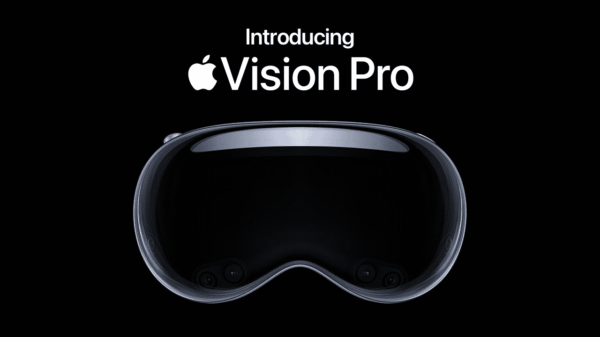
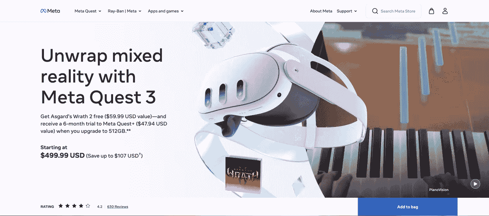
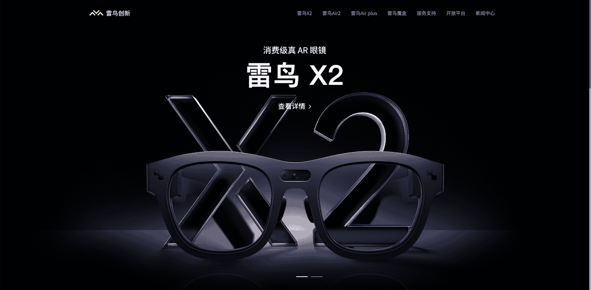
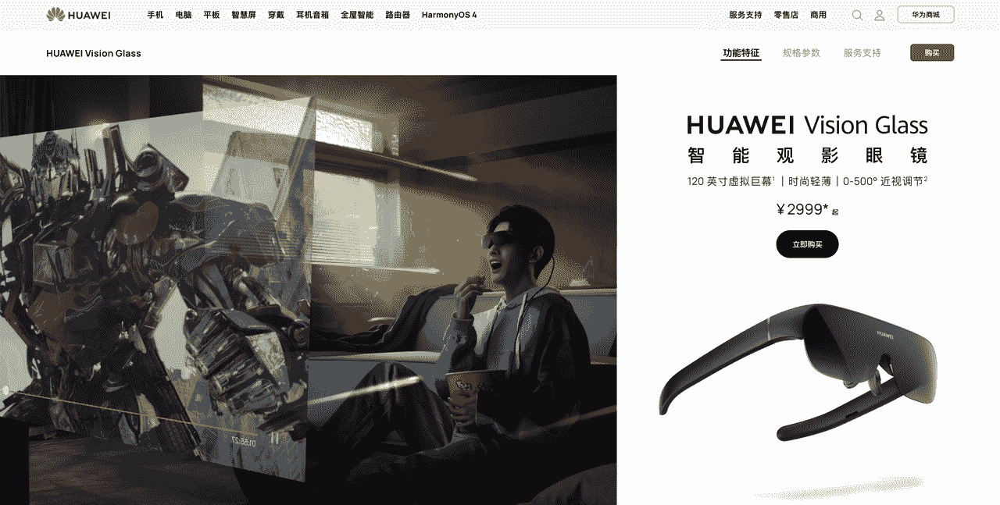
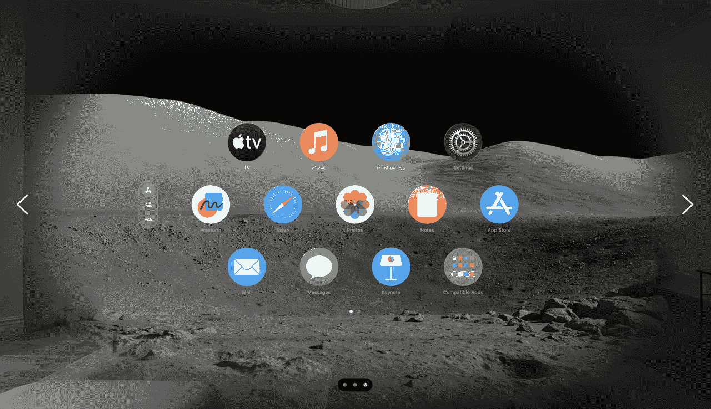
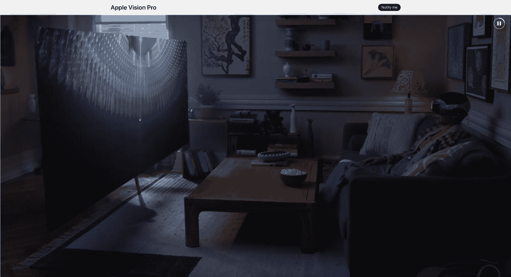
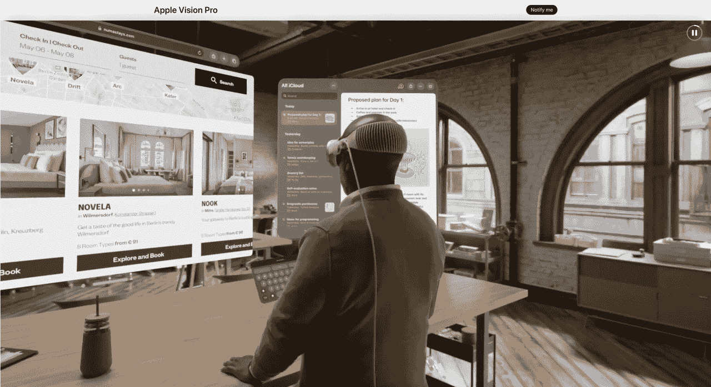
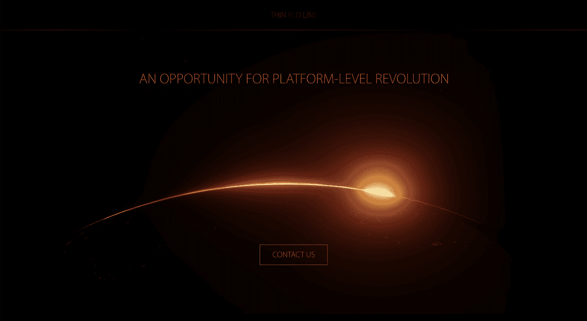

# 大白话聊 Apple Vision Pro

> 来源：[https://leonzhang.feishu.cn/docx/Tjvsd8ghTohBW9x9Jeic1G7gnfh](https://leonzhang.feishu.cn/docx/Tjvsd8ghTohBW9x9Jeic1G7gnfh)

> #Tech #Apple #VP

> Apple Vision Pro 是苹果公司在 MR 领域的一次重要布局。这款产品具有颠覆性潜力，将为用户带来全新的沉浸式体验，并为 AR/VR 行业的发展注入新的动力。那么，它会是下一代计算平台吗？

## 引言

### Apple Vision Pro 是什么？

Apple Vision Pro（VP），是苹果公司即将上市的一款混合现实（MR）头显。它融合了 AR（增强现实）和 VR（虚拟现实）的功能，为用户带来全新的沉浸式体验。

这里是 Apple Vision Pro 的发布视频地址。

## Apple Vision Pro 特点

### Apple Vision Pro = 拼合怪 ？

+   Apple Watch 的表冠和表带。

Apple Vision Pro 采用了与 Apple Watch 类似的表冠和表带设计，降低操作习惯的影响。表冠可以用于缩放、滚动等操作，表带可以用于固定头显并调整佩戴位置。

+   iPhone、Mac 上用于充电/供电的 Magsafe。

Apple Vision Pro 采用了类 Magsafe 式的磁力吸附，可以方便快捷地为设备供电。磁力吸附的方式，兼顾方便的同时也可以有效防止设备在供电过程中意外脱落。

+   iPhone 上用于结构光、景深拍照的 ToF 摄像头。

Apple Vision Pro 采用了 iPhone 上用于结构光和景深拍照的 ToF 摄像头，用于进行 3D 建模。雷达可以发射出无线电波，并根据波束的反射情况来计算物体的三维形状。通过两颗 VST 摄像头 + 点阵投影 + ToF 的方案来精确感知深度信息，为 Apple Vision Pro 提供更加精准的 3D 建模，从而实现更加逼真的 AR 体验。

+   iPhone 上用于计算摄影的算法。

Apple Vision Pro 采用了 iPhone 上计算摄影的算法，用于处理 VST 摄像头采集的物理世界画面。这些算法再加上 M2 芯片可以对画面进行优化，提高图像的清晰度和亮度，并消除噪点。此外，这些算法还可以对画面进行调整，使其与虚拟世界更加融合。

+   Airpods 的空间音频。

Apple Vision Pro 后期大概率（99.9%的可能）会支持 AirPods，并通过空间音频技术营造更加真实的沉浸式空间。空间音频可以根据用户的头部位置和耳机的位置，将声音准确地定位到虚拟世界中的特定位置，以获得更加身临其境的体验。

+   Mac、iPhone 上的用于 HDR、Promotion 技术的屏幕。

Apple Vision Pro 采用了 Mac、iPhone 上的 HDR 和 ProMotion 屏幕，可以显示更加逼真的图像。与 Sony 深度定制的 HDR 屏幕可以显示更宽的色域和更高的亮度，从而呈现更加丰富和细腻的画面。ProMotion 屏幕可以根据画面内容的变化，动态调整屏幕的刷新率，提供更加流畅的视觉体验。

+   为多数 Apple 设备设计的 Apple Silicon（苹果芯片）。

Apple Vision Pro 采用了 Apple Silicon（R1+M2）芯片，具有高性能、低功耗的特点。M2 负责实时渲染，R1 负责降低延迟，为 Apple Vision Pro 提供强大的计算能力的同时，也能保证相对较长的续航时间。

|  |
| --- |

### Vision Pro 选择 VST 方案的优劣势如何？OST 方案的优劣势又如何？

AR 有两种技术方案， VST（Video See-Through，视频透视）和 OST（Optical See-Through，光学透视）。

#### [**VST，如 Vision**](https://www.meta.com/quest/quest-3/)** **Pro、Meta Quest 3。

**优点**

+   画面自由度高。将虚拟世界画面叠加到物理世界画面上，从而实现虚拟世界与物理世界的无缝融合（参考视频中手臂上实时渲染的装备），达到“以假乱真”。

+   超大显示视场角。由超广角 VST 摄像头 + Pancake 镜组实现，理论上可以更改视场角看到的物体和场景。

**缺点**

+   对设备计算性能要求高，功耗大。VST 方案需要实时渲染虚拟世界的画面，因此对计算性能要求相对较高，故功耗大，从而一定程度上影响续航。

+   设备小型化困难。VST 方案需要集成计算、摄像头、传感器、散热、屏幕等多种部件，导致设备小型化困难。

+   画质和延迟问题。虽然 Vision Pro 在 Sony 深度定制屏幕及苹果芯片的加持下，画质和延迟影响不大，但其他品牌的设备就还是要考虑的。

**未**来主要发展方向：如何减少设备体积和重量，降低功耗、提高画质和降低延迟是未来优化和发展需要考虑的地方之一。

|  |
| --- |

> 据 AK 的消息，原本以为腾讯会在今年 10、11 月份左右引入 Meta Quest3 ，没成想这事儿黄了，有些遗憾了。后续新闻看这里：重组 XR 团队、引进 Meta 头显 Quest 3？腾讯回应了

#### **OST，如**[**雷鸟 X2**](https://rayneo.cn/product/x2/)**、**[**华为 Vision Glass**](https://consumer.huawei.com/cn/wearables/vision-glass/)**。**

**优点**

+   对比 VST，计算性能要求低，硬件成本降低，价格更便宜（起码少了两颗 VST 摄像头 + 屏幕）。且 OST 方案不需要实时渲染虚拟世界画面，因此对计算性能要求低，同时也降低了硬件成本，所以价格更便宜了。

+   对比 VST，设备体积更小更轻便。OST 方案不需要集成计算、摄像头、传感器、散热、屏幕等多种部件，因此设备体积更小更轻便。

缺点

+   画面自由度低。OST 方案只能将虚拟世界画面叠加到物理世界画面上，无法做出虚拟物品的投影。

+   光学方案仍待优化。主流的 OST 光学方案 Birdbath 结构存在视场角小、色彩失真等问题。

+   画面延迟问题。物理世界对比虚拟世界产生的追踪延迟（主要是时间差）。

未来主要发展方向：优化光学方案、增大视场角，降低追踪延迟。

|  |
| --- |
|  |

#### VST 与 OST，两种方案对比：

+   VST 方案的画面自由度高，可以实现虚拟世界与物理世界的无缝融合。这项技术可以为用户带来更加逼真的 AR 体验，但也存在对计算性能要求高、功耗大、设备体积小型化困难等问题。

+   OST 方案的计算性能要求低、设备体积更小更轻便，但也存在画面自由度低、光学方案仍待优化、画面延迟问题等问题。

## Vision Pro 的核心竞争力及潜在应用

### Vision Pro 的核心竞争力

**软件生态 + 硬件配置。**当前头显的核心竞争力主要是软件生态，提前发布 Vision Pro，展示系统和 Vision Pro 软件的开发标准，为等待自己与开发者充实 Vision Pro 的 App Store。

甚至苹果在发布 Vision Pro 之前，已经为其准备了一系列软件，包括：

+   系统软件：基于 iOS 17 打造，支持 AR/VR 应用。

+   开发工具：提供给开发者快速开发 AR/VR 应用的工具。

+   应用程序：提供丰富的 AR/VR 应用，如游戏、娱乐、教育等。

然后是交互的创新，比如眼球追踪、手势识别等。Apple Watch 的 App 蜂窝式排列，也被“移植”到 Vision Pro 的 App 上。通过眼球的 Focus 来选择，手指的捏和等动作进行操作（终于不用再握着两个手柄了）。

|  |
| --- |

### Vision Pro 的潜在应用

**机会：**

+   游戏：Vision Pro +Airpods Pro ，打造身临其境的游戏体验，仿佛置身游戏世界，有电影《头号玩家》的感觉。比如射击游戏，可以通过 Vision Pro 看到敌人的实时位置，并利用周围的环境进行掩护。

+   娱乐：提供丰富的娱乐内容，如电影、电视剧、音乐会等。比如观看电影时，用户可以看到演员就在眼前，并感受到爆炸和枪击的震撼。

+   教育：为老师/学生提供全新的教育/学习方式，让学生可以身临其境地体验各种知识。比如学习历史、地理，可以通过模拟场景，让学生“亲身感受”，用实际感受加深理解。

+   办公：为企业的员工提供全新的工作方式，电影《钢铁侠》的情节复刻。比如，设计产品时，设计师可以通过 VP 看到产品在现实世界中的效果。

**挑战（机遇与挑战并存）：**

+   价格：3499 美元的定价，就注定 Vision Pro 不是消费级产品。不过考虑到行业从业者及开发人员的购买，可能也会有一批出货量。

+   续航：由于采用了 VST 的方案，所以需要实时渲染，从而导致高功耗，而且高功耗一定会导致续航时间的下降。

|  |
| --- |
|  |

[每当我](https://www.thinredline.com.cn/)想起”下一代计算平台“时，我都会想起老罗的细红线。期待，祝好。❤️

|  |
| --- |

## 相关内容

+   [大白话聊 Apple Silicon（苹果芯片）](https://sm84lfdag7.feishu.cn/wiki/QfffwdAQ3ipzuIkYqnrcgWwNnqg)

## 参考内容

+   Apple Vision Pro 详情页：https://www.apple.com/apple-vision-pro/

+   Apple Vision Pro Impressions! : https://youtu.be/OFvXuyITwBI?si=ndByodjZoA92z3my

+   Apple Vision Pro 的发布视频：https://www.youtube.com/watch?v=GYkq9Rgoj8E&t=4848s

+   Meta Quest 3 : https://www.meta.com/quest/quest-3/

+   腾讯引进 Meta Quest 3 后续：重组 XR 团队、引进 Meta 头显 Quest 3？腾讯回应了

+   雷鸟 X2 AR 眼镜：https://rayneo.cn/product/x2/

+   华为 Vision Glass：https://consumer.huawei.com/cn/wearables/vision-glass/

+   双目、结构光、tof，三种深度相机的原理区别：https://www.oakchina.cn/2023/05/16/3_depth_cams/

+   HDR 视频：https://support.apple.com/zh-cn/102205

+   【「Vision Pro 硬核分析」第一期：扒掉苹果的底裤！从技术角度全面解读苹果 AR 眼镜 Vision Pro】 https://www.bilibili.com/video/BV18N411r7uu/?share_source=copy_web&vd_source=672ec070780ce29c890256a5fabe799b

+   细红线：https://www.thinredline.com.cn/

---

一个 PM 看到的、听到的和想到的，欢迎交流～

+   WeChat ID: thinkinghunt

+   Email: thinkinghunt@163.com

+   Homepage: [Leon Zhang's User Manual（对外）](https://sm84lfdag7.feishu.cn/wiki/wikcnvVUZ7NmWg31mUgnpvXwsie)