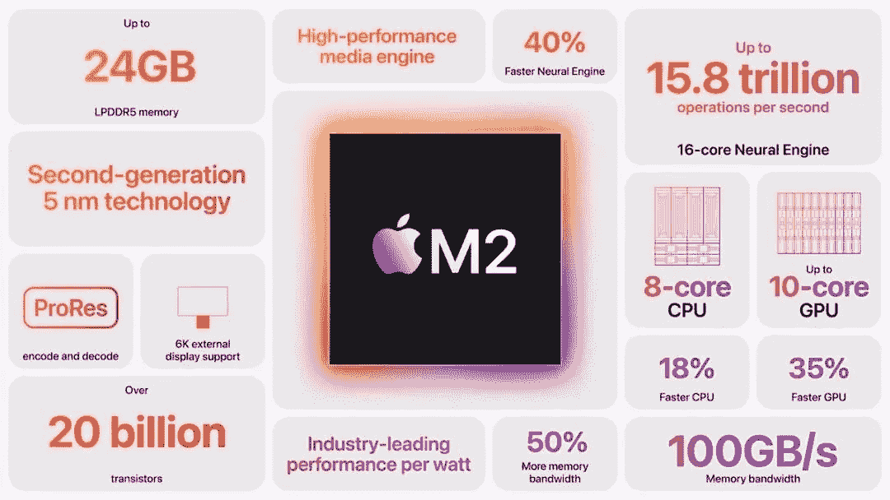
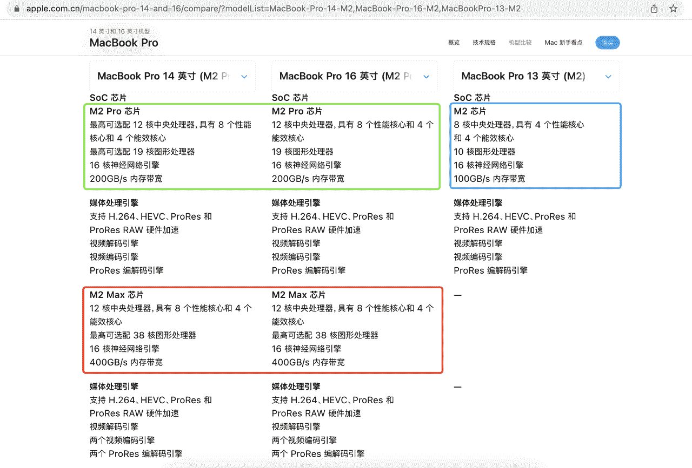
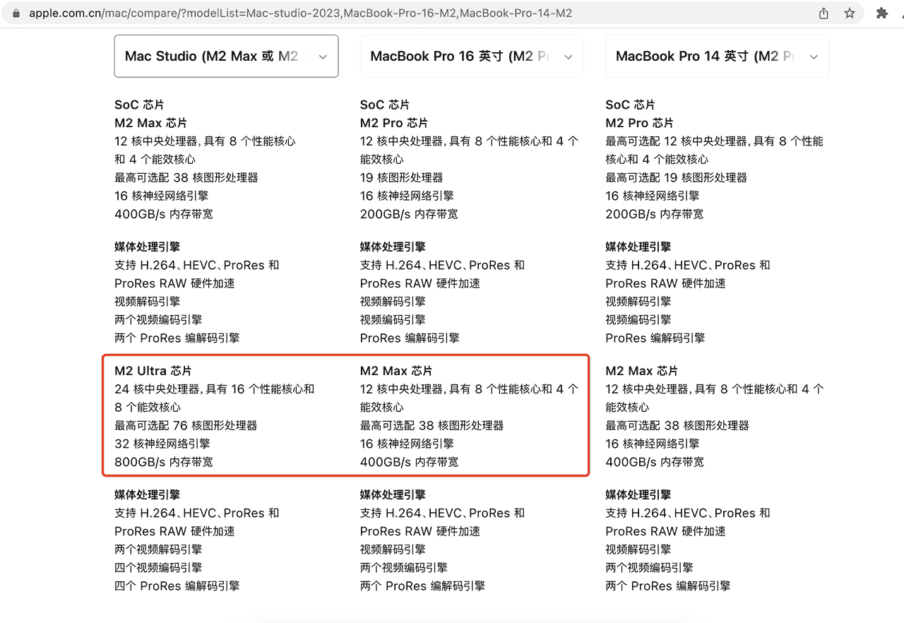
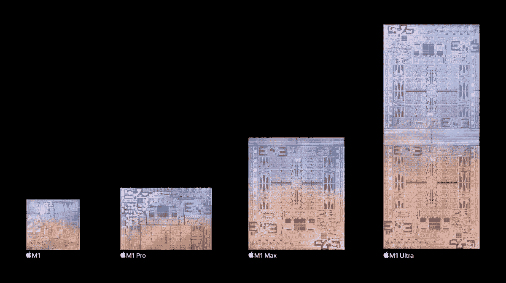

# 大白话聊 Apple Silicon（苹果芯片）

> 来源：[https://leonzhang.feishu.cn/docx/UaoedPlF1owz0ExJtIHcMvn4nrh](https://leonzhang.feishu.cn/docx/UaoedPlF1owz0ExJtIHcMvn4nrh)

> #Tech #Apple

> 免责声明：本文内容颗粒度较粗，详细参数请参考其官方资料。

> 起因是与一个很喜欢折腾手机的宅男朋友聊天，当话题聊到华为手机和 iPhone 时，发现他竟然对 SoC 几乎不了解，更不了解 Apple Silicon（苹果芯片）的优秀设计。

> 作为一名果粉，决定好好和他唠唠基础知识，普及（嘚瑟）一下 😁 。由此，本文诞生。

在科技行业，苹果公司几乎一直是神一般的存在。从乔帮主发布的第一款 iPhone 开始，苹果拉开了移动互联网时代的序幕。乔帮主之后的库克时代，苹果几乎还是处于制造创新和突破性产品的前沿。比如 Apple Pencil、Watch、AirPods 以及今年 6 月份 WWDC 的 Vision Pro 等产品。

这些创新产品的背后有着不可或缺的支持，那就是苹果自家研发的芯片系列——Apple Silicon（苹果芯片）。

如果你也在用 Apple 设备，而且也好奇 Apple Silicon（苹果芯片） 的神奇之处，本文咱们一起来探索一下～

## CPU、GPU、NPU 是什么？

首先[硬件产品的常见参数](https://sm84lfdag7.feishu.cn/wiki/NScjwjRYciYIFBkYey5chg1inQe)了解一下 Apple Silicon（苹果芯片） 的关键组成部分有哪些，比如 CPU、GPU 等，分别代表什么含义以及主要工作是什么。另外，如果你对硬件产品的常见参数感兴趣，欢迎阅读：

### CPU（Central Processing Unit，中央处理器）

通用型处理器，计算机系统的核心组件之一，即计算机系统的大脑，负责执行一些通用型的指令并协调各部件之间的工作。例如 Intel Core i7-9700K，主频为 3.6GHz。

### GPU（Graphics Processing Unit，图形处理器）

专用型处理器，主要负责执行图形运算工作的处理器，善于并行计算和图像渲染。以 GPU 为核心的主板扩展卡就是我们常听到的“显卡”。

主流显卡主要由 NVIDIA 和 AMD 两大厂商制造，常说的“N 卡”就是用 NVIDIA 芯片的显卡，“A 卡”就是用 AMD 芯片的显卡。例如 NVIDIA GeForce RTX 3090（经常听到的 3090 显卡）。

### **NPU（Neural-network Proc**essing Unit，神经网络处理器）

专用处理器，用于大规模、并行的矩阵运算和向量操作的处理器，也就是我们经常听到苹果芯片的“神经网络引擎”。

也得益于这块处理器，经常用苹果设备的你会发现，苹果设备的 OCR（Optical Character Recognition，光学字符识别）的正确率是高于其他品牌设备的。

当然，同样的算法，不同芯片也会带来不同的结果。

我曾对比过搭载 M1 芯片的 2020 款 Macbook Pro 13th 与搭载 Intel 芯片的 2019 款 Macbook Pro 16th 这两款设备，同样的图片，2020 款 Macbook Pro 13th 的 OCR 正确率是远高于另一台的，其主要原因就是 Intel 芯片没有神经网络引擎。

如何理解 CPU、GPU、NPU 这三者之间的关系呢？

可以简单理解为：CPU 是一个全才的科学家，GPU 是一群拿着计算器的艺术生，而 NPU 则是一群拿着计算器的高智商学生。（不严谨，仅作为理解方便使用）

## Apple Silicon 是什么？

要知道什么是 Apple Silicon（苹果芯片），还要再了解一下，什么是 SoC。

### SoC（System on a Chip，系统级芯片）

SoC 是指集成了多个功能组件和电子元件的单个芯片，通常包括 CPU、GPU、NPU、RAM（内存）、输入/输出接口等。如 Apple 的 A 系列芯片。

### 何为 Apple Silicon？

Appl[e 芯片](https://zh.wikipedia.org/wiki/Apple%E6%99%B6%E7%89%87)（Apple silicon）是对苹果公司使用 ARM 架构设计的单片机系统（SoC）和封装体系（SiP）处理器之总称。它广泛运用在 iPhone、iPad、Mac 和 Apple Watch 以及 HomePod 和 Apple TV 等苹果公司产品。（维基百科）

简而言之：是将不同的计算核心（CPU、GPU、NPU 等）集成到一个 SoC（System on a Chip）中，再结合硬件的性能要求，将不同的 SoC 通过 SiP（System in Package）的方式拼接到一起，从而形成的一个“大 SOC”。

苹果将其命名为 Apple Silicon，常见有 iPhone 上的 A 系列芯片，如 A16 或 A17 Pro 以及 iPad、Mac 上的 M 系列芯片，如 M2、M2 Pro、M2 Max、M2 Ultra 等。

|  |
| --- |

## Apple Silicon 的特点

我们经常听到的“苹果芯片”，其实更多是指 Mac 上的 M 系列芯片，主要是用于替代之前使用的 Intel 的 x86 处理器。目标是为了提高苹果设备的性能、效率和安全性，同时实现软硬件更好的整合。

### Apple Silicon 的 “LEGO 式设计”

**“拼合怪”**

在下图中，细心的你可能会发现，苹果的 M2 Max、M2 Pro、M2 芯片的 CPU、GPU、NPU 参数可以得到“随心所欲”的控制，这得益于苹果芯片的“LEGO（乐高） 式设计”。

最明显的对比就是 M2 Ultra 与 M2 Max 的参数关系，没错，M2 Ultra 就是由两颗 M2 Max 拼接起来的。同理，M1 Ultra 也是如此，见下图。

这种“拼合”设计并非苹果芯片设计的首次，其实在早期 Apple Watch 的 S 系列芯片设计中，就能发现端倪。因为 S 系列芯片就是由 A 系列芯片的其中一颗性能核心“魔改”而成的。

|  |  |
| --- | --- |
|  |  |

### Apple Silicon 的优劣势

**以苹果芯片的 **M 系列芯片为例，主要优势如下：

+   **架构优势**：统一架构设计（UMA），将 CPU、GPU、神经网络引擎（NPU）和其他组件集成在一颗 SoC 中，共享高速低延迟的内存，提高了数据传输效率。

+   **生态优势**：M 芯片可以原生运行基于 ARM 架构的 macOS 和 iOS 应用，也可以通过 Rosetta 2 转译器运行基于 x86 架构的 macOS 应用，甚至可以通过虚拟机运行 Windows 和 Linux 系统。

**主要劣势如下：**

+   **兼容性问题**：虽然 Rosetta 2 转译器可以实现 x86 的应用在 M 芯片上的运行，但是过程可能会带来一定的性能损失和兼容性问题，比如一些依赖特定硬件驱动或者底层指令集的应用可能无法正常工作。

+   **扩展性问题**：M 芯片由于采用了统一的内存架构和高度集成的设计，牺牲了扩展性和灵活性，比如无法更换或者升级内存和存储空间。

### 搭载 Apple Silicon 设备的优劣势

首先，苹果芯片是基于 ARM 架构的设计，相较于 Intel 的传统 x86 架构，在性能和功耗方面表现更好。

体现在设备上的话，就是搭载 M1 芯片的 2020 款 MacBook Pro 可以实现 18 个小时的续航（数据来源于苹果官网），更何况还搭载了一块分辨率为 2K 的视网膜显示屏，而普通轻薄本的续航通常是 3-8 个小时不等，通常搭载是分辨率为 1080P 的普通显示屏。

其次，苹果的设计思路是将芯片与硬件设备紧密结合，以实现最佳的能耗比。

以搭载 M2 Max 的 2023 款 MacBook Pro 16th 为例，在接入适配器电源和为介入适配器电源，性能几乎保持不变。但同样性能的 windows 电脑，在不接电源适配器的情况下，性能则直线下降。

> 感兴趣的朋友可以参考 up 极客湾做的续航测试，视频中详细讲述了 Intel 的芯片是如何为了获得优秀的性能，疯狂 Boost 其中一颗单核的全过程，而这也就是带来高功耗，从而降低设备续航的主要原因之一。

> 【我们找到了 Windows 电脑续航差的原因！苹果 M2 深度分析】 https://www.bilibili.com/video/BV18B4y1b7gj/?share_source=copy_web&vd_source=672ec070780ce29c890256a5fabe799b

总结来说，苹果芯片的优势就是更高的能效比、更优秀的整合和优化能力，从而带来更优秀的使用体验；劣势主要是兼容性问题（x86 软件的适配工作）和高昂的内存售价...

## One more thing

题外话：每次写内容遇到不同文档中的相同内容时，就会感叹 Notion Black 是多么的易用！Ivan 真牛！🥹

## Related content

+   [硬件产品的常见参数](https://sm84lfdag7.feishu.cn/wiki/NScjwjRYciYIFBkYey5chg1inQe)

## Further reading

+   英特尔® 酷睿™ i7-9700K 处理器：https://www.intel.cn/content/www/cn/zh/products/sku/186604/intel-core-i79700k-processor-12m-cache-up-to-4-90-ghz/specifications.html

+   NVIDIA GeForce RTX 3090: https://www.nvidia.com/en-us/geforce/graphics-cards/30-series/rtx-3090-3090ti/

+   Apple 芯片（Apple silicon）：https://zh.wikipedia.org/wiki/Apple%E6%99%B6%E7%89%87

---

一个 PM 看到的、听到的和想到的，欢迎交流～

+   WeChat ID: thinkinghunt

+   Email: thinkinghunt@163.com

+   Homepage: [张帅的个人说明书（对外）](https://sm84lfdag7.feishu.cn/wiki/wikcnvVUZ7NmWg31mUgnpvXwsie)