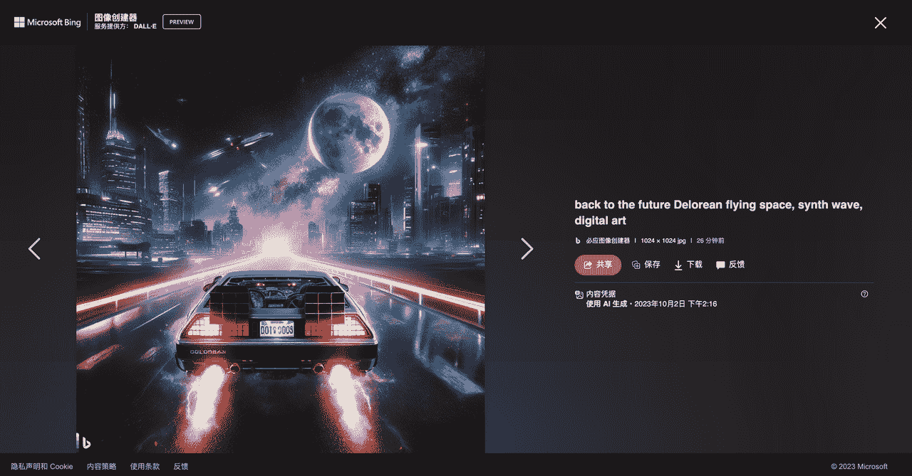
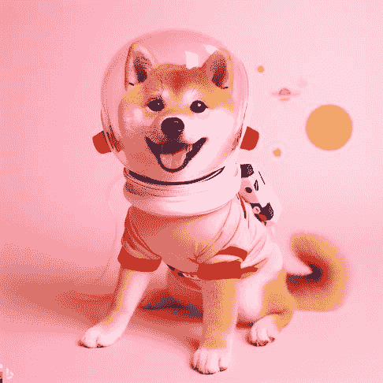
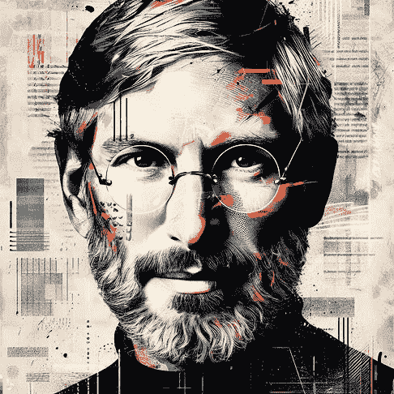
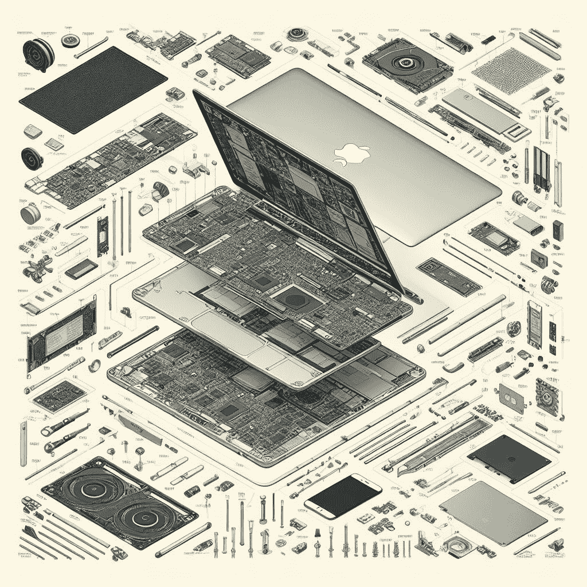
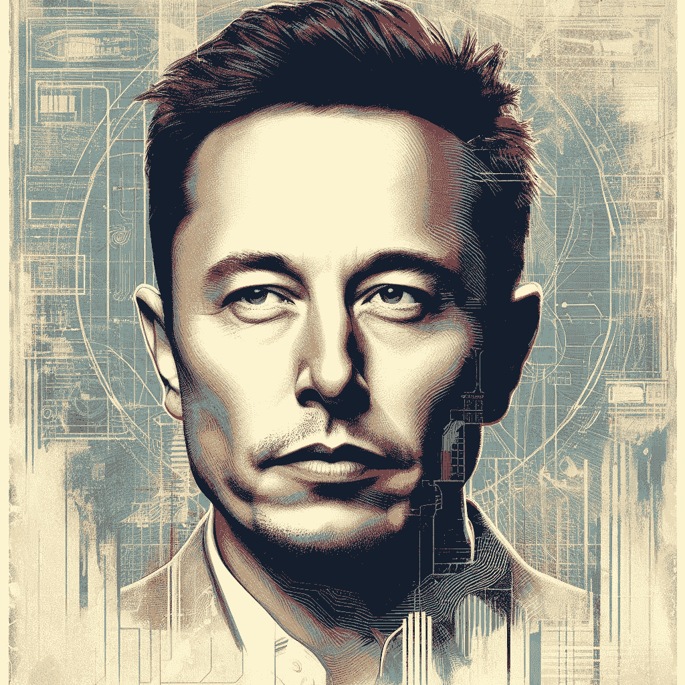
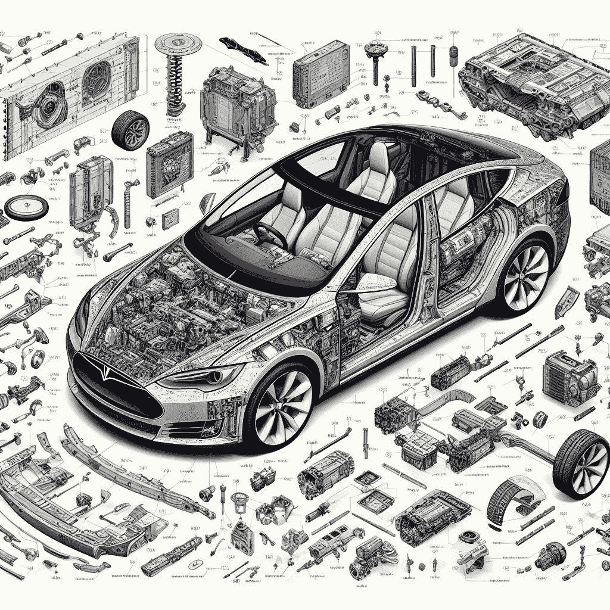

# AI 绘画之 New Bing，基于 DALL·E 3

> 来源：[https://leonzhang.feishu.cn/docx/UXUVdqpUWo7iU3xis9zcUnHunmd](https://leonzhang.feishu.cn/docx/UXUVdqpUWo7iU3xis9zcUnHunmd)

> New Bing 已经支持 DALL·E 3！微软还是快呀！！

> 虽然说微软十年前就开始布局 AI 了，但你苹果 Siri 现在还是个智障是不是多少有点说不过去呀...

> 果然没有对比就没有伤害 🌚

### New Bing 如何使用 DALL·E 3

访问 Bing 官网（ https://www.bing.com/ ），文本框中输入

```
prompt
请根据以上 prompt 生成 AI 绘画
```

或者也可以访问微软图像创建器（ https://www.bing.com/images/create/ ），直接输入 prompt 即可，效果很棒，感兴趣的朋友可以自己去试试。

### **prompt 生成图像**

**prompt **

```
back to the future Delorean flying space, synth wave, digital art
```



**prompt **

```
Colorful splashes of paint, geometric, abstract art

a cute happy shiba inu astronaut on a pink background
```

|  |  |
| --- | --- |

**prompt **

```
Mixed Media Portrait of Apple Founder Jobs, Digital Art, Screen Print, Wheatpaste Poster

Exploded view technical drawing of a MacBook Pro laptop. Include the unibody aluminum enclosure, display assembly, logic board, SSD, battery, trackpad, keyboard, speakers, heatsink, cooling fan, MagSafe charging port, hinges, screws and other fasteners. Show dimensions and labels for key components. Render in the style of an Apple service manual with detailed line art, precise dimensions and schematic diagrams. The drawing should showcase the internal layout and assembly of the MacBook Pro.
```

|  |  |
| --- | --- |

**prompt **

```
Mixed media portrait of Tesla Inc. founder Musk, digital art, screen print, wheatpaste poster

Exploded view technical drawing of a Tesla Model S electric car. Include the body, chassis, battery pack, drive units, suspension, brake system, steering system, HVAC system, infotainment system, seats, trim, and major electrical components. Show dimensions and labels for key components. Render in the style of a Tesla service manual with detailed line art, precise dimensions, and callouts. The drawing should showcase the internal layout and assembly of the Tesla Model S.
```

|  |  |
| --- | --- |

注：Model S 的真实结构的美观度要远高于生成的图像这样。

### **See also**

+   [关于 DALL·E 3 的介绍：O](https://www.jiqizhixin.com/articles/2023-09-21-12)penAI DALL·E 3 来了，集成 ChatGPT，生图效果太炸了

+   Windows 11 发布重磅更新！马斯克火速围观，见证颠覆 PC 的新 AI 操作系统：https://mp.weixin.qq.com/s/6ueFO-1bLZJRh612iAsvgQ