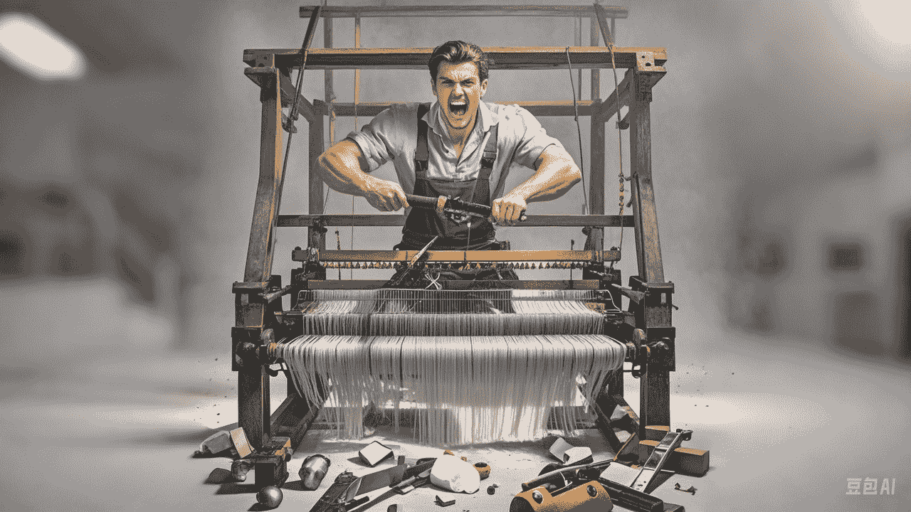
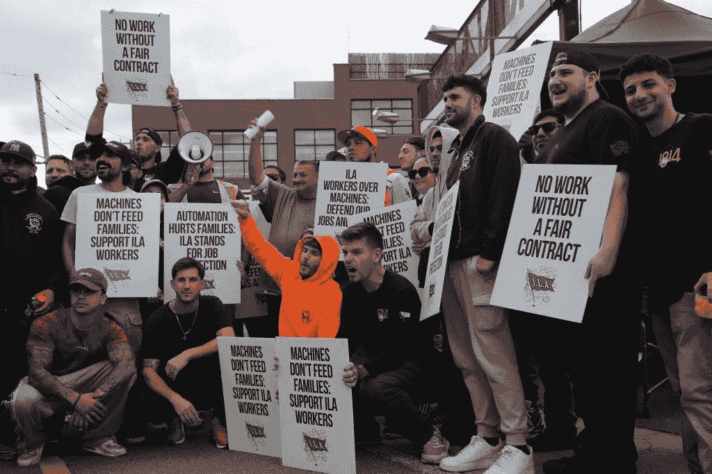

# 兴趣漫谈：历史重演与技术革新带来的机遇与挑战

> 来源：[https://leonzhang.feishu.cn/docx/V0COdYNAmok3QVxUCOMcTzAHnee](https://leonzhang.feishu.cn/docx/V0COdYNAmok3QVxUCOMcTzAHnee)

Leon Zhang, October 27, 2024

> 历史不会重演，但总会惊人的相似。—— 马克·吐温

## 前言

关于“卢德运动”，起初我并不了解这起真实发生过的历史事件。

**直到上周**阿珂问我说，是否听说过 卢德运动？

在阿珂没有向我提问前，我根本不了解这件事，要不是阿珂的再次提醒，甚至我差点错过这个话题，我去查了一下才算了解个大概。

简单说就是，在 19 世纪英国工业革命时，由于纺织机的大量投入使用，取代了人力劳作，进而导致采用手工纺织的工人失业。工人认为这些机器不仅降低了他们的工作技能和价值，甚至严重威胁到了他们的生计，他们便开始用破坏机器的方式，表达他们的愤怒和抗议。

这个名称的来源更是有趣，算是我了解到的最**早的以讹传讹**的故事了。起因是有一个名为 内得·卢德 的纺织工人砸坏了两台织布机，被他人以讹传讹成所谓卢德将军或卢德王领导反抗工业化的运动，然后得名“卢德运动”。

然后我就想起来前段时间美国港口的码头工人罢工事件，简单说就是码头工人想提高工资，但因为要求过高，公司（USMX，美国海事联盟有限公司）不答应，然后就导致了这场以工会（ILA，国际码头工人协会）为首的集体罢工。

为什么我会向阿珂提到这场罢工事件？因为我还了解到，这次工会除了要求涨薪，他们还反对港口使用机械自动化设备（其实在之前就一直在抵制），因为他们认为自动化设备的引入，会导致导致大量的工人失业。

形成鲜明对比的就是国内的港口，机械自动化程度与效率堪称全球第一。

当然，这场罢工也随着“未来六年内加薪 62%（即平均时薪从 39 美元提高到 63 美元）”的临时协议的敲定而结束。

真的只能说，历史不会重演，但总会惊人的相似，更不会简单的重复。

## 从卢德运动看现代自动化冲击

阿珂最近在写稿子，背景是 19 世纪的英国，她在搜资料的时候搜到卢德运动，比如有一篇文章是 十九世纪的卢德运动是“AI 失业”的历史前鉴吗？

她说，在当时被狄更斯称为“最好的时代，也是最坏的时代”，有各种童工、妓女、阶级矛盾、性别对立，其实底层人民过得特别苦。当然她最近为了写稿子，也去看了很多这种社会的黑暗面，现在又联想到我们当前所处的境况跟那个环境有一些对照关系时候，突然觉得“深渊”距离我们很近很近的感觉。

在她这样向我描述之后，我才明白这个背景大概是如何。

接着，她又提到说，“据说广东那边之前早就有无人驾驶的外卖车和快递车上路了，上了一段时间路，被批评说会剥夺太多底层人民的工作岗位，所以又禁止了，现在路面上都没有了，但其实这种技术已经可以实现了”。

“是呀，还包括重庆、苏州、杭州的出租车，都因为出租车和网约车司机共同抵制，现在被禁止了。”我告诉她。

回到卢德运动，她想借助这个话题讨论下这次运动与现在这波 AI 技术革命的相似性。

她说，“当时工人集体砸纺织机，最终运动结束后，100 个人里还是会留下 1 个操作纺织机的人，在取代旧岗位的同时创造了新岗位，但是结果就是当时英国的城镇通常有超过半数的居民都是失业工人，所有的平民家庭都受牵连。在当时，谁掌握了新技术，谁就可以重新获得收入，但学习和掌握新的工具需要教育资本，也需要适应期，所以企业会倾向于雇佣更年轻，对技术有更快适应能力的人，而之前的老员工就很难有核心竞争力。从整个社会层面看，技术进步了、产业发展了，但这种进步的前后是两批完全不同的人，单从这方面来看，卢德运动和当下的情况没有什么不同。”

> 文章中提到，“卢德分子被认为是技术恐惧症（technophobia）的代名词。患上技术恐惧症的人，对新技术具有本能的排斥、拒绝和抵制，对新产品、新技术感到压力、焦虑，并反应过度。因其标签式的破坏机器的行为，卢德运动被认为是技术恐惧症的一种。莫著认为：把卢德运动理解为技术恐惧症是一种歪曲。书中提到，卢德分子熟悉机器，本身就是技术专家，他们并不憎恨机器，而是憎恨机器被用来作为对付他们的工具。以诺丁汉郡的织袜工为例，一方面他们组织起来捣毁工厂的织袜机，但另一方面，他们也要求工厂主使用一种计量织物中线束密度的机器，后者可以更准确地验证他们工作的质量，而不是任由工厂主随意压低产品的价格。显然，织袜工们并不反对甚至是欢迎使用机器来维护自身的权益。这印证了他们憎恨的并非机器，而是不公平的对待。”

阿珂看了文章的内容后向我解释说，“卢德运动也一定程度被误解了，当时砸毁纺织机的那批工人其实并不排斥技术，他们当时甚至还在主动推广一种能帮助他们更高效地使用纺织机的辅助工具，而这些人不是不懂技术的人，反而是工人里最资深的那种技术专家，真正懂机器的工人，在卢德运动里更反对纺织机。所以他们的观点不是广义地排斥所有机械，他们反对的是“用机器一刀切地替代全部人工”，但他们也认同机器可以提高生产效率、推动社会进步，在这一点上，卢德运动与 AI 革命是异曲同工的。”

没错的，他们并不是排斥技术，只是更怕被取代，从而断了他们最后的生存之道。就好比现在美团外卖的无人机配送，从去年已经就更新到第四代机型了，也试运营了好久，那为什么不投入呢？是外卖小哥不喜欢嘛？对比人工配送，无人机配送肯定更省力、更简单，可他们会被取代不是嘛？

我了解到，很多外卖小哥为了能够接单更多、送单更多，会多花钱给自己“升级装备”。首先就是 iPhone，对比很多安卓机，iPhone 的定位不准、定位范围偏大，所以他们就能多接单；其次是电动车，可能便宜的两三千，但他们会升级到五六千，甚至更高，为了节省更多时间，送更多的单；最后就是平衡车，因为很多小区不让进电车，平衡车也能节省一部分时间。

他们也在尽自己的最大努力，希望让自己的生活变得更好。

透过卢德运动，能看到我们在面对技术进步时的矛盾心理 —— 既渴望进步，又害怕被取代。

## 网约车司机的视角：自动驾驶的隐忧

由于上下班打车频次的增加，进而让我有了更多与网页车师傅攀谈的机会，也让我有机会听到他们对同一件事的不同的解读。

这里想补充两个故事。是我印象深刻的两个网约车师傅的故事，尽管我现在已经不记得师傅的面孔和对话时间，但大概的对话还有印象，如下。

一般是下班返程的时间聊的，因为上午上班时间，有些网约车师傅会比我急，因为他们上午有一个时间段是平台免抽佣的，同时价格偏高的，所以他们希望能够多拉几单。[202406｜不要对自己没有做过的事情说没有意义](https://leonzhang.feishu.cn/wiki/R9QkwLdPpiEfkIk4D5FczD3Xnmb)以，下次遇到上午开车快的师傅就理解是怎么回事了，当然也有不清楚规则，可能是新手或者出来体验生活的，比如我之前遇到的开小鹏 P7 的车主 🥹，详细内容见：

### 故事一

......

“这边还有做直播的呢？怎么这么晚下班？”师傅问我。

“没有，现在很多公司不是都降本增效嘛，有些老板觉得员工加班时间长，花钱才不亏”，我回答他。

“是呀，大环境不好，我们开网约车也不行，现在都自动驾驶了，也不知道后面还能做什么”，显然能听（感受）到那种无奈。

“武汉已经禁止了，估计杭州这边短时间也进不来”，我尝试安慰对方，考虑到当前的就业环境，真的很难让自动驾驶的网约车或出租车跑在路上，毕竟社会也要考虑大家的就业。

“因为我们之前联名抵制过，现在就余杭那边有，但也不多”，说到这里，师傅不仅调整了坐姿，甚至连声音都提高了一度。

......

可即便如此，我从内心里也明白，这只是短暂的胜利，并不长久。不过，能延迟一段时间也不算坏事。其实写到这里，我内心是蛮心酸的，因为他们多数都不是孤身一人，背后是一个一个的家庭，每天 10-14 个小时拼着，全年无休（他们没有周末）、身心俱疲，如果他们垮了，可能半个家就垮掉了。

### 故事二

> 故事二的师傅是东北人，可以脑补下东北人的对话语气。

“你好师傅，手机尾号 xxxx”，我说。

“好嘞”，他在手机上操作完毕后便开始挂挡起步，遇到红灯的时候，他问我说，“你这刚下班呢？”

“对，最近工作事情比较多，没办法早下班”，我回答道。

“现在干啥也不好整，像咱开个网约车，不光同行多，平台还搁上面使劲儿薅，还有‘小萝卜’瞎捣乱。”

......

当我刚听到师傅说 “‘小萝卜’来捣乱”的时候，我甚至第一时间没有反应过来他在说什么，然后就想到上热搜的武汉萝卜快跑，然后便和师傅确认了一下，是的。我猜师傅应该是在短视频平台看到的，毕竟对于做短视频的人来说，如何更快抓人眼球，数据真实性很少有人去考究，又或许夸大事实就是他们的流量策略之一。

其实不止武汉，在重庆、深圳、上海、苏州、杭州其实都有在推行自动驾驶商业化落地的，相对而言武汉则更为激进些。甚至武汉曾立志成为世界上首批全面推广自动驾驶商业化的城市，再加上与国内互联网自动驾驶的巨头百度的合作，进而共同促成了“萝卜快跑”的无人驾驶出租车业务。

愿景总是丰满与美好，但现实却总是骨感与黑暗，就业环境差致使网约车师傅们多了很多同行。

当然，我也尝试聊过其他方向，比如“短时间应该不会影响到大家的就业，不然我们这帮人去哪里？岂不是巨大的不稳定因素？”但他们多数比较悲观，“不清楚，到时候再说。”

就像大多人说的，“要不为了生活，谁会做这样的工作？” 其实本质并不是这个工作付出不够多或者不够努力，而更多是这个社会缺少了对他们的基本尊重，包括还有环卫工人，城市的干净整洁与他们深度绑定，是城市评“文明城市”荣誉称号的基本前提，可对比他们付出的时间和精力，真的能拿到对应匹配的结果嘛？可能需要我们对他们有更多的包容，虽然做不了什么，但起码能减少一定程度的社会戾气，哪怕一点点。

抱歉，有些跑题，让我们回到文中。

网约车师傅的焦虑，实际上是技术更新给他们带来的冲击。在他们身上，我仿佛看到了曾经反抗纺织机的卢德分子的影子——为守住生计而无奈地抗争。这背后，正是创造性破坏与颠覆式创新的真实写照：随着新技术的应用，传统岗位被替代，社会与也在不断经历新的阵痛。

## 创新的双刃剑：创造性破坏 vs 颠覆式创新

技术革命中，创新往往带来一系列深远的社会变革，既重塑产业格局，也冲击传统的生产和生活方式。在这个过程中，创造性破坏 和 颠覆式创新这两大理论分别从宏观和微观视角揭示了技术如何改变世界的不同路径。

> 创造性破坏（Creative Destruction）由经济学家约瑟夫·熊彼特提出，描述了新技术、新产品或新商业模式替代旧事物的过程。这一过程常伴随着传统企业和旧产业的衰落，体现出资本主义体系中的创新动力。

对比“创造性破坏”，互联网人可能更熟悉的是“颠覆式创新”，来源是《创新者的窘境》。我最早了解这本书，应该是我上大学时听老罗推荐的，以及后来在 360 的创始人周鸿祎的演讲中听到过（他就是这样的网红性格，所以他演讲多很正常）。

> 颠覆式创新（Disruptive Innovation）由克莱顿·克里斯坦森在 1997 年提出，是指将产品或服务透过科技性的创新，并以低价、低品质的方式，针对特殊目标消费族群，突破现有市场所能预期的消费改变。

简单说就是从低端市场或没有被满足需求的市场切入的小众创新，提供更便利的产品或服务，然后逐渐扩大市场，最终替代或颠覆市场上主流的产品或服务，也可以简单理解为“以小博大”。

比如最初日本的索尼、佳能、丰田汽车都是从低端市场开始切入的，甚至日本汽车在美国的快速发展还差点干倒了美国的汽车行业，现在是国内的新能源汽车。IBM 与 Apple 的故事也是如此，IBM 垄断了大型计算机的市场，不断提高这类客户的需求，然后忽略小型或个人计算机（PC）市场，然后乔布斯和沃茲的 Apple 才有机可乘，直到成为行业的领军者，当然也包括后来的微软。

除了像上面提到的案例，还有很多这样的例子，比如索尼、佳能等数码相机颠覆富士胶卷相机等案例；Netflix 在线流媒体订阅服务颠覆了百视达这类传统 DVD 租赁和有限电视；iPhone 颠覆了诺基亚和摩托罗拉的功能机；Uber、滴滴等网约车颠覆了传统出租车；Tesla、比亚迪等电车品牌颠覆了传统燃油车等等。

[我](https://www.algoworks.com/blog/disruptive-technologies/)在查资料的时候还看到了一篇 2015 年 4 月份的文章 The other side of Disruptive Technologies – Who suffers？ - Algoworks，也列举了很多的案例，这里也带一下内容，比如

1. iPod、 iTunes 与实体 CD；

1. Emails 与信件；

1. 社交媒体（Facebook、Twitter）、Facetime 与 SMS、SIM 卡拨打电话。

1. 电子阅读与纸质资料；

1. 移动支付与现金支付；

......

你看，并不是互联网人一定要去主动了解才能知道这些事情，而是我们就生活在这样的变化中，甚至有些产品或服务的更新迭代，就有你我作为互联网人，作为互联网产品经理添的一块砖、加的一片瓦。

回到上文提到的“创造性破坏”，对比“颠覆式创新”的差异点是什么？

或许有些乱，我们来重新捋一下。

首先是 **定义**，：

1. **创造性破坏**，描述的是新技术或新商业模式替代旧事物的过程，过程中会伴随着传统企业和旧产业的衰落。

1. **颠覆式创新**，描述的是从低端市场或未被满足需求的市场切入的小众创新，然后逐渐扩大市场，最终颠覆市场上主流产品或服务。

其次是 **特点或视角**，：

1. **创造性破坏**，通常是由 **技术进步或宏观经济变化** 驱动，表现为整个行业和经济结构的升级或变化。

1. **颠覆式创新**，通常是 **微观企业视角**，从不被主流市场关注的低端市场或未被满足的市场切入，最终吸引大量用户，进而颠覆主流市场。

然后是 **案例**，：

1. **创造性破坏：**工业革命蒸汽机的发明促进机械化发展；电力普及取代了煤油灯，重塑工业生产和日常生活；汽车的发明重构了整个交通行业，包括基础设施、燃料供应都发生了变化。

1. **颠覆式创新**：如上面提到的：Netflix 颠覆传统 DVD 租赁；iPhone 颠覆功能机；Tesla 的电车颠覆传统燃油车。

最后是 **结果**，：

1. **创造性破坏：**旧行业、技术或工作岗位被替代，新产业或新型经济活动出现。

1. **颠覆式创新**：新兴企业取代传统市场领导者。

对比后你会发现，其实无论是哪一种，只要涉及到真正意义上的创新，它就一定是会对现有的经济和产业结构进行破坏，然后我们才有机会获得创新给我们带来的好处。

对大公司或者创业者来说，只有通过不断的创新才能打破某个市场的平衡，才有可能获取超额的回报，所以创新不会停止。

比如现在做 AI 的公司，OpenAI、Meta、Google、Apple、Tesla 等，有了这些科技巨头们的努力，才能让我们现在实现 GPT 陪我们聊天、DALL-E 帮我们作画、DeepL 帮我们翻译、iPhone 帮我们更好生活、AutoPilot（Tesla FSD）替我们开车等等。正是他们的不懈努力才让我们看到了 AI 技术的全面应用、甚至对未来 AGI 的期待。

## 历史的回响：从卢德运动到 AI 革命的终局

卢德运动的起源是工人为了维护自己的利益，才有了砸掉“偷工人面包”机器的故事。

卢德运动的抗议虽然强烈，但并未能遏制工业化进程。机器的效率优势推动了工业革命的深入，而这种由效率驱动的生产模式最终成了不可逆转的趋势。今天的 AI 也类似，尽管面临伦理争议和就业问题，但其带来的高效性和便捷性使得全球许多行业都在积极应用和探索，因此 AI 技术的发展整体趋势不会因为个别抵制而终止。

美国港口罢工的码头工人的情况也是类似。也许未来一天，美国港口的公司（USMX，美国海事联盟有限公司）可能会因为过高的人力成本付出，最后入不敷出，甚至破产清算。

阿珂还我告诉，不只是在于卢德运动和 AI 革命有相似之处，她当时觉得最戏剧性的是“卢德运动爆发的时候，拜伦是唯一一个声援工人的议员，在议会上对镇压工人的提案投了反对票，但是几十年之后拜伦的亲女儿写出了世界上第一条机器算法。”好奇的我去搜了下“拜伦”，全称应该是 乔治·戈登·拜伦，同样我也查到他的女儿是 埃达·洛夫莱斯，也是被公认为史上第一位程序员。

卢德运动和当代 AI 技术革命的对比让我们看到，技术的进步不只带来生产力的提升，还在不断重塑社会的价值结构和我们生存的方式。AI 时代的到来不可避免地推动产业升级，但也给劳动者和社会带来了新的挑战。或许，面对未来，关键在于如何找到技术发展和人文关怀的平衡点，使社会不再被“创造性破坏”裹挟，而是主动去迎接“颠覆式创新”的积极影响。

正如作者 Ajeet Singh 在文中说的，与其等待下一个颠覆性技术到来，不如积极成为改变的一部分。

## 相关阅读

1. [卢德运动 - 维基百科](https://zh.wikipedia.org/zh-hans/%E7%9B%A7%E5%BE%B7%E9%81%8B%E5%8B%95)

1. 港口罢工之争折射美国产业升级之困 - 中国网

1. 加薪 62%后，美国港口工人罢工闪电结束！ - 华尔街见闻

1. 计海庆｜十九世纪的卢德运动是“AI 失业”的历史前鉴吗？ - 澎湃新闻

1. [202406｜不要对自己没有做过的事情说没有意义](https://leonzhang.feishu.cn/wiki/R9QkwLdPpiEfkIk4D5FczD3Xnmb)

1. [美团无人机发布第四代新机型 携全新城市低空物流解决方案参展 2023 WAIC - 美团](https://www.meituan.com/news/NN230706019014042)

1. 美团无人机获批在深圳送外卖，平均时长约 12 分钟 - 美团

1. 萝卜快跑：中国为何展开大规模无人驾驶出租车试验 - BBC News

1. 萝卜快跑，让谁不满？ - 投中网

1. [创造性破坏 - 维基百科](https://zh.wikipedia.org/wiki/%E5%88%9B%E9%80%A0%E6%80%A7%E7%A0%B4%E5%9D%8F)

1. 熊彼特的创造性破坏理论 - MBA 智库百科
1. [颠覆式创新 - 维基百科](https://zh.wikipedia.org/wiki/%E7%A0%B4%E5%A3%9E%E6%80%A7%E5%89%B5%E6%96%B0)
1. [T](https://www.algoworks.com/blog/disruptive-technologies/)he other side of Disruptive Technologies – Who suffers? - Algoworks
1. [乔治·戈登·拜伦 - 维基百科](https://zh.wikipedia.org/zh-cn/%E6%8B%9C%E4%BC%A6%E5%8B%8B%E7%88%B5)
1. [埃达·洛夫莱斯 - 维基百科](https://zh.wikipedia.org/wiki/%E6%84%9B%E9%81%94%C2%B7%E5%8B%92%E8%8A%99%E8%95%BE%E7%B5%B2)
