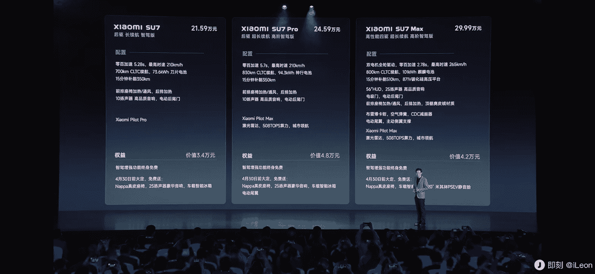
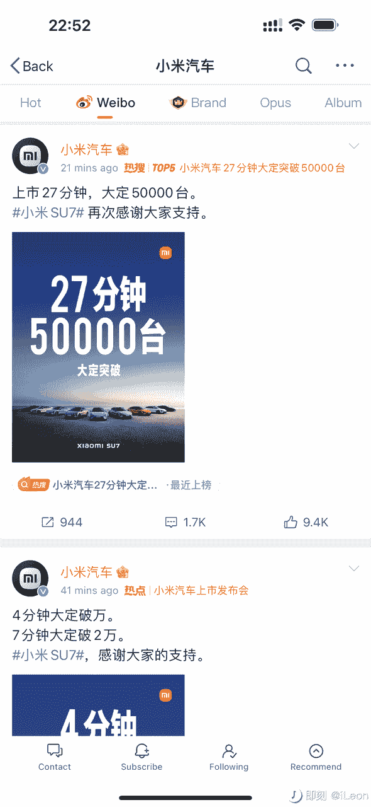
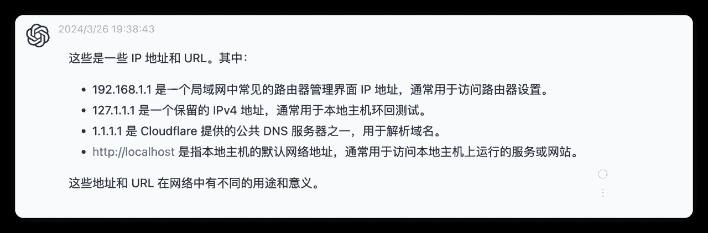

# 2024 年 3 月｜做时间的朋友，要有资格才行

> 来源：[https://leonzhang.feishu.cn/docx/AuhvdxGG0omNvrxAPulcVEZin4f](https://leonzhang.feishu.cn/docx/AuhvdxGG0omNvrxAPulcVEZin4f)

Writer: Leon

Date: 2024/04/06

#Thinking #自省

<https://my.feishu.cn/sync/AhxQdex0fs8TOtbgH9bc9GConRe>

### 精神鸦片

**1**

你以为的困难，大部分时候是不存在的，是你自己吓唬你自己。

**2**

“20 分钟公园”理论：待在公园 20 分钟，即使什么都不干，心情也会更好。

**3**

千万不要相信，压力可以转化为动力，你的压力只会转化成病历，人真正的动力，源自于内心深处，对于快乐和兴趣的追求。 ——毛姆《人生的枷锁》

**4**

https://mp.weixin.qq.com/s/oXffWqiJOu1U5PYeCDwTjQ

康德说过：“这个世界唯有两样东西能让我们的心灵感到深深的震撼：一是我们头上灿烂的星空，一是我们内心崇高的道德法则。”头顶的星空让我们觉得个体无比渺小，在宇宙不过只是尘埃中的尘埃，受制于各种无可奈何的自然规律，但是我们内心崇高的道德法则则让我们高贵，当我们摆脱欲望的奴役，不在乎结果的功利，只在乎行为的对错，我们就是顶天立地的自由之人。

站在道德高地上对他人指指点点的人通常都有不可告人的黑暗，往往要通过指责他人来掩饰自己的不堪。 —— 罗翔老师

**5**

**耐心和坚持，不要胆怯！**

每个人都应该坚持自己的生活，奋斗去争取胜利，这么说或许很鸡汤，但如果没有鸡汤，哪会有那种凭空出现的动力呢？为了自己重要的人也好，为了自己的人生也罢，每个理由都值得去奋斗，不说了，好好学习，好好工作，好好生活，好好爱家人，最重要的，好好爱自己。

### 生活日常

**1**

想到自己有个不是很好的习惯，经常看到一篇觉得还行的，就会直接 follow author，如果下次看到不合适再取关。

看起来合理，但经不起短时大量 follow，如果再积攒一段时间，简直是噩梦（gmail 好几个月没整理了， 2000+ 🥲

https://web.okjike.com/repost/65ff69f212ed2fda683c8a9f

**2**

确实是 Dream Car，做梦都梦到去试驾了 😂

|  |  |
| --- | --- |

**3**

本是后山人，偶做前堂客。醉舞经阁半卷书，坐井说天阔。

大志戏功名，海斗量福祸。论到囊中羞涩时，怒指乾坤错。

https://web.okjike.com/repost/65ff67c23b9c66cae4832d1c

**4**

用 Mac 看视频，发现 Arc、Chrome 都不能用空间音频，但我又不想下客户端，然后顺手问了 Gemini，它告诉我 Safari 是可以直接用，然后打开发现，果然可以...

It's something only Apple can do.

https://web.okjike.com/originalPost/65e71fa312ed2fda687610d1

**5**

在星巴克听到一帮人在聊天，在策划什么活动（声音真的很大，不是我故意听到的...

他们商量活动要送大家什么礼品，其中一个男生说可以送音箱、充电宝啥的，其中一个妹子接的原话说，“我从来不买充电宝、也不用充电宝的，因为到处可以借的到。”

听到时我就在想：你既然说自己不买、也不用充电宝，那你为什么要借别人的用呢？

结果我刚出去洗手间的时候，在路上突然意识到了自己内心的阴暗，没准人家说的是借「共享充电宝」呢...

**6**

朋友告诉我说，他前老板有一句至理名言：很多人都想做时间的朋友，但是和时间做朋友要有资格的，大部分人是没有资格的。所以那些天天喊你要做时间的朋友的，都是大忽悠。

### Thinking

**1**

**把个人成长比喻成一棵树**。**在生长初期**，树木需要扎实的根系以及稳固的主干。此时要疯狂生长树根，不仅要有广度、扩张侧根，吸收更**多土壤里的水**分和养分，还要确保主干的深度，确保风暴来临的时候有一定程度的抵抗力；在生长过程中，树木不仅要向上生长得更高，还要保持茂密的叶子和枝干。

35 岁之前的阶段，注重**广度和深度**。需要通过不断扩展自己的知识、技能和经验（广度），并加深对事物的理解和见解（深度）。

35 岁之后的阶段，追求**广度和高度**。需要更注重在某个领域/方面取得更高的成就，而不仅仅只是停留在原有的成绩中。

**2**

**大多数人不知道应该如何陪伴自己**。

陪伴自己就是照顾好自己，甚至把自己作为一个第三者，作为对立关系，相互照顾。

**3**

**我不怕孤独前行，我怕平庸而死。**成功者和失败者都是相似的，没成功的人可能是运气不好。从这个意义上说，成功和失败是近义词，但它们共同的反义词是平庸。

这句话让我想到《华尔街之狼》中一个片段，小李子说，我每次都会选择那个牛逼的人。（回看了片段，台词是「富人」，“我富过，也穷过，我每一次都会选择做富人。”

**4 **

公司创始人有两项核心技能，第一是找钱，第二是找人。创始人“找钱”的能力是第一关键，我和我前老板都很认同。

现在回想，之前看不下去做的一些功能设计，觉得这么大投入没有必要，或许是**我的视角过**于单一而造成的。或许**只是单**纯从产品角度考虑了，现在拓展来看，除了关注「当下做什么」，还应该关注的是「给谁看」。

**5**

Apple 设备的 aha moment

第一次用 iPhone 的时候，发现 Camera 有 Live Photo 的功能，忍不住惊叹：“原来静态图还可以动态显示！”

当然，虽然这个功能从原理上讲并不复杂，就是图片 + 视频，但当时给我的体验和感觉真的很震撼，本来就是一张很普通的照片，但因为有了这样的设计，所以照片前后发生的好玩瞬间也被记录了下来。这个产品设计就很棒，结合技术创造出令人满意，甚至超出预期的体验。

### PM 碎片想法

**1**

**Feedback 微信输入法**

默认候选字优先级策略，至少包括有：应用推荐策略（包括词频统计、语境相关性）、用户输入习惯，其中，英文词组和中文词组应该是不同的两种策略。

中文的关联性很强，相反英文的关联性较弱，不一定要高频依赖词组。英文场景下，经常因为关联性不强，但应用又强使用「推荐策略」，导致结果就是默认的候选词不是当下想要的。

举例：经常敲键盘「iPhone」，默认优先候选是「iPhone 15」；敲字「Apple」，默认优先候选是「Apple Watch」，而我几乎没有手动敲过「Apple Watch」」，所以推断是推荐策略问题（过多依赖词组）。

应该是这样吧？🤔

**2**

上周买了一款 AR 眼镜，是 Rokid Max，京东售价 ¥2998

很遗憾，并没有使用上，开机引导就出现了卡死的情况，尝试重启多次，均无法解决。

打客服电话想请问 Station 的 Reset （强制重置/恢复出厂设置）要如何触发，对方告诉我没有这个设计，只能将设备给他们寄回售后处理，于是对方在线客服引导我申请退货。

当时还傻乎乎的记了笔记：“底层是 Android，就一就一定会出现死机的情况，而不是引导用户在设备操作内设置。”

结果写这篇内容的时候突然意识到，这种硬件产品怎么可能没有 Reset？

今天回想的时候，突然意识到好多问题。

1.  查看说明书，印象看的是眼镜而不是 Station 的说明书。

1.  为什么不自己查一下社区或官网？只是相信 400 客服说没有，然后就直接放弃查找了。

1.  为什么不自己问下 AI 工具，或许它的回答也可以尝试一下？，比如 Gemini 的回答，可能能够帮我解决问题，但还是有些晚了，产品已经退掉了。

**3 **

发现快车和顺风车是两种不同的收费策略，快车服务后付费，顺风车要提前预付。

平时打快车比较多，多是实时计价或是一口价，服务结束后付费；而顺风车则多是固定价格，且需要预付款项，无论是否一定能打上车（打顺风车两次发现都是如此）。上周打车过去看小米 SU7，去的时候打快车，回来的时候打顺风车。回来路上的时候就在想，为什么平台要在同一产品上设计这两种不同的收费策略？

或许有快车与顺风车的运营策略、平台方、司机端三个视角考虑。第一，从快车与顺风车的运营策略出发。快车收费更灵活，价格可能会根据市场需求、时间段、天气状况以及路程是否拥堵等交通状况进行动态调整，比如上下班打车的价格多高于平时的价格；而顺风车价格通常低于快车，更多是顺路的点对点，所以金额相对固定，不考虑市场需求、时间段、天气状况等交通状况（因为顺风车司机肯定会顺路过乘客端目的地）。

第二，从平台方视角出发，降低平台损失或交易成本（费用到账时间）。相信有很多人打完快车之后，因为赶时间（去机场、高铁站）而忘记支付（没错，我也是其中之一...），所以在产品的支付逻辑上必然会有流程设计，比如下次打车前支付，或应用内 Push，亦或是短信通知提醒等，当然，平台方应该最希望用户开通签约支付。当然，在用户未支付费用前，平台大概率是不会预付费用给司机师傅。

第三，从司机端视角出发，快车端司机与顺风车端司机的签约规则不同。虽然两者都依赖于平台派单，但前者会相对更稳定、更高频，对他们而言，这算是全职或半全职工作，在费用结算时间上不会有很高的心理预期；而后者却相对低频，而心理上会更希望服务结束后，服务费立马到账（损失厌恶心理）。

由上，平台方无论是出于司机端留存率还是新增，都会选择顺风车车主的款项费用优先结算，以提高司机端满意度，所以就将费用结算提前转嫁给了乘客。嗯，很高明的策略。

这个逻辑也在我下车前与司机师傅核实确认了，结束后费用立马到账。我实际支付费用为 37.85，而顺风车司机师傅的收款为 34，即平台端收取 3 元左右的手续费（猜测应该是 10%）；而快车端手续费应该是 30%左右，上次与一个师傅聊，他说他现在所在平台的手续费是 27%。

### 好玩

**1**

公共 wifi 不弹出登录页面怎么办？

在浏览器输入路由器可能的默认网址，看会不会弹出登录界面，比如：

**192.168.1.1 **局域网中常见的路由器管理界面 IP 地址，通常用于访问路由器设置。

**127.1.1.1**** **是一个保留的 IPv4 地址，通常用于本地主机环回测试。

**1.1.1.1**是 Cloudflare 提供的公共 DNS 服务器之一，用于解析域名。

**h**ttp://localhost 是指本地主机的默认网络地址，通常用于访问本地主机上运行的服务或网站。

以上，

祝你早安、午安、晚安～