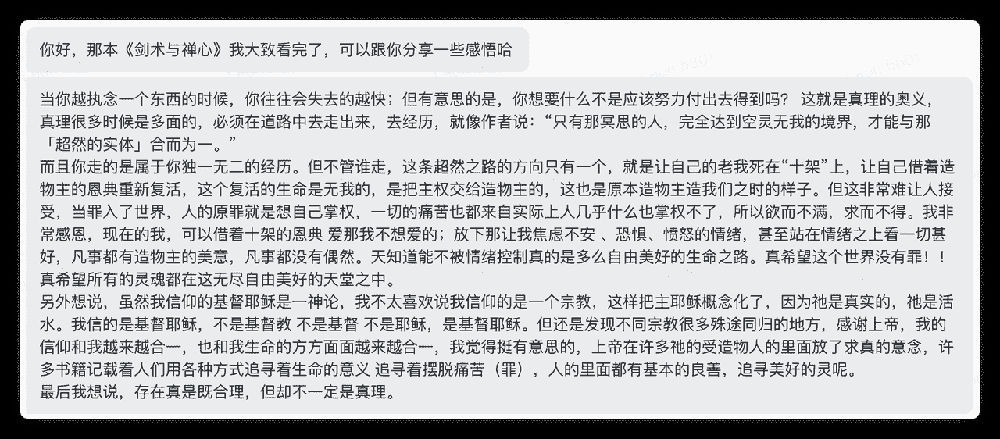
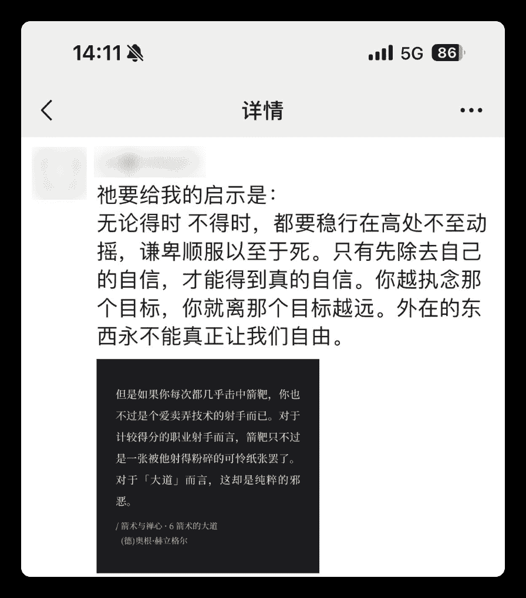

# 2024 年 2 月｜不变的是原则，万变的是现象。

> 来源：[https://leonzhang.feishu.cn/docx/Ge5MdaZ8yoKLgWxP8pzcs2qAn1b](https://leonzhang.feishu.cn/docx/Ge5MdaZ8yoKLgWxP8pzcs2qAn1b)

Writer: Leon

Date: 2024/03/03

#Thinking #自省

<https://my.feishu.cn/sync/AhxQdex0fs8TOtbgH9bc9GConRe>

### 生活日常

**1**

与 Chen（ ByteDance） 同学交流读书感悟

起因是 1 月初时，她在字节共成读书社群里问一本奥根的《箭术与禅心》，我恰好在年前看过，所以顺手发了 。epub 文件，便有了这次的交流和沟通。

这里是我当时的感悟： [读《箭术与禅心》后记：专注与体验](https://leonzhang.feishu.cn/wiki/NysSwZ7SXivtGmk7BCrcZRjInOh)

对比而言，这本书我的感受并没有很深刻，从我记录的内容中也能够看出。我读这本书的契机是《宇宙玩家》的一集节目，或许是我预期过高，又或许是我没有完全静下心来，最后结果比较表面，最终感受一般。也许某天想起或看到这些，也许我会再重读一下这本书。

地址：Vol.3 势能与能量 寻找人生的使命（ https://www.xiaoyuzhoufm.com/episode/65544e5f9f440f544343e3de)

**2**

[国内首个完成适配银行应用，招商银行 App 宣布登陆苹果 V](https://www.ithome.com/0/751/467.htm)ision Pro 头显 - IT 之家

https://www.ithome.com/0/751/467.htm

招商银行是我用过的银行 App 里比较好用的了，呈鲜明对比的是，之前用的某个讨厌银行 App，验证码输入时，调起的是随机顺序的安全键盘，真是大写的服气！

**3**

仰望 U9 ｜帅的一塌糊涂！漂亮得不像实力派！！

+   [比](https://www.ithome.com/0/751/954.htm)亚迪仰望 U9 超跑上市：零百 2.36 秒 / 最高时速近 310km，售 168 万元 - IT 之家

https://www.ithome.com/0/751/954.htm

+   【仰望 U9 | 309.19km/h， 中国百万级最高极速纯电超跑-哔哩哔哩】 https://b23.tv/xJzOZ8G

**4**

雷总太难了，被极氪追着打呀

极氪 001 不仅在技术和配置对比上款不仅提升了很多，价格还降了！想买的人肯定很心动呀！

只能说雷总更难了，SU7 是小米第一款车，价格配置、市场定位、定价策略都很关键，结果这节骨眼儿上被 001、007 围攻，尤其 001，全系 800V 高压快充、高性能电机，再加上 CLTC 750km 的续航。

[16.98 万元起，比亚迪汉荣耀版车型上市：新](https://www.ithome.com/0/752/605.htm)增银釉白 / 暮山紫配色 - IT 之家

https://www.ithome.com/0/752/605.htm

还有最近看到的比亚迪汉、秦 Plus，想当初，汉可是卖 30 万的呀，结果现在只需要 16.98 万起；比亚迪秦 Plus 7.98 万，（这价格，还要啥自行车呀）。卷得厉害的，果然“等等党永远不亏”是吧，笑死

### Thinking

**1**

了解自己是人生最大的课题。最不了解的就是自己，希望可以通过命理/风水，了解到自己不为人知和可能的一面。

起初，我曾对命理、星座、生肖等不感兴趣，但是随着去年的变化之后，开始逐渐感兴趣了。我并不是要执着于这些，我只是更想了解自己，关注通过这些还可以发掘出哪些兴趣爱好。这是热爱生活的一种外在表现之一。

**2**

阿珂打算写小说，不可避免的我俩在讨论一些关于小说相关的一些事情，一些作品和作者，尤其是《旧日音乐家》作者写的创作心路历程印象深刻。

因为自己没有读过几本小说，所以自然而然联想到当年明月的《明朝那些事儿》，突然意识到写小说的人，是真正的聪明的人。创作者不仅拥有丰富的想象力和创造力，他们的大脑还需要同时拥有多种观点，在作品中展示多个人物不同角度的思考。内容中也经常隐藏着他们想要表达的东西，不能够太浅也不能够太深，似明非明的观点才能够让读者在阅读过程中思考更多、体会更多。

**3**

能说服一个人的从来都不是道理，而是南墙。能点醒一个人的从来都不是说教，是磨难。

### 精神鸦片

**1**

每天**流汗、晒太阳、保持平静**，能解决你 99% 的问题～

成功是一时的，失败才是人生的主旋律。如果一个人在他的领域总是拿到赢家的剧本，要么说明他作弊了，要么说明那个领域根本就没竞争力。如果你一直对失败者是一种不宽容的嘴脸，那就一定会有被回旋镖打到的那一天。

爱本并没有错，爱谁都是自由，爱强者更是人类的天性。不过因为自己所爱的事物强大，就幻想自己也强大了，甚至觉得爱其他事物的人都已经被踩在脚下了，这就是病态，一种弱者的病态。

**2**

当你来到十字路口的时候，你一定要倾听内心最勇敢的声音。当命运需要你去逆风飞翔的时候，就不能随风而去。v—— 《少年班》

**3**

罗翔老师说：任何寻求安慰的行为都不会让你成长：宿醉、旅行、甚至和朋友促膝长谈，因为这些都只是让你在长期停留的茧房里感觉安全、良好。

**当我们把寻求安慰的行为当作成长的代替品**时，我们失去了成长的机会，因为成长需要勇敢面对自己的不足和缺点，需要敢于面对挑战和痛苦，需要不断地学习和改变。

成**长其实是特别艰难的自省，你必须抛弃所有**说给别人和自己**听的漂亮话，正视你的**无能和劣根，甚至一遍又一遍被打破、割裂、推翻以前的所有观念和认知再重组。然后你才懂得成长真正需要的是改变。

你必须拥有很大的福德，才能遇到那个把你唤醒的人。事实上，即便你遇到那个把你唤醒的人，你是否愿意醒也是个问题。有很多人觉得睡觉更舒服。有些人找老师并非为了觉醒，而是为了睡的更舒服。

即便你遇到有伟大证悟的老师，他也不可能魔法棒一挥你就证悟了。你需要按他说的做，深信不疑，持续精进。在一次次被揭皮疼痛时，虚大的自我被挫伤时，一次又一次的摔打考验中，英勇无畏，不折不饶，初心不改，才能修成正果。

**人生是一场觉醒，如果你不觉醒，生活就会你痛，如果还不觉醒，就会让你更痛，如果还不觉醒，就会让**你失去，如果还不觉醒，就会让你死亡。当觉醒的那一刻，就走上了成长与找回自己的路。

### 学习资料

**1**

**扎**克伯格最新对谈：智能手机不会消失，AR 会是主流移动计算设备，XR 则是桌面计算设备，生成式 AI 实现人机交流

https://mp.weixin.qq.com/s/A3IdPYZqV-_1MB_oy8Qbkw

**2**

揭秘拼多多：市值超越阿里，它是怎么做到的？  https://mp.weixin.qq.com/s/q6VnNrWvV2Jh9UuTl96dWQ

员工高执行力的策略之一，招一个人、发两个人的钱、让他干三个人的活。

拼多多的主要成功因素，高层高质量的决策 + 团队高效的执行力

+   高质量决策（黄峥、阿布）：消费者第一、高效率、低价

+   高效执行力（强权 +竞争）：高薪资（起薪 + 每年涨薪）、强权、强竞争

**3**

https://x.com/Svwang1/status/1761417657902129429?s=20

很多高效的长寿习惯，并不需要很多钱，但带来的时间财富，长期看一本万利，需要持续和刻意的探索。

+   间接性断食，可以健脑和高效精准调节体重。

+   慢跑，可以健脑和提高心肺功能。

+   瑜伽和普拉提，可以训练核心肌群，提供精准控制能力，从而解决腰酸背痛相关问题。

+   蒸桑拿（每周四次，单次 20min），可以促进心血管健康，降低精神压力，促进大脑生长激素分泌。通过热休克蛋白质的分泌而预防各种因为蛋白质错误折叠 （protein misfolding） 而导致的慢性病 （比如老年痴呆），延年益寿。

+   高强度间歇训练，或许能够进一步提高 vo2max （最大摄氧量） 和促进大脑生长激素的分泌。

**4**

商业世界的一些范式转移（三个变化）｜李翔 https://mp.weixin.qq.com/s/dZppcnBt2Yy7e48kE8ymuQ

1.  全球化公司和区域化公司的分化变得明显，未来全球化必然会成为很多公司的必选战略。

1.  随着线上的成熟和机会变少，线下的创新会有一波复苏。

1.  个体的努力和机会会趋向于更小众和更专业的方向，产品力和服务供给上会有更大的丰富度和改良。

**5**

OpenAI 的 Sora 简介

Sora 是 OpenAI 开发的文本到视频生成模型，可以从文本描述生成逼真且富有想象力的视频。它基于深度学习技术，并使用了大量的视频和文本数据进行训练。

Sora 的主要功能包括：

+   从文本描述生成视频：可以输入一段文本描述，Sora 会自动生成相应的视频。

+   视频编辑：可以对生成的视频进行编辑，例如剪辑、添加特效等。

+   视频合成：可以将多个视频合成一个新的视频。

Sora 的应用场景包括：

+   影视制作：可以用于制作电影、电视剧、广告等视频内容。

+   教育培训：可以用于制作教育视频、培训视频等。

+   娱乐游戏：可以用于制作游戏视频、虚拟现实等娱乐内容。

**Sora 的工作原理**

Sora 采用了深度学习技术，并使用了大量的视频和文本数据进行训练。具体来说，Sora 的工作原理可以分为以下几个步骤：

1.  首先，Sora 会将文本描述转换为一系列的语义向量。

1.  然后，Sora 会使用一个深度学习模型将语义向量转换为视频帧。

1.  最后，Sora 会对视频帧进行处理，生成最终的视频。

**Sora 的优势**

Sora 具有以下几个优势：

+   可以生成逼真且富有想象力的视频。

+   可以对生成的视频进行编辑，满足用户的个性化需求。

+   可以将多个视频合成一个新的视频，方便用户进行创作。

**Sora 的局限性**

Sora 仍处于开发阶段，还存在一些局限性，例如：

+   生成的视频有时可能存在瑕疵，例如人物动作不自然、场景不协调等。

+   对文本描述的理解能力还有待提高，有时可能会生成与文本描述不符的视频。

+   需要大量的计算资源，普通用户可能无法使用。

**参考资料**

+   OpenAI Sora: [openai.com](https://openai.com/sora)[...](https://openai.com/sora)

+   Video Generation Models a[s World Si](https://openai.com/research/video-generation-models-as-world-simulators)[mul](https://openai.com/research/video-generation-models-as-world-simulators)ators: openai.com...

### 扩展内容（AI Weekly）

+   [240225 - 0219｜谷歌 Gemini 生图功能紧急关闭；Tesla Optimus 大更新：有史以来最快的步态，速度约为 0.6 米/秒；英伟达成立最壕 AI 实验室：Jim Fan 领衔，专攻具身智能；清华叉院、理想提出 DriveVLM，视觉大语言模型提升自动驾驶能力；Stable Diffusion 3 震撼发布，采用 Sora 同源技术，文字终于不乱码了；Gemini 1.5 Pro 在几秒钟内将一部完整的电影变成了摘要；马斯克：Neuralink 首位人类受试者已康复 可凭思维控制鼠标；Sora 到底懂不懂物理世界？一场头脑风暴正在 AI 圈大佬间展开...](https://leonzhang.feishu.cn/wiki/Zn4XwREe2iYITwklqdocdtYan7g)

+   [240218 - 0212｜OpenAI 发布视频生成模型 Sora；微软 Copilot 开售；Google Gemini 上线，MoE 架构，100 万上下文；OpenAI 赋予 ChatGPT 记忆功能，由你掌控；OpenAI 7 万亿超大芯片计划曝光，要重塑全球半导体行业；Google 提出全新 RLHF 方法：消除奖励模型，且无需对抗性训练；华为盘古大模型变「小」，1.5B 也很能打；苹果设计团队专访｜软件与硬件副总裁谈 Apple Vision Pro 产品开发与体验 ...](https://leonzhang.feishu.cn/wiki/CTcDwcZJri8BX0kbZDLc1r8knYc)

+   [240211 - 0205｜黄仁勋：从此之后，请叫我黄院士；三个 Agent 顶个 GPT-4，基于开源小模型的那种｜中大阿里联合出品；吉他摇滚、电子音乐都能搞定，Meta 开源音频生成新模型 MAGNeT；MidJourney 开始构建硬件，挖走 Apple Vision Pro 工程师；OpenAI 发布 visionOS 版 ChatGPT！通义千问再开源，Qwen1.5 带来六种体量模型，性能超越 GPT3.5 ...](https://leonzhang.feishu.cn/wiki/XRuowDI5LirKsokAmLfc2Wtln6g)

+   [240204 - 0129｜张鹏对话 Pika 创始人 Demi：AGI 时代的产品，需要「少年气」和为用户「留白」；Google Bard 更名 Gemini；像人类一样在批评中学习成长，1317 条评语让 LLaMA2 胜率飙升 30 倍；更新后的 GPT-3.5 Turbo 模型，降低了 50%的输入定价，25%的输出定价；比肩 GPT-4，商汤日日新大幅升级 4.0，多模态能力领先一步；苹果 iOS 史上最大更新！Siri 要上大模型了；马斯克：Neuralink 首次将芯片植入人体，产品已在路上 ...](https://leonzhang.feishu.cn/wiki/ItxEwlLOQiEOoEkBQszckYr9nxb)

以上，

祝你早安、午安、晚安～