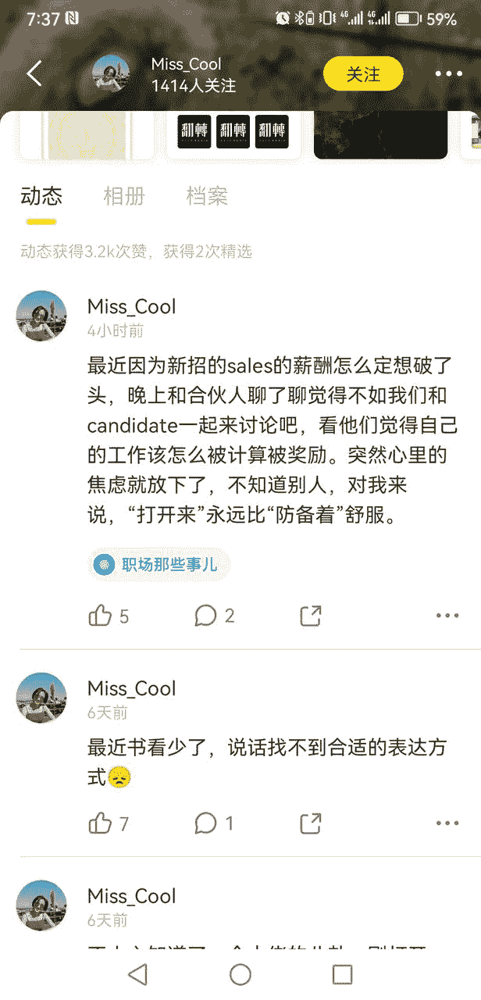

# 2023 年 8 月

> 来源：[https://leonzhang.feishu.cn/docx/R3MTdELjyoo0LTxgPjxc6IVWnid](https://leonzhang.feishu.cn/docx/R3MTdELjyoo0LTxgPjxc6IVWnid)

### 0828

人的一生的每一个动作都是为了自己。

### 0824

在一个变化无常的 world，我们不应该做任何长期计划。应该把握当下，不断学习和成长，为自己在未来的成功打下基础。

Zara: Just by persisting, you will already be at the top of the pack.

### 0823

苹果的 MagSafe 外接电池，这个需求洞察好棒。

众所周知，iPhone 不仅耗电快，它充电也慢呀！出门在外手机电量不足时，无非三个选择：一者使用共享充电宝；二者自带充电宝+数据线；三者自带电源适配器+数据线。明显后两者会增加你背包的重量，且使用时并不优雅，而 MagSafe 外接电池只需要「啪」的一下，完美解决以上问题。

而 MagSafe 外接电池可以完美解决以上问题。直接磁吸在你的手机背面，完全不需要再带数据线（和充电宝）。

### 0822

在面对未知的未来时，我通常有两种态度，即风险和机会。

怎么选？收益和风险并存。换言之，在面对更大的风险和挑战时，往往也伴随着更多的机会。

### 0822

当自己发现无法专注于文字内容学习的时候就真的放开心看一些视频，比如 youtube、b 站的待看。

### 0821

刘飞：朋友说，经历了 Gap Year，有了大量的思考和体会，才真的知道自己想要什么了 —— 更多的 Gap Year。

Gap 中，就...很应景......

### 0815

**一个现实的问题：如果你不幸运，30** 岁之前没有成为管理层，今后靠什么生活？

### 0815

职场管理者的“处心防备”与”坦诚相待“，前者会获得掌控感、欣喜若狂、自我满足，后者会获得信任与尊重、也会减少管理冲突与压力。

昨晚好友发我一个截图（右图），大概内容是一个管理者选择与候选人讨论薪酬制定方案。他说感觉这个想法挺好，甚至有一瞬间，想去这个团队工作。

我猜这个团队的氛围一定很棒，因为团队成员被重视。

|  |
| --- |

### 0813

突然想到，妙鸭相机的创始人张月光说：“AIGC 的产品第一天不收钱，就可能收不到钱。”本质是因为现在很多的 AIGC 产品都是基于各种“模型”的应用层产品，这几乎没有壁垒，更容易被复制或超越。

如何建立差异化和持久化的竞争优势是我们在设计中需要不断思考的。

### 0813

如果你碰到了一些问题，你只能选择面对，不要藏着掖着。

### 0812

+   想到很多事情攒着到最后关头才动手。本身是小时候的抄作业带来的恶习，也是固有观念，比如开学前的最后一天，甚至最后一天晚上开始「抄/胡写」 寒暑假作业。

+   失败计划，并非是做不完就不做了。而是即使晚了，我还是要努力去做，更多的是降低自我剥削或者减少压力的一个理由。

### 0811

这世上没有绝望的处境，只有面对处境绝望的人。

### 0810

段永平：不要让重要的事情，变成紧急的事情。

### 0806

**相信逻辑，而不是现象**。“痛定思痛”之后，一定要有一个判断结果，一定要有一个结论。其中最关键的逻辑是什么，无论是对是错，没有结论的分析和时间都是沉没成本。

### 0804

“总觉得你面对人不自信，面对事有时候又太自信了”，好友如是说。

辩证的看，有两个情况。一者，我已经了解透彻这件事了；第二，那只是我认为的了解透彻。所谓近墨者黑，我的真实情况大概率是后者。继续拼图！

### 0803

看到一篇文章《一个独立创造者的五年》，里面有句话，我很是喜欢：“生意即艺术。做生意和做艺术一样，你可以在各个环节发挥自己的创造力。你可以借鉴、融合别人的创意，也可以打破常规，尝试一些别人从来没试过的事情。”

产品设计也是如此，你可以大胆发挥你的想象力，过程你也可以加入属于你的“小心机”，最后从中选取最合适的那个方案。

换句话说，人生也是如此，难道不是吗？!

### 0802

读书，要从“研究”的角度出发，深入一个主题。要清楚的了解自己当下的目的，同时也要有足够的“克制”，避免在搜集资料的时候跑偏，同时对同一观点要持有批判性思维。

关于批判性，罗翔老师说过，“一个人成熟的重要标志是，就是能够在脑海中同时存在两种看似对立的观点。”

知行合一的大道，在几千年后的仍旧闪耀着真理的光辉。