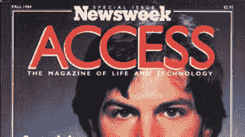

# Steve Jobs: 1984 Access Magazine Interview

> 来源：[https://leonzhang.feishu.cn/docx/GIAcd6tpxoe31hxV3IgcHmgSnoc](https://leonzhang.feishu.cn/docx/GIAcd6tpxoe31hxV3IgcHmgSnoc)
>
> 🔗 原文链接：https://www.thedailybeast.com/steve-jobs-1984-access-magazine-interview?ref=scroll

In 1984, Tom Zito interviewed a 29-year-old Steve Jobs, months after he introduced his first Mac.

No technological advance has more quickly captured the imagination and opened the pocket books of Americans than personal computers. Like the space program that initially nurtured computer research, these new information appliances have come to symbolize America’s return to technological superiority—a place seemingly lost in the past decade to imported televisions, cameras, digital watches and Walkmen.

Mirroring this resurgence, a new lifestyle has grown up around the personal computer industry, nowhere more visible than in Silicon Valley, 45 miles south of San Francisco, where prune orchards have been transformed into a fertile crescent of research and development. The Valley is a strange blend of workaholism and conspicuous consumption, hot tubs and traffic jams. Technological vision and rivalry are so intertwined that local residents call the place Silicon Gulch.

No individual has become more a symbol of this land of opportunity than Steven Paul Jobs, the 29-year-old cofounder and chairman of the board of Apple Computer. Jobs, adopted at birth by a middle-class couple in Mountain View, California, was raised on Little Richard, Bob Dylan and technology. In many ways he was a typical—albeit young—product of the counterculture of the '60s. He experimented with drugs, dropped out of Reed College his freshman year, and only settled down to work after answering a help wanted ad for Atari that promised, “Have fun and make money.” Still in search of higher truths, Jobs quit Atari after a brief stay, journeyed to India and shaved his head. In 1975 he returned to the States and set about building home computers with the brilliant Stephen Wozniak, a friend who had been working as an engineer at Hewlett-Packard.

In early 1977, they founded Apple Computer which quickly became one of the dominant forces in the personal-computer field. In 1981 IBM entered the market and the struggle between what Jobs calls “the innovators and the blue suits” was joined. So great was the competition that Apple’s stock plummeted almost 50 points last year, as IBM seemed to be defining the standard in the personal-computer marketplace.

In January, however, with the introduction of Macintosh, Apple began an aggressive counterattack, heralded by its “1984” TV commercial that portrayed a woman hurling a hammer through a screen image modeled after Orwell’s Big Brother. Jobs claims Apple will sell a half-billion dollars worth—250,000—of Macs this year, a number considerably less than demand, which has exceeded even Apple’s original hopes. Equally inspiring for Jobs is the fate of Apple II, the company’s tried-and-true product, which has walloped IBM’s PC jr. Two million Apple IIs have been sold in the company’s seven-year history, and last April, at a party with the theme "Apple II forever,” the company introduced its new IIc—a portable version of the Apple II that can be operated without a battery pack. Not to be outdone, IBM recently introduced a portable version of its own PC. Once again, the chips will fly.

### Is the computer business as ruthless as it appears to be?

No, not at this point. To me, the situation is like a river. When the river is moving swiftly there isn’t a lot of moss and algae in it, but when it slows down and becomes stagnant, a lot of stuff grows in the river and it gets very murky. I view the cutthroat political nature of things very much like that. And right now our business is moving very swiftly. The water’s pretty clear and there’s not a lot of ruthlessness. There’s a lot of room for innovation.

### Do you consider yourself the new astronaut, the new American hero?

No, no, no. I’m just a guy who probably should have been a semi-talented poet on the Left Bank. I sort of got sidetracked here. The space guys, the astronauts, were techies to start with. John Glenn didn’t read Rimbaud, you know; but you talk to some of the people in the computer business now and they’re very well grounded in the philosophical traditions of the last 100 years and the sociological traditions of the '60s.

There’s something going on here, there’s something that is changing the world and this is the epicenter. It’s probably closest to Washington during the Kennedy era or something like that. Now I start sounding like Gary Hart.

You don’t like him?

Hart? I don’t dislike him. I met him about a year ago and my impression was that there was not a great deal of substance there.

So who do you want to see…

I’ve never voted for a presidential candidate. I’ve never voted in my whole life.

### Do you think it’s unfair that people out here in Silicon Valley are generally labeled nerds?

Of course. I think it’s an antiquated notion. There were people in the '60s who were like that and even in the early '70s, but now they’re not that way. Now they’re the people who would have been poets had they lived in the '60s. And they’re looking at computers as their medium of expression rather than language, rather than being a mathematician and using mathematics, rather than, you know, writing social theories.

### What do people do for fun out here? I’ve noticed that an awful lot of those who work for you either play music or are extremely interested in it.

Oh yes. And most of them are also left-handed, whatever that means. Almost all of the really great technical people in computers that I’ve known are left-handed. Isn’t that odd?

Are you left-handed?

I’m ambidextrous.

### But why music?

When you want to understand something that’s never been understood before, what you have to do is construct conceptual scaffolding. And if you’re trying to design a computer you will literally immerse yourself in the thousands of details necessary; all of a sudden, as the scaffolding gets set up high enough, it will all become clearer and clearer and that’s when the breakthrough starts. It is a rhythmic experience, or it is an experience where everything’s related to everything else and it’s all intertwined. And it’s such a fragile, delicate experience that it’s very much like music. But you could never describe it to anyone.

### In 1977 you said that computers were answers in search of questions. Has that changed?

Well, the types of computers we have today are tools. They’re responders: you ask a computer to do something and it will do it. The next stage is going to be computers as “agents.” In other words, it will be as if there’s a little person inside that box who starts to anticipate what you want. Rather than help you, it will start to guide you through large amounts of information. It will almost be like you have a little friend inside that box. I think the computer as an agent will start to mature in the late '80s, early '90s.

### You once talked about wanting to have a computer that could sit in a child’s playroom and be the child’s playmate.

Forget about the child—I’d like one myself! I’ve always thought it would be really wonderful to have a little box, a sort of slate that you could carry along with you. You’d get one of these things maybe when you were 10 years old, and somehow you’d turn it on and it would say, you know, “Where am I?” And you’d somehow tell it you were in California and it would say, “Oh, who are you?”

“My name’s Steven.”“Really? How old are you?”“I’m 10.”“What are we doing here?”“Well, we’re in recess and we have to go back to class.”“What’s class?”

You’d start to teach it about yourself. And it would just keep storing all this information about you and maybe it would recognize that every Friday afternoon you like to do something special, and maybe you’d like it to help you with this routine. So about the third time it asks you: “Well, would you like me to do this for you every Friday?” You say, “Yes,” and before long it becomes an incredibly powerful helper. It goes with you everywhere you go. It knows most of the raw information in your life that you’d like to keep, but then starts to make connections between things, and one day when you’re 18 and you’ve just split up with your girlfriend it says: “You know, Steve, the same thing has happened three times in a row.”

You grew up in an odd place here, surrounded by all this technology. Yes. The guy next door to my parents’ place was doing some of the foundation research on solar cells. Actually, I had a pretty normal childhood. It’s nice growing up here. I mean the air was very clean; it was a little like being out in the country.

As a kid, were you already conscious of some sort of social structure forming, that there were people who were in the silicon business and there were people who weren’t? Hmmm, no. See, there wasn’t such a thing as the silicon business back in the early '60s when I was between the ages of 5 and 10. There was electronics. Silicon, as a distinct item from the whole of electronics, didn’t really occur until the '70s.

How did it affect the culture here? Well, Silicon Valley has evolved into the heart of the electronics industry—which is the second largest industry in the world and will soon pass agriculture and become the largest. So Silicon Valley is destined to become a technological metropolis and there are pluses and minuses to that.

It’s very sad in a way because this valley was probably the closest thing to the Garden of Eden at one point in time. No more. Why? Because now there are too many square miles of concrete and asphalt.

Does that have something to do with the ruthlessness of the business? No. Then was it because a lot of people realized they could make a fast buck here? First of all, things happen in increments, right? They don’t happen all at once. But people didn’t start these companies just to make a buck. I mean they started businesses with very romantic notions. It wasn’t just money. Nobody would say to himself, “Jesus, I think next Monday my friend and I are going to start a company so we can make lots of money.” No, but you think you’d be the same person today if your aggregate wealth consisted of one Volkswagen van? Obviously not. But that’s sort of a meaningless question.

No, what I’m suggesting is that some people started companies because they were fascinated by the technology and a lot of other people started companies because they thought they could make a buck. Not the really great ones. Then what, if not money, defines the social pecking order out there? A combination of having pioneered something significant, and having built a thriving organization. The right company, that’s very important.

In other words, even though some people have come out with neat products, if their company is perceived as a sweatshop or a revolving door, it’s not considered much of a success. Remember, the role models were Hewlett and Packard. Their main achievement was that they built a company. Nobody remembers their first frequency-counter, their first audio oscillator, their first this or that. And they sell so many products now that no one person really symbolizes the company.

But what does symbolize Hewlett-Packard is a revolutionary attitude toward people, a belief that people should be treated fairly, that the differentiation between labor and management should go away. And they built a company and they lived that philosophy for 35 or 40 years and that’s why they’re heroes. Hewlett and Packard started what became the Valley.

What skill do you think you have that allowed you to succeed? Well, you know, there were probably a lot of guys out there sitting in garages who thought, “Hmmm, let’s make a computer.” Why did we succeed? I think we were very good at what we did and we surrounded ourselves by very fine people.

See, one of the things you have to remember is that we started off with a very idealistic perspective—that doing something with the highest quality, doing it right the first time, would really be cheaper than having to go back and do it again. Ideas like that. Can you be more specific? No, because that’s as specific as you get. Just general feelings about things, without any experience to back them up.

They’re not based on, say, “Gee, look what happened to Hewlett-Packard”? No, no, no. We just sort of had these feelings. We started to run the company our way and it turned out things we were doing worked. We never lost sight of how our idealism could translate into tangible results that were also acceptable in a more traditional sense.

You seem to have postured Apple’s image as the last crusade against the IBM-ization of the world. You know, that’s not quite right. If you froze technology today, it would be like freezing the automobile in 1915: you wouldn’t have automatic transmissions, you wouldn’t have electric starters. You don’t want to see IBM freeze the standards.

But the flip side of that is that this industry has matured more rapidly than any other industry in the history of business and there are suddenly things that billion-dollar class companies can do that $100 million or $10 million class companies can’t do. For example, Apple will spend the better part of $100 million this year on research and development, and will spend the better part of $100 million on advertising. Now, IBM will spend that on personal computers alone. And if IBM and Apple invest that money wisely, it will be very difficult for the $10 million or even the $100 million class companies to keep up.

Is there any company besides Apple and IBM that could keep up? AT&T obviously could choose to invest $200 million. General Electric could obviously choose to invest $200 million. The question is will they? Will they take the risk? Do they see promise? Do they have the passion to innovate?

Out here there are traffic jams at 7:30 in the morning, even though people in the Valley have this reputation of being laid back… Oh right, people work very hard here. And I think you have to differentiate between a true workaholic, and somebody who loves his work and wants to work because he gets true satisfaction and enjoyment out of it.

The perfect example is the software people who don’t get in until noon but they work until two in the morning. And they like it. Don’t you ever wake up in the morning and say to yourself, “There’s no reason for me to work another day for the rest of my life. I’ve made enough money so that I can just have a good time, do anything I want…” Well yeah, I suppose some people say that.

But the question ignores all the reasons why people do things here. The money is literally a 25 percent factor, at most. The journey is the reward. It’s not just the accomplishment of something incredible. It’s the actual doing of something incredible, day in and day out, getting the chance to participate in something really incredible. I mean that’s the feeling we’ve had.

I think everyone on the Mac team would have paid to come to work every day. I don’t say this snidely, but that’s a very easy thing for somebody to say who owns 6.9 million shares of Apple stock. Then go ask the rest of them.

Do you know how many places Burrell [Smith, Mac’s hardware designer] and Andy [Hertzfeld, the operating-system designer] could go to tomorrow if they wanted to? Sure, they have a lot of money, and they could go work anywhere else they wanted to. But here you have a guy like Andy who spends I don’t know how many thousands of dollars renovating his kitchen, and he never cooks a meal in it!

So what? What’s the point? Well, I’m talking about quality of life. One of the things that strikes me about Silicon Valley is that nobody seems to do anything but work. A lot of people will probably take this analogy wrong, but there are a good number of people who would have loved to have had even the most menial job on the Manhattan Project in Los Alamos and watch those brilliant people work together for that period of time.

There are also a lot of people who want to join the Marines. No, no. There are moments in history which are significant and to be a part of those moments is an incredible experience. In other words, there are more important things than cooking in your own kitchen. I’m simply suggesting there’s a very interesting relationship in this Valley between work, money and personal life.

Well, I don’t know what this Valley is. I work at Apple. I’m there so many hours a day and I don’t visit other places; I’m not an expert on Silicon Valley. What I do see is a small group of people who are artists and care more about their art than they do about almost anything else.

It’s more important than finding a girlfriend, it’s more important… than cooking a meal, it’s more important than joining the Marines, it’s more important than whatever. Look at the way artists work. They’re not typically the most “balanced” people in the world.

Now, yes, we have a few workaholics here who are trying to escape other things, of course. But the majority of people out here have made very conscious decisions; they really have.

How quickly did you become a millionaire? When I was 23, I had a net worth of over a million dollars. At 24, it was over $10 million, and at 25, it was over $100 million.

How did that affect the quality of your dates? My dates? Nothing really changed, because I don’t think about it that much. The people who think about those things a lot I never meet.

Sometimes it’s got to be overwhelming to you that about 10 years ago you were at some festival on the Ganges river and now you’re running a billion-dollar corporation. Yeah, well, OK. What do you want me to say? Give me the possible responses, I’ll pick one. Well, I think there are an infinite number of responses.

I’m simply suggesting that it somehow relates to Andy Hertzfeld never cooking a meal in his own kitchen. I don’t know what it relates to. Andy and I are roughly the same age, right? There’s a whole set of things that neither of us has ever done before, you know: neither of us has ever been married before; neither of us has come home at 5 o’clock and hung out by the pool. I mean, there’s a whole set of things.

And we’ve chosen, at least in part, to spend a large number of hours and a large amount of our energy in a different way, making a computer.

Now other people make things too. Other people put their energy into having a family, which I think is wonderful—I’d love to do it myself—or they put their energy into making a career or making this or making that. We’ve put our energy into making Macintosh over the last two years, which we thought would make a difference to a group of people that we wouldn’t ever really know, but we’ll walk into classrooms and see 50 Macintoshes and we’ll feel good.

When Apple was starting up, were people always conscious of stock options? Oh sure. Well, not as much as they are now. Apple was the first company that gave stock options to almost everybody, every engineer, every middle-level marketing guy and so on.

It strikes me that very few people cash in their chips here. Some do and some don’t. One of the trends I’ve seen is that once things seem a little stable, once the company has made it over some critical hurdles, some of the people will sell enough of their stock to buy a house or do something which may not mean that much to them, but will mean something, let’s say, to their spouse or to their family, which hasn’t seen enough of them for the last two years.

They’ll want to do something to sort of say, “Hey, you know, what I’ve been working on really has been valuable, it really has been worth it and besides my loving it, it has produced something for the family or for both of us." A lot of analysts and venture capitalists I’ve talked to think you’re absolutely crazy to still have as much Apple stock as you have.

Is it a matter of pride? Well, it’s a lot of things. Certainly, a year ago the stuff was worth, you know, more than twice as much as it’s worth now. Last year, it decreased by about $200 million. I’m the only person I know that’s lost a quarter of a billion dollars in one year.

How does that make you feel? It’s very character building!
