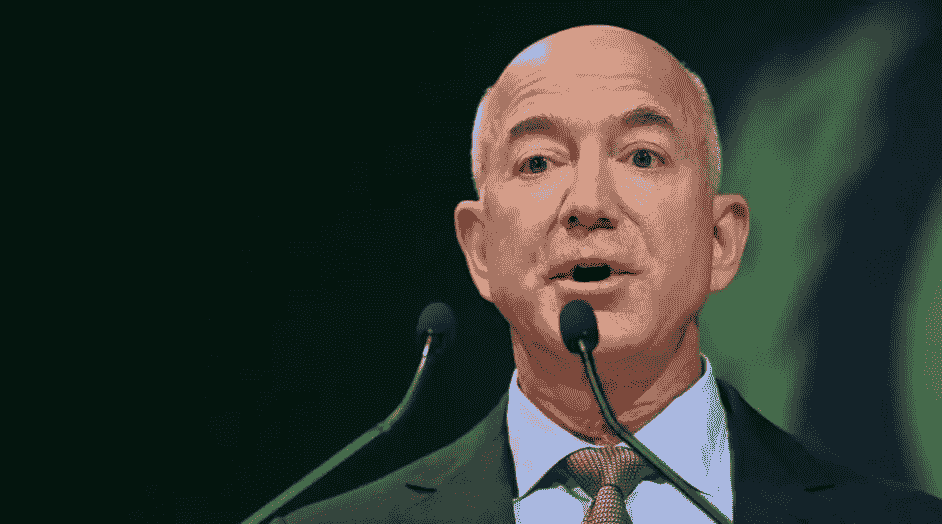
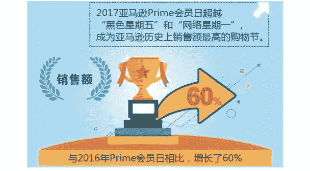
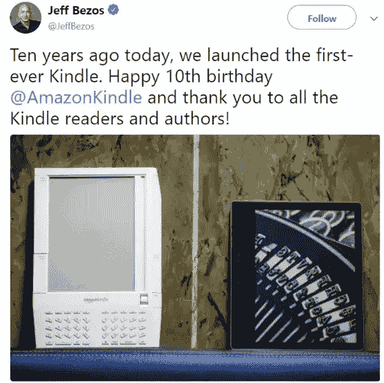
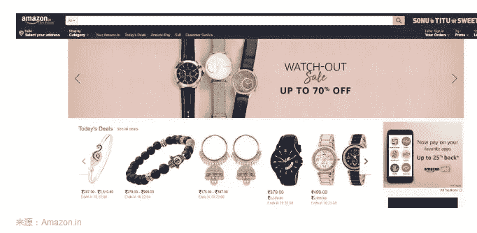
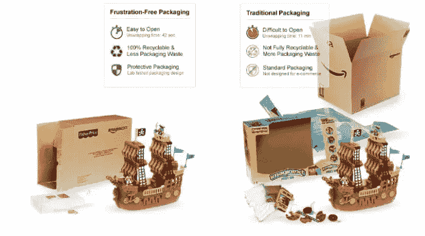

# 贝索斯2017年致股东信

> 来源：[https://leonzhang.feishu.cn/docx/FZpEdlu1KoEO8hxuxOgc4NZ3ngf](https://leonzhang.feishu.cn/docx/FZpEdlu1KoEO8hxuxOgc4NZ3ngf)

> 企业三大原理：交易成本原理 + 创新原理 + 社会目的原理，在亚马逊这家企业上体现得淋漓尽致。

> 在这封信中，我们可以看到以客户为中心的亚马逊如何通过创新，降低了交易成本，包括企业内部的交易成本以及企业外部的交易成本，甚至降低其它企业的交易成本。

> 科技的创新让两个成本都快速下降，从而多业态、多产品类型的企业能够更大程度避免因为内部管理成本的快速攀升而分崩离析。换句话说，熵增因组织文化和技术创新得到一定程度的抑制。

> 有的企业开两家店，就因为经营管理不善，无法保持产品的品质就倒闭了。有的企业则成为人类社会生活的梦想化身，这当中的差异值得深思，从原理层面的深思。

> 🔗 原文链接： h[ttps://www.bilibil](https://www.bilibili.com/read/cv13888888)i.com/read/cv138...

贝索斯的2018年度股东信

**致我们的股东：**

美国顾客满意度指数近日宣布了年度调查的结果，亚马逊第八年蝉联第一。英国也有类似指数，即英国顾客满意度指数，由客户服务中心提供，亚马逊英国公司连续第五次排名第一。亚马逊也被LinkedIn提名进入2018年最强企业名单，其中罗列出专业人士心目中美国最抢手的就职场所。

而就在几周前，哈里斯民意调查公布了年度声誉商数，针对从工作环境到社会责任、到产品和服务等广泛议题，对超过25,000名消费者进行了调查，亚马逊连续第三年名列首位。

祝贺并感谢560,000名亚马逊人，多年来，是你们怀着对客户的无限赤诚，每日以充满创造力的工作，践行着卓越运营的承诺。同时，我代表世界各地的亚马逊人，真诚感谢您 —— 我们的客户。看到你们对这些调查的反应，我们感到无比兴奋。

在客户层面，我所喜爱的一件事是他们永不满足，令人肃然起敬。他们的期望不是静止的，而是上升的，这符合人的本性。我们没有止步于原始狩猎时期，对更好的追求从未止息，昨天的“哇”很快变成了今天的“稀松平常”。

我看到，改进周期比以往任何时候都短，这可能是因为客户比以往任何时候都能轻松地获得更多信息。只用短短几秒钟或在手机上按动几个键，客户便可以阅读评论、比较多个零售商的价格、看看是否有库存、查明何时发货或可供选择的提货方式，等等。这些例子来自零售业，但我觉得同样的客户授权现象也在我们亚马逊和其他大多数行业广泛地发生。在这个世界上，你不能坐以待毙，因为客户不答应。

**如何面对不断上升的客户期望而始终立于潮头？单一的方式是行不通的 —— 必须结**合多种方法。但是，（广泛应用和在所有细节层面的）高标准一定是其中的重要组成部分。

在过去几年里，我们在满足客户的高期望方面取得了一些成就，同时也为失败付出了数十亿美元的代价。以这些经历为背景，我想和大家分享一下（到目前为止）我们学到的关于组织内部高标准的几个要点。

1 高标准是内生的？还是可以传授的？

首先有一个基本的问题：高标准是内生的？还是可以传授的？

如果你让我加入你的篮球队，你可以教我很多东西，但你不能教我长高。我们首先需要选择“高标准”的人吗？如果是这样的话，这封信将主要描述招聘工作。 但我不这么认为，我相信高标准是可以学到的。

事实上，人们很容易通过耳濡目染来学习掌握高标准，高标准具有传染性。把新人带进一个高标准的团队，他们很快就会适应，反之也是如此。如果低标准占了上风，它也将迅速蔓延。

虽然亲身接触是实施高标准的好途径，但我相信你可以通过阐明一些高标准的核心原则来加快学习的速度，这是我希望在这封信中分享的方法。

2 高标准是通用的？还是特定的？

另一个重要问题是高标准是通用的？还是特定的？换句话说，如果你在一个领域实行很高的标准，其他领域会自动达到高标准吗？

我相信高标准是特定的，你必须在每个利益相关领域单独学习高标准 。创立亚马逊公司之初，我在业务开发、客户关怀、以及员工招聘方面都设立了高标准，但在操作流程中没有设立高标准，其中包括如何解决问题，如何消除底层缺陷，如何检查流程，等等。我必须经过学习，才能在所有这些方面制定高标准（同事是我的导师）。

理解**这一点非常重要，因为它让你**保持谦卑的态度。一般来说，你可以自认为是一个高标准的人，虽然不乏令人沮丧的盲点。也可能在有些方面你甚至不知道自己的标准很低，或者根本不存在什么标准，当然，更达不到世界级水平。 保持开放心态是至关重要的。

3 高标准的识别和范围

在一个特定的领域，你需要达到什么样的高标准？

首先，你必须能够识别出那个领域中何谓好、何谓不好。第二，你的期望必须具有现实性，对实现目标的难度（需要付出多少努力）心中有数。

让我给你们举两个例子。其中之一是玩具插图，但它清楚地说明了一点，另一个是在亚马逊上时时出现的真实事例。

**事例A：完美的倒立**

我的一位密友最近决定学做完美的徒手倒立。不是倚着墙，不是几秒钟，而是要拍一张靓照发在Instagram上。她决定在自己的瑜伽健身室开始倒立。她练习了一会儿，效果不佳。于是她雇了一名倒立教练。是的，我知道你在想什么，但这确实是一件真事。

在第一节课上，教练给了她一些很好的建议。“很多人，”他说，“认为，如果他们努力练习，应该能够在两周掌握倒立技巧。实际情况是，即使每天练习的话，仍大约需要六个月。如果你认为可以在两周内做到，那就准备放弃吧。”

不切实际的期望 —— 经常藏在心里，且未经讨论 —— 扼杀高标准。为了达到高标准，或者作为团队的一部分， 你需要形成并主动传达真实的理念，告诉大家这件事有多难 —— 教练做得很好。

**事例B：六页纸的陈述**

在亚马逊，我们不做PPT（或任何其他幻灯片）演示。相反，我们用六页纸写了一篇备忘录。我们在“学习大厅”内召开的每次会议开始时将它默读一遍。毫不奇怪，阅读效果差异巨大，有些人声音清晰，像天使在歌唱。他们精明能干，深思熟虑，在会上展开高质量的讨论。有时结果则恰恰相反。

在倒立的例子，高标准的设立一目了然。不难列出动作细节，接着，你要么做，要么不做。备忘录的形式则截然不同。一流的备忘录与平常的备忘录之间的差异很容易分辨，既要写明详细要求，又要构思出一篇一流备忘录，这是非常困难的。

然而，我发现在大部分时间，读者对一流备忘录的反应极其相似，他们一眼就能看出来。标准就在那儿，是真实存在的，尽管不易描述。

这就是我们所得到的认知。通常情况下，如果备忘录有问题，原因不在于作者无法识别高标准，而是期望有误：他们错误地认为一份高标准的、六页的备忘录可以在一两天甚至几小时内写完，而实际上，它可能需要一个星期或更长时间！

他们试图在两周内做出完美的倒立，而我们没有以正确的方法训练他们。一流的备忘录需要写了又写、反复重写，与被要求改进工作的同事一起，留出几天时间，换个脑筋重新编辑，不可能在一两天内完成。 要点在于你可以通过简单的教学动作来提高成绩 —— 一篇一流的备忘录可能需要一周或更长时间。

4 除此以外，还需要技巧吗？

除了识别标准和拥有可行性期望之外，还需要技巧吗？编写一份世界级备忘录，你必须是一位写作技巧非常熟练的作家吗？这是另一个必要元素吗？

在我看来并非如此，至少对团队中的个人而言 。足球教练不需要上场踢球，电影导演也不需要亲自表演。但他们都懂得什么是高标准，并把切实可行的期望告诉其他人。即使在写六页备忘录的例子中，也需要团队合作。团队里有人具有这种能力，但未必是你。（顺便说一下，按照亚马逊的传统，作者的名字从来不会出现在备忘录上 —— 备忘录是整个团队的智慧结晶。）

5 高标准所带来的好处

建设高标准文化是非常值得的，它带来很多好处。最自然和最明显的是，你将为客户提供更好的产品和服务，这个理由就足够了！也许不那么明显的一点是，人们会被高标准所吸引，有利于招募和保持员工。

**更为微妙的是：高标准文化对每一家公司内所进行的“**无形”但至关重要的工作可起到保护作用。 我说的是那些无人监督的工作，即使没人看着，工作也会完成。在高标准文化中，做好工作本身就是一种奖励 —— 是专业性的一部分。

最后，高标准是有趣的！一旦你尝到了高标准的甜头，就没有回头路了。

**因此，我们认为高标准具备四个要素：它们是可以传授的，是特定的**，你必须承认它们，必须明确设定期望值。 对我们来说，这些工作意味着在各个层面上都要注重细节。从写备忘录到全新干净纸张的业务倡议，一切的一切。我们希望它们也能让你受益无限。

6 坚持最高标准，我们的成就

领导者们不懈坚持高标准，许多人可能认为这些标准高得离谱。——从亚马逊领导原则谈起。

**最近的里程碑：**

我们领导层所致力的高标准，已经让我们受益良多。尽管我自己做不了倒立，但可以分享一些去年令我们非常自豪的重要成果，其中的每一个都是多年来集体努力的结晶。我们从不认为成绩唾手可得。

**1）Prime **—— 在上线13年之后，我们如今在全球已经拥有超过1亿Prime付费会员。2017年，亚马逊Prime在全球范围内销售出了超过50亿件商品。

这一年无论是全球Prime会员的增长数量，还是美国Prime会员的增长数量都超过了往年。美国的Prime会员现在可以享受超过1亿种商品的无限制免费2日达配送服务。我们将Prime会员服务扩展到了墨西哥、新加坡、荷兰和卢森堡等国家，并且在美国和德国推出了Business Prime Shipping服务。

同时，我们还在努力让Prime配送变得更快，如今已经有超过8000个城市和城镇可以享受当日达和一日达服务。全球范围内9个国家的50个城市支持Prime Now。2017年的Prime会员日，成为了我们有史以来销售额最大的全球销售日（直到后来没数码星期一超越），在这一天加入Prime的新会员，超过了历史上以往任何一天。

新增注册用户量

**2）AWS **—— Amazon Web Services的平均销售额已经达到了200亿美元，如今这项业务的得到了快速、健康的增长。AWS的创新步伐也获得了增长，尤其是在机器学习、人工智能、物联网以及无服务器计算技术等新兴领域。

2017年，AWS一共发布了超过1400个优秀的服务和功能，包括Amazon Sagemaker，该服务能够帮助普通开发人员更轻松的打造复杂的机器学习模型。我们有数万个客户正在使用AWS全面的机器学习服务，去年活跃用户的数量增幅超过了250%，其中Amazon SageMaker贡献了很大的力量，许多新用户开始接受这个服务。

去年11月间，我们举办了第六届re:Invent大会，共有超过4万人来到现场，网上还有6万人观看了直播。

**3）线上零售业务 **—— 2017年，全球范围内，亚马逊平台上销售出的商品中，超过一半来自第三方卖家，包括中小型企业（SMBs）这是亚马逊诞生以来的历史首次。

2017年，有超过30万来自美国的SMBs开始在亚马逊平台上销售商品，亚马逊在全球范围内销售处了上百亿个来自SMBs的商品。在2017年Prime会员日当天，消费者在亚马逊平天上购买了超过4000万件商品，相比2016年Prime会员日，SMBs的当日销售额提升了超过60%。

我们的全球销售项目（该项目能够帮助SMBs将商品卖到全球各地）在2017年增长了超过50%，SMBs的跨境电商业务占全部第三方总销售额的25%。

**4）Alexa **—— 消费者购买Alexa设备的热情度依旧未减，使用了Alexa虚拟助手的设备是亚马逊平台上销量最好的商品之一。越来越多的企业和开发者希望融入进Alexa生态系统，他们都希望在Alexa上创建自己的服务体验。

目前，Alexa拥有超过3万个来自外部开发人员的技能，现在消费者可以使用Alxea控制超过4000种智能家居设备，这些设备来自1200个独立品牌。

每一天Alxea都变得更加智能。我们开发并且部署了设备上的指纹技术，在电视中播放Alexa广告的时候，用户家中的Alxea设备不会被误唤醒（这个功能确保了我们在超级碗期间播放的Alexa广告，没有将数千万台Alexa同时唤醒）。

去年，Alexa设备的远场语音识别技术的准确率又提升了15%；在美国、英国和德国我们在过去12个月中，通过使用机器学习以及半监督学习技术，提升了设备的口语理解能力，准确度提升了25%。

最后，我们通过使用机器翻译以及传输学习技巧，显著减少了Alexa学习新语音所需要的时间，这让我们能够为来自更多国家的消费者提供服务，例如印度和日本。

**5）亚马逊设备 **—— 2017年是我们有史以来硬件销售表现最好的一年。消费者购买了数千万部Echo设备，Echo Dot和Fire TV电视棒是亚马逊平台上所有商品中销量最好的商品，包括所有商品类别和制造商。这一年的节日购物季，消费者购买的Fire TV电视棒和儿童版Fire Tablets的数量去上一年的两倍。

2017年，我们发布了全新的Echo，新设备拥有全新的外观设计，更好的音质，而且价格更低；Echo Plus内置了智能家居控制中心；还有Echo Spot，这个设备体积小巧便携，并且搭载了耀目的原型显示屏；我们在这一年还发布了最新一代的Fire TV，这台电视拥有4K Ultra HD显示屏，并且支持高动态范围图像（HDR）；还有Fire HD 10平板电脑，这台设备搭载了1080p Full HD显示屏。

这一年，Kindle设备迎来了自己的10岁生日，为了庆祝这个里程碑，我们发布了全新的Kindle Oasis，这是截止到目前我们所推出的最先进的电子书阅读器，它使用了尺寸更大的7英寸显示屏，这个高清屏幕的ppi达到了300，而且内置了发声器，让用户可以用来聆听有声书。

杰夫贝索斯推特

**6） Prime视频 **—— Prime视频继续为Prime会员的增长与留存做出了重要贡献。去年，我们对Prime视频做出了改进，为消费者提供了更好的使用体验，我们添加了Prime Original自制剧集，例如获得了两项评论家选择奖以及两项金球奖的《了不起的麦瑟尔夫人》，以及获得了奥斯卡提名的电影《大病》。

我们在全球范围内添加了更多的频道，上线了来自美国最新一季的《Bosch and Sneaky Pete》，来自英国的《The Grand Tour》和来自德国的《网络追凶》。同时，我们还添加了来自日本的《Sentosha》以及来自印度的《Inside Edge》。

同样是在这一年，我们的Prime Channel服务添加了更多的频道，在美国、英国和德国添加了CBS All Access服务。我们在Prime视频，上线了《NFL Thursday Night Football》节目，11场比赛直播共计吸引了1800万人观看。2017年，Prime Video Direct获得了超过3000部电影的订阅权，为独立电影制作者和其他版权方贡献了超过1800万美元的收入。

未来我们将会继续在Prime Original自制剧方面发力，包括：

汤姆·克兰西（Tom Clancy）执导，约翰·卡拉辛斯基（John Krasinski）主演的《杰克·莱恩》；

安东尼·霍普金斯（Anthony Hopkins）和艾玛·汤普森（Emma Thompson）主演的《李尔王》；马特·韦纳（Matt Weiner）制作的《罗曼诺夫王朝》；

奥兰多·布鲁姆（Orlando Bloom）与卡拉·迪瓦伊（Cara Delevingne）主演的《狂欢命案》；

乔·哈姆（Jon Hamm）主演的《好兆头》以及山姆·艾斯梅尔（Sam Esmail）制作，朱莉娅·罗伯茨（Julia Roberts）首次以主演身份参与的电视剧《Homecoming》。

我们购买了多季电视剧《指环王》以及《科尔特斯》的全球电视播放权。《科尔特斯》是一部根据西班牙传奇人物埃尔南·科尔特斯（Hernán Cortés）所改变的电视剧，由史蒂芬·斯皮尔伯格（Steven Spielberg）制作，哈维尔·巴登（Javier Bardem）担纲主演。

**7）亚马逊音乐 **—— 亚马逊音乐在2017年继续快速发展，如今已经拥有了数千万付费用户。

Amazon Music Unlimited是我们的免广告按需点播服务，2017年这项服务进入了超过30个新国家，过去6个月内会员数量实现了翻倍。

**8） 时尚 **—— 亚马逊已经成为数千万消费者购买时尚用品的平台。2017年，我们推出了公司历史上第一个以时尚为导向的Prime产品：Prime Wardrobe。

这个新服务能够将试衣间直接搬到Prime会员的家中，他们可以在购买之前直接试穿最新的潮流服饰。我们还与Nike和UGG联手，为消费者提供德鲁·巴里摩尔（Drew Barrymore）和德怀恩·韦德（Dwyane Wade）的联名款服装，另外我们还与其他一些私人品牌达成了合作，例如Goodthreads和Core10。

我们还为成千上万的设计师和艺术家提供了平台，让他们在亚马逊的Merch上销售他们的设计和作品。2017年底，我们与Calvin Klein联手推出了互动式购物体验。

**9） 全食超市 **—— 去年在我们完成对全食超市的收购之后，我们宣布将会致力于提供高质量、纯天然的有机食品，让所有人都能够买到，之后我们降低了一些销量最好的食品的价格，包括鳄梨、有机鸡蛋和高质量养殖的鲑鱼。

去年11月，我们进行了第二轮降价，在感恩节期间，我们的Prime会员可以以会员专享的折扣价购买火鸡。

今年2月，我们在部分城市内推出了两小时达配送服务，Prime会员订单超过35美元即可享受这项服务。在随后的3月和4月中，我们将这项服务带到了其他一些城市，并且计划在今年内让这项服务覆盖全美范围。我们还扩大了亚马逊Prime联名信用卡的福利，用户在使用这张联名卡在全食超市购物的时候，可以获得5%的刷卡金奖励。

除此以外，消费者可以在亚马逊、Echo和其他亚马逊设备上购买全食超市的私有品牌商品，例如365 Everyday Value。在数千家全食超市门店内，消费者可以使用亚马逊的自提柜自主提货，或是进行退换货。

我们目前正在解决一些技术问题，让全食超市可以识别消费者的Prime会员身份，这项技术完成之后，在全是超市内购物的亚马逊Prime会员将会获得更多的福利。

**10） Amazon GO **—— Amazon GO是一种全新的实体店，无需用户排队结账，我们在今年一月于西雅图开设了第一家Amazon GO实体店。

自从开业以来，我们很开心的看到，很多消费者将这种购物体验描述为“神奇的体验”。这种购物体验以来的是我们自主研发的计算机视觉技术、感应器融合技术和深度学习技术，我们将这些技术结合在一起，创造出了这种全新的购物体验，我们将这种购物方式称为“Just Walk Out购物（JWO）”。

有了JWO之后，消费者在购物的时候只需要走进商店，拿去他们需要的早餐、午餐、晚餐、零食或是其他杂货，然后走出商店。这种购物方式比以往任何一种购物方式都更方便。我们发现，含咖啡因的饮料和饮用水最受欢迎，也有一些消费者偏爱鸡肉三明治、巧克力饼干、切好的水果、小熊软糖和我们的Amazon Meal Kits。

**11） 宝藏卡车 **—— 宝藏卡车从最初的只在西雅图拥有的一辆卡车，发展到了覆盖美国25个城市以及12个英国城市的35辆卡车。我们的这个会吹泡泡、放音乐的卡车为消费者配送了数十万个订单，商品类别从T骨牛排到雀巢公司最新产品无所不包。

2017年中，宝藏卡车还与一些本地社区达成了合作，在受飓风影响的社区内，为当地失去家园的人提供帮助，例如为社区内需要帮助的人群提供玩具、鞋袜和其他一些生活必需品的捐赠。

**12） 印度 **—— comScore和SimilarWeb的数据显示，Amazon.in已经成为印度发展速度最快的线上购物市场，在移动端和PC端都是访问数量最大的网站。

App Annie表示，2017年，Amazon.in的移动端应用成为了印度市场上下载数量最高的购物类应用。在登录印度首年以后，Prime会员数量的增长速度超过了亚马逊历史上所有其他国家。目前，印度的Prime服务涵盖了超过4000万种来自第三方卖家的本地产品，Prime Video目前正在印度进行大规模的自制剧集投资。

**13） 可持续发展 **—— 一直以来，我们都在致力于通过优化运输网络来、改进产品包装以及在运营中加强能源效率等方式减少碳排放，我们还有一个长期目标，那就是让我们在全球的基础设施都100%使用可再生能源。

我们最近在得克萨斯州建造了亚马逊风力发电站，这是我们至今为止最大的风力发电站，这个发电站拥有超过100个涡轮发电机，每年能够产生100万兆瓦时的电量。我们计划在2020年在50个履行中心使用太阳能系统。

截止到目前为止，我们已经在全美范围内建造了24个太阳能和风力发电项目，未来还将再建造29个。目前，亚马逊所有的可再生能源项目产生的电量足以供超过33万个家庭每年的使用。

2017年，我们的Frustration-Free Packaging迎来了10岁生日，Frustration-Free Packaging是我们的环保包装项目，过去10年间，这个项目已经节省了超过24.4万吨的包装材料。另外，仅2017年一年，我们的这个项目就显著的减少了包装材料方面的浪费，节省了3.05亿个包装箱。

全世界范围内，亚马逊正在与服务提供商签署合作协议，上线我们的第一个低污染最后一英里配送。截止到目前，我们在欧洲的运输车队中，已经配备了大量的低污染电动汽车和天然气汽车，我们还有超过40个电动自行车在城市内进行配送。

**14） 助力中小企业 **—— 数千万来自世界各地的中小型企业如今都在亚马逊平台上销售商品，他们在亚马逊平台上可以接触到来自全球的新客户。这些中小型企业不仅来自美国各地，更来自世界范围内超过130个国家。

2017年内，在所有中小型企业中，有14万家在亚马逊销售处了超过10万美元的商品。还有超过1000名独立作者在2017年内通过Kindle Direct Publishing获得了超过10万美元的收入。

**15） 投资与创造就业 **—— 自2011年以来，我们在全球范围内对服务网络、运输能力和技术基础设施（例如AWS数据中心）方面已经投资了超过1500亿美元。亚马逊已经在全世界创造了超过170万个直接和见解就业岗位。

2017年一年中，我们直接超过了超过13万个亚马逊直接就业岗位，不包括通过收购而来的岗位，截止到目前，亚马逊在全球拥有员工56万人。我们的新创造的职位覆盖了多个领域，从人工智能科学家到包裹专业人士等。

除了这些直接的岗位之外，我们预计亚马逊线上市场已经在全球范围内创造了90万个职位，而且亚马逊的投资在建筑、物流和其他专业服务领域还创造了额外26万个岗位。

**16） 职业选择 **—— 一直以来，我们都非常自豪自己为员工提供了一个职业规划项目：Amazon Career Choice。

对于在亚马逊工作时间超过1年以上的时薪员工，我们会预先为他们支付95%的学费、杂费和教科书费用（最多1.2万美元），让他们通过学习获得高需求职业的从业证书，例如飞行器维修、计算机辅助设计、机器工具技术、医药实验室技术和护理等。无论这些员工所学习的技能是否属于亚马逊所要求的技能，只要他们所选择学习的技能属于高需求技能，我们就会为其提供资金帮助。

自2012年推出以来，全球范围内已经有1.6万名员工（其中1.2万人来自美国）参与了这个项目。目前这个项目已经覆盖了10个国家，并且将于今年晚些时候覆盖南非、哥斯达黎加和斯洛伐克三国。

商业卡车驾驶、医疗护理和信息技术是最受欢迎的三个技能。目前为止我们已经建造了39个职业选择培训教室，这些教室都被安放在仓储中心的明显区域，教室使用的是透明的玻璃墙，其他员工都可以看到他们的同事正在接受培训。

这些里程碑来自于很多人的贡献。亚马逊离不开来自世界各地的所有56万名员工，还有200万卖家、数十万作者、数百万AWS开发人员以及数亿尊贵的消费者。这些人正是我们每天都想要取得进步的动力。

7 前方的路

今年是第一封股东信诞生二十周年，我们的核心价值观和方法没有改变 。我们继续渴望成为地球上以客户为中心的最佳公司，而且，我们认识到这不是一个小的或容易应对的挑战。我们知道我们可以做得更好，在未来即将面临的许多挑战和机遇中，我们找到了巨大的能量。

特别感谢每一位客户，能够为您服务，我们心怀感恩。感谢股东的支持，感谢世界各地亚马逊人的智慧、激情，以及你们的高标准。

[像往常一样，我将附上最初写](https://sm84lfdag7.feishu.cn/wiki/wikcnrqMPiLzFdcHFgLiHLRSxJd?from=wiki)于1997年的那封信（ 贝索斯1997年致股东信 ）。时间仍然是第1日（Day 1）。

真诚的杰夫·贝索斯

创始人兼首席执行官

亚马逊公司