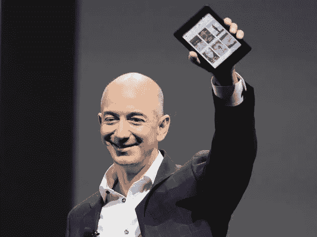

# 贝索斯2012年致股东信

> 来源：[https://leonzhang.feishu.cn/docx/LALpdeRdko1YG7xXr8Pc3HApnig](https://leonzhang.feishu.cn/docx/LALpdeRdko1YG7xXr8Pc3HApnig)

> 🔗 原文链接： h[ttps://www.bilibil](https://www.bilibili.com/read/cv13934905)i.com/read/cv139...

致我们的股东：

常看我们致股东的信的读者们都应该知道，我们在亚马逊工作的动力在于打动用户，而非打败竞争对手。我们不会评论那些可能让企业最大限度获得成功的方法。这样做有利也有弊，以打败竞争对手为工作重心而获得成功的企业也有许多例子。我们致力于关注竞争对手，受到他们的启发，不过实际上以用户为中心是我们企业文化的标志性元素。

我们的优势，也许是微妙的优势，就是以用户为中心，这有助于调动某种积极性。在我们表现最好的时候，我们并不会等待外界的压力。在我们需要行动以前，我们就从内部改善我们的服务，增加优势和功能。在我们需要行动以前，我们就开始下调商品价格，为用户增加价值。在我们需要行动以前，我们就开始发明创造。

这些投资的动机就是对用户的关注，而不是对竞争对手的反应。我们认为这种做法能够赢得用户的更多信任，推动用户体验的快速改善。更重要的是，即使在我们已经领先的领域也是如此。

“感谢你们！每次我看到亚马逊首页的白皮书，我就知道我支付的费用会换来超出自己想象的服务。我注册了Prime的账号，享受免运费服务，现在我能看到更多的电影、电视和图书。您们不断增加更多的商品，但是不收取更多的费用。我要为此再次表示感谢。”

我们的会员服务现在有超过1500万件商品，比我们在2005年推出这项服务时增长了15倍。流媒体视频的观看节目在一年多里增加了两倍，拥有超过38000部电影和电视剧。Kindle借阅图书馆的图书增加了两倍多，拥有超过30万本图书，包括我们斥资数百万美元购买的全套哈利波特系列，供用户选择。

我们并非必须对会员服务做出这些改进，但我们积极主动地提供服务。

与此相关的投资——长达数年的重要投资，是亚马逊配送。亚马逊配送让第三方卖家选择把他们的库存商品投入我们的配送中心网络。对我们的卖家用户来说，这项服务改变了游戏规则，因为他们的商品从会员服务中获益，带动他们的销售额，与此同时让用户受益，他们可以通过会员服务选择更多的商品。

我们建立了自动化系统进行观察，如果我们提供的用户体验没有达到我们的标准，系统就会主动向用户进行补偿。

有位业内观察家最近收到了我们系统自动发送的电子邮件，邮件上说，“我们检测到，您在观看亚马逊视频点播提供的电影《卡萨布兰卡》时视频播放效果不佳。我们很抱歉给您带来了不便，并向您退还以下费用：2.99美元。我们希望您能再次使用这项服务。”

这次主动退款让他感到惊讶，他在文章中提到了这次体验：“亚马逊注意到，我观看视频的效果不佳，他们竟然因为这件事决定给我退款？您瞧，这才是用户至上。”

如果您从亚马逊网站预订了商品，我们保证您能得到商品预售期间的最低价格。“我刚刚收到通知，由于预定价格保护机制，亚马逊向我的信用卡里退还了5美元…这种做生意的方法太棒了！感谢您们公平诚实的交易。”

大多数用户非常忙碌，在预订商品后没时间查看价格的变动，我们的政策本来可以要求用户和我们联系，请求退款。主动退款对我们来说成本更高，但是也会给用户带来惊喜快乐，赢得他们的信任。

作者同样是我们的用户。亚马逊出版刚刚宣布，每月向作者支付他们的版税，支付时间延后60天。行业标准是每年支付两次稿费，这个标准已经实施了很长时间。然而我们把作者看做用户，支付稿费的次数太少会让他们感到不满意。

想象一下，如果您每年收到两次稿费，会有什么感受。我们并没有面临竞争压力，改变每隔半年多向作者支付稿费的做法，这是我们积极主动的做法。

顺便说一句——尽管这项研究费时费力，我依然完成了调查，很高兴地告诉大家，最近在佛罗里达海滩上使用Kindle的用户有所增加。现在发布了第五代Kindle，我相信除了第一代产品以外，每一代的Kindle都有人在使用。

我们的经营方针是以盈亏平衡的价格出售优质的设备。我希望通过人们使用我们的设备来赚钱——而不是赚购买设备的钱。我认为，这让我们和用户建立了更好的关系。比如说，我们不需要我们的用户进行设备升级。我们很高兴地看到，人们依然在使用发布四年的Kindle产品！

我会不断前进——KindleFire的FreeTime功能，我们的Andon Cord用户服务，亚马逊MP3的AutoRip服务——还有我们内部驱动发展的典范：亚马逊网络服务（AWS）。2012年，亚马逊网络服务推出了159项新功能和服务。我们从七年前推出这项服务以来，已经把亚马逊网络服务的价格降低了27倍，增加了企业服务支持功能，打造了创新的工具，帮助用户提高效率。

AWS Trusted Advisor工具可以检查用户的配置，把他们与已知的最佳实践进行对比，然后通知用户他们现在有提高性能、加强安全和节省成本的机会。实际上，我们会积极告知用户，他们向我们支付的费用超过他们的需要。

在过去90天里，用户通过Trusted Advisor工具节省了数百万美元，这项服务才刚刚开始。取得这些进步的背景是亚马逊网络服务是这个领域内获得广泛认可的领导者——您可能会担心外部的动机在这种情况下不起作用。另一方面，内部动机——让用户真心赞叹的动机——正在迈开快速创新的步伐。

总体而言，我们在会员服务、亚马逊网络服务、Kindle、数字媒体和用户体验方面的大量投资，给人们的印象是过于慷慨、对股东利益漠不关心，甚至是违背了作为营利性公司的原则。有位旁观者写道，“在我看来，亚马逊是一家慈善机构，为用户利益在许多领域进行投资。”但是我不这么认为。对我而言，遇到问题才改进的结果只会是聪明反被聪明误。我们生活的世界正快速发展变化着，这种做法非常危险。

从根本上来说，我认为长远思考才能做到不可能的事情。积极主动地取悦用户，赢得他们的信任，这能从用户那里获得更多的业务。即使在新的商业领域也是如此。用长远的眼光来考虑，让用户和股东的利益保持一致。

在我写这份股东信的时候，我们公司最近的股价表现不错，但是我们不断提醒自己重要的一点——我经常在全体员工大会上引述著名投资者本杰明·格雷厄姆（Benjamin Graham）的名言——“短期而言，股票市场是投票机，但是长远来看，股票市场是称重机。”

我们并不会像庆祝卓越的用户体验那样庆祝股价上涨10%。在股价上涨10%的时候，我们并不会比以前聪明10%，在股价下跌10%的时候，我们也不会比以前笨10%。我们希望对重量加以权衡，我们一直致力于打造一家分量更重的公司。

正如我为我们的进步和发明感到自豪那样，我知道我们在前进的路上会犯错误——有些错误是自己造成的，有些错误是聪明勤劳的竞争对手造成的。我们对开拓进取的热情将推动我们去探索狭窄的途径，不可避免地，许多人会走进死胡同。

但是——只要有一点好运气——我们也会找到几条通向广阔大道的平坦途径。

我感到非常幸运，自己身处这个庞大的团队，这些优秀的员工像我一样重视用户的价值，他们每天努力工作。我一如既往地附上1997年致股东的信 （ 点击可阅读1997年的致股东信 ） 。我们从未更改我们的经营之道，今天仍然是亚马逊的“第一天”。

杰夫·贝索斯

亚马逊创始人、首席执行官