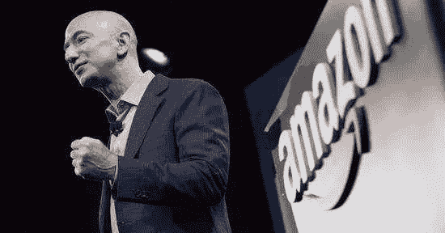

# 贝索斯2006年致股东信

> 来源：[https://leonzhang.feishu.cn/docx/ASOHdBljsoF6Jaxym9dceYZhnSf](https://leonzhang.feishu.cn/docx/ASOHdBljsoF6Jaxym9dceYZhnSf)

> 🔗 原文链接： https://www.cmtzz.cn/news/27475

> **亚马逊于2006年推出A**WS云服务这一现象级业务，11年后AWS全球市占率已高达33%，贡献52%的经营性利润。AWS进入的是一个与电商完全不同的领域，客户是软件开发商，主要服务是为用户提供“运算与存储”服务。看看当时的报告就知道，华尔街的分析师们起初并不看好AWS的发展前景。看空的理由也非常简单，亚马逊是一个电商公司，并不具备TO B服务的基因，同时这是一项耗费大量现金流且影响短期盈利的业务。因此股价在当年持续承压，当年公司市值163.36亿，同比降低16.7%。营收107.1亿，同比增长26.2%，自由现金流5.25亿，同比减少12.5%。AWS是亚马逊“第二曲线”业务，看似毫无关联的“电商”与“云计算”背后却有巨大的协同，12年的电商运营让亚马逊积累了“巨量”数据分析存储的能力，将这一能力放大并提供给第三方就是今天的AWS业务。由于新业务需要耐心培育，一些大公司很难将新业务由小做大。亚马逊的企业文化对那些起点较小却有巨大潜力的新业务提供了不同寻常的支持，贝索斯相信这是亚马逊竞争优势的一个源泉。

**致我们的股东：**

以亚马逊目前的规模，要培育出一个对公司举足轻重的新业务，需要一定的条理、一点点耐心，还有注重培育新业务的企业文化。

我们现有的业务都是扎根极深的年轻树木。它们在快速增长，具有很高的资本回报率，而且面向非常宽广的细分市场。这些特点对我们将要启动的任何一项新业务都提出了很高的标准。在我们将股东的资金投入任何一项新业务前，我们必须相信，这项新业务能带来股东决定投资亚马逊时所期待的资本回报；我们还必须确信，这项业务今后能达到的规模，使其对我们整个公司来说都是举足轻重的。

此外，我们必须相信，这项新业务目前尚不完善，而我们有能力为这个市场提供具有显著差异化的产品或服务。如果不是这样，我们不可能做大这项新业务。

我经常被问道：“亚马逊什么时候开设实体店？”开设实体店是我们一直在抵制的一个扩张机会。除了它能达到的规模能符合前面提到启动新业务所要达到的标准，其它都不符合。实体店网络可能达到的规模非常引人入胜，但是，我们不知道如何通过实体店来实现较高的投资回报。实体店零售业是一项旧的业务，各项服务都已经很完善了，我们不知道在这一领域如何为用户带来非凡并且差异化的体验。

我们每涉足一项新业务，一定是因为我们相信它符合上面所提到的标准。收购卓越网(Joyo.com)是我们向世界人口第一大国提供服务的第一步。电子商务在中国仍然处于初期阶段，我们相信这是一个绝佳的商机。在鞋类、服装、日用百货等领域，我们有很强的创新能力，能做大规模并获得较高的投资回报，同时能真正改善这些领域的用户体验。

FBA [1] 就像是亚马逊网络服务的API接口，它使我们面积达1200万平方英尺的物流中心网络变成一个庞大而复杂的电脑周边设备。只要向我们支付一定的费用（每立方英尺物流中心空间的每月租金为45美分），您就可以将您的商品存放在我们的网络中。

您可以在用于库存的商品即将到达的时候，通过网络服务通知我们选取、包装一个或多个商品，并告知我们将这些货物将发送到什么地方。您无需电话通知我们。这项业务能给用户带来差异化的体验，能达到很大的规模，其资本回报率也符合我们的要求。

AWS [2] 是新业务另一个成功的的例子。有了AWS，我们进入了一个全新的业务领域，瞄准的是一个全新的用户群——软件开发商。

我们目前提供10种不同的网络服务，建立了一个拥有超过24万注册开发者的社区。我们立足于满足开发者的广泛需求，比如开发者们一直在为了得到强大的存储和运算能力而寻求帮助，而在这些领域我们拥有从亚马逊过去12年不断扩大中所获取的深厚专业知识。

开展这项业务我们拥有很大的优势，这项业务也有着显著的差异化优势。随着时间的推移，它必将成为亚马逊一个重要的、有良好经济效益的业务。

由于新业务需要耐心培育，一些大公司很难将新业务由小做大。在我看来，亚马逊的企业文化对那些起点较小却有巨大潜力的新业务提供了不同寻常的支持，我相信这是亚马逊竞争优势的一个源泉。

像任何公司一样，我们也有我们的企业文化。企业文化不仅是我们信念的体现，也反映了公司的发展历史。亚马逊的历史相当短暂，但幸运的是，这短暂的历史里面已经包含有好几个新业务由小做大的例子。我们公司有许多人，亲眼目睹了数个业务由千万美元的规模发展成数十亿美元。这种第一手的经验和植根于这些成功事例的公司文化，是我们能将业务由小做大的重要保证。

我们企业文化要求这些新业务具有很大的潜力，以及具有创新性和差异性，但并不要求它们一开始就有很大的规模。

我记得，当1996年我们图书销售额突破1000万美元大关时，我们是多么激动。我们不能不激动，我们的图书销售额是从零增长到1000万美元。现在，当亚马逊有某项新业务的营收增长至1000万美元时，整个公司的营收从100亿美元增长至100.1亿美元。

按理来说，我们那些营收高达数十亿美元现有业务的高管，很可能会对此不屑一顾。但他们不会，他们关注的是新兴业务的增长速度，并会发送电子邮件表示祝贺。这相当酷，我们很自豪这是我们企业文化的一部分。

根据我们的经验，就算一项新业务刚推出就取得了势不可挡的成功，它也只能在三至七年后才会对整个公司的财务有举足轻重的影响。我们在国际业务、早期的非传媒业务和第三方销售业务上见证了这一点。

现在，我们的营收45％来自于国际销售业务，34％来自于非传媒业务；销量总量的28%来自于第三方销售业务。如果我们的一些新业务也能取得如此成功，我们会感到很高兴。

现在距我们庆祝销售额首次突破1000万美元已有一段时间。随着我们继续成长，我们将努力延续积极支持新业务的企业文化。当启动一项新业务时，我们会条理清晰地作出决策，注重资本回报、预期规模以及推出用户一直关心的差异化的产品和服务。我们并不总是能做出正确的选择，我们也不会总是能取得成功。但我们会谨慎选择、全力以赴和保持耐心。

依照惯例，我们随信附上亚马逊1997年致股东的信 （点击可阅读1997年的致股东信） 。您们会看到，我们的经营理念和经营方法一直没有改变。非常感谢您的支持和鼓励。

杰夫·贝索斯

亚马逊公司创始人、首席执行官

[1]译者注：FBA，全称为Fulfillmentby Amazon，是指卖家把自己在亚马逊上销售的产品库存直接送到亚马逊当地市场的仓库中,客户下订单,就由亚马逊系统自动完成后续的发货。

[2]译者注：AWS，全称为Amazon Web Services，是亚马逊提供的专业云计算服务，于2006年推出，以Web服务的形式向企业提供IT基础设施服务，通常称为云计算。