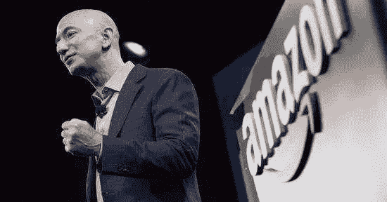
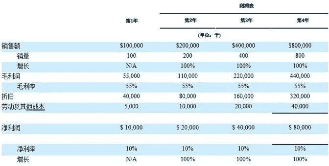
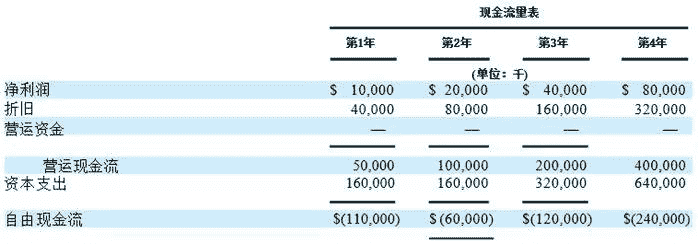
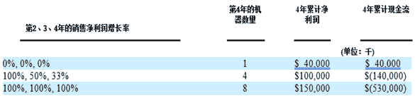

# 贝索斯2004年致股东信

> 来源：[https://leonzhang.feishu.cn/docx/MHkZdWScCohMewxyYMhcq9fonoe](https://leonzhang.feishu.cn/docx/MHkZdWScCohMewxyYMhcq9fonoe)

> 🔗 原文链接： https://www.cmtzz.cn/news/27477

> **贝索斯用一个实际的例子来证明用“固定资产投入”换来的“净利增长”是不可持续的。净利增长率和EBITDA因为没有考虑“营运资本和资本支出”只能反映运营状况的一部分，仅注重净利增速是片面且不可持续的。一家公司的盈利增长的确可能在特定环境**下损害股东价值。当增长所需的资本投资超过这些投资产生现金流的现值时，就会发生这种情况。贝索斯认为一个公司最重要的财务指标应该是“每股自由现金流”。由于市场对“亚马逊”长期盈利能力的担忧，当年市值下滑至181亿美元，同比下降14.5%，PS估值自2003年的4.03回落至2.62。

**致我们的股东：**

我们的终极财务指标，以及我们最想达成的长期目标，是每股自由现金流。

我们为什么不像大多数人那样，首先关注每股盈利或盈利增长？答案很简单，盈利并不能直接转化为现金流，而股票价值是未来现金流的现值，不是未来盈利的现值。未来盈利是每股未来现金流的重要组成部分——但并非其唯一组成部分。运营资本和资本支出也很重要，因为是未来的股份稀释。

有些人会认为这有悖常理，但事实上，一家公司的盈利增长的确可能在特定环境下损害股东价值。当增长所需的资本投资超过这些投资产生现金流的现值时，就会发生这种情况。

为了阐述这个观点，我要用一个简单例子来说明，设想一位企业家发明了一种机器，可以快速把人从一个地方运送到另一个地方。这台机器价值昂贵——耗资1.6亿美元，每年能够运送10万名乘客，使用寿命为4年。每次载客运行售票1000美元，能源和原材料成本为450美元，劳动力和其他成本为50美元。

设想这项业务生意兴隆，第一年运送了10万人次，最大限度地发挥了这台机器的能力。在扣除经营费用）（包括折旧，占净利润的10%）后，带来了1000万美元的盈利。这家公司优先考虑利润；所以根据第一份财报，企业家决定投资更多的资金，用于购买燃料以增加盈利，并从第二年开始每年增加更多的机器。

下面是这项业务头四年的利润表：

这张报表令人惊叹：100%的复合收益增长率，1.5亿美元的累计盈利。只考虑上述利润表，投资者一定会感到非常高兴。

然而，现金流量表却是完全不同的情况。同样在这四年里，运输业务产生了5.3亿美元的负自由现金流。

当然，其他商业模式的盈利更接近现金流。但是我们的这个例子表明，不能依赖利润报表来判断股东价值的得失。

请注意一点，那就是EBITDA（税息折旧及摊销前利润）会导致我们在判断业务的健康状况时得出同样错误的结论。假设每年的EBITDA分别是5000万美元、1亿美元、2亿美元和4亿美元——连续三年实现100%的增长。

但是我们在考虑EBITDA的同时，没有考虑到12.8亿美元的资本支出，而资本支出对于创造现金流必不可少。因此，我们看到的只是冰山一角——EBITDA不能代表现金流。

如果我们相应地改动增长率和相应的机器资本开支——现金流情况究竟是更加恶化还是有所改善？

不可思议的是，从现金流的角度来看，这项业务增长速度越慢，发展得就越好。为第一台机器投入初期资本支出后，理想的增长轨迹是尽快增加至100%的运营能力，然后停止扩张。然而即使只有一台机器，累计现金流总额也直到第四年才超过初期的机器成本，现金流的净现值（资本成本为12%）依然是负值。

不幸的是，我们这个例子存在根本上的缺陷。增长率对运作业务的初期投资或后续资本来说没有意义。实际上，我们的例子如此简单明了，显而易见。投资者会在经济方面对净现值进行分析，迅速确定这个项目不值得投资。尽管现实世界的情况更加微妙和复杂，这个问题——净利润和现金流的两面性，依然会经常出现。

现金流量表经常不会得到应有的关注。但是，眼光敏锐的投资者不应该只重视利润表。

我们最重要的财务指标：每股自由现金流

亚马逊的财务关注点是每股自由现金流的长期增长。

亚马逊的自由现金流主要来自不断增加的营业利润、有效管理的运营资本以及资本支出。我们的工作致力于通过改善各个方面的用户体验增加营业利润，通过保持精简的成本结构来提升销售额。

我们拥有现金来产生营业周期 [1] ，原因是我们能够较快地消化库存，在从客户那里收取款项之后，才向供应商支付货款。我们的高库存周转率意味着我们能够保持相对较低的库存投资——在年底为4.8亿美元，同期销售额接近70亿美元。

我们商业模式的资本运用效率可以通过对固定资产的适度投资来说明，年底这笔投资达到2.46亿美元，相当于2004年销售额的4%。

2004年自由现金流 [2] 增长了38%，达到4.77亿美元，比去年同期高出1.31亿美元。我们相信，如果我们继续改善用户体验（包括增加商品选择和降低价格）、执行效率和我们的价值定位，我们的自由现金流将进一步增加。

至于股权稀释方面 [3] ，2004年底亚马逊公司的总流通股加上股权激励与2003年持平，比过去三年下降了1%。与此同时，我们通过提前偿还原本是在2009年和2010年才到期的6亿美元的可转换债务，减少了600多万股的潜在股权稀释。合理地控制流通股总量，意味着更多的每股现金流，给持股人带来更高的长期价值。

对于亚马逊来说，关注自由现金流并不新奇。在我们刚成为上市公司时，我们在1997年致股东的信中就阐明了这个观点 （点击可阅读1997年的致股东信） ：“如果一定要在最优化GAAP报表和最大化未来现金流二者之间做出选择，我们会选择后者。”我在此附上1997年致股东信的副本，希望现有和潜在的股东看一看这封信。

我们一如既往地感谢我们所有的客户，感谢他们的业务支持与信任，感谢为我们辛勤工作的每一位员工，感谢我们的股东给予的支持和鼓励。

杰夫·贝索斯

亚马逊公司创始人、首席执行官

[1] 营业周期，原文为operating cycle，计算方法为：营业周期=存货周转天数+应收账款周转天数-应付账款周转天数。

[2]自由现金流量定义为经营活动提供的净现金减去固定资产的购买，包括资本化内部使用软件和网站开发，这两者都在我们的现金流量表中列出。2004年的自由现金流4.77亿美元是经营活动提供的净现金5.67亿美元，减去的固定资产购买（包括资本化的内部使用软件和网站开发成本）8900万美元。2003年的自由现金流3.46亿美元是经营活动提供的现金3.92亿美元，减去购买固定资产（包括资本化内部使用软件和网站开发费用）4600万美元。

[3] 亚马逊在2001年致股东的信中提出了限制股权稀释的目标。