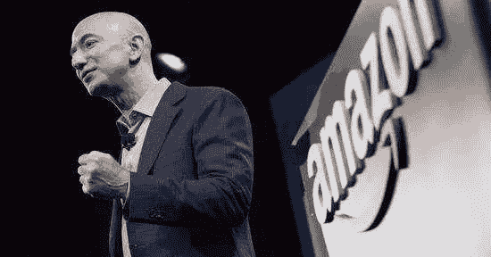

# 贝索斯2002年致股东信

> 来源：[https://leonzhang.feishu.cn/docx/QfB5dvQepoctTuxsjdrcmmGJnId](https://leonzhang.feishu.cn/docx/QfB5dvQepoctTuxsjdrcmmGJnId)

> 🔗 原文链接： https://www.cmtzz.cn/news/27481

> **亚马逊自由**现金流首次转正达1.35亿美金，市值也重拾升势，全年上涨79%，达72亿美元。 贝索斯着重解释了传统零售与电商的不同：在传统零售领域，提升用户体验的花费是动态成本；在电商领域，提升用户体验的花费是固定资产投资。这一差异允许亚马逊在提升用户体验的同时，利用用户数量的增多而降低单客成本。因此，同时实现看似矛盾的两个目标“提升用户体验”以及“降低售价”，在亚马逊的商业模式中成为了可能。

**致我们的股东：**

从许多方面来说，亚马逊并不是个普通的商店。我们能提供不受货架限制的丰富商品。在这一年里，我们的库存增加至去年的19倍；我们为每位用户打造个性化的商店；我们出售不动产来购买技术 [1] （技术正变得越来越便宜并且越来越强大）；我们敢于显示商品 的所有 用户 评论（包括批评）；用户可以在几秒钟内点击购买商品；我们把二手商品附在全新品旁边供顾客选择；我们与第三方分享我们的首要不动产——产品细节页面，如果他们可以提供更好的价值，我们欢迎他们参与。

外界曲解了我们积极的一面。人们发现，我们决心同时提供世界领先的用户体验和价格最低的产品，但要实现这双重目标尽管并非完全不切实际，至少看起来也自相矛盾。传统的商店面临旷日持久的权衡取舍——要么提供优质的用户体验，要么提供低价产品。亚马逊如何做到两全其美？

答案就在于我们把大部分用户体验功能——比如无与伦比的商品多样性、丰富的产品信息、个性化的建议和其他新的软件功能——转变成固定费用。随着用户体验成本基本固定（更像是出版模式而不是零售模式），我们的营运成本占销售额的比例随着业务的发展迅速缩小。

此外，可变的那部分用户体验成本——比如物流运营成本的可变部分——随着我们这种商业模式不断完善的同时也在得到改善。消除业务的缺陷可以改善成本，带来更好的用户体验。

我们相信，我们有能力在降低价格的同时推动用户体验优化升级。过去的一年证明这个战略切实可行。

首先，我们将继续推动用户体验优化升级。 今年的假期就是个例子。我们向用户配送了有史以来最多的产品，我们同时也提供了有史以来最好的用户体验。我们配送中心处理订单的周期比去年缩短了17%。最为敏感的数据——每笔订单用户满意度指标也提高了13%。

在现有的产品领域内，我们努力丰富商品的种类。在美国市场销售的电子产品种类比去年增加了40%以上，我们现在提供的电子产品种类是大型电子产品商店的10倍。

即使在已经经营8年的美国图书领域，我们的商品数量也增加了15%，大部分是很难寻找到的和不再发行的图书。当然，我们也增加了新的商品类别。我们的服装配饰商店拥有500多种顶级服装品牌，在开业的头60天，用户购买了15.3万件衬衫，10.6万条裤子和3.1万件内衣。

美国顾客满意度指数是最具权威的顾客满意度调查指标，今年的调查结果显示，亚马逊网站的顾客满意度为88分，创下有史以来的最高分，不仅是在线商务和零售业的最高分，也是服务业有史以来的最高分。援引自美国顾客满意度指数：

“亚马逊网站继续展现出相当高的顾客满意度，获得了88分（增长5%），创造了服务业前所未闻的满意度水平。亚马逊的顾客满意度能够再创新高？美国顾客满意度指数的最新数据显示，这个目标的确很有可能。亚马逊提供的服务和价值定位都出现了快速增长。”

其次，在关注用户体验的同时，我们也充分地降低了价格 。 我们的降价范围广泛地涵盖了各类产品——从图书到电子产品。对于购物超过25美元的订单，我们提供全天候免费送货服务。亚马逊每个国家的网店都采取类似的优惠措施。

我们的定价目标不是在有限的时间内对少量产品进行打折销售，而是每天都推出低价产品，广泛适用于整个产品范围。为了说明这一点，我们最近与几家大型知名连锁书店的图书价格进行了对比。我们没有为了迎合结论而故意挑选一部分种类图书，恰恰相反，我们选择了这些连锁书店2002年的前100名畅销书单作为对比。

这更能代表最畅销的图书，其中有45本精装书和55本平装书，涵盖各个类别，包括文学、爱情、推理惊悚、非小说类、儿童读物、励志资助等读物。

我们走访了西雅图和纽约的多家大型书店，记录了100本书的价格。我们用了六个小时，在四家不同的大型书店找到了所有100本书。我们将所有图书的价格相加，得出下面几点结论：

+   在他们的书店里，这100本畅销书的价格总计为1561美元。在亚马逊网站，同样的100本书价格总计为1195美元，总共节省366美元，相当于23%。

+   在100本畅销书中，我们有72本书的价格更便宜，有25本书的价格持平，只有3本书在连锁书店的价格更低（我们随后下调了这三本书的价格）。

+   在100本畅销书中，只有15本书在实体书店里打折销售——其余85本书都按照定价销售。在亚马逊网站上，100本书里有76本书都打折销售，只有24本书按照定价销售。

可以肯定的是，您还能找到在实体商店购物的理由——比方说，您需要马上得到商品。但是如果这样做的话，您会付出更高的价格。如果您想节省金钱和亲自去一趟实体店的时间，最好通过亚马逊网站来购物。

第三，我们同时提供低廉价格和优质用户体验的决心，已经带来了可观的业绩 。今年亚马逊的净销售额增加了26%，达到创纪录的39亿美元，产品销量增速更快，达到34%。我们最重要的财务指标——自由现金流达到1.35亿美元，比去年同期增加了3.05亿美元。 [2]

总而言之，对用户有益的举措也对股东有益。

今年我再次附上了1997年致股东的信件 （点击可阅读1997年的致股东信） ，希望现有和潜在的股东们都能看一看这封信。我们已经有所成长，互联网也有很大的发展，值得一提的是，我们经营的基本原则依然没有变化。

我们一如既往地感谢我们所有的用户，感谢他们的业务支持与信任，感谢为我们辛勤工作的每一位员工，感谢股东们给予的支持和鼓励。

杰夫 ·贝索斯

亚马逊公司创始人、首席执行官

[1]译者注：出售不动产指亚马逊通过把平台提供给卖家，收取平台订阅费、产品佣金、配送费、仓储费用、货件移除费用、广告促销费用等，作为亚马逊的重要收入来源。

[2]原文注：2002年亚马逊的自由现金流为1.35亿美元，等于运营活动提供的1.74亿美元净现金减去购置固定资产的3900万美元。2001年的自由现金流为负1.7亿美元，等于用于运营活动的1.2亿美元现金减去购置固定资产的5000万美元。