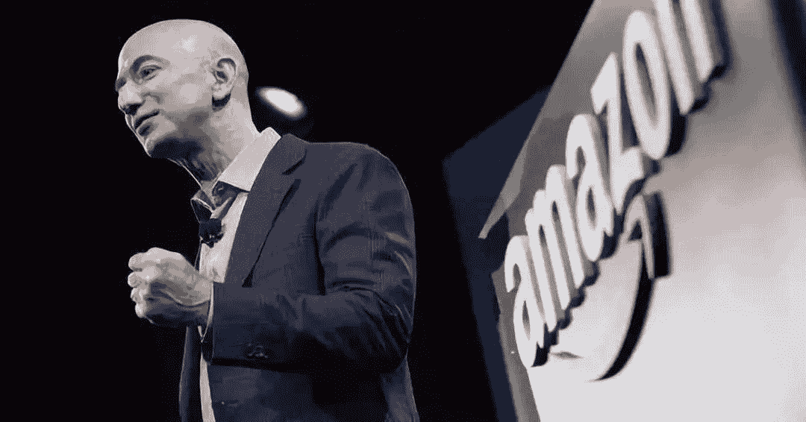

# 贝索斯2001年致股东信

> 来源：[https://leonzhang.feishu.cn/docx/NPtXdLcdaoxQmSxvky9c7EjVnHC](https://leonzhang.feishu.cn/docx/NPtXdLcdaoxQmSxvky9c7EjVnHC)

> 🔗 原文链接： https://www.cmtzz.cn/news/27482

> **亚马逊的规模**效应在当年开始加速显现。专注于优化成本，带来了降价的能力，优于同行的价格吸引了更多的消费者，规模效应进入了良性循环。亚马逊将规模效应带来的利润空间返还给消费者，优惠的价格吸引了更多的消费者，这是亚马逊的长期策略。在“当期盈利”和“扩大规模”之中，亚马逊总是选择后者。当年营收达31.2亿美元，同比仅增长13%，是亚马逊创立以来增速最低的一年。亚马逊当年市值40亿美元，同比下跌27%。互联网泡沫破裂带来的阴霾还没有散去，市场对亚马逊的未来成长空间产生了质疑。

**致我们的股东：**

去年7月份是亚马逊的一个重要里程碑。在那之前，我们用了4年时间来专攻增长，随后又花了不到两年时间来专攻减低成本。我们现阶段已经有能力平衡 两大目标—— 增长和优化成本的关系，能够同时根据这两大目标调配资源和项目。去年7月份那场大减价就诠释这一变化，当时我们将亚马逊网站上的书籍价格大幅降价30%，平均每本降价超过20美元。

这种“平衡”方式，在第四季度开始给我们带来回报，当季我们不光远远超过了预期的盈利目标，同时也加快了业务的增速。进入1月后，我们在升级全年免配送费的送货服务的同时，又开始了新一轮的降价，平均每订单降价超过99美元。

专注于优化成本给予了我们降价能力，进而拉动业务的增长。业务增长会带来更多销量，从而分摊固定成本，减少平均成本，反过来给我们更大的降价能力。这能够讨好用户，对股东来说也是好事。我们希望保持这种良性循环。

第四季度我们的预计营运利润为5900万美元，预计净利润为3500万美元，都超过了我们此前制定的目标。遍及全球的数千名亚马逊员工都为实现这一目标努力付出过，现在，他们应该对此感到自豪。以下是更多亚马逊在去年所取得的骄人成绩：

+   销售额从2000年的27.6亿美元增加至31.2亿美元，同比增长13%；在第四季度，我们首次实现单季度营收超过10亿美元，年化增长达到23%。

+   用户数由2000年的2000万增加至2500万，1999年这一数字为1400万。

+   国际市场销售额增长74%，美国之外的市场贡献超过25%的营收。作为我们最大的国际市场，英、德两国网店在第四季度合计运营利润为正。仅仅运营一年时间的日本市场在第四季度的销售额已增至1亿美元。

+   数十万的小企业和个人，通过在亚马逊产品页面上展示产品详情，向用户销售新旧产品，利用亚马逊的高访问流量实现收入。我们在2000年11月推出Marketplace，在第四季度Marketplace上生成的订单已占到美国市场总订单数的15%，远远超过我们的预期。

+   库存周转率由2000年的12增加至16。

+   更为重要的是，由于坚持用户至上的理念，在密歇根大学制作的被广泛使用的美国消费者满意指数中，亚马逊已连续第二年获得84的高分。据悉，这个数字是在任何行业的服务类公司（不仅仅是零售商）中空前最高的。

**坚持用户至上的理念**

七月之前，亚马逊网站上已经初步建立起用户体验的两大支柱：选择丰富以及便捷性。七月，我们又建立起了第三大支柱——不断降价。但同时，我们仍不会放松对前两大支柱的维护。

目前，电子消费品商店中已有超过4.5万种商品，大约是电子产品“大盒子商店”（这种商店都有巨型的店面，平均十二万余平方英尺以上的单层面积与高于四十英尺的屋顶，俗称为大盒子商店）的7倍，我们厨具类产品数量已增长到原来的3倍（在这里，您可以找到最好的品牌），我们已经推出了计算机和订阅杂志的商店，我们通过与Target和Circuit city建立战略合作关系，从而增添了更多的商品种类。

我们在提高便捷体验方面也有所提高，如及时订单更新功能，当您重复购买同一商品时，该功能就会提示（一些人会因为忙碌而忘记自己已经购买过相同的商品）。

同时，我们也大幅提高了自助服务功能，消费者现在很容易找到、取消或者变更自己的订单。想要找到订单，您只需在网站上注册和认证，就可以在您的订单页上搜索任何商品。当您进入某件商品的详情页面时，页面上方会放置订单页面的链接。

我们创建了一个新的功能叫“Look Inside the Book”。用户不光可以浏览到书的封面，还可以看到书的背面、索引、书目以及部分内容，这些内容全都通过高清图片的形式展现出来。用户购买之前可以使用这一功能。该功能适用于超过20万种书目（相比之下，传统书店仅能提供10万种书目）

最后一个例子，我想说的是，我们为改善用户体验而做出的努力，也大大改善了可变成本的生产效率：从根源上消除失误。从亚马逊成立之日起，我们在减少失误这方面做得越来越好，尤其在去年我们做得异乎寻常地优秀。从根源上消除失误，不仅为我们节省金钱，也为用户节省时间。

用户感知是我们最有价值的资产，我们将通过创新和努力工作来培育它。

**投资框架**

在每年的致股东信中（包括这一封），我们都会附上1997年那封最早的致股东信 (点击可阅读1997年的致股东信） ，帮助投资者判断投资亚马逊的决策是否正确，以及帮助我们来判断公司是不是仍在寻求最初的目标和价值。

在1997年那份信中，我们写到：“如果一定要在最优化GAAP报表和最大化未来现金流二者之间做出选择，我们会选择后者。”

为什么要以现金流为重呢？因为每股股票代表了一份公司未来现金流，因此现金流看起来比其他任何单变量都更能诠释一家公司的长期股价。

如果您能很确信地知道两个东西——一个公司的未来现金流和它的未来流通股数量——您很可能已经对这家公司目前的市场价值有了较深认识。（合适的贴现率也是非常重要的，如果您清楚未来现金流，您就很容易判断出应使用什么样的贴现率）。

这不是一件容易的事，但您可以通过检查公司之前的表现，以及查看这家公司模型中的杠杆率，来对其未来现金流做出预测。对一家公司在外流通股的数量的预测，还需要您对公司授予员工期权数，或可能出现的资本交易等项目做出预测。最后，您对每股现金的判断，将会帮助您决定愿意以多高的价格投资该公司股票。

我们期望公司可以控制好固定成本基本不变，甚至包括其他的数额较大的成本。我们相信未来几年，亚马逊将产生可观、稳定的自由现金流。我们为2002年设定的目标就反映了这一点。

正如我们在1月份公布的第四季度财报里所讲的那样，我们计划今年产生正的运营现金流（OCF），从而获得自由现金流（FCF），这两者之间的差额（FCF=OCF-CE）则是7500万美元计划资本性支出。未来12个月的公司预计净利润应该会大体但不完全和未来12个月现金流趋势保持一致。

限制流通股数意味着更高的每股现金流和更大的股东长期价值。因此，为了限制流通股数，我们现阶段的目标是，在未来五年内，通过向员工支付股票价格与认股权的行权价之间的差额来补偿员工放弃行权的损失 [1] ，从而将员工行使认股权带来的股权稀释维持在3%的年均水平，尽管有的年份可能会与这个数字有出入。

**致力于股东的长期回报**

正如我们此前所说的，我们坚信，股东的长期利益和用户利益紧密联系在一起。如果我们努力方向对了，现有用户会增加以后的购物，用户数量会不断提升，公司现金流也会增加，股东的长期价值随之而增加。最后我想说的是，我们一直都致力于通过有利于用户和投资者的方式，来扩大我们在电商领域的领导地位——离开其中任何一方，我们都不可能成功。

走进2002年，我非常高兴地告诉大家，我对亚马逊的热情比以往任何时候都要高。未来的创新会比以往的多得多，我们正逐渐呈现出我们模式的运营杠杆，而我得与这支非凡的全球亚马逊团队一同继续努力了。对此，我倍感幸运和感激。我们的股东们，感谢您们的支持和鼓励，一路以来跟随我们的冒险之旅。如果您们同时是我们的用户，那请再次接受我们的感谢！

杰夫·贝索斯

亚马逊公司创始人、首席执行官

[1] 译者注：原文为 “grants net of cancellations” 。认股权是公司授予员工以一定的行权价格在将来某一时期购买一定数量公司股票的选择权，当股票价格超过行权价时，通过行权可获得两者之间的差额。而通过补偿这个差额，亚马逊可以促使员工放弃行权，从而达到限制股权稀释的目的。