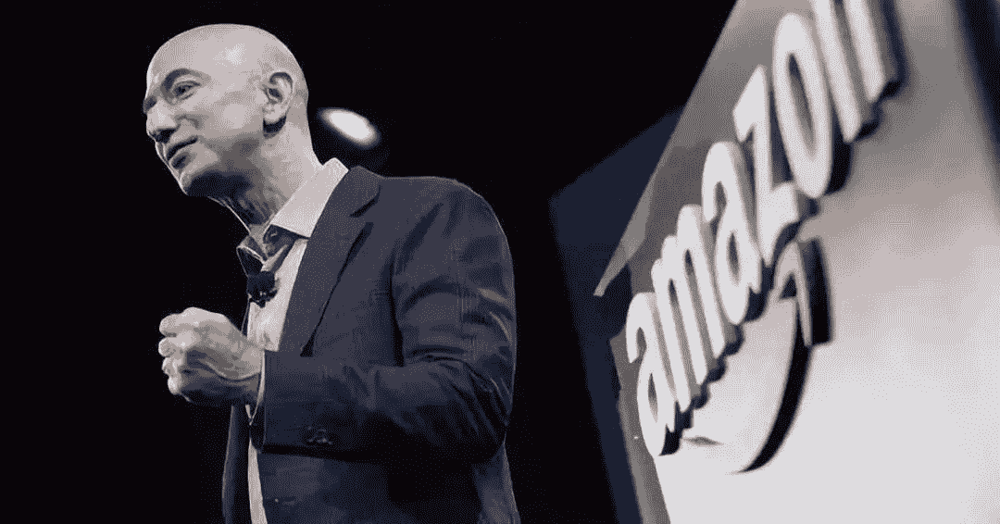

# 贝索斯2000年致股东信

> 来源：[https://leonzhang.feishu.cn/docx/NvcFd0h9noTE7axJxFXckD2ZnJc](https://leonzhang.feishu.cn/docx/NvcFd0h9noTE7axJxFXckD2ZnJc)

> 🔗 原文链接： https://www.cmtzz.cn/news/27483

> **泡沫终究还是要破裂的，2000年亚马逊市值下跌近80%。这一年致股东的信难免有些悲凉之感。公司 全年 营收达到27.6亿美元，同比增长68%，业务的快速增长仍然难以吞噬过高的估值。文中着重提到“电商”是一门固定成本高、可变成本很低的生意，因此很难做成一个中等规模的生意，变相地承认了投资“PETS.COM”以及“LI**VING.COM”的失败。传统零售商一直在利用技术降低成本，而“电商”在利用技术改善用户体验，从而吸引足够多的用户达到规模效应。摩尔定律带来的带宽提升会让用户体验持续升级，这是亚马逊长久增长的原因之一。文中引述格雷厄姆“称重机”与“投票器”的比喻，再一次重申长期价值的重要性。贝索斯没有为了保住当期利润而停止扩张的步伐，对长期价值的追寻在熊市中更显得弥足珍贵。

**致我们的股东：**

唉，2000年，对于许多人来说，当然也包括亚马逊股东，是资本市场残酷的一年。从我们上一封致股东信到现在，公司股价在一年的时间里已下跌超过80%。但是不管以何种标准来衡量，亚马逊此时所处的境况，比以往任何时间都更加有利。

+   我们的用户数由去年的1400万增加至2000万。

+   我们的销售额由去年的16.4亿美元增至27.6亿美元。

+   第四季度公司预计营运亏损率由去年同期的26%减少至6%。

+   第四季度公司在美国市场的预计运营亏损率由去年同期的24%减少至2%。

+   用户人均消费达到134美元，同比增长19%。

+   毛利由去年的2.91亿美元增至6.56亿美元，同比增长125%。

+   第四季度有近36%的美国用户在我们的非BMV（图书、音乐和视频）商店消费，如电子、生活工具、厨具等。

+   国际市场的销售额由去年的1.68亿美元增至3.81亿美元。

+   第四季度我们帮助合作伙伴Toysrus.com完成了1.25亿美元玩具和电子游戏的销售额。

+   截至年末，由于我们在2000年初的欧元融资，我们的现金和有价证券由去年年底的7.06亿美元增加至11亿美元。

+   更为重要的是，我们推行的用户至上的服务理念，使得我们在美国消费者满意度指数中获得了84的高分。据悉，这个数字是在任何行业的服务类公司中空前最高的。

那么，如果公司目前的处境要比去年好很多，为什么股价会比上一年低这么多呢？著名投资人本杰明·格雷厄姆说过，股市从短期来看是个“投票机”，从长期来看则是个“称重机”。

很明显，繁荣的1999年使得市场上中出现了很多“投票”行为，但“称重”行为则很少。我们是一家想要获得市场“称重”的公司——从长期来看，所有公司都需要成为这样的公司。与此同时，我们也将努力把公司打造更具“重量”。

您们当中应该有很多人听我说过要“赌一把”。我们曾经“赌了一把”，包括对电子产品、无线技术以及一众小电商进行投资的决定，我们未来仍将继续这么做。其中living.com和pets.com这两家小电商 在2000年关闭， 作为它们的重要股东，我们遭受了不小的经济损失。

我们从前这样投资，是因为我们深知我们不能在短期内进入这些细分市场，因此，我们热衷于互联网里的“圈地运动”。事实上，这种“圈地”模式在1994年以后的几年中对公司决策起到非常重要的帮助。但现在我们认为，这种方式的有效性在过去两年中已经基本消失。回过头来看，我们远远低估了进入这些细分领域所需要的时间，也低估了一家单品类电商公司要完成如此规模所要遇到的困难。

相比于传统零售，在线销售是一个固定成本高、可变成本相对较低的规模经营模式。这使得成为一家中等规模的电商企业很难。如果pet.com和living.com能长期获得足够的资金支持，它们或许就能够拥有足够多的客户来实现规模效应。但当资本市场关闭了互联网企业的融资大门时，这些企业别无选择，只能关闭。同样令人难过的是，如果我们将自己的钱投到这些企业中，试图让他们继续跌宕起伏，将是一个更大的错误。

未来：摩尔定律并不适用于不动产 [1]

展望未来，为什么说您们应该看好电商和亚马逊呢？

消费者网购体验的不断提高，将推动电商产业的增长，吸引更多的消费者。宽带、硬盘空间以及计算机运算能力的大幅提升带来的创新，又能推动消费者体验的提升。

计算机运算能力的性价比大约每18个月就会翻一倍，硬盘空间的性价比大约每12个月就会翻一倍，宽带的性价比大约每9个月会翻一倍。按照宽带性价比的这个提高速度，亚马逊在保持用户人均宽带成本不变的前提下，将会在未来五年把用户人均宽带容量扩充至60倍。同样地，硬盘和计算机运算能力性价比的提高也将使亚马逊网站更加实时化、人性化。

在实体店中，零售商一直借助技术进步来减少成本，但技术进步不会帮助他们改变消费者体验。我们同样借助技术进步来减少成本，但技术进步更大的影响是使用技术来拉动用户数量增长和营收增长。我们相信将会有大约15%的零售业份额从线下转移到线上。

尽管现在下定论还为时过早，但我们有足够的证据来证明。亚马逊的股票如今是一个独特的资产：我们有自己的品牌，有客户关系，有技术，有仓储物流设施，有财务优势，有人力资源，有在这个新兴行业中保持领先、并且建立起一个伟大和长久的公司的决心。 我们未来仍会 依照用户至上的理念，继续这样发展下去。

2001年将成为公司发展的史上重要的一年。跟2000年一样，今年的重点是“专注”和“执行”。首先，我们已经确立了今年第四季度预计经营性利润的目标。尽管我们还需要做大量工作，也不能保证完成目标，但我们已制定了计划来促成这一目标，这是我们的重中之重，公司中的每一个人都将致力于实现这一目标，我期待在明年能向您们讲述我们在这一目标上取得的进展。

按照惯例，我附上了1997年的第一封致股东的信 （点击可阅读1997年的致股东信） 。更有趣的是，一年年过去，我们所坚持的东西几乎从未改变。我特别推荐您阅读“一切以长远价值为中心”那部分内容。

我们依然感谢我们的用户，谢谢他们给我们带来的业务和支持，也感谢辛勤工作的员工们，以及股东们的支持和鼓励。感激不尽！

杰夫·贝索斯

亚马逊公司创始人、首席执行官

[1]译者注：不动产，原文为real estate，原指包括土地及其上之房屋等不可移动、有固定地址的建筑物。这一词汇会在亚马逊今后每年的致股东信中经常出现，意为亚马逊网站，把亚马逊比作像实体店一样的建筑，无论亚马逊上的商品和服务如何变化，亚马逊网站本身是“不动”的。今后的致股东信中还会用“首要不动产”（prime real estate）来指称亚马逊网站的产品细节页面。

摩尔定律是指，当价格不变时，集成电路上可容纳的元器件的数目，约每隔18-24个月便会增加一倍，性能也将提升一倍。换言之，每一美元所能买到的电脑性能，将每隔18-24个月翻一倍以上。这一定律揭示了信息技术进步的速度。摩尔定律不适用于不动产，指亚马逊这个“不动产”不仅可以借助技术进步来减少成本，还能用来提升消费者体验，这带来的进步远不止摩尔定律。