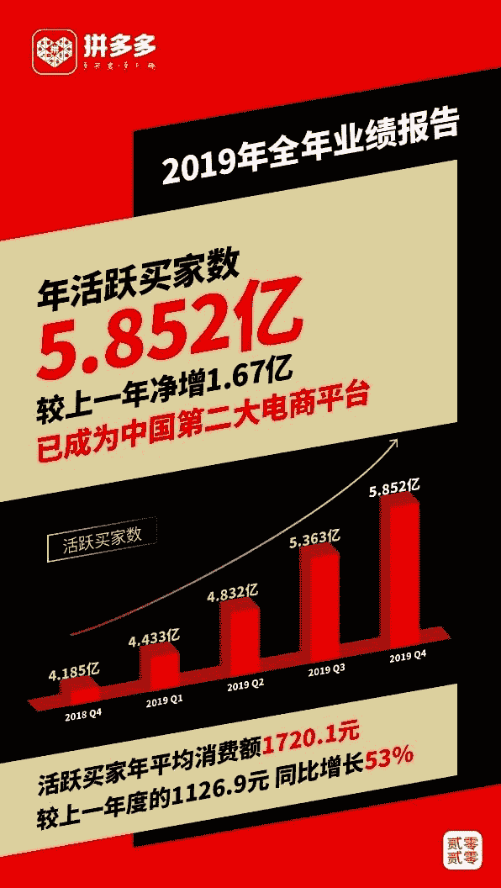

# 2020年度致股东信：新的世界正在到来，新的物种必然出现

> 来源：[https://leonzhang.feishu.cn/docx/BwR3dxPp3oAZg3xa22wcIL1WnDf](https://leonzhang.feishu.cn/docx/BwR3dxPp3oAZg3xa22wcIL1WnDf)

> 🔗 原文链接： h[ttps://view.inews.](https://view.inews.qq.com/a/FIN202004250003810E)qq.com/a/FIN2020...

> 4月25日凌晨，拼多多发布2019财年年报。

> 2019年拼多多实现成交额10066亿元，平台年活跃买家数达5.852亿，年营收301.4亿元。

腾讯证券4月25日讯，北京时间4月25日凌晨，拼多多发布20**19财年年报，披露财年各项完整运营数据。年报显示，2019年拼多多实现成交额1006**6亿元，平台年活跃买家数达5.852亿，年营收301.4亿元。从用户数看，创立4年半的拼多多已经成为中国第二大电商平台。

拼多多创始人、董事长兼CEO黄峥随同年报发布了股东信，这是2018年以来黄峥连续发布的第三封年度致股东信。

在信中，黄峥谈论了近期疫情带给自己的思考，从疫情与世界、人类与时间的关系角度，重新思考当下面对的现实。

黄峥认为，当这个微小的病毒进入人类世界时，它就像试管中的催化剂一样，加速了新世界的形成。过去世界的某些维度在被重构，一些规则也在被改写，这股席卷全球的力量将从根本上永久地改变我们所生存的世界。

“我们假设每个物体的过去的所有历史都已经被其当前状态所完全包含，并且每个物体都是独立的，但疫情开始让人怀疑这一假设是否正确”，黄峥表示。

“如果概率和随机性本来就是每个物体的天然属性呢？如果大量的物体在本质上就是相互交织和关联的呢？”黄峥认为，由于物体存在这些内在联系，试图屏蔽物体之间的关联的方法就不再能够那么有效。

▲ 截至2019年底，拼多多年活跃买家数达5.852亿，已成为中国第二大电商平台。

此前，拼多多宣布与国美达成全面战略合作，拼多多战略副总裁九鼎表示，此次合作是平台践行“普惠、人为先、更开放”新消费理念的最新一步。

在2019年，拼多多遭遇了竞争对手持续发起的史上最大规模的“二选一”。在上一封股东信中，黄峥也曾表示，长期独家排他是必然会被打破的，不符合商业逻辑和自然规律。

2019年，随着拼多多在社交拼团、市县长直播等模式创新，并通过独创的百亿补贴活动直接为消费者创造价值，年报显示，当前拼多多的商家数已从360万增长至510万。

因此，黄峥认为，一个全新的人类世界正在到来，新物种将会以和从前完全不一样的样子在新的土壤中孕育和生长。

而关于未来，黄峥表示，人类曾经将时间视为方程式中的可逆参数，但疫情把人类从幻梦中惊醒，时间更像是一个不可逆的向量，“无论我们多么固执地渴求着对称和永恒，时间总是在不断制造着世间种种的不对称、不可逆以及死亡”。

因此，“我们需要证明我们这一代人的与时俱进和与以往不同，我们将更加坚定地投资未来，努力建设面前的新世界”。

附1：

## 黄峥致股东信中文全文

### What time?

### 今夕何夕？

今年2月，COVID-19作为一个新词汇在全球家喻户晓，并颠覆了我们的日常生活。就在我书写这封信的时刻，世界上仍有一半的人蜗居家中，无助地等待着引发全球危机的小小病毒尽快消失。等待之初，我们急切盼望生活能够重回正轨；而越来越漫长的等待，则让我们逐渐忘记了时间。

今天，我们正身处怎样的时间之中？时间又究竟是什么？

对人类来说，这是一个危机的时刻，流言和混乱四起，人们因不同的理念意见而产生分裂，甚至是对抗。这是一个百年不遇的特殊时刻，不过也许它也只不过是历史长河中一个再平常不过的片刻。

病毒是大自然向人类派出的危险“信使”。出于生存本能，我们竭尽所能地调动自身的机体能量与之对抗。这种对抗的副产品是伤及自身甚至致命。很快，激战从单个生物体蔓延至整个社会有机体，不同大小不同类型的公司、政府和国家，都在用自己的方式对抗这一威胁，其副产品也是不可避免地伤及自身。

这一切只是源于一个几乎看不见，离开宿主都无法复制的病毒。一个携带了一些信息（RNA）和很少能量的小小“信使”而已。这和数十年来我们担忧的原子能威胁形成了鲜明的对比。一朵可以升腾出巨大能量的乌云，与自身几乎毫无能量的“信使”，谁会给人类造成更大、更持久的危害？

这真是如幻如梦…… 这是大自然给我们的一个启示？一个教导？抑或是对我们的惩罚，还是救赎？也许，仅仅是大自然和人类开的一个小小的玩笑？

### Time for new

### 新生之时

当爱因斯坦写下他著名的方程式E = mc²时，他优雅地（某种意义上，也可以说是傲慢地）描绘了他脑海中的物质世界。但他并没有解释那描绘物质世界的精神世界与客观物质世界之间的关系，也没有解释能量与信息之间的关系。

今天，全世界都处在一种常规的反常中。成万上亿的人被迫困在家中，与亲朋好友分离。然而，我们又同时通过某种精神和情感连结在一起。这种关系也影响着我们所能感知到的物理世界。虚拟世界和物理世界之间的边界前所未有地模糊，我们开始看到（而不仅仅是想象）一个新的世界正在走来。或者，更精准地说，是一个全新的人类世界正在走来。在这个新世界中，“虚拟现实”一词已经过时。现实和虚拟可以相互转换，现实变得虚幻，虚幻却是现实一种。同样，人类物质与精神需求之间的分别也愈发模糊。

当这个微小的病毒进入人类世界时，它就像试管中的催化剂一样，加速了新世界的形成。过去世界的某些维度在被重构，一些规则也在被改写。这股席卷全球的力量将从根本上永久地改变我们所生存的世界。就像我在前面两封致股东信中解释“拼多多的诞生”时所述，新物种将会以和从前完全不一样的样子在新的土壤中孕育和生长。现在，正是世界萌发新生，重新构建的时候。

### Feel the time

### 感受时间

Time with an arrow/direction

时间的方向

人类一直努力地用我们所掌握的逻辑和原理，试图理解和控制世界。在许多事情上，我们确实成功过，比如科学。在科学的世界里，我们试图从客观物质世界里抽离出来，以超然的上帝视角来进行“客观”的观察、理解，并通过有限的方程式来定义这个客观物质世界。在这样的框架中，时间变成了方程式 -t = (-)t 中的一个可逆参数。它只是描述物体在按预定轨迹运动的方程式中的一个参数而已。

但是，当一个渺小的病毒把我们从幻梦中惊醒，我们发现人类并没有凌驾于世界之上，仅仅是这个被观察的世界中的一个可忽略不计的组成部分而已。我们唯一能做的，是停下手中的一切，等待时间流逝，感受时间流过的痕迹。

我们进而意识到，时间很可能不应该是方程式中的一个可逆参数，它更像是一个不可逆的向量。它是一股强大的有方向的力量，默默地驱动着我们所见所感的一切事物。无论我们多么固执地渴求着对称和永恒，时间总是在不断制造着世间种种的不对称、不可逆以及死亡。

热力学第一定律（∆U = Q-W）给予了我们一定的控制感和确定性，而热力学第二定律（∆S> = 0）又使我们谦卑地认识到有另外一种存在，在力和质量组成的物理世界之外。熵（S）与信息有关，我不确定熵是否连接着精神世界，但它确实可以帮助我感受和理解时间。时间不应该只是物理世界里一个可逆的变量，或是孤立的存在于精神的想象，沉默而永不停息的它更像是在物质和精神世界表象背后的那股强大的有方向的不可逆的驱动力。

### Time, crowd and uncertainty

### 时间、人群和不确定性

当牛顿最早揭示F = M（dV / dT）时，它让我们有了“可以控制世界”的错觉，或至少给了我们可以掌控力量的某些理解和暗示。我们不再感到担心，因为每个物体都可由其位置、质量、速度和作用力来计算出轨迹。我们假设每个物体的过去的所有历史都已经被其当前状态所完全包含，并且每个物体都是独立的。在这样的假设下，大量物体之间的大量交互随着时间的推移将变得愈发复杂、混乱，也会表现得不确定和随机。时间之矢好像创造了混乱和不确定。而所谓概率，是对大量相互作用下的确定性的物体的轨迹集合的一个近似统计描述。

但是，当我们被隔离在家中，在焦虑和不安的情绪中等待时，我们开始怀疑“每个物体之间的相互独立性”是否真的是我们在试图理解和解释世界时的一个正确的假设。在我们对确定性的渴望中，我们选择性地接受了诸如“物体间的独立性”这样的简单假设，以帮助我们解释复杂的世界。我们的渴望是如此的强烈以至于让我们开始相信这就是真理。

但是，如果概率和随机性本来就是每个物体的天然属性呢？如果大量的物体在本质上就是相互交织和关联的呢？就像我们的人类社会一样，无论每个个体有多独立，我们都在真实和虚拟的世界中，通过相互关联而定义自我的存在。由于物体存在这些内在联系，试图屏蔽物体之间的关联，研究孤立个体的方法也就不再能够那么有效。相反，我们看到，时间推移下的个体间大量互动反而成为一种为社会和世界带来秩序和确定性的力量。我们再一次感受到了时间的力量和魔力。

### Seize the time

### 把握今朝

当新型冠状病毒席卷全球时，每个机体都不得不面对大自然带来的残酷挑战。相对年轻的人或许心存一些侥幸与慰藉。这并不是说我们要在“危”中讨巧得利。任何妄图趁人之危或利用漏洞使自身受益的想法，在时间面前显得异常愚蠢，无异于一个狂妄的赌徒试图在赌场上赢过时间。

相反，我们感受到了需要更加努力工作的冲动和动力。这是因为我们比以往任何时候都更理解和珍惜宝贵的青春。我们越发意识到我们应尽的责任。我们需要证明我们这一代人的与时俱进和与以往不同。在这个新世界中，新物种和新生物必将诞生并茁壮成长。

大自然的蓬勃发展和趋势不会因为任何个人意志而改变。理解这些自然规则不应该让我们感到优越，更不可能让我们有能力统治自然。相反，这使我们能够谦卑地认识和承认，我们只不过是世界自然演变过程中的沧海一粟罢了。

恰如一位诗人写道：“我冷眼向过去稍稍回顾，只见它曲折灌溉的悲喜，都消失在一片亘古的荒漠。这才知道我的全部努力，不过完成了普通的生活。”

带着这样的视角，我们既感到无比的谦卑和平静，又无比感恩于拥有的宝贵青春和担负着的重大责任。因此，我们将更加坚定地投资未来，努力建设面前的新世界。在这新世界中，我们的美好旅程才刚刚开始。

黄峥

谨代表拼多多

2020年4月20日

---

**What time?**

---

1.**大与小的对比****，**关注仰头瞩目的大，丧失俯视脚下的小（人类过于傲慢）

这一切只是源于一个几乎看不见，离开宿主都无法复制的病毒。

一个携带了一些信息（RNA）和很少能量的小小“信使”而已。

这和数十年来我们担忧的原子能威胁形成了鲜明的对比。

一朵可以升腾出巨大能量的乌云，与自身几乎毫无能量的“信使”，谁会给人类造成更大、更持久的危害？

Time for new (趋势与机会)

---

2.**精神世界的方程式**

E = mc² 描绘物质世界的方程式

没有解释以下**变量**之间的关系

+   精神世界与客观物质世界

+   能量与信息

3.虚拟与实体之间的边界模糊（消费生活虚拟化）

可能在孕育一个新的综合世界

物理世界被隔离，虚拟世界通过互联网链接更加紧密

人们开始更多频次，更强深度的通过虚拟世界增强情感与消费内容

虚拟世界和物理世界之间的边界前所未有地模糊，一个新的世界正在走来

虚拟与现实之间转换相互增多

4.融合的新世界生新的物种（商业组织）

病毒无疑加速了虚拟与现实的融合

融合的新世界中

+   过去世界的某些维度在被重构

+   规则也在被改写

会诞生新的物种

Feel the time （重新理解时间）

---

Time with an arrow/direction/时间是一个向量

1.**时间是一个可逆的参数**

人们试图以超上帝的视角，用方程式去定义物质世界

这样的框架中，时间只是方程式中的一个可逆参数  -t = (-)t

描述物体在按预定轨迹运动的方程式中的一个参数而已。

**但是病毒却**人类发现，在物质世界中，人仅仅是这个被观察的世界中的一个可忽略不计的组成部分而已。

2.**时间是一个不可逆的向量**

无论我们多么固执地渴求着**对称和永恒**

时间总是在不断制造着世间种种的**不对称、不可逆**以及**死亡**。

热力学第一定律（∆U = Q-W）

给予了我们一定的控制感和确定性，

热力学第二定律（∆S> = 0）

又使我们谦卑地认识到有另外一种存在，在力和质量组成的物理世界之外。

3.**理解时间的桥梁**

熵（S）与信息有关，我不确定熵是否连接着精神世界，但它确实可以帮助我感受和理解时间。

**Time, crowd and **uncertainty（时间的不确定性）

---

F = M（dV / dT）

让我们有了“可以控制世界”的错觉

每个物体都可由其位置、质量、速度和作用力来计算出轨迹

1.**假设**

假设每个物体的过去的所有历史都已经被其当前状态所完全包含

并且每个物体都是独立的

2.**推导**

在这样的假设下，大量物体之间的大量交互随着时间的推移将变得愈发复杂、混乱，也会表现得不确定和随机。

所谓概率，是对大量相互作用下的确定性的物体的轨迹集合的一个近似统计描述。

3.**质疑**

病毒让我们质疑这种假设

怀疑“每个物体之间的相互独立性”是否真的是我们在试图理解和解释世界时的一个正确的假设？

**4.反思**

我们为什么会接受「物体间的独立性 」这样简单的假设？

因为我们**对确定性的渴望**中

**5.希望**

无论每个个体有多独立，我们都在真实和虚拟的世界中，通过相互关联而定义自我的存在。

由于物体存在这些内在联系，试图屏蔽物体之间的关联，研究孤立个体的方法也就不再能够那么有效。

相反，我们看到，时间推移下的个体间大量互动反而成为一种为社会和世界带来秩序和确定性的力量。（流动性）

**Seize the time**

---

在这个新世界中，新物种和新生物必将诞生并茁壮成长。

“我冷眼向过去稍稍回顾，只见它曲折灌溉的悲喜，都消失在一片亘古的荒漠。这才知道我的全部努力，不过完成了普通的生活。”

**冥想**

（一）

为什么万物之灵的我们，

遭遇还比不上一棵小树？

今天你摇摇它，优越地微笑，

明天就化为根下的泥土。

为什么由手写出的这些字，

竟比这只手更长久，健壮？

它们会把腐烂的手抛开，

而默默生存在一张破纸上。

因此，我傲然生活了几十年，

仿佛曾做着万物的导演，

实则在它们长久的秩序下

我只当一会小小的演员。

（二）

把生命的突泉捧在我手里，

我只觉得它来得新鲜，

是浓烈的酒，清新的泡沫，

注入我的奔波、劳作、冒险。

仿佛前人从未经临的园地

就要展现在我的面前。

但如今，突然面对着坟墓，

我冷眼向过去稍稍回顾，

只见它曲折灌溉的悲喜

都消失在一片亘古的荒漠

这才知道我的全部努力

不过完成了普通的生活。