# 熬夜整理罗永浩100句经典文案，够学好几年！

> 来源：<https://leonzhang.feishu.cn/docx/Hjb6dBqOmovyBKxxzyBc6DPTnDg>

> 🔗 原文链接：<https://www.digitaling.com/articles/788304.html>

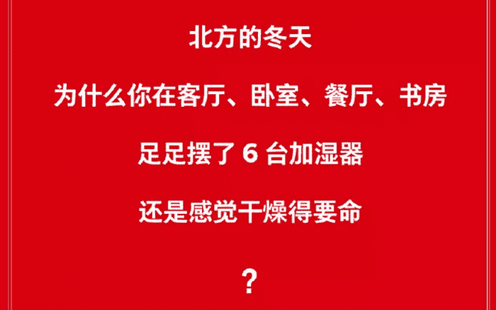

## 宣布退网！再次创业！老罗的“真还传”要完结了！罗永浩以行动证明他的名言，“彪悍的人生，不需要解释。”

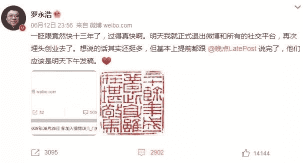

从新东方英语讲师到锤子科技CEO，从中国第一代网红到四大天王之一的明星主播，罗永浩的每个经历单拎出来，都能拍出一部精彩的连续剧。

还有，他被奉为经典的文案作品和火遍全国的老罗语录。

本篇文章从产品文案、品牌文案、直播带货文案和个人语录方面，整理了100句文案，供大家学习借鉴。（部分文案出自老罗的团队以及老罗与合作伙伴的共创，不全是老罗所写。）

话不多说，上文案！上金句！

## 锤子科技系列文案，契合产品一锤定音

### SmartisanT1

**1、**

天生骄傲

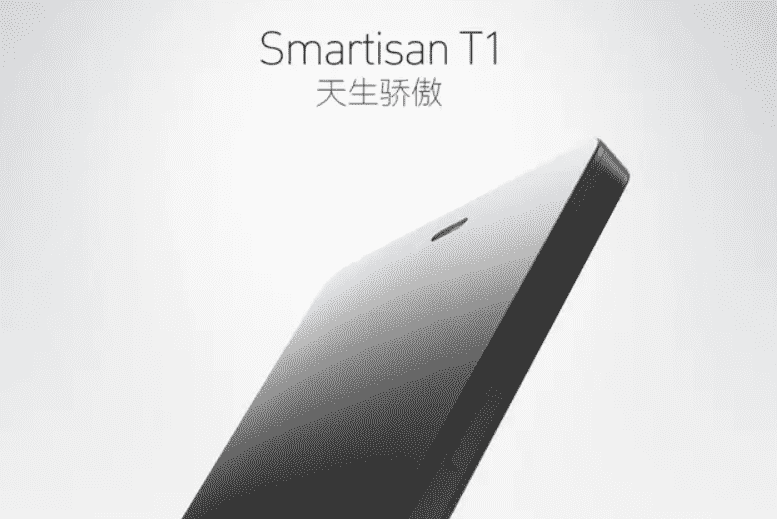

**2、**

Simplicity, is hidden complexity

简约，源自隐藏的精密

the essence of flat, is super curved

平坦的本质，是极致的曲面

Uncomfortable, is the new comfortable

不适感，导致了全新的舒适

Right is right, Left is also right

让你的左右，不被产品左右

No detail, can be too detailed

所有的细节，都决定成败

Smartisan T1, Born to be proud

Smartisan T1，天生骄傲

[🎦 点击观看视频](https://v.qq.com/txp/iframe/player.html?vid=a3026uqj7eo)

### SmartisanT1发布会

**3、**

还在为了寻找你的162个应用程序中的某一个

在屏幕上含辛茹苦地划来划去吗

**4、**

每次使用语音助手（`siri`及其抄袭者）的时候

边上总有人像看着笨蛋似的看着你

**5、**

五年半啦，每天面对满屏幕的

圆角矩形图标，不腻歪吗

**6、**

iPhone之后，单是小米一家厂商就已经有

518种滑屏解锁方式了

可是你想过智能手机如果真的够智能

其实根本就不该有解屏这一步吗

**7、**

你把第一屏的鳄鱼洗澡、第二屏的神庙瞎跑

第三屏的汤姆傻猫和第四屏的愤怒小鸟

一起放到归置游戏的第七屏去需要多长时间

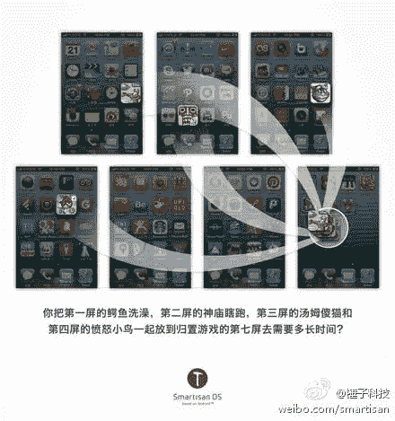

**8、**

一个人性化的细节设计会让你感动

十个人性化的细节设计会让你失态

多少个人性化的细节设计会让你崩溃

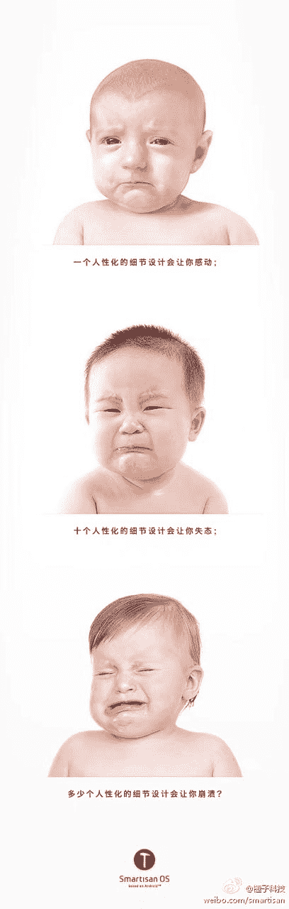

### 纪念SmartisanT1的H5文案

**9、**

《所有的光芒，都需要时间才能被看到》

我们看到太阳发出的光需要8分钟

看到海王星反射出的光需要4个小时

看到银河系边缘的光至少需要2.4万年

而我们看到宇宙中离我们最远的那颗星星

发出的光需要139亿年

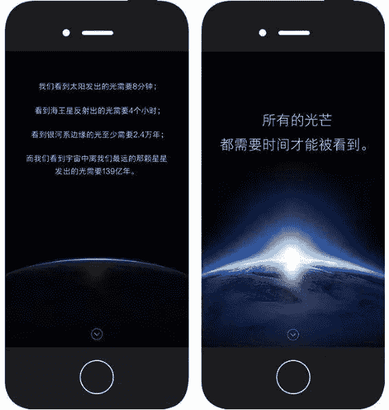

### 手机M1/M1L产品文案

**10、**

锤子科技的一小步，智能手机进化的一大步

**11、**

微小的光亮，巨大的关怀

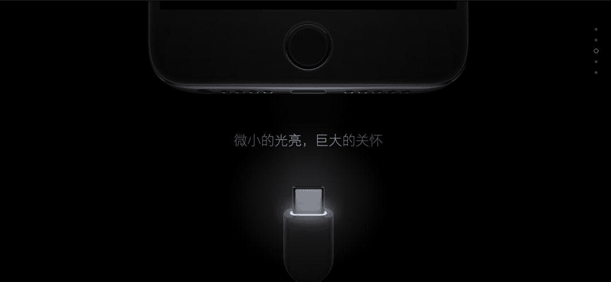

**12、**

继功夫和颜值之后，肌肉也有了...

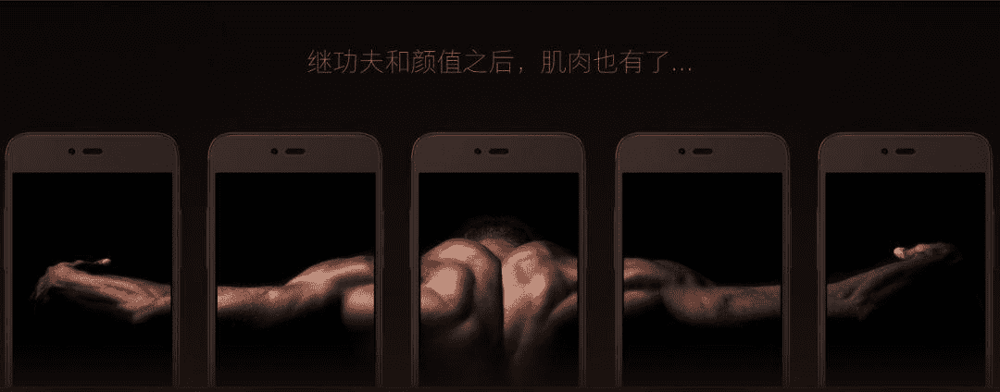

### SmartisanOS发布会倒计时海报

**13、**

一个伟大的公司就要不由自主地诞生

不是我选择了这个行业

是命运选中了我

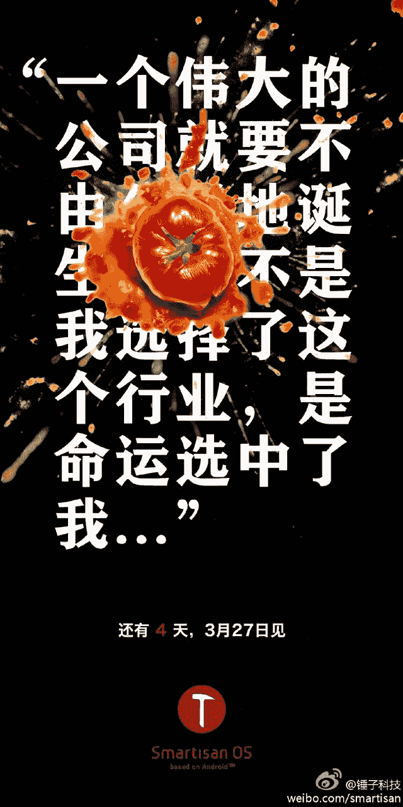

**14、**

洗脸时发现额头上隐隐有一个“王”字

顿时感到我的公司要改变世界了

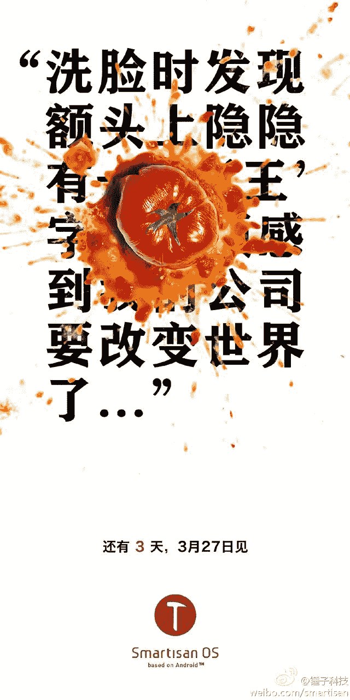

**15、**

在命运安排的不可避免的（未来的）巨大成功前夕

我伤感了

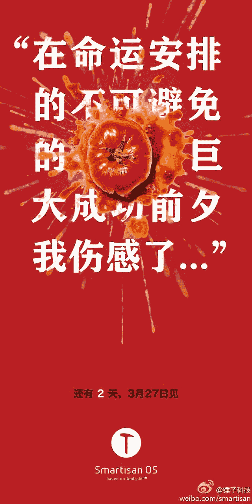

**16、**

明天见

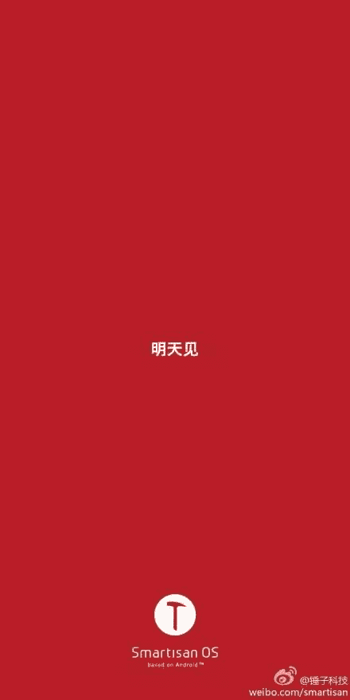

### 坚果PRO

**17、**

圆滑当道时代的锐丽异类

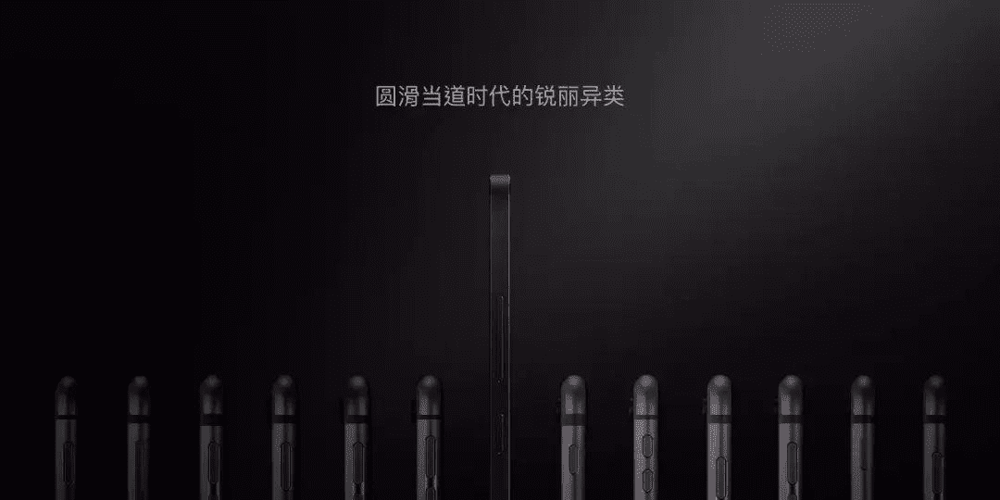

**18、**

肉感时代的纤瘦身影

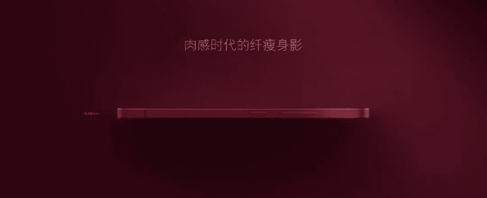

**19、**

大红大金时代的内敛与闷骚

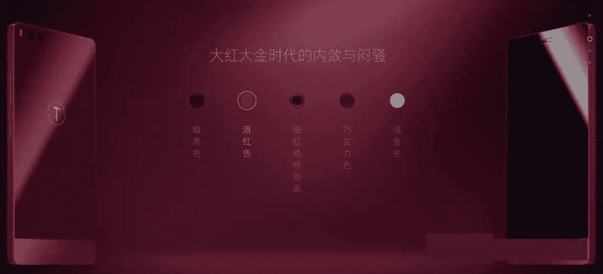

### 坚果手机

**20、**

漂亮得不像实力派

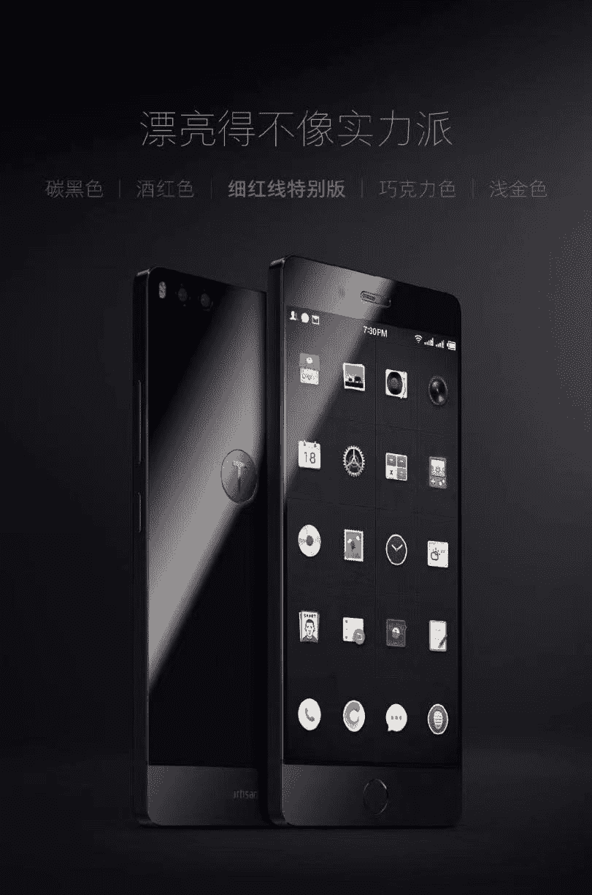

**21、**

漂亮得不像实力派——延伸版

能写诗,能跳芭蕾

能十六岁走上大银幕

还能十八岁出演人类历史上第一部全裸戏

能让追求她失败的男人自杀

能让她的六任老公在她面前自惭形秽得想自杀

还能以1700多万美元卖出680个吻来抵抗纳粹

能以烂演技在好莱坞颠倒众生

能在演烂戏之余从事通讯领域的科研工作

还能在几十年后被称为CDMA之母

她的名字叫海蒂·拉玛

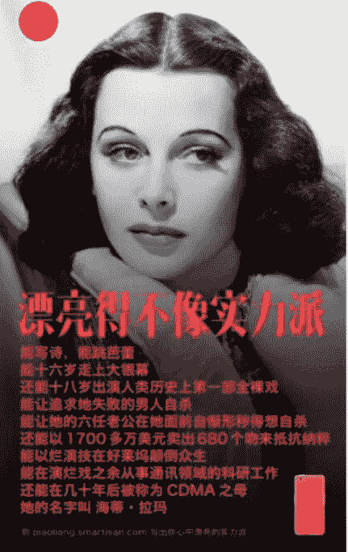

**22、**

漂亮得不像实力派——延伸版

能当首相，能领导国家取得世界大战的胜利

还能提名诺贝尔和平奖

能写书，能让书畅销

还能以畅销书获得诺贝尔文学奖

能胡吃海塞,能一生抽掉3000公斤雪茄

还能活到91岁

他的名字叫温斯顿·丘吉尔

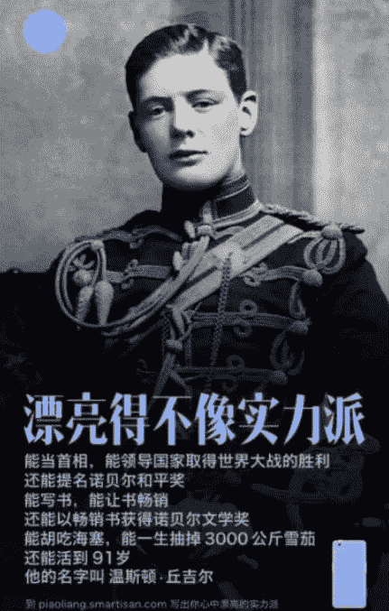

**23、**

漂亮得不像实力派——延伸版

能在连换六所高中后仍然按时毕业

能写诗,能弹琴,能为《时尚》杂志撰稿

还能给罗斯福总统夫人当老师

能陪着人开飞机飞越大西洋

能一个人开飞机飞越大西洋

能一个人开飞机再次飞越大西洋

能打破几乎所有的女子飞行记录

还能失踪七十多年后让人们继续苦苦寻找

她的名字叫阿梅莉亚·埃尔哈特

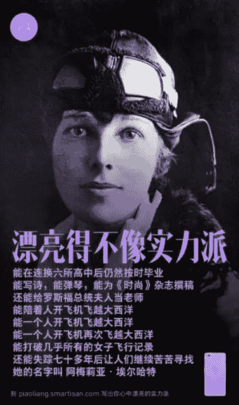

**24、**

漂亮得不像实力派——延伸版

能去非洲狩猎

能在海上捕鲨能上战场立功

能凭一本小说获得普利策奖

还能凭同一本小说获得诺贝尔奖

能飞机失事后大难不死

能在几天后飞机再度失事时再次大难不死

还能在经历无数死里逃生后一枪打死自己

能被毁灭，但不能被打败

他的名字叫海明威

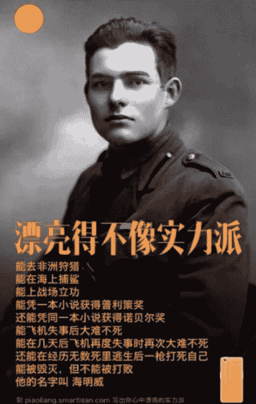

### 空气净化器

**25、**

“唰”的一下就干净了

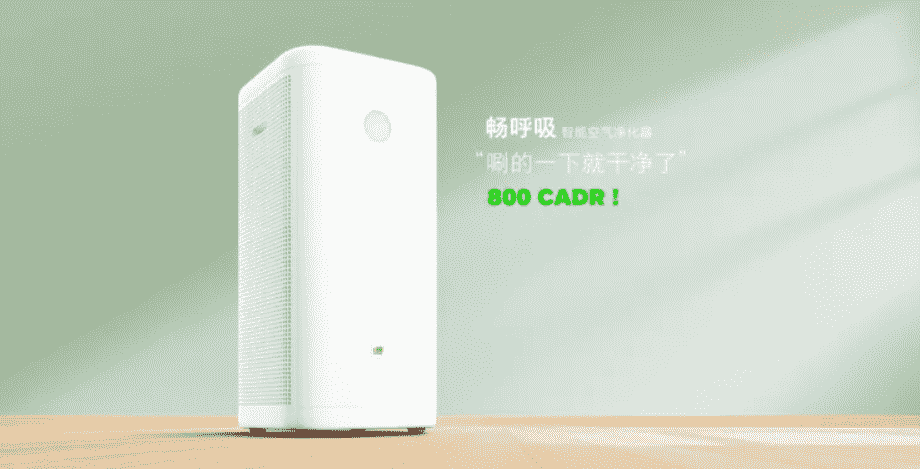

### 锤子阅读新版海报

**26、**

看事情，就要先看表面

锤子阅读

可能是界面最漂亮的阅读软件

**27、**

就要做一个挑肥拣瘦的人

锤子阅读

最挑剔的编辑

向你推送精品文章

**28、**

想游泳，就别去浅水区

锤子阅读

汇聚经典媒体的深度报道

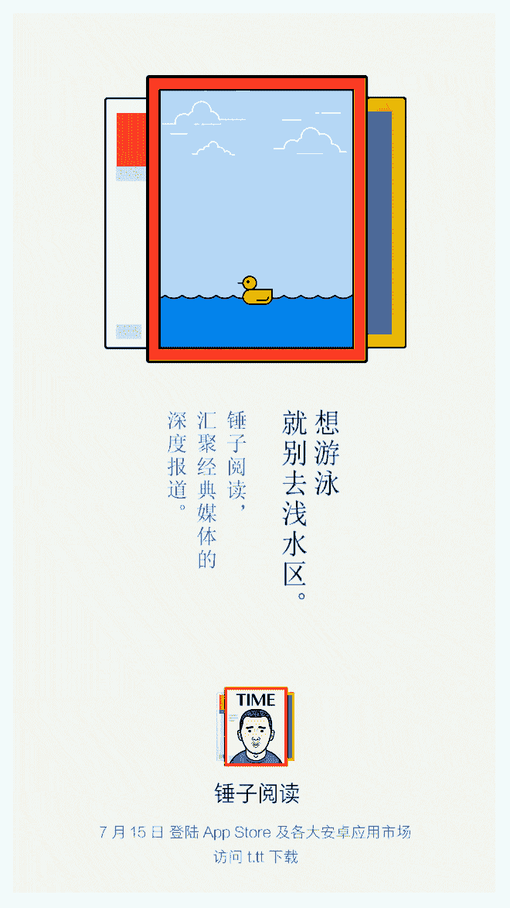

### 2018成都新品发布会倒计时海报

**29、**

北方的冬天

为什么你在客厅、卧室、餐厅、书房

足足摆了6台加湿器

还是感觉干燥得要命

？

**31、**

当我们因为忙碌

忘记给他们打电话

当他们因为怕打扰

不敢给我们打电话

当他们因为年迈

学不会使用智能手机和🛰️

还有什么

能让我们和他们

经常听听对方的声音

？

**32、**

偶尔出门的人

出门时什么都可以对付

所以旅行箱里

永远只带―种必备的物品

？

总是出门的人

出门时如果什么都对付

他的一生就都对付了

所以旅行箱里

永远要带―种必备的物品

？

**33、**

“朱萧木,把灯打开”

“朱萧木,说说今天的新鲜事儿吧”

“朱萧木,播放朴树的歌”

“朱萧木，声音再大一点儿”

“朱萧木，把加湿器开到极速档”

“朱萧木，明天早上七点钟叫醒我”

“朱萧木...”

“朱萧木,屋里只有咱俩你为什么老要我叫你的名字”

？

**34、**

为什么那些

能在5分钟内

记住一副扑克牌的

记忆冠军

出门还是会忘带钥匙

？

**35、**

因为“人性化”

车展被办成了车模展

真正的爱车人因此不好意思去了

因为“人性化”

文学经典被包装成了情色小说

真正的爱书人因此不好意思读了

因为“人性化”

智能音箱被设计成了女仆

真正的爱乐人因此不好意思用了

人性化的“人性化”

究竟应该是什么样的

？

**36、**

在北京机场

乘客过安检平均需要43秒旅行箱

过安检平均需要68秒

这意味着大部分乘客

要在传送带上的安检筐里

多看一会儿孙俪的脸

如果一个有志于

解决安检效率问题的

箱包设计师

刚好是孙俪的粉丝

他究竟应该如何抉择

？

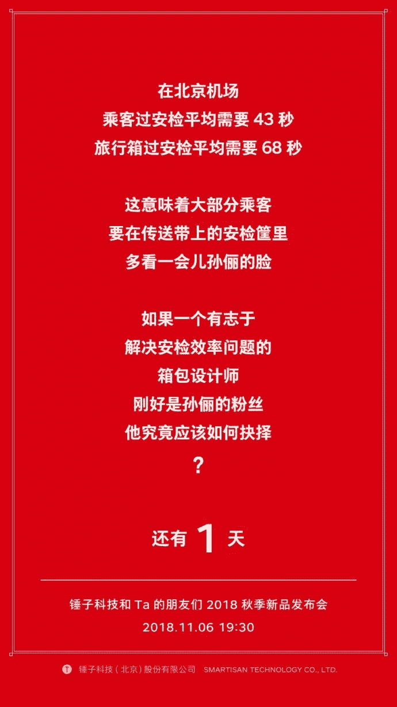

## 老罗英语培训宣传文案，有洞察有亮点

早年在新东方教课的罗永浩，就以“幽默有梗”的教学方式受得大批学生的欢迎。之后，他创办了“老罗英语培训”，延续趣味好玩的风格，将大众对英语课程的洞察结合进广告文案里，让人眼前一亮的同时，降低消费者对广告宣传的戒备心。

**37、**

人民币一块钱在今天还能买点什么？

或者，也可以到

老罗英语培训听八次课

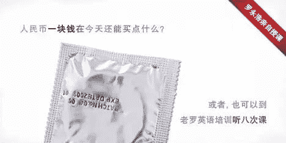

**38、**

不用再试了，你不是在做梦

我们寒假班的住宿确实是免费的

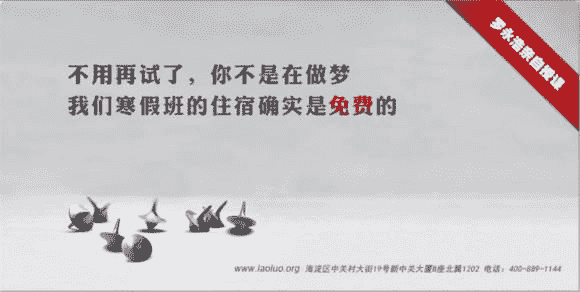

**39、**

选择我们，效果硬朗一些

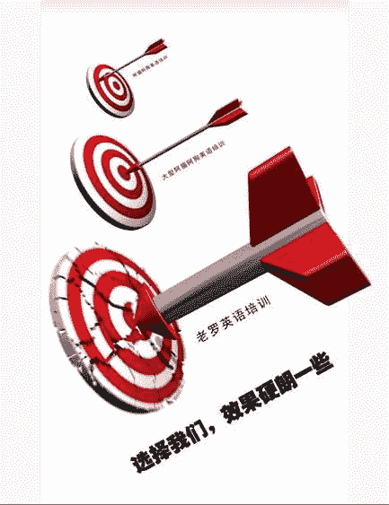

**40、**

1280元的暑假住宿班

空前火热，打架报名中

人往往在经历了N次的错误之后

才找到正确的方向

也许，我们可以帮你少走一些弯路

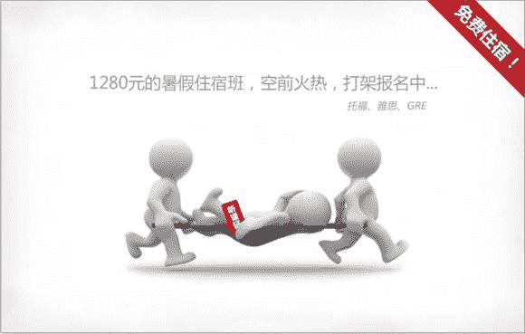

**41、**

生命不息，奋斗不止

2012年，老罗英语，世界末日

照常上课

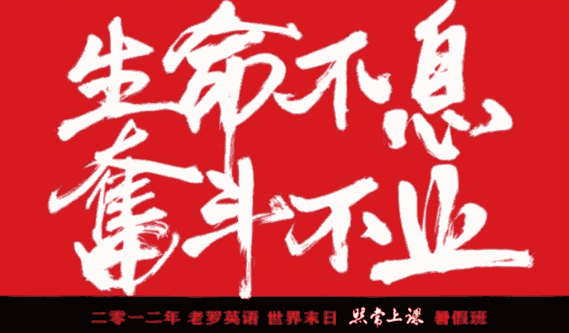

**42、**

统一方案怎么能适合所有的人

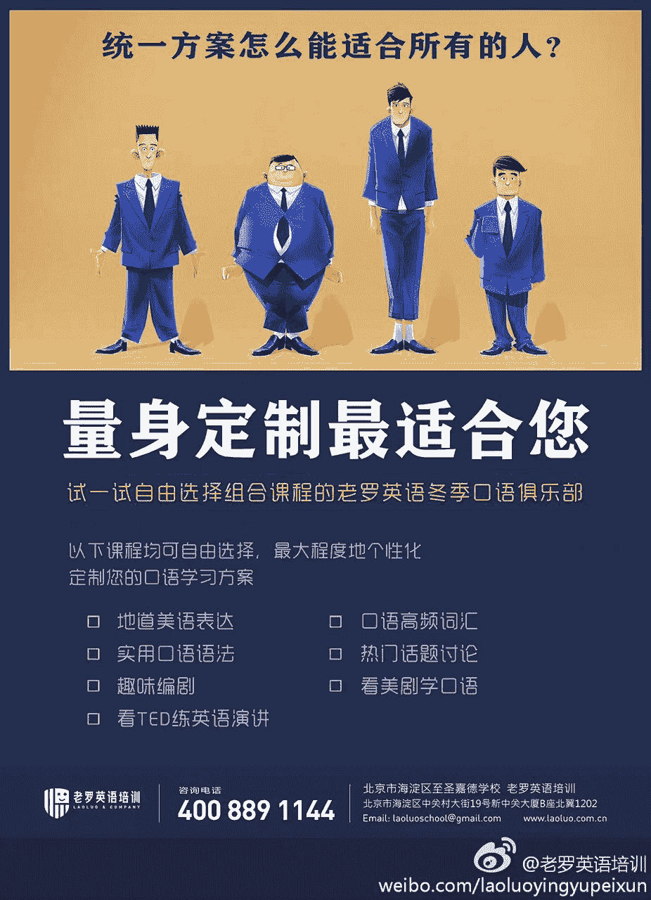

**43、**

反正也是堵在路上

为什么不到这里学点实用的

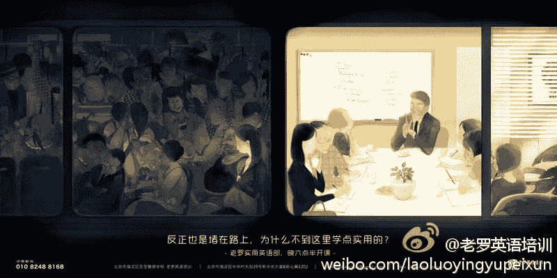

**44、**

有思想的年轻人在哪里都不太合群

直到他们来到老罗英语培训

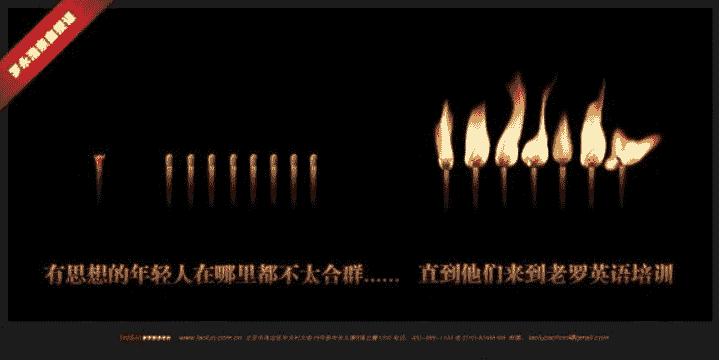

**45、**

二X青年上的英语培训学校

**46、**

普通青年上的英语培训学校

**47、**

有思想的青年上的英语培训学校

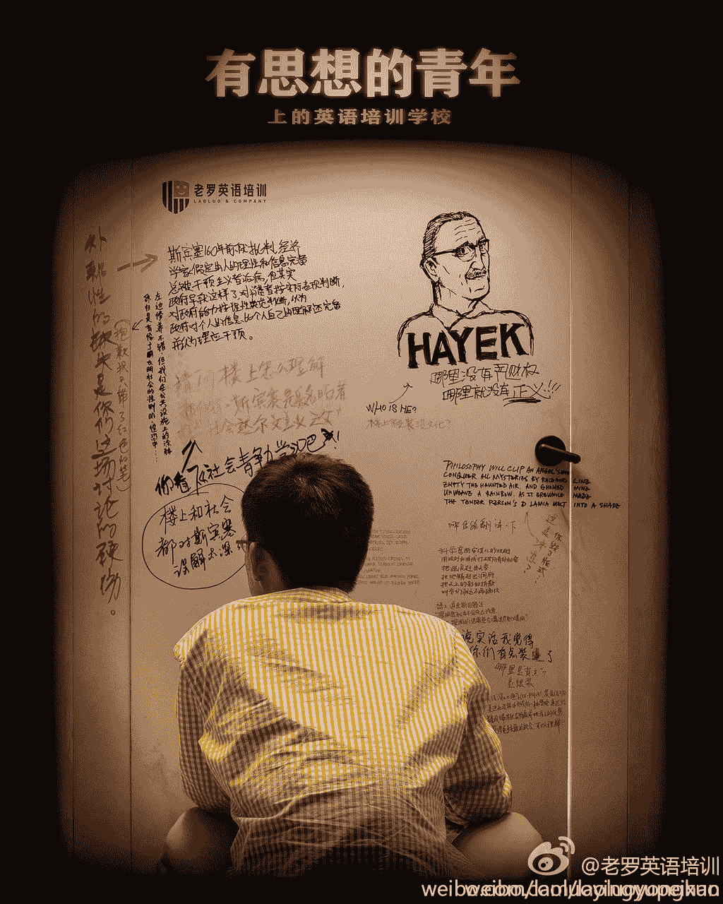

## 交个朋友直播间，带货附赠听相声

2020年4月1日，罗永浩正式开启直播事业。老罗的第一场直播，吸引了4892.2万人次前来观看，销售额达1.8亿。大部分人涌向直播间并下单的原因，一个是老罗的个人魅力，另一个是老罗的单口相声和精彩的卖货文案。

### 海报文案

**48、**

（基本上）不赚钱，交个朋友

（也许是）中国第一代网红

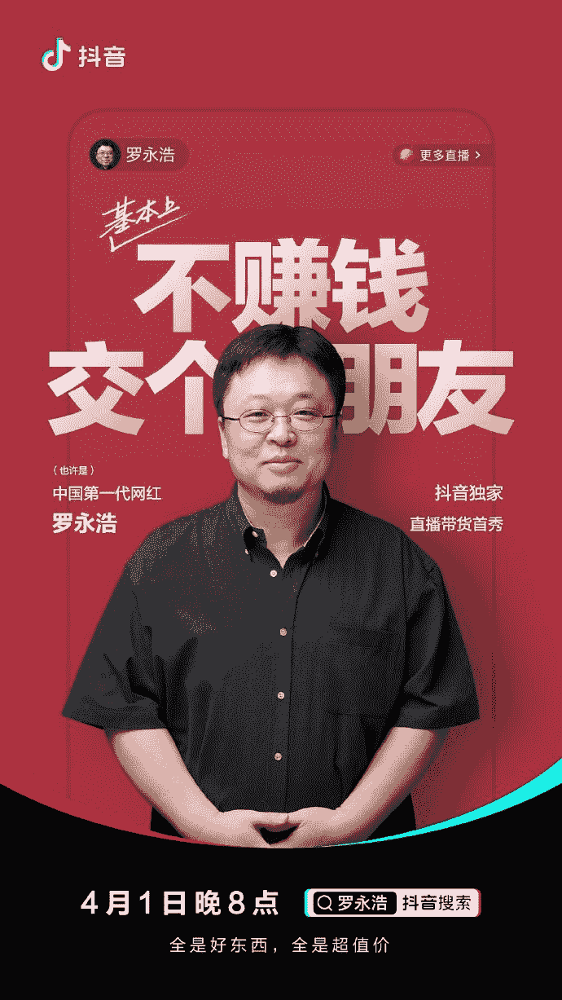

### 倒计时海报文案

**49、**

如果不是全网最____

怎么会让上千万人

挤在一个屋子里买东西

？

**50、**

如果不能帮忙节省更多的____

怎么会让有事做的人

也在这里呆上好几个小时

？

**51、**

如果没有大量地发____

怎么会让路人也兴奋得

大呼小叫

？

**52、**

如果不能涨____

怎么会让这么多的人

花了钱之后还心怀谢意

？

**53、**

如果不是全程都____

怎么会让不买东西的人

也舍不得离开

？

### 直播间卖货文案

**54、**

听起来折扣并不是很多

但有些品牌就是很硬朗

**55、**

我们也许是最不啰嗦的直播电商

**56、**

相声是穿插其中附送的

卖货才是主要的

**57、**

我们准备上架第一款产品了

大家可以先拿这个练练手

**58、**

感谢你们对我的不信任

让我对你们很信任

**59、**

请大家看在我秃了头的份上原谅我

**60、**

我们只是演员，是艺人

## 老罗的个人语录，有些厉害的人生感悟

高二退学、新东方担任老师、创办牛博网、建立锤子科技、互联网公开辩论、欠款6个亿……罗永浩丰富的人生经历，给予了他看待世界的不同角度。他从一次次的经历，凝练出人生的感悟并带给大家。也许生活辜负了老罗的所有努力，但他始终对生活怀揣着热爱。

小编从老罗写的三本书《我的奋斗》、《生命不息，折腾不止》、《创业在路上》以及他在公开场合的讲话中，精选些金句分享给大家。

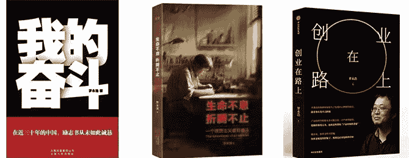

### 《我的奋斗》

> **61、**希望那些喜欢用“枪打出头鸟”这样的道理教训年轻人，并且因此觉得自己很成熟的中国人有一天能够明白这样一个事实，那就是：有的鸟来到世间，是为了做它该做的事，而不是专门躲枪子儿的。

> **62、**“永远年轻，永远热泪盈眶。”当你试图放弃一个你知道是正确的事情的时候，希望你能再看看这句话。

> **63、**那时候天空湛蓝，阳光充足；轻轻抚摩过小腿的河水清澈见底；空气里有一种说不上来的好闻味道；洗干净的衣服在河边的树枝上随风微微晃动，石滩上舒舒服服地躺着十几个懒洋洋的女人，所谓"岁月静好"，应该就是这样吧。

> **64、**每一个生命来到这世界，都注定要改变这个世界，你别无选择，如果你是一个好人，这个世界就因为你变得美好了一点点，如果你是个恶心的人，这个世界就因为你而变得恶心了一点点。

> **65、**真正坚强并且心态健康的人，被朋友出卖、被亲人误解、被爱人抛弃，也不会对人性失去信心。

### 《生命不息，折腾不止》

> **66、**如果你想把一个企业长期地做下去，做一个百年老店的话，任何时候，诚实都是最明智的选择，诚实都是最受欢迎的。考虑到这个，我们一开始在生意还冷淡的时候，从来没好意思用什么“火热报名中”这样的词。

> **67、**在人格力量方面加分向来是我为数不多的恶趣味之一。

> **68、**我们人生的每一个阶段，能影响多少人，就影响多少人，哪怕只能影响一个人，也好过不影响。

> **69、**在人格力量方面加分向来是我为数不多的恶趣味之一。

> **70、**我们来到世间，留下一些东西也带走一些东西。我们学习那些好的，批评那些坏的，正视那些该正视的，这是对他们最好的纪念。

> **71、**尽管会碰到无穷无尽的混蛋和笨蛋，但总会有一些人，让你感觉到生命的温暖和满足，让你感慨生命的“不虚此行”。

> **72、**传统经济学假定人在市场上进行消费、交易的时候，每个人都是理性的个体，这个大原则直到今天仍然是正确的。但它解释不了一些个体的差异，一些具体的非理性的行为。

> **73、**消费者的心理是古怪而有趣的。非常邪门，你用常识判断的话，会和很多领域一样，经常出现错误的。

> **74、**不怕苦，吃苦半辈子；怕吃苦，吃苦一辈子。

### 《创业在路上》

> **75、**一个商业上的好的设计，既要兼顾创新、差异性、设计上的美感，还要兼顾公众的接受度，这几点是同样重要的。

> **76、**“以前有一个网友开玩笑地问我，我会在自己的墓碑上写什么？我说应该写：他的一生是无论从事任何行业，都会对其他行业造成不可挽回损失的一生。当然，这是开玩笑的说法。做企业5年之后，我想应该这样写：他小时候有过很多梦想，后来因为个人的努力和时代的机遇能够做成一件事。”

> **77、**如果你凑巧是一个产品经理型的创业者，你可能会犯一个严重的错误，就是想做的事情太多，也就是所谓的“产品经理的贪婪”。

> **78、**如果你做的事情不是自己热爱的，只是为了成就，就很难为了多年后可能的奖励和回报支撑下来，这点非常重要。特别是如果你创业的时候年纪已经不小了，那你更要想清楚，人们对自己不喜欢的事情，忍耐地干那么多年，其实是很难的

## 罗永浩 VS 王自如公开辩论

> **79、** 粉丝经济的载体通常是一个20美元左右的东西，这是全世界通行的商业规律。你注意看，从粉丝身上挣钱的明星，都是通过卖一本书、一张光盘张电影票，这种是单价20美元左右的东西。如果他卖上千元的东西，在商业上成功的案例几乎是没有的。

> **80、** 如果你被包养了，就不要谈独立人格，真的很奇怪。

> **81、** 你不知道就说不知道，不要不懂装懂。

> **82、** 请大家作为一个体面的手机厂商，不要再给手机做评判的这些人投资了，拜托大家。

> **83、** 对第三方的定义是既不代表消费者，也不代表厂商，是独立客观的第三方。

> **84、** 任性，不涉及对错问题。

## 其他金句

> **85、** 彪悍的人生，不需要解释。

> **86、** 以傲慢与偏执回敬傲慢与偏见。不被嘲笑的梦想，是不值得去实现的。

> **87、** 但愿在未来的日子里，让抛弃了我的人们始终坚信，他们的抉择是正确的。

> **88、** 失败只有一种，那就是半途而废。

> **89、** 做你该做的，做你认为正确的，不要为了谁而做，当走在你前面的人没出息地倒下或是变节的时候，你应该感到高兴；你走到你的偶像前面了，多牛逼啊。

> **90、** 未来属于那些仍然愿意弄脏双手的少数分子。

> **91、** “真还传” 不是一个遵守契约精神的正面案例，而是一个远远超出契约精神的正面案例。其实基于现代公司法，无论在哪个现代国家，还这个债都肯定不是天经地义的。

> **92、** 对商业的世界来说，一直都是认知大于真相，真相怎么样并不重要，大家对你公司和品牌的认知才重要。

> **93、** 人的一生，总要找一两件自己真正喜欢做的事情来度过，如果还能因此有些收入，那简直是幸福了。

> **94、** 通往牛逼的路上，风景差得让人只想说脏话，但创业者在意的是远方。

> **96、** 我们爱我们倒霉的工作 也爱这个千疮百孔的世界，

> **97、** 外向的人也许会左右这个世界，但是内向的人才会创造世界。

> **98、** 偏执于有用的细节，偏执于无用的细节，偏执于甚至不会被发现是有用还是无用的细节，这就是工匠精神。

> **99、** 好的软件的特征是，明明没用过，但总觉得用过似的。

> **100、** 人生总有起落，精神终可传承。

## 出走半生，归来依旧是少年

**“**拿得起，放得下”、“输得体面”、“敢承担，背起6亿元债务”、“不缺从头再来的勇气”、“戏剧化的生活，喜剧化的度过**”。

这是我看到的罗永浩，一个充满血气、理想和担当的少年。

大大小小的失败让他更看清了生活的全貌，更了解自己追求的目标，更懂得**如何抓住人心**。所以，从他的文案里，看到了他对人生、对事业、对品牌的态度和情怀。 ”永远年轻，永远热泪盈眶” 是永不被打败的人生态度； ”彪悍的人生，不需要解释” 是自我认可的事业追求； “锤子科技的一小步，智能手机进化的一大步” 是由内向外的品牌自信，通过真诚的情感渲染，将个人形象及品牌特点植入大众内心。

同时，老罗善于发现那些容易被忽略的生活细节，常以精巧的细节处理，吸引群体**的关注**。老罗英语培训的 **“反正也是堵在路上，为什么不到这里学点实用的？” 和空气净化器的 “唰的一下就干净了”，** 一个是抓住高峰期的痛点，通过对比手法，强化英语课的价值感，另一个是发现产品的使用场景特点，借助数字，凸显产品的功能。

**老罗**的前半生给我们提供了不少经典的营销案例和生活启发。现在，50岁的老罗选择再次创业，不惧过往的失败，不惧外界的质疑，不惧年龄的限制，以少年的姿态开启全新的冒险。小编相信他会创造新的奇迹，为我们带来新的思考和营销范式，让我们一起拭目以待吧。

最后，欢迎大家在评论区分享老罗的其他经典语录~
