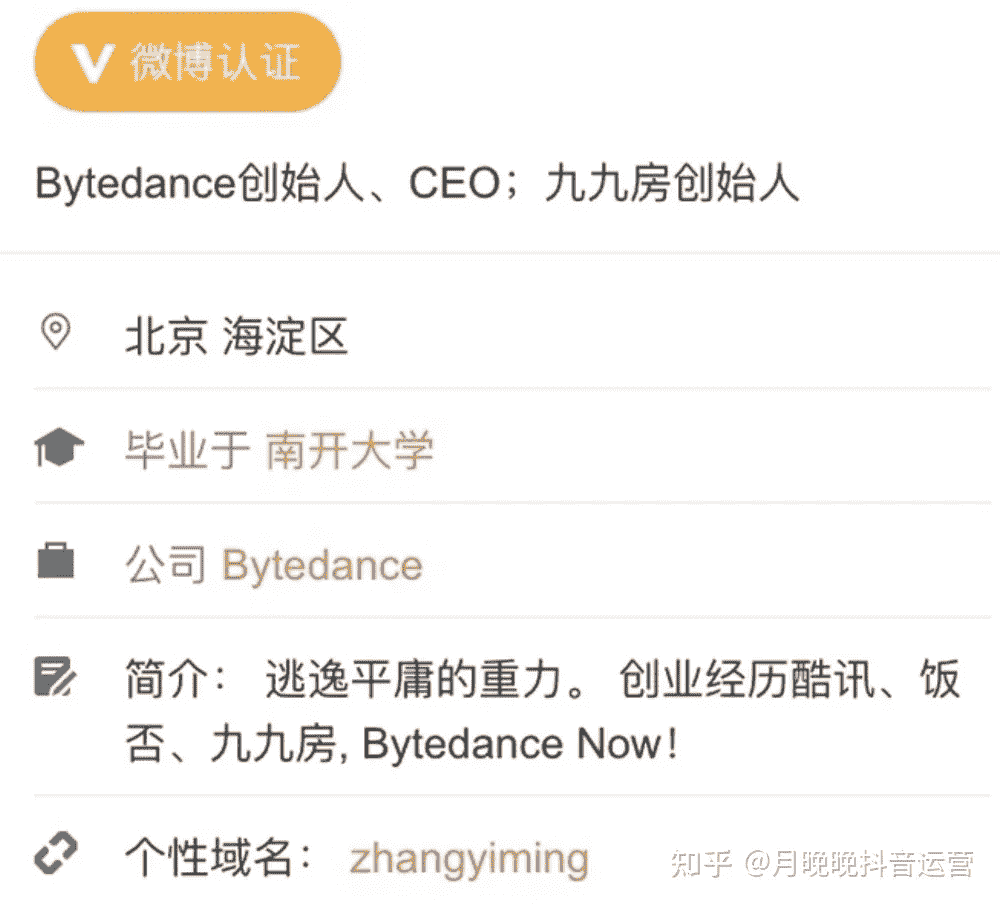

# 张一鸣10年的微博汇总！

> 来源：[https://leonzhang.feishu.cn/docx/Ph9kd63zKoejwzxpCiJcf8GWnmh](https://leonzhang.feishu.cn/docx/Ph9kd63zKoejwzxpCiJcf8GWnmh)

> 🔗 原文链接： h[ttps://zhuanlan.zh](https://zhuanlan.zhihu.com/p/461028377)ihu.com/p/461028...

[张一鸣 ](https://www.zhihu.com/search?q=%E5%BC%A0%E4%B8%80%E9%B8%A3&search_source=Entity&hybrid_search_source=Entity&hybrid_search_extra=%7B%22sourceType%22:%22article%22,%22sourceId%22:%22356806240%22%7D)从 2010年到2020年的微博汇总，结合他的一些内部讲话、外部访谈等，梳理他的认知成长之路，在这里一并记录。

从 20 岁到 30 岁的这几年里，张一鸣从一个标准的程序员成长为一个有思考深度和执行魄力的CEO，在互联网IT行业扮演着越来越不可替代的角色。

+   2009年，张一鸣辞掉在微软的工程师工作，开始第一次独立创业，创办房产搜索引擎“九九房”。

+   2011年底，张一鸣辞去九九房的CEO职位，开始筹备“今日头条”。

+   2016年，字节跳动推出「抖音」App。

+   2017年，字节跳动旗下TikTok上线。

**张一鸣究竟是一个怎样的人？ **是怎样的契机让他创立今日头条？ 作为技术出身的创业者，他是怎么快速抓住了建立一家大公司的要领的，这背后的思考逻辑和行为方式是什么？

这一切都让人很好奇。

从2010年到2016年的几年间，张一鸣总共发布了2000多条微博，其中绝大部分内容都是关于对创业的认知。

时间序排布的微博，是一个绝佳的观察窗口，从这些微博里，我发现了张一鸣身上有很多值得学习的品质。

同时，一家公司创始人的风格往往会深刻影响公司的经营，从微博记录中，也可以窥探字节跳动的业务布局，如何不设边界，赢得「App工厂」称号，一步一步成为超级互联网公司。

**哪些特质值得学习？**

2009年9月，第一次独立创业的张一鸣在微博上留下了一句话： 风景长宜放眼量，往者不可忆，来者犹可追。

一年以后，张一鸣又发微博：“ **我快**30岁了，这几年又开始重新学习/补习本应在青少年时间学习的东西：如何阅读、如何了解自己、如何与人沟通沟通、如何安排时间、如何正确的看待别人意见、如何激励自己、如何写作、如何坚持锻炼身体、如何耐心。 ”

苏格拉底说，未经省察的人生是没有价值的，对应西方哲学体系有一句名言：认识你自己。当一个人在观察和反省自己的时候，他的成长之路就真正开始了。

通过张一鸣的微博以及他说的最多的关键词，我整理了这些特质：

+   **不甘平庸**

+   **追求极致，不设边界**

+   **延迟满足感**

+   **坦诚清晰**

+   **专注投入**

+   **目标拆解**

+   **即时激励**

+   **赢家通吃**

+   **像做产品一样做公司**

不甘平庸

张一鸣的微博签名一直是「逃逸平庸的重力」，这句话来自2010年的一条微博：

2010-10-20 平庸有重力，需要逃逸速度。

后来他又发过这样一条微博：心里充满想法，行动甘于平庸。

这句话描述的状态，相信不光是我，很多朋友都有类似的感觉，晚上想想千条路，早上醒来走原路。再好的规划没有执行都是零，知易行难， 唯有日拱一卒，功夫不辍，才能做出一点事情来 。

**追求极致，不设边界**

2014-2-9 《诗》曰:‘周虽旧邦，其命维新’，是故，君子无所不用其极。---原来无所不 用其极果然是将追求极致的好意褒词贬用了!

君子无所不用其极，最开始的意思是无处不用尽心力,引申为君子到任何地方,都用最高的标准要求自己。

张在微博中非常赞赏乔布斯的产品观，这和乔布斯的追求极致，殊途同归，后面他还点评过人人网的运营，指出「做事太糙」。

[2013-6-13 花](https://www.zhihu.com/search?q=steve+jobs&search_source=Entity&hybrid_search_source=Entity&hybrid_search_extra=%7B%22sourceType%22:%22article%22,%22sourceId%22:%22356806240%22%7D)了 6 个月看完 kindle 上英文版《 steve jobs 》前半本，昨天花了 6 个小时在 iphone 上看完了唐茶中文版的后半本。实话说，我被震惊了:乔布斯不是完人毛病很 多。但在对平庸的极端不容忍和对卓越标准的极度追求，以及对此的牺牲上，好到令人怯步。

2010-8-1 没有免费的午餐。创业公司要出人头地就要求非常优秀高的自我要求。告别“差 不多”、“还行”、 “先这样吧”、告别工作掉链子、拖拉、80 分。很多创业 公司还不如大公司努力要求高就沉浸“创业”的状态，或者是只沉浸在工作时间 长的伪"创业"状态。

2013-6-11 人人网做事太糙。一时糙可以，但当糙成为习惯就没救了。//【豆瓣坚持低调 运营懂得节制 人人或被边缘化】

雷军笑谈互联网的商业模式为“把一切做到极致”，简单说就是：既不给自己留后路，也不给别人留活路。

张一鸣评论雷军谈商业模式：其实从博弈论和概率论可以推导出来，我给人出过的面试题中有类似的结论。

2012-3-25 德鲁克为什么成为管理大师，为什么能总结要领？最近温习《卓有成效的管理》有感。我觉得是非常多的观察和思考总结，并不是“想”到的。

把一切做到极致，道理总是如此简单，做到总是那么不容易。

流量时代到注意力时代，个体的注意力越来越容易被发散，一定要善用。

我们生活在一个被包装的世界，一部分人都活在另外一拨人精心设计的标题和吸引人的段子中。

延迟满足感

在微博上，张一鸣多次提到的一个词，就是延迟满足感。

2010-9-29 延迟满足感和坚决告别惰性是“优秀”的最重要两块基石。

2010-12-31 今天晚上的时候，每个周五晚上下半时，我常会和同事说“我明天假期我们再把***做好。每次突然想这句话矛盾啊，不能这样要求。嗯，生活工作要平衡。不过，别人腐败的时候我们在努力，别人消磨时光的时候我们在学习，那么延迟的满足一定会厚积薄发来到。

2011-1-26凡事就怕不认真，不思考。好多问题我应该能知道的，只是之前没有认真看、认真想，想当然（不是没时间）。延迟满足感是一项长期修炼。

2012-6-29 一件一件做好：精力被分散之容易程度相当容易被低估，可能反面是自我贪心和高估。打算再次裁剪干扰注意力的事情。

在微博上，张一鸣发过这样一句话：sacrifice what we want now for what we want eventually ，显而易见，他选择 what we want eventually。

**延迟满足，也是一种长期主义。**

投机的心态是一种小聪明，很难做出大的成绩，找到点滴优化和精进的过程，要做时间的朋友，让时间来帮助你增加收益，而不是相反。

**坦诚清晰**

2010-7-24 一直非常认同韦尔奇的这个总结，转发以再度提醒自己和团队 //@UBee:“培育 坦率，不论是对于企业文化建设，还是我们所期望的一个明亮的商业世界，都是 一件必须要做的事。”一个公司最强的敌人是什么?韦尔奇说，是“坦率”。深表认同。幸好，坦率是可以培育的。

“There is a huge difference between being brutally honest and simply being brutal.” 跟乔布斯合作多年的 Ken Segall 这句话说的很有道理。沟通时不留情面的坦诚是 好的，而且这并不妨碍你也能作一个温暖、幽默、有建设性的人。但坦诚对于一 起做事的人无比重要。

坦率，坦诚是张一鸣多次强调的关键词 。

这些观点在很多公司的价值观中都有体现。

根据一些公开资料，在字节跳动内部的业务会上，张一鸣会公开给自己的OKR逐项打分，没做好的地方都会直接告诉大家，对哪项业务不满意也会直言不讳，从不遮遮掩掩。

**专注投入**

2010-5-5 最近重读到稻盛和夫的《活法》，其中提到专注投入，其中举的陶瓷工艺改进的 例子尤其另我印象深刻。我们做每一件事(写一段程序，写一封邮件，写一个策 划)的时候是否在想自己是否投入全力以赴的认真做了，结果真的不一样?请试 试:你能有多专注?

专注投入，和延迟满足，追求极致一脉相承，在早期的99房的招聘中，也会看中这一点：

2010-8-14 选择越高级影响越大的人才越要看一些基本素质:理性、逻辑、修养、企图心、 自我控制力。

勤奋，抵抗惰性

2010-6-18 是一种状态 @张亮

关于勤奋，就我所知，罕有成功者不是工作时间极长的:通用电气的 CEO 每周 工作一百小时，坚持了至少十年。巴菲特为了最早看到次日的华尔街日报，经常 在凌晨四点去取报纸。勤奋不是一种形式，而是一种心理状态:享受挑战极限的 过程，保持热情和好奇心，坚持不屑。

2012-6-16 常言道：以大多数人努力程度之低根本上轮不到拼天赋。我的版本：以大多数人满足延迟感程度之低根本轮不到拼天赋。什么是努力？早出晚归，常年不休的人很多，差别极大，区别好像不是努力。

张一鸣时常觉得自己是有惰性的，因而经常反思自己。

2010-7-8 《The Road Less Traveled》里写到万恶之源是懒惰，再次感慨确实如此。

惰性是人性本性，真正能做到告别惰性，需要极高的自律，也正是这种自控能力，是大部分人难以出类拔萃的原因。

**目标拆解**

2010-7-24 我觉得以后团队的工作，不论大小，应把工作的目标定义并分解后，邮件发出来。1、这样可以被人提意见；2、可以避免重复的工作；3、避免定义清楚理解有误差；4、同时能估计工作量、评估效率方法。清楚不含糊要成为公司的文化。

2010-6-27 不抬杠，要抓住主要问题，任何办法都是在一定时空下对真理的近似实现，时空条件越具体，办法就越有效。如果去抬杠“近似”，那么就难在时空条件下实施。

目标拆解的思想，在各种项目管理中都经常见到。抓大放小，做好checklist，找到主要问题，也就是主要矛盾，不要在无关紧要的问题是花费过多精力。

时空条件类似于场景，在越具体的场景中解决具体的问题的办法就是好办法。

**即时激励**

2011-11-10 为什么刷牙不能坚持认真刷，为什么在跑步机上能坚持跑步。有许多事情不容易做好和不被重视的原因就是因为没有指标系统。比如，如果健康有准确方便度量的指标，那么大家的身体素质一定会提高。

2011-2-11 越发觉得指标反馈系统的重要性，只有少数人不需要显性的指标系统，自我会构建内在的指标感应来推动自己。至于有完全显性指标也做不好的情况，那是没药可救了。

即时激励和延迟满足相矛盾吗？

并没有。

从系统论的角度，一个完成的系统必须有反馈，要有正确、及时的反馈，显性的指标必不可少。

对一个产品来说，明确业务指标，参与各方都一起为之努力；对于个人来说，要制定可以落地的短期，中期和长期的规划，通过短期目标，不断修正，来促进正向反馈。

**赢家通吃**

2010-8-1 互联网行业往往是Winner Takes All，即使是传统行业也往往是120%努力的人获得200%的回报。这个是可以社会有利的，社会需要激励顶尖、极致、创新来带动社会发展。所以每天出门前问问自己如何才能全力以赴了做到杰出。

[马太效应 ](https://www.zhihu.com/search?q=%E9%A9%AC%E5%A4%AA%E6%95%88%E5%BA%94&search_source=Entity&hybrid_search_source=Entity&hybrid_search_extra=%7B%22sourceType%22:%22article%22,%22sourceId%22:%22356806240%22%7D)无处不在。

二八法则是真实世界运作的规律，我们应该了解规律，利用规律。

在临界点上，每多做出一点成果，都会带来非线性的回报增长。

**像做产品一样做公司**

技术出身的创业者，如何运作一家公司，这中间的Gap在哪里？

我在张一鸣的微博里找到了他的答案：

2015-11-7 Develop a company as a product.

互联网人最熟悉的就是产品开发/需求扩展，像是开发一个产品一样治理一家公司，来自张的体会非常自然。

但是这句话给我最大的体会，却来自一个完全不同的视角：develop yourself as a company。

把自己当成一家公司来经营，以此为起点，你会有完全不同的视角。

老板是你的客户，你的工作就是把你的产出作为产品打包卖给公司，而公司就是你的销售渠道，劳动合同就是供货合同。

从这个角度，你可以思考如何处理工作，对外言论，时间管理，服务提供者并不只有你一个，每一个人的工作都是可以被外包替代的，

用企业经营的思维模式去解决工作问题，可能会有一个全新的认识。

**观点摘录**

时间到这里，也就是在2015年以后，张一鸣的微博上原创观点越来越少，大部分都是转发今日头条的文章外链。

我把张一鸣的部分微博，做了一个简单的分类，并且保留了我认为非常重要的更新日期，按照时间序摘录在下边，相信会对大家有所启发。

**关于成长**

1.  2010-5-28 聪明还耐心是有一些矛盾的优点，同时具备两点的人却非常优秀

1.  2010-6-14 @ [王学宗 ](https://www.zhihu.com/search?q=%E7%8E%8B%E5%AD%A6%E5%AE%97&search_source=Entity&hybrid_search_source=Entity&hybrid_search_extra=%7B%22sourceType%22:%22article%22,%22sourceId%22:%22356806240%22%7D)哈佛有一个著名的理论:人的差别在于业余时间，而一个人的命运决定于晚上 8 点到 10 点之间。每晚抽出 2 个小时的时间用来阅读、进修、思考或参加有意的 演讲、讨论，你会发现，你的人生正在发生改变，坚持数年之后，成功会向你招 手

1.  2010-7-22 说的非常好，代团队!

1.  @石头 chen 有人问我如何突破自己的职业瓶颈，我说:你的瓶颈就在于你的心。你的心更宽， 心态更好，遇到问题将自己拨高一层去看问题，把你心里的那些小纠结小疑惑小 算盘小私心，统统打破，你就没有瓶颈

1.  2010-8-20:15职场总结#工作基本上是一个积累信誉的过程。

1.  自己今天的工作一直在为自己的 明天积累信誉。工作中总是掉链子、需要人提醒就是不断的丢掉自己的信誉。We are what we repeatedly do ，not we repeatedly think or want or say.

1.  2010-8-5 做一点补充:内向但精力充沛有企图心的人 @经纬张颖

1.  转微博小百科：性格内向的人更易成功:美国 MSNBC 网站报道称，一项研究发 现，内向害羞大多与生俱来，而且，内向的人在工作中更容易成功。

1.  在做决策时， 他们愿意花大量时间思考，不喜欢闲扯其他的话题，更能专心致志地奔着一个目 标努力，因此他们成功的几率也相应增大。

1.  2010-6-19 其实加入一个优秀的早期公司公司有一个明显的好处：公司会想尽办法帮你提高，因为公司有很多事情要做，而人员又有限。这个时候就会对有潜质的人提出各种高的要求，帮助提高。在大公司你的老板即使愿意(不一定)花时间和精力coach你，肯定没有创业公司多。

1.  2010-11-28 现在年轻人部分流行把三四十岁退休作为理想，我不认同，我觉得理想是一直有机会创造、实现想法，有机会学习，修炼，创造到老。

1.  为什么会想退休？想退休说明你认为现在是在“忍”。我还有很多很多想法想做，希望三四十岁更多条件去实现想法。

1.  2011-1-8 下午小型同学聚会。毕业五年，我准备给大家的建议是 ，向更广阔天地挑战正当其实。

1.  2011-3-14 前天，请教某前辈，他最后提到：年轻人很看重title，有利有弊。title好你甚至少给Ta薪酬Ta都乐意，积极性特别高。但是工作经验长了，就不是如此，更看重本质。但是title有一个严重问题就是容易引起比较和办公室政治。他说自己年轻也是，无比重视title。

1.  2011-2-27 你们读了哪些传记？想起2年钱朋友说：如果不知道让小孩阅读什么，最适合的就是传记。最近在思考与回忆：关于品格、理想、动机的形成，觉得确实如此。

1.  2011-4-15 我们构架师生了小孩，请管理团队吃饭，说到教育：提到父母言传身教，身体力行是最重要的。人16岁之后，品性基本已定，其中最大的因素就是父母，为人父母者，要抓紧时间update自己。 但是我确实也见过一些能够和父母气量、自信、品行完全不一样的人，那是成长中遇到好人或者遇到好书，并且能自省。

1.  2011-5-10 非常同意RT:一个资深经理加入微软中国两年后向我感慨：微软中国这样的公司，政治太多，待遇太好，很多优秀的毕业生进来待了几年，没学到太多有用的东西，却又舍不得优越的待遇，最后就荒废在这里了，非常可惜！真的希望更多的优秀毕业生能勇敢的加入创业企业，而不是沦为大公司可有可无的螺丝钉。

1.  2011-9-10 一直认为年轻人在花钱省时间这个事情上应该激进激进，省时间！省时间！用好时间!

1.  2012-9-29 对待年轻人的辅导既要像春风般的温暖，又要像北风般的严格要求。。。

**关于团队**

1.  2010-5-1 执行力这个词一度很流行，在我理解来看就是态度和能力。不断筛选和提高大家的态度能力就是提高执行力。

1.  2010-6-21 要提高团队效率必须让大家多互相培训交流，要提高交流效率要求主讲者提高演讲沟通的能力。磨刀不误砍柴功，磨石不误磨刀工 。而创业公司的特点是必须三个东西一起磨，不能一个一个磨。

1.  2010-7-18 战略很重要，但是团队也相当重要，我自己有切身体会的。

酷讯和去哪儿竞争，方向很清楚，但是差距越来越大。当年海内和开心竞争，对开心的数据产品也很了解，可惜就是眼睁睁看着对手从产品到推广上的节节胜利。回到现在团购网站，模式非常简单也没有什么门槛，但是也能拉开这么大的差距。

1.  2010-7-24 我觉得以后团队的工作，不论大小，应把工作的目标定义并分解后，邮件发出来。 这样可以别人提意见、 可以避免重复的工作、 避免定义清楚理解有误差 同时能估计工作量、评估效率方法。清楚不含糊要成为公司的文化。

1.  2011-6-19 有个同事提到多招女生来活跃气氛，我晕，果然小年轻的想法，这是分心不是活跃，难道学支付宝美腿招聘么。

1.  周末想了想，应该是其实能看到产品在进步、用户体验在提高，自己在修炼进步，交流沟通中有智慧有火花，个人回报满意有提高，就是 high 的关键。

**关于沟通**

1.  2010-6-27 不抬杠，要抓住主要问题，任何办法都是在一定时空下对真理的近似实现，时空条件越具体，办法法就越有效。如果去抬杠“近似”，那么就更难在这个时空条件下实施。

1.  2010-7-18 很多复杂问题是更高维度简单问题的投影，比如说打篮球动作变形、速度慢、配合差是很多时候体力不行；写程序烂、bug多、时间长是抽象分解问题做的不好；还有比如海军说的“很多管理问题都是假象本质是能力问题”。

而解决这些本质问题需要更大代价和决心的。

1.  2010-10-31 今天和同事的讨论效率，说到表达模糊影响效率和沟通的问题。很有同感，我一直就觉得类似以下含糊说法在工作中应避免：“应该差不多吧 过两三天大概就可以了 估计再要一点时间就接近好了，这个东西也还行吧，最好能xxxx吧，差不多也都行 我过一段弄一下 这样也还是可以的”

1.  2011-1-20 能够迅速 Get the point 和 Get to the point 都是很好很重要的两个素质。

1.  2012-1-24 沟通中没听明白的话，常因为这些话用了“这个”，“那样” 等代词，或笼统的名词，含糊的形容词、副词、量词替换掉往往“本身还模糊或有分歧的内容”。虽然句子是完整了，但是意思不清楚。然而如果替换的部分是清楚的，并不会听不明白。你要做的就是抓住这个词，还给他们。

1.  2012-7-29 我是不是太喜欢“产品运营”的。总感觉再强加用户，自以为比用户高明；另外一个角度是产品机能不行，需要人干预；好比政府指导市场。就比如新浪，居然在我的发布框里面给我填各种内容，推荐让我发表。

**关于创业**

1.  2010-3-31 周末见了一堆公司的创始人，发现技术出身的founder果然性格都偏内向，当然其中也包括我自己。 改变自己是创业这种挑战性很强的事情很需要的。改变和挑战自己也是人之所以为人最有意思的事情。

1.  2010-5-1 创业公司的常见问题:技术怨产品、产品怨战略、战略怨市场。但是往往这种去 情况的公司技术产品、产品、产品都做的不怎么样。

1.  2010-5-29 每天坚持抽看并跟踪 10 条用户反馈，避免问题疏忽。

1.  2010-6-4 模式、方向、战略提的很多，但是许多公司其实死在非常重要但是容易被忽略的基础点或细节上

1.  2010-6-9 中午见到了一个在做音频信息处理的很有意思的团队，我相信信息的聚合、检索、 关联、推荐有很大的空间。

1.  2010-8-1 互联网行业往往是 WinnerTakesAll，即使是传统行业也往往是 120%的努力的人 获得 200%的回报。

1.  这个是可以社会有利的，社会需要激励顶尖、极致、创新来带动社会发展。所以每天出门前问问自己如何才能全力以赴了做到杰出。

1.  2010-7-18 战略很重要，但是团队也相当重要，我自己有切身体会的。酷讯和去哪儿竞争， 方向很清楚，但是差距越来越大。当年海内和开心竞争，对开心的数据产品也很 了解，可惜就是眼睁睁看着对手从产品到推广上的节节胜利。 回到现在团购网站， 模式非常简单也没有什么门槛，但是也能拉开这么大的差距。

1.  2012-3-27 企业也是一样的。我们都在大部分 JD 中不加精通要求，都写成熟悉。@郭昂 9 今天看到一份简历中写着“精通数据结构，精通 C\C++，JAVA 和 C#”。每当我 看到简历中写到“精通 xx(尤其是 c++)”之类的自我评价，同时没有显赫的项目 经验时，第一感觉是反感。缺乏对自我及事物的正确认知，同时又盲目自信的， 往往是比能力不足更大的缺陷。而且自我评价越满，被面试时的问题可能就越刁钻。

1.  2010-5-7 如何吸引人才：我总结（总结不表示我做好了，而是认识到要做好）四个要素：【短期回报】、【长期回报】、【个人成长】、【精神生活】。

1.  从左到右，从易到难，其中丰富不一般的人生体验和精神生活是最综合要求最高的，要不断反思追求，九九房会努力做好！欢迎优秀的技术人才、产品人才加入一起共事。

1.  2010-6-19 招人最简单莫过于招干过这个事的人 。 不过能找到特质最具合适特质的人更重要。特别是创新企业，很多岗位未必有成熟的人对应，或者业界的普通标准并不特别适合，或者具体的岗位有一些特别的要求。 这时候通过对岗位的理解而去招具备性格技能爱好特质的人就特别重要。

1.  2010-5-7 长期回报重点是股份期权。但这方面国内的还不规范：即使是早期[核心成员也](https://www.zhihu.com/search?q=%E8%A1%8C%E6%9D%83%E6%9D%A1%E4%BB%B6&search_source=Entity&hybrid_search_source=Entity&hybrid_search_extra=%7B%22sourceType%22:%22article%22,%22sourceId%22:%22356806240%22%7D)不被告知自己的期权占公司总股本的比例，更是没有普及优先偿还，行权价、 行权条件 限等概念，所以很多公司董事会把总股数做很大，让员工听起来好听。 我想这个情况不会持久，我们不会这么做。

1.  2010-7-8 20:28 有没有这么一种搜索引擎，人才搜索，快速搜索到我们想要找的人。自动按 JD 搜。人肉搜也是可以的，就是蛮辛苦。另外搜简历是不够的，搜博客微博客才有效。现在招聘的时候经常会上 sns，blog 做背景调查，显然微软当初没有对唐骏 这么搜一把。

1.  2011-5-12 关于福利，好的公司应该争取提供：健康的食品、宜居不远的房子、舒适抗职业病的的办公环境，这是真正的人力资本投资。

1.  2012-2-28 有人说：这么多互联网公司诞生、上升，会不会有泡沫。这么想可以理解，在农业社会向工业社会转型时，也难预料到会出现这么工厂、汽车公司，甚至轮胎公司。 所以工业社会向信息社会转变过程出现很多创造、组织、传输、存储信息的企业也是超出直觉的。

1.  [2012-4-5](https://www.zhihu.com/search?q=%E4%B8%AD%E5%9B%BD%E4%BC%81%E4%B8%9A%E5%AE%B6%E6%9D%82%E5%BF%97&search_source=Entity&hybrid_search_source=Entity&hybrid_search_extra=%7B%22sourceType%22:%22article%22,%22sourceId%22:%22356806240%22%7D) 转发// @ 中国企业家杂志 #本期主角#【罗川:资源是最不靠谱的事儿】很多人创业，都会想到大公司有资 源，现在我明白资源是最不靠谱的事儿，是最容易扼杀创新的东西。

1.  如果我能给 六年前的我忠告，我会告诉自己：自己对公司有掌控力的自由，才是最重要的。

1.  2012-6-27 称谓我要求的更细。不许称总，不要喊哥， 不可叫老大，敬语没留心，好像本来就没有，出现的话也加上要求 。( 17:29)

1.  2015-5-4 问查理:“你有私人飞机，伯克希尔也有专机，你为什么要到商用客机机场经受 这么多的麻烦呢?”查理答:“第一，我一个人坐专机太浪费油了。第二，我觉 得坐商用飞机更安全。”但查理想说的真正理由是第三条：“我一辈子想要的就 是融入生活，我不希望自己被孤立。”

**关于生活**

1.  2009-10-31 风景长宜放眼量。往者不可亿，来者犹可追。

1.  好像是最近一年来我用来自勉和共勉的句子。多年后回首这是一种怎么心态的我呢。

1.  今天的太阳真好，我要早点上班给团队带个好头。

1.  [2011](https://www.zhihu.com/search?q=%E7%9F%A5%E6%98%A5%E9%87%8C&search_source=Entity&hybrid_search_source=Entity&hybrid_search_extra=%7B%22sourceType%22:%22article%22,%22sourceId%22:%22356806240%22%7D)-8-31 北京6年住了6个地方：回龙观，双榆树， 知春里 ，和平里，惠新西街，西土城。你住过哪儿？

1.  2012-2-23 20:19 今天和朋友谈lifestyle，我说：把面试、合作交流当作闲聊、聚合一样有趣；把分析竞争对手数据、体验产品当作电影电视一样沉迷；把讨论分享，team building 当作腐败party类的活动；工作创业一定都不会比外企、国企的休闲生活差！Enjoy it ！

**关于商业**

1.  2012-3-1 堆砌的产品没有安全感，准确的抉择才有。

1.  2012-2-27 组织的成果都在组织之外，所以不要把做完了某某项目说成成果，而应该始终关注对外体现的成果，如：用户在什么方面体验得到了提升，公司在业界得到了什么益处。

1.  2011-12-24 微博的验证码是什么东西，怎么都答不对，这么重要的东西就这样质量就上线了。引以为戒。

1.  2011-11-27 创业就要像生小孩一样：准备好体力，用长劲，快速换气；喊疼和抱怨没用，专注在努力，关键时候坚持再坚持一把！

1.  2011-11-10 重视服务，重视感受，是重要的机会，随着收入水平提高，怕麻烦，希望高质量服务将成为付费动力。帮用户省钱不再是唯一思路，甚至不是最佳思路。 非常强的改善体验的技术应用，靠技术的强劲推动力，让不可能变成可能。

1.  2011-10-10 对产品经理的常用问题：有什么好处，重要吗，怎么知道的，达到这个好处有 好的做法吗

1.  2011-6-20 如果你很有才华，在某些方面又有一技之长，请先不要急于露出锋芒，如果你只是以普通身份而不是以领导身份到新单位去的，那就更不能锋芒太露。 一个人新到一个单位，就像一粒石子投入一潭平静的池水，往往会引入注目，一举一动， 一言一行，都在别人的视野之中。

1.  2011-4-28 发现问题总是又高兴又郁闷，高兴：解决问题；郁闷：为什么是我发现，为计么现在才发现

1.  2011-4-27 做产品一定要坚持面对事实仔细辨析小心求证，不绕弯不侥幸不鸵鸟，延迟满足感。

1.  2011-4-25 创业忌：未思进，[先]思退

1.  2010-11-30 转发【大半夜来点给力的，创业四原则】刚才又一位出来创业的兄弟 msn 上跟我聊。再次诚恳分享给他：1，凡事只能靠自己；2，万事皆有解，且只有唯一正解；3， 凡是担心的事一定会发生；4，从创业的第一天开始，享受！

1.  2010-12-25 未来会有更多的输入输出的创新让信息可流动，更多分发推荐的机制转动起来

1.  2010-12-4 我从小到大遇到过 2 个大忽悠(不是某件事忽悠，忽悠成性的那种人)，一个中学 同学，一个是今年，我的总结是一定不要和大忽悠交往合作，否则即使利益不受 损，口碑也会受损。甚至连敷衍都不要去敷衍，那也会浪费你时间。

1.  2010-11-2 转发 林彪研究战略更研究战术。46 年共军初到东北，一个师打不过国军一个团。他冒死亲赴战场观战，研究出 班的三三制战斗队形、一点两面等战术方法。并亲 自讲课推广，缩小了与国军战斗力差距。没有林彪，共党很可能失掉东北，改变战争进程。一个企业，如果战略家太多不是好事，抓细节的人越多越好。

1.  2010-10-31 创业公司周末上班是依靠中策，希望能做到依靠上策：非常主动，高峰状态，时 间管理。Procative，Mindfull，Sensitive

1.  2010-9-18 看马化腾的腾讯微博，真是超级注重用户体验的产品经理项目经理。

1.  2010-9-1 明天是 9 月的第 1 天。去年的今天，我离开了上一个团队开始筹备

1.  过去的一年表现有优秀有不足，但是打下了很好的产品/用户/市场//技术/团队基础，尤其是我能明显感觉到团队的进步。

1.  从明天开始，我们要对自己有更高的挑战和要求。

推荐书单

最后附上张一鸣微博中提到的推荐书单和电影：

《别做正常的傻瓜》

《活法》稻盛和夫

《清教徒的礼品》

《无痛一身轻》

《身体语言的密码》

《 [现代启示录 ](https://www.zhihu.com/search?q=%E7%8E%B0%E4%BB%A3%E5%90%AF%E7%A4%BA%E5%BD%95&search_source=Entity&hybrid_search_source=Entity&hybrid_search_extra=%7B%22sourceType%22:%22article%22,%22sourceId%22:%22356806240%22%7D)》

《如何阅读一本书》

《从零到百亿》

《 [无价 ](https://www.zhihu.com/search?q=%E6%97%A0%E4%BB%B7&search_source=Entity&hybrid_search_source=Entity&hybrid_search_extra=%7B%22sourceType%22:%22article%22,%22sourceId%22:%22356806240%22%7D)》

《a sense ofurgency》

《卓有成效的管理者》

《谈判是什么》

《伟大的博奕》

2016年，晚点latenews采访了张一鸣，在这次采访中，张一鸣分享了对自己影响大的作品：

BBC 纪录片《宇宙奇妙之旅》

《活法》

《少有人做的路》

《高效人士的七个习惯》

《 [基础生物学 ](https://www.zhihu.com/search?q=%E5%9F%BA%E7%A1%80%E7%94%9F%E7%89%A9%E5%AD%A6&search_source=Entity&hybrid_search_source=Entity&hybrid_search_extra=%7B%22sourceType%22:%22article%22,%22sourceId%22:%22356806240%22%7D)》

《世界应你而动》

《你从来没有努力过》

**小结**

回看张一鸣创业期间的2000多条微博，可以明显的感知到，张一鸣一直处在一个获取信息、思考、积累和复盘的过程中。

从这个角度，他的创业以及字节跳动的快速成长，也是一种厚积薄发、水到渠成。