# 2024年，前方道路迎来转折点（The road ahead reaches a turning point in 2024）

> 来源：[https://leonzhang.feishu.cn/docx/EQvDdcqvooJ6Eox7L9RcZG0Xnyd](https://leonzhang.feishu.cn/docx/EQvDdcqvooJ6Eox7L9RcZG0Xnyd)

> This year signaled the start of a new era. Here’s why I believe next year is an opportunity to shape the world’s next chapter for the better.

> December 19, 2023  22 minute read

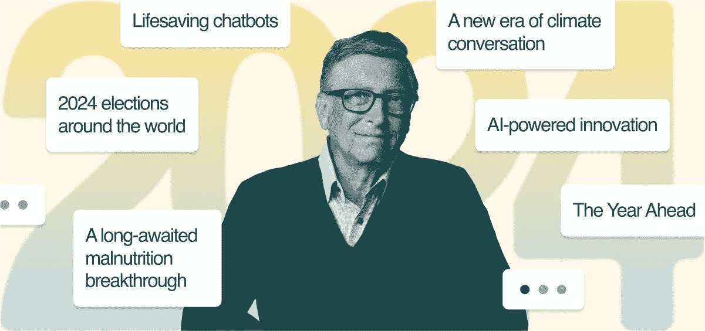

When you think back on 2023, how will you remember it?

For me, this will always be the year I became a grandparent. It will be the year I spent a lot of precious time with loved ones—whether on the pickleball court or over a rousing game of Settlers of Catan. And 2023 marked the first time I used artificial intelligence for work and other serious reasons, not just to mess around and create parody song lyrics for my friends.

This year gave us a glimpse of how AI will shape the future , and as 2023 comes to a close, I’m thinking more than ever about the world today’s young people will inherit. In last year’s letter , I wrote about how the prospect of becoming a grandparent made me reflect on the world my granddaughter will be born into. Now I’m thinking more about the world she will inherit and what it will be like decades from now, when her generation is in charge.

I can begin to picture it: the tools she will use, the ways she will stay in touch with her loved ones, the problems these innovations will help solve. We now have a better sense of what types of jobs AI will be able to do by itself and which ones it will serve as a copilot for. And it’s clearer than ever how AI can be used to improve access to education, mental health, and more. It motivates me to make sure this technology helps reduce—and doesn’t contribute to—the awful inequities we see around the world. I've always been a firm believer in the power of innovation to offer every child an equal chance to survive and thrive. AI is no exception.

The early years of a new age are often marked by lots of changes. If you are old enough to remember, think back to the beginning of the internet. At first, you probably didn’t know many people who were using it. But it became more common over time until, one day, you realized most people had email addresses, bought things online, and used search engines to answer their questions.

We are just at the beginning of this transition right now. This is an exciting and confusing time, and if you haven’t figured out how to make the best use of AI yet, you are not alone. I thought I would use AI tools for the foundation’s strategy reviews this year, which require reading hundreds of pages of briefing materials that an AI could accurately summarize for me. But old habits are hard to break, and I ended up preparing for them the same way I always do.

Of course, AI is far from the only defining feature of 2023. Millions continue to experience unbearable grief as a result of Russia’s war on Ukraine and in the aftermath of the war in Ethiopia. My heart is broken for the continued suffering of Israelis and Palestinians, as well as for the people of Sudan. At the same time, more people are being forced to endure hardship as a result of more frequent extreme weather events caused by climate change. And families around the world continue to be hit hard by rising inflation and slow economic growth.

There’s no question these are challenging times, but I remain optimistic about the future. The speed of innovation has never been faster. We’re making big strides on tough problems—like Alzheimer’s, obesity, and sickle cell disease—that will improve the lives of millions of people. My friend the late Hans Rosling used to say that “things can be bad and getting better.” It’s a good reminder that progress is not only possible but happening every day.

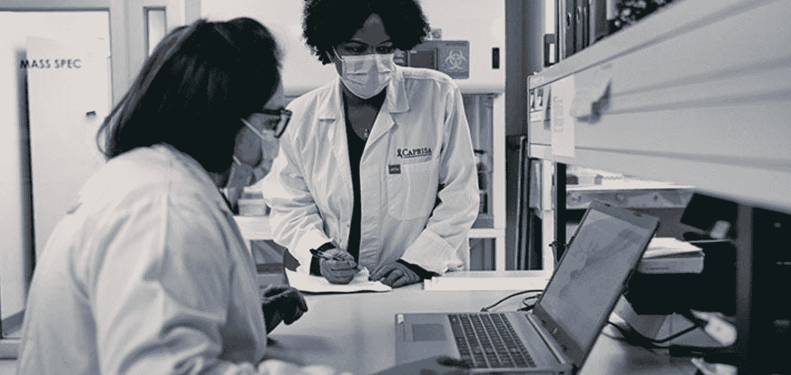

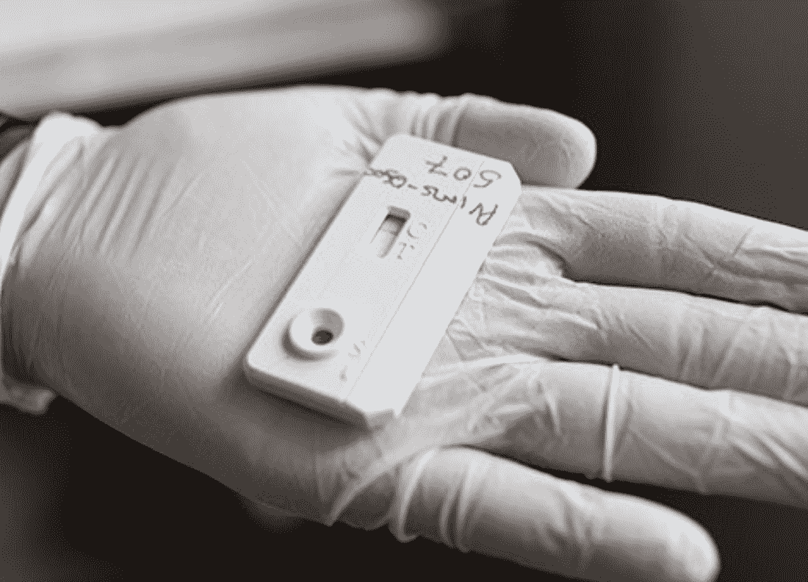

The team at CAPRISA in South Africa is using data to improve treatments for patients infected with both HIV and tuberculosis.

A Ugandan nurse examines a participant’s test during a clinical trial for an HIV vaccine. (Luke Dray/ Getty)

That’s why I remain dedicated to making sure that, even in the face of setbacks, the world continues to do more to help the poorest people. I do the bulk of this work through the Gates Foundation , where my colleagues remain dedicated to improving global health, education, gender equality, and more. While I could write a thousand pages about the incredible work they’re doing with our partners, this letter focuses on just a few of the most exciting breakthroughs.

I also write about why I’m optimistic about the world’s climate progress. Most of my climate and energy work is done through Breakthrough Energy , although the Gates Foundation is helping people in low- and middle-income countries adapt to a warming world. I also continue to privately fund research into other areas like Alzheimer’s disease. And I still get to advise Microsoft, which gives me insight into what’s coming down the pipeline and how it can be used to make the world a more equitable place.

I’m lucky that my work gives me insight into all the ways the world is getting better. The challenges we feel a lot less daunting when you understand what exactly it will take to tackle them. In this letter, I will share just a few reasons I am optimistic about the year ahead. I hope they make you as excited about all the progress to come as I am.

## AI is about to supercharge the innovation pipeline.

My work has always been rooted in a core idea: Innovation is the key to progress. It’s why I started Microsoft, and it’s why Melinda and I started the Gates Foundation more than two decades ago.

Innovation is the reason our lives have improved so much over the last century. From electricity and cars to medicine and planes, innovation has made the world better. Today, we are far more productive because of the IT revolution. The most successful economies are driven by innovative industries that evolve to meet the needs of a changing world.

My favorite innovation story, though, starts with one of my favorite statistics: Since 2000, the world has cut in half the number of children who die before the age of five.

How did we do it? One key reason was innovation. Scientists came up with new ways to make vaccines that were faster and cheaper but just as safe. They developed new delivery mechanisms that worked in the world’s most remote places, which made it possible to reach more kids. And they created new vaccines that protect children from deadly diseases like rotavirus.

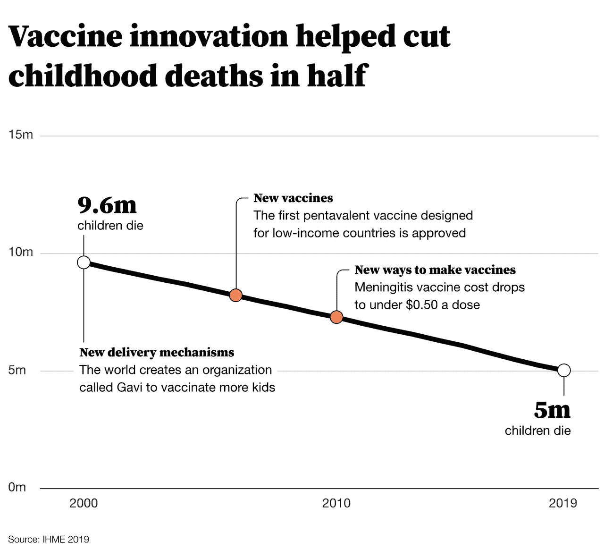

In a world with limited resources, you have to find ways to maximize impact. Innovation is the key to getting the most out of every dollar spent. And artificial intelligence is about to accelerate the rate of new discoveries at a pace we’ve never seen before.

One of the biggest impacts so far is on creating new medicines. Drug discovery requires combing through massive amounts of data, and AI tools can speed up that process significantly. Some companies are already working on cancer drugs developed this way. But a key priority of the Gates Foundation in AI is ensuring these tools also address health issues that disproportionately affect the world's poorest, like AIDS, TB, and malaria.

We’re taking a hard look at the wide array of AI innovation in the pipeline right now and working with our partners to use these technologies to improve lives in low- and middle-income countries.

In the fall, I traveled to Senegal to meet with some of the incredible researchers doing this work and to celebrate the 20th anniversary of the foundation’s Grand Challenges initiative. When we first launched Grand Challenges —the Gates Foundation’s flagship innovation program—it had a single goal: Identify the biggest problems in health and give grants to local researchers who might solve them. We asked innovators from developing countries how they would address health challenges in their communities, and then we gave them the support to make it happen.

Many of the people I met in Senegal were taking on the first-ever AI Grand Challenge. The foundation didn’t have AI projects in mind when we first set that goal back in 2003, but I’m always inspired by how brilliant scientists are able to take advantage of the latest technology to tackle big problems.

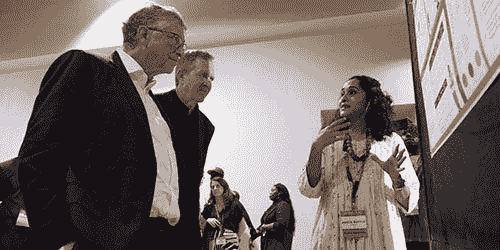

Much of their work is in the earliest stages of development—there’s a good chance we won’t see any of them used widely in 2024 or even 2025. Some might not even pan out at all. The work that will be done over the next year is setting the stage for a massive technology boom later this decade.

Still, it’s impressive to see how much creativity is being brought to the table. Here is a small sample of some of the most ambitious questions currently being explored:

+ **Can AI combat antibiotic resistance?** Antibiotics are magical in their ability to end infection, but if you use them too often, pathogens can learn how to ignore them. This is called antimicrobial resistance, or AMR, and it is a huge issue around the world—especially in Africa, which has the highest mortality rates from AMR. Nana Kofi Quakyi from the Aurum Institute in Ghana is working on an AI-powered tool that helps health workers prescribe antibiotics without contributing to AMR. The tool will comb through all the available information—including local clinical guidelines and health surveillance data about which pathogens are currently at risk of developing resistance in the area—and make suggestions for the best drug, dosage, and duration.

+ **Can AI bring personalized tutors to every student?** The [AI education tools](https://www.khanacademy.org/khan-labs) being piloted today are mind-blowing because they are tailored to each individual learner. Some of them—like Khanmigo and [MATHia](https://www.carnegielearning.com/solutions/math/mathia/)—are already remarkable, and they’ll only get better in the years ahead. One of the things that excites me the most about this type of technology is the possibility of localizing it to every student, no matter where they live. For example, a team in Nairobi is working on [Somanasi](https://kytabu.africa/somanasi/), an AI-based tutor that aligns with the curriculum in Kenya. The name means “learn together” in Swahili, and the tutor has been designed with the cultural context in mind so it feels familiar to the students who use it.

+ **Can AI help treat high-risk pregnancies?** A woman dies in childbirth every two minutes. That’s a horrifying statistic, but I’m hopeful that AI can help. Last year, I wrote about how [AI-powered ultrasounds](https://www.gatesnotes.com/The-Year-Ahead-2023#ALChapter6) could help identify pregnancy risks. This year, I was excited to meet some of the researchers at [ARMMAN](https://armman.org/), who hope to use artificial intelligence to improve the odds for new mothers in India. Their large language model will one day act as a copilot for health workers treating high-risk pregnancies. It can be used in both English and Telugu, and the coolest part is that it automatically adjusts to the experience level of the person using it—whether you’re a brand-new nurse or a midwife with decades of experience.

+ **Can AI help people assess their risk for HIV?** For many people, talking to a doctor or nurse about their sexual history can be uncomfortable. But this information is super important for assessing risk for diseases like HIV and prescribing preventive treatments. A new South African chatbot aims to make HIV risk assessment a lot easier. It acts like an unbiased and nonjudgmental counselor who can provide around-the-clock advice. Sophie Pascoe and her team are developing it specifically with marginalized and vulnerable populations in mind—populations that often face stigma and discrimination when seeking preventive care. Their findings suggest that this innovative approach may help more women understand their own risk and take action to protect themselves.

+ **Could AI make medical information easier to access for every health worker?** When you’re treating a critical patient, you need quick access to their medical records to know if they’re allergic to a certain drug or have a history of heart problems. In places like Pakistan, where many people don’t have any documented medical history, this is a huge problem. [Maryam Mustafa’s](https://www.maryamustafa.com/) team is working on a voice-enabled mobile app that would make it a lot easier for maternal health workers in Pakistan to create medical records. It asks a series of prompts about a patient and uses the responses to fill out a standard medical record. Arming health workers with more data will hopefully improve the country’s pregnancy outcomes, which are among the worst in the world.

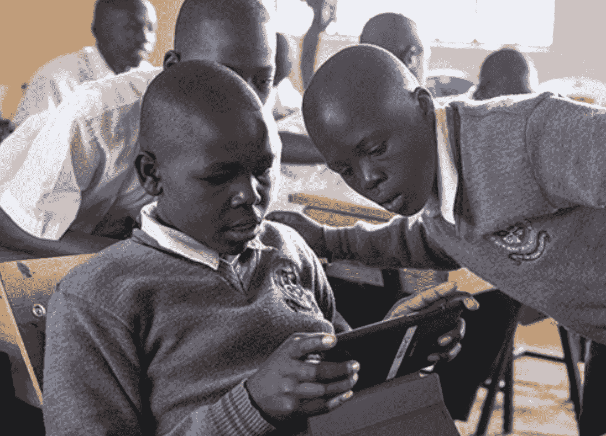

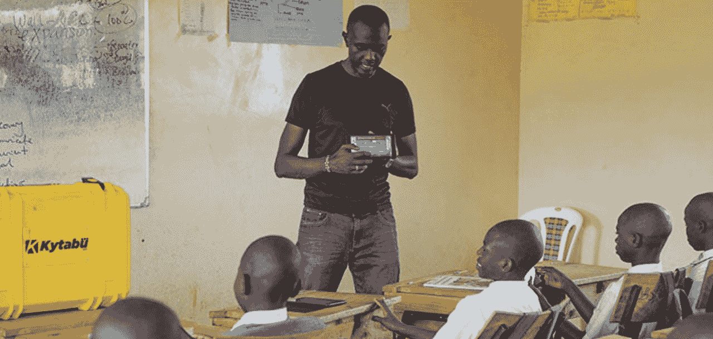

Students interact with an AI tutor in a classroom in Nairobi, Kenya.

Tonee Ndungu—whose team is developing Somanasi—shows off the latest version of their personalized education tutor.

There is a long road ahead for projects like these. Significant hurdles remain, like how to scale up projects without sacrificing quality and how to provide adequate backend access to ensure they remain functional over time. But I’m optimistic that we will solve them. And I’m inspired to see so many researchers already thinking about how we deploy new technologies in low- and middle-income countries.

We can learn a lot from global health about how to make AI more equitable. The main lesson is that the product must be tailored to the people who will use it. The medical information app I mentioned is a great example: It’s common for people in Pakistan to send voice notes to one another instead of sending a text or email. So, it makes sense to create an app that relies on voice commands rather than typing out long queries. And the project is being designed in Urdu, which means there won’t be any translation issues.

If we make smart investments now, AI can make the world a more equitable place. It can reduce or even eliminate the lag time between when the rich world gets an innovation and when the poor world does.

If I had to make a prediction, in high-income countries like the United States, I would guess that we are 18–24 months away from significant levels of AI use by the general population. In African countries, I expect to see a comparable level of use in three years or so. That’s still a gap, but it’s much shorter than the lag times we’ve seen with other innovations.

The core of the Gates Foundation’s work has always been about reducing this gap through innovation. I feel like a kid on Christmas morning when I think about how AI can be used to get game-changing technologies out to the people who need them faster than ever before. This is something I am going to spend a lot of time thinking about next year.

# A long-awaited malnutrition breakthrough is almost here.

At the Gates Foundation, we are willing to take big bets. We know every risk might not pay off—but that’s okay. Our goal isn’t just incremental progress. It’s to channel our efforts and resources into major initiatives that, if successful, could save and improve lives.

# Using the Gut Microbiome to Prevent and Treat Malnutrition

When you’re making a big bet, you often wait a long time to see if it pays off. The feeling is incredible when you finally realize it’s going to succeed. We are close to that moment with one of the big bets I’ve been most excited about: Using our understanding of the gut microbiome to prevent and treat malnutrition.

I often get asked what I would choose if I could only solve one problem. My answer is always malnutrition. It’s the greatest health inequity in the world, affecting about one in every four children. If you don’t get enough nutrition during the first two years of life, you don't develop properly—physically or mentally. By tackling malnutrition, we can reduce one of the biggest contributors to childhood mortality.

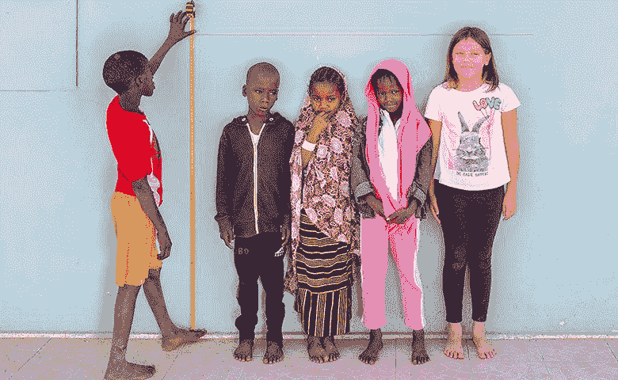

The causes of malnutrition are a lot more complicated than just not getting enough food. Around 15 years ago, researchers began to suspect that the bacteria that live in your gut—your microbiome—might play a role after noticing that oral childhood vaccines like polio weren’t as effective in places with high rates of malnutrition. It was clear that something prevented them from being absorbed properly.

This suspicion was [confirmed](https://source.wustl.edu/2013/01/gut-microbes-at-root-of-severe-malnutrition-in-kids/) in 2013, when biologist Jeff Gordon published a landmark study looking at the microbiomes of infant twins in Malawi. It revealed that your microbiome is not just a byproduct of your health but a determinant of it. This was the first big clue that we might be able to reduce malnutrition by changing the gut microbiome.

In the last 10 years, we have learned more about the gut microbiome than we learned in the 1,000 years before that. We’ve discovered that the bacteria living in your gut can be in a dysfunctional state that causes inflammation so you can’t absorb nutrients. And we found that you can make the biggest improvements to the gut microbiome if you intervene early.

One of the first gut bacteria to appear in human development is called B. infantis. It helps break down the sugars in breastmilk into nutrients the body needs to grow. Breastmilk, in turn, provides food for B. infantis and your entire gut microbiome. It’s a virtuous cycle. But if a baby doesn’t have enough B. infantis bacteria at the beginning, they may not absorb enough nutrients from breastmilk to support the growth of other necessary gut bacteria.

It’s almost impossible to overcome this deficit. You can have access to all the nutritious food in the world, and it won’t matter. If your gut’s growth path gets thrown off early, you may never be able to absorb all the nutrients you need.

But what if we could give at-risk infants B. infantis as a probiotic supplement? Could we intervene early enough to set them on the right path?

That’s what foundation partners have been looking into for years—and we’re finally close to an answer. Phase III trials are underway on a powdered B. infantis supplement that can be added to breastmilk. 16,000 babies from five countries are involved, and researchers are tracking each one to make sure the probiotic is both safe and effective.

The results so far are amazing: Feeding infants this probiotic helps them move their microbiome into that positive state so they can grow up and achieve their full potential. This could be a tremendously helpful tool for preventing malnutrition.

While the trials are ongoing, foundation partners are also trying to figure out how to reduce the cost of manufacturing. It’s essential that we make the cost cheap enough that they can be widely used in low-income countries where malnutrition rates are highest.

The next step is (hopefully) broader regulatory approval and scaled-up, high quality, and reliable manufacturing. The WHO has already released guidance on how to use these probiotics, which is a big hurdle to clear. I’m also optimistic about ongoing research into other form factors, like a liquid version that’s given directly to infants rather than mixed into breastmilk.

I’m also excited about the possibility of improving the gut microbiome before an infant is even born. New research has found that a baby’s microbiome is connected to their mother’s. Addressing inflammation in the womb can have additional benefits to the woman, the placenta, and the developing fetus.

What if we could give an expectant mother a probiotic supplement that would put her child’s gut on the right path from day one? It’s unclear yet what exactly these live biotherapeutics would look like or how they would be administered, since this is very early-stage research. But studies show a healthy microbiome could help babies gain an additional 5 grams of weight per day in the late stages of pregnancy.

Over the past decade, the field of child health has moved faster and further than I thought I’d see in my lifetime. It’s been amazing to watch the microbiome go from something that was completely invisible to a key strategy for tackling one of the greatest health inequities in the world. I can’t wait to see how much more we learn—and how we use that knowledge to save lives—in the year ahead.

# The climate conversation has entered a new era.

What happens when you bring heads of state, student activists, business leaders, and philanthropists together and ask them to work on the climate crisis? A whole lot of progress, it turns out.

Earlier [this month](https://www.gatesnotes.com/Investing-in-Energy-Innovation), I [spent](https://www.gatesnotes.com/Reflections-from-COP26) several productive and awe-inspiring days at the COP28 conference in Dubai. This was my third COP—I also went to the conferences in Paris and Glasgow.

These meetings are a great way to track how the climate fight is evolving over time. I’m always blown away by the passion from young climate activists. It’s especially interesting to see how the overall intensity of the climate discussion has gone up over the years as more people see and experience extreme weather events all over the world.

I’m hopeful that this intensity will [drive](https://www.gatesnotes.com/How-CGIAR-is-feeding-our-future) us to invest more in innovations that will help those who are most affected by climate change — especially poor farmers who live near the equator. They deserve our attention because they’ve done nothing to cause this problem, yet it literally threatens their lives. On that front, it was exciting to see a greater focus on adaptation at this year’s COP, including the inclusion of an entire day devoted to health.

The palm trees that produced these dates can handle water that’s salty, so they can grow in more places.

Dr. Tarifa Al Zaabi from the International Center for Biosaline Agriculture presented her research on growing crops in saline environments during COP in Dubai.

I was also struck by how sophisticated and nuanced the conversation around climate has become. The biggest change I saw in Dubai was how broad the discussion is about mitigation—and especially clean energy.

At [previous COPs](https://www.gatesnotes.com/Why-I-am-going-to-COP), a lot of the focus was on scaling up wind and solar. At this COP, there was a lot more discussion about other sectors that contribute significant emissions, like agriculture and manufacturing. (I’ve written before about what I’m doing to reduce and offset my own emissions.) It’s also clear that leaders are thinking seriously about how countries can build a green energy future that pulls from many different sources. Wind and solar remain a key part of that future, but leaders now recognize that you need to supplement them with something more reliable when the sun isn’t shining or the wind isn’t blowing.

That something increasingly includes nuclear energy.

Over the last year, I have noticed a major shift toward overall acceptance of nuclear. In the past, when I would bring it up, I would often have to explain why nuclear isn’t the boogeyman many peop[le assumed it was.](https://www.reuters.com/sustainability/climate-energy/over-110-countries-set-join-cop28-deal-triple-renewable-energy-2023-12-02/) But lately, I’ve spent a lot more time explaining how we scale the technology up rather than why we need it at all. I was excited to see nearly two dozen countries pledge at COP to triple their nuclear capacity by 2050.

I think one reason for this shift is practical. Nuclear is the only carbon-free energy source that can reliably deliver power day and night, through every season, almost anywhere on earth, that has been proven to work on a large scale. As countries make progress on their climate plans, more people are realizing that we will likely need nuclear power to meet the world’s growing need for energy while eliminating carbon emissions.

I also attribute some of the shift to the progress being made on next-generation nuclear technology.

For decades, nuclear technology remained stagnant. High-profile disasters like Chernobyl and Three Mile Island put a spotlight on the real risks that come with nuclear power. And instead of getting to work on solving those problems, we just stopped trying to advance the field. Luckily, that is changing.

I’m optimistic about the [approach cr](https://www.terrapower.com/)eated by TerraPower, a company I founded in 2008. Earlier this year, I visited the future home of the first TerraPower plant in Kemmerer, Wyoming. When this plant opens—potentially in 2030—it will be the most advanced nuclear facility in the world, and it will be much safer and produce far less waste than conventional reactors.

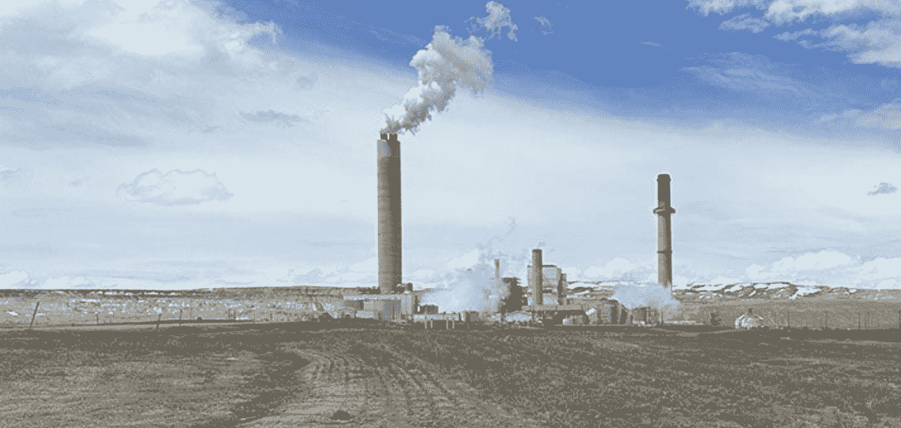

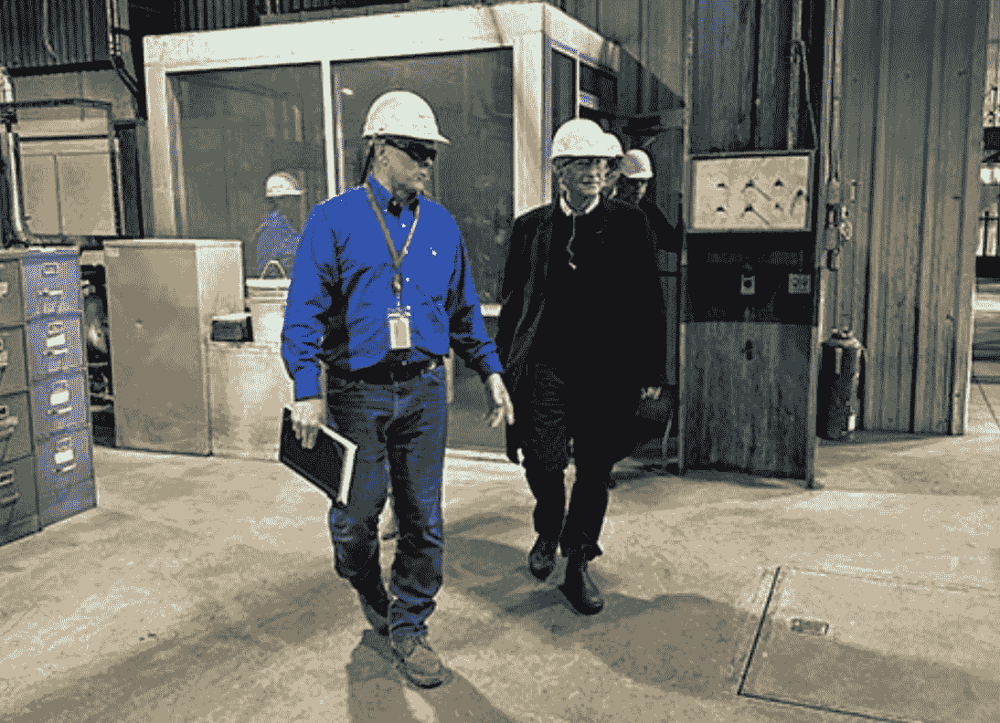

The power plant in Kemmerer, Wyoming, will stop burning coal by 2026 and shut down completely by 2036.

I visited the Naughton plant in Kemmerer earlier this year. The plan is for all workers to get jobs in the TerraPower facility if they want one.

A lot of people are still (understandably!) skeptical about the economics of nuclear power, since building new plants is so expensive. My hope is that the Kemmerer plant will remove some of those doubts. Building the facility will bring 1,600 construction jobs to town at its peak. And once it’s up and running, it will employ between 200 and 250 people—including workers from the local coal plant that’s scheduled to shut down soon.

In 2024, construction will begin on the sodium test facility in Kemmerer. (You can read more about the super-cool role sodium plays.) This is an important step as TerraPower continues to make progress toward breaking ground on the nuclear facility.

TerraPower uses a fission reactor, which is what most people think of when they picture a nuclear power plant. It creates power by splitting atoms apart. But scientists are also working on a completely new type of reactor that pushes atoms together to generate energy. This process is called fusion, and it’s the same process that powers the sun.

Almost exactly one year ago, scientists at the Lawrence Livermore National Laboratory achieved the first fusion reaction that generated more energy than it took in. This was a tremendous achievement and a huge step forward. The technology is still in the R&D phase, but there are plenty of reasons for continued optimism.

It’s always exciting to see zero-emission technologies go from idea to reality. One of the highlights of my trip to COP was walking around the technology start-up zone. Most of the companies there didn’t exist eight years ago when the world declared at the Paris COP that it was committing to climate innovation.

In 2024 and beyond, I predict we will see lots of new innovations coming into the marketplace—even in very complicated areas like nuclear. The climate crisis can feel overwhelming, but I find it easier to stay optimistic when you focus on all the progress we’re making. If the world continues to prioritize funding innovation, I’m hopeful we can make good progress on our climate goals.

# 2024 elections will shape the future of global health and the climate.

I recently read a statistic that blew my mind: More people might vote in 2024 than in any other year in history.

Citizens from nearly 60 countries will head to the polls next year to elect leaders at all levels of government. Those countries are home to more than 4 billion people—or more than half of the world’s population. It’s staggering to think about.

National elections—like the ones happening in the United States, India, and South Africa—will grab most of the attention. But billions of people around the world will also elect governors, mayors, local councilmembers, and more. All levels of government are on the ballot. And while every year’s elections are important, the sheer number of people who will vote in 2024 means that the results will have an outsized impact on the future of our world.

If I could make one wish for all the people headed to the polls next year—no matter where they live—it would be for them to consider electing leaders who understand the importance of investing in human development around the world. History has proven time and time again that, when governments choose to engage with and help people outside their borders, the entire world benefits.

2023 marked the 20th anniversary of perhaps the best example of this type of generosity: PEPFAR. Two decades ago this year, President George W. Bush launched what is officially known as the United States President's Emergency Plan for AIDS Relief. Since then, the program has saved 25 million lives by providing more than $100 billion in funding for AIDS prevention and treatment. By alleviating some of the burden AIDS placed on African economies, PEPFAR helped lower the continent’s poverty rate by more than a third since 2003.

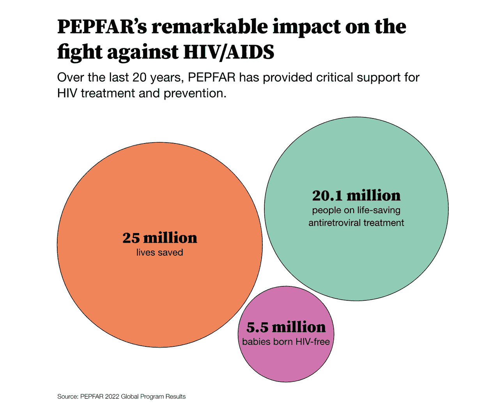

This is exactly the kind of program that governments should support. But economic crises have cut into international funding for global health priorities, and the climate crisis has added another challenge that deserves global attention and support.

**I believe the 2024 elections will be a turning point for both health and climate.** The decisions made by elected leaders will determine how much progress we continue to make in each area.

On health, we need to not only make up the ground we lost because of the COVID pandemic but continue to push forward.

The [best way](https://www.gatesnotes.com/Gavi-has-helped-prevent-13-million-deaths) to assess how we’re doing is to look at how many children die before they reach the age of five. Since 1990, childhood deaths have fallen from 12 million a year to 5 million a year. That’s astounding—and a testament to programs like PEPFAR and organizations like Gavi, which vaccinates children against deadly diseases. Because of COVID and other setbacks, the United Nations’ goal to cut childhood deaths in half again by 2030 will be missed. But it can still be achieved the following decade if nations maintain or increase their foreign aid commitments.

We also are not as ready for the next pandemic as I hoped we would be by now. This is something I’ve written about a lot—including in last year’s letter!—and the list of things the world needs to do remains unchanged. Now is the time for policymakers to prioritize pandemic preparedness before it is too late.

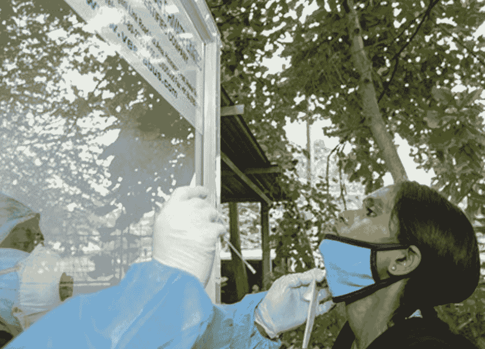

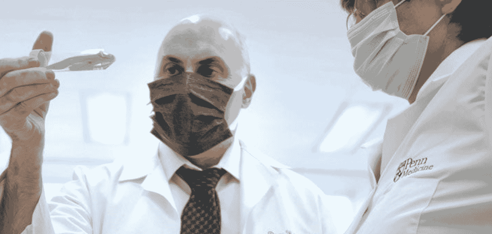

A woman in Bengaluru, India, gets tested for COVID-19.

At their University of Pennsylvania lab, Dr. Katalin Karikó and Dr. Drew Weissman work on the technology that made mRNA vaccines possible.

On climate, as I wrote in the previous section, I am feeling optimistic about our progress overall. But the next five years remain critical.

It was amazing to see so many world leaders talking about their support for climate innovation when I was at COP. Some of that funding is already being used to develop new breakthroughs, but a lot of it is still scheduled to be dispersed. In the United States, for example, funding from the Inflation Reduction Act and the Bipartisan Infrastructure Law will continue heading to communities over the next five years. Many countries around the world are in similar positions. We cannot afford to see these investments delayed or halted.

This decade is also a key period for upgrading electric grids and improving power transmission. The world has made incredible advancements in generating clean electricity, but we won’t realize the full potential of this hard work without the infrastructure to deliver it. This is something that will require support from all levels of government but especially from local leaders.

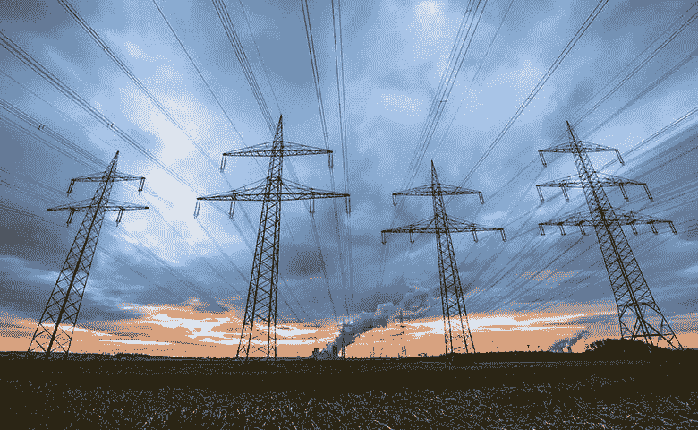

There’s no question that we are facing some big challenges. If we are going to address them, we need to make sure policymakers keep as many options on the table as possible. We cannot let extremism and polarization limit our choices.

Consider this: We don’t know yet which combination of climate breakthroughs will get us to zero emissions. Some of the innovations the world is betting big on today may not work out in the end—and that’s okay, as long as we have other options on the table. We need to think ahead when it comes to the big challenges facing us, and we need to think about what will have the biggest impact over time.

Earlier in this letter, I wrote about why I believe innovation is the key to progress. Accelerating innovation requires both political leadership and private sector leadership. As voters around the world decide which candidates they want to elect to fill national, state, and local offices, I think we should consider what kind of leaders can drive the innovations we need—and make sure they reach the people who need them most.

# Getting ready for 2024

I have been thinking a lot lately about my [friend Chuck Feeney](https://www.gatesnotes.com/Remembering-Chuck-Feeney), who passed away in October. He was a huge proponent of what he called “giving while living.” As another year comes to a close, I find myself reflecting on what it means to truly embody that idea.

For me, it means constantly asking myself a question: How can I use my wealth to do the most good for the most people, now and in the future? Sometimes the answer is clear. When it’s not, I turn to my brilliant colleagues, family, and friends who, more often than not, can provide the perspective, moral clarity, and data points needed to make the right choice.

It’s been a special joy to watch my children grow up to become invaluable sources of wisdom in their own right. One of the highlights of my year was sharing the stage with Phoebe, my youngest, at the foundation’s Goalkeepers event. I can always count on all three of my kids to keep me up to date on how young people see the world—and on the latest TikTok trends.

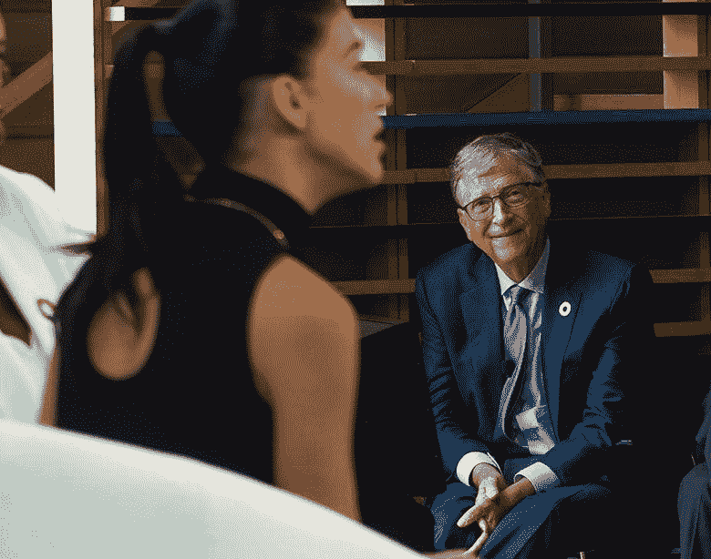

I’m looking forward to spending the holidays with them and recharging a bit. When I was my kids’ age, I didn’t believe in vacations or weekends. But as I got older—and especially since I became a father—I realized there is more to life than work. I hope you’re able to take some time this holiday season to have fun and relax before we dive into 2024.

I wish you and your loved ones a wonderful new year.

> 🔗 原文链接：[The Year Ahead 2024](https://www.gatesnotes.com/The-Year-Ahead-2024)
