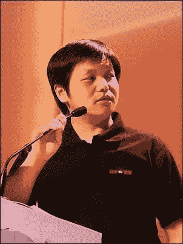
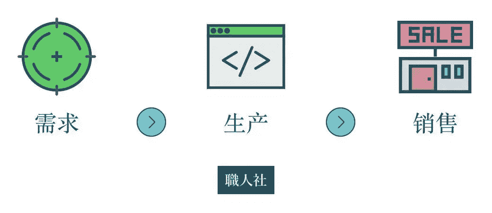
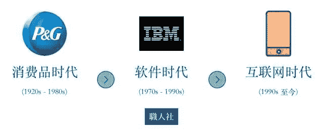
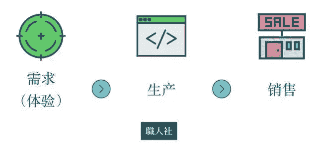
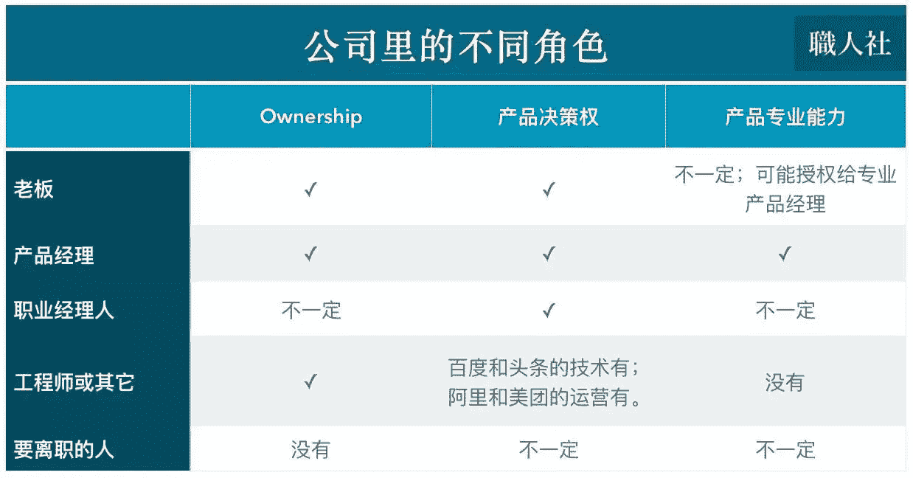
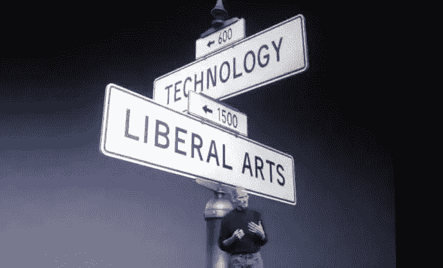
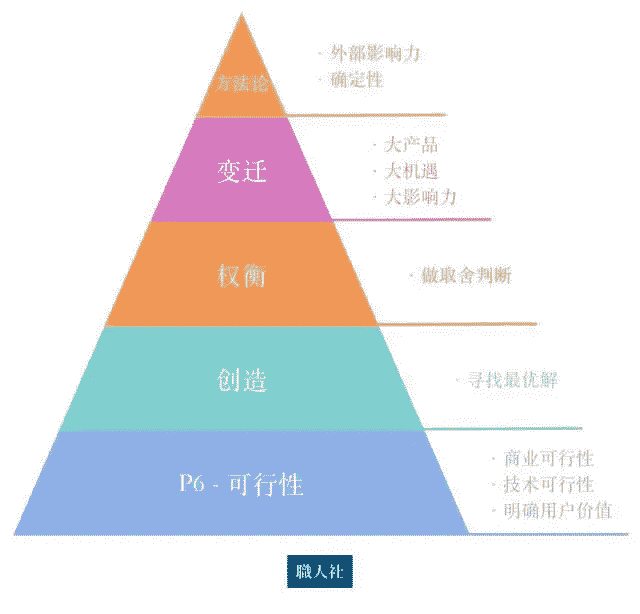

# 深度对话俞军：关于产品经理的价值、天赋、能力、成长及未来，最系统的分享

> 来源：[https://leonzhang.feishu.cn/docx/Yyn1dtnuUozguoxNrdLcl2E9nSf](https://leonzhang.feishu.cn/docx/Yyn1dtnuUozguoxNrdLcl2E9nSf)

> 🔗 原文链接：https://www.jianshu.com/p/255991941...

俞军是中国互联网界的一个传奇：热爱搜索成痴，2000 年以网名「搜索引擎 9238」写了一封传奇的求职信 ①，后加入百度，担任产品副总裁和首席产品架构师。在那个中国互联网处于野蛮生长、还没有产品经理概念的年代里，他是百度搜索系列产品早期唯一的产品经理，后来主持设计了百度贴吧（2003 年）、百度知道（2005 年）等世界级创新产品。直到俞军 2009 年离开百度后，他在百度多年的产品经理方法论，被同事们整理总结为「PM 12 条」流传业界 ②，至今仍影响着一代又一代的产品经理。

## 1. 到底什么是产品经理

俞老师认为，从古到今，所有产品都可以分为需求、生产、销售三个环节。产品经理是要对产品的市场结果负责，全盘考虑三个环节的职业角色。

**需求**：产品到底满足用户的什么需求；

**生产**：有效率地把产品做出来。不管是实体的，还是软件的，或者是一项服务；

**销售**：把产品卖给用户。包括营销、品牌、售后等。

我们知道，产品经理概念最早是宝洁提出来的。在此之前，宝洁这么大个公司也运作了很多年，只不过「产品经理」这个角色的职能是其他人在承担的，可能是总经理或者掌柜的。宝洁开始可能只生产一个产品，但当他需要生产更多产品的时候，发现需要资源调配、需要排优先级，他的组织结构需要重新适应新的生产需要。从一个横向的维度，宝洁提出了产品经理的概念，不拥有实权、不实际汇报、对结果负责、将原来的职能部门按照产品重新组织，提升效率。一个职业的诞生和留存，必然是因为它优化了企业分工，提高了企业收益，产品经理也不例外。

虽然都是为结果负责，但对于不同形态、不同阶段的产品，最能创造价值的侧重点不一样，产品经理需要搞清楚在当前阶段侧重哪一块更能够创造价值。

## 2. 产品经理的演进史

在以宝洁为代表的消费品时代，侧重点都在销售上面。因为需求相对确定，生产也很标准化，都有工业时代成熟的方法论来支撑，使得产品本身容易同质化，但在品牌定位、营销、渠道控制上能够拉开差别，决定公司挣 10 亿还是 100 亿。宝洁时代的产品经理，本质上是「营销产品经理」。

然后是软件时代，这个时期常见的产品经理，本质上是「项目产品经理」，主要工作是管理软件生产。早年软件的需求大多数是 to B 的，to B 的需求相对容易明确，顶多跟老板或客户 argue 一下需求。即使有一些 to C 的产品，也因为市场稀缺性的缘故，用户面临较少选择，不愁卖。那个时代最稀缺的是生产软件的合格工程师，如同五年前的产品经理，供给远远跟不上需求。所以产品经理在管理生产上更能创造价值，沟通协调，版本控制，按时交付。

再到互联网时代，才较多出现「需求产品经理」。项目产品经理和营销产品经理的工作做得平庸一点，不是严重问题。但「需求产品经理」的表现好坏，却往往能够决定一个产品的生死，这才导致产品经理职业的地位上升，受到关注。这样的产品经理很少，素质要求很高，工资收入也很高，开始影响到整个行业。这里面有两个原因，第一是需求判断：当你把一种新要素引入到现有的生产体系或生活方式中，结合之后能够创造出巨大的新价值时，创新就形成了。

过去五年，最大的新要素是「移动互联网」；再往前十几年，最大的新要素是「PC 互联网」。历史上的电、石油、蒸汽机也是重大的新要素。每一个影响时代的新要素出现后，跟我们的生活和生产方式结合，就能创造无数的新产品，我们可以根据需求去判断可以做哪些。但每个时代，亿级和千万级用户规模的产品需求都是有限的。你得早发现，而且到最后还能从激烈竞争中胜出，才能改变时代。只有能决定正确方向的需求产品经理，才有价值，决定了后续成败。如果需求产品经理表现平庸，后面不论是融资多少、工程师还是运营、营销多优秀，可能都无法弥补错误决定带来的损失。

▲ 产品经理的三大时代

这是第一方面，是需求判断，是因为有一个新要素出来。但这也是现在很多产品经理惶惶的原因，地位跟五年前不一样了，因为这个新要素被挖掘差不多到头了。但俞老师认为下一波 AI 很可能不是一个能创造很多 to C 新产品的新要素，可能跟二三十年前的软件计算机类似，主要价值在于跟原有产品结合，提升企业效率。

但是跟软件时代相比，除了需求，还有第二个因素也就是「体验」。这一代产品经理的影响力这么大，是因为需求、体验碰撞到一起，双击效应（Double-killing Effect）。

▲ 体验变得越来越重要

为什么体验这么重要呢？还是互联网带来的。互联网作为一种信息科技，使得人与人之间的信息传递和交换非常高频、主动。用户的发言能力和信息获取能力都变强了，从贴吧、博客、🧣到🛰️培养了人们发声的习惯，再加上消费品从物质变为软件和服务，而且是 7×24 小时在线、来回数据交互、大规模、充满竞争、用户发声容易、负面评价容易被传播的在线服务，用户的切换相对容易，用户的选择权大大增加。怎么让用户选择我们呢？极致的体验开始有了价值。而且当一项服务动不动就千万级、亿级用户时，体验每改进一点，价值就乘以千万次。而如果一个软件只有 1 万人使用，你花同样的成本去做，收益就非常有限。所以，这个时代不只是互联网，很多传统行业都逐渐意识到了体验的重要性，不管是开餐馆，还是开公司招人，你的声誉和体验变得越来越重要，直接影响别人的选择 —— 追求极致的体验开始变得有了更大商业价值。所以传统领域现在开始强调「互联网思维」和「产品思维」，本质原因就在这里。而重视体验最好的方法，就是用「产品经理」的角度，以用户为中心，横向组织资源，按需求去做生产和销售。

移动互联网是需求 × 体验 × 生产三个方面加在一起，导致产品经理（和工程师）被大量需要：新要素出现导致无数的新产品需求亟待挖掘、移动互联网导致用户数量上升一个量级后对体验要求更高、大量 app 需要流水线的生产人员。所以过去五年产品经理这么火。现在呢，需求方面重大新要素未出现，生产方面 app 数量降低，体验方面很多产品成熟加上从业者水平上升也差不多了，所以现在没有一技之长的产品经理不好找工作。但现在 P7 级别以上的优秀产品经理依然极其稀缺，一将难求。

## 3. 产品经理对公司环境的要求

叫什么 title 不重要，任何产品都有产品经理。真正的产品经理是三位一体的：

主人翁意识（Ownership）：把产品当成自己的子女，绝大部分老板是这样；但空降兵、职业经理人、打算离职的人不一定有。

决策权（Decision-making Power）：参照下图

专业能力（Professional Competence）：后面会详细讲解

▲ 一个公司内不同角色的表现

只有同时拥有 Ownership、决策权和专业产品能力，并且在一个正确的土壤和环境里，才能诞生真正的产品经理。

与此同时，由于产品经理是一个非常注重完整流程实践的角色，还与公司是否具备高容错能力直接相关。

高容错：比如现在🛰️如果要做搜索，即使是找 B 类人才去做，也可以高容错地反复试。反正内容的生产体系（👸号）、用户行为数据、连接服务的能力都在🛰️自己手上，用户替代成本也高。通常，一个公司的新业务、边缘业务、有优势资源的业务、核心业务协同业务、低竞争业务、老板关注的业务、没人跟你抢的业务，更有高容错倾向，天赋一般的产品经理，可以考虑选择这些业务以获得更好的成长宽容度，但代价是更长的成长时间。

低容错：有些做产品的机遇，是低容错的，错了就大概率失败，竞争环境、资金、团队都不会给你第二次机会。有自信的产品经理，可以挑战这样的机遇。其实不论做什么产品，总有些选择是低容错的，这一关总要过。

也可以简单地说，一个产品经理如果没有达到 P6（3-5 年经验）的水平，冒然加入一个低容错的业务（比如早期创业公司），对他的成长是不利的。

## 4. 如何成为顶尖产品经理

一个人需要同时具备天赋、努力和机遇三大要素，才有可能成为顶尖的产品经理。

机遇：包括公司的环境（见上一节）和业务（是否能够碰上新要素）两个方面。这个业务面向的用户是百万级、千万级还是亿级，商业价值是十亿美金还是百亿美金，很多业务的用户价值天花板在一开始就已经注定了。虽然后面可以不断调整用户价值，比如降低替代成本，提高体验，但这都是微调，大方向的突破总是小概率事件。而且关键的产品经理，得在业务的前半段或上升期就参与其中，才能够学到更多，过程中有无数的权衡取舍和细节决策。到产品成熟期之后，能够学到的就少很多了。

天赋：当然不能太弱。产品经理的天赋到底是什么？后面会详细说明。

努力：没什么好说的，聪明的人一般都不会太懒。

每一个时代里，业务在亿级、千万级、百万级的产品数量，就那么点，依次降低增加一个数量级。只有碰到复杂产品成长期的机遇，并且环境合适，加上自己有天赋，才能够成长为优秀产品经理。中国这样的产品经理可能就两百个，其中很多还不是做着产品经理职业。

## 5. 产品经理的天赋到底是什么？

俞老师把产品经理分为 A、B、C 三级。

B 级相对简单，要求有逻辑。

C 级是指逻辑或性格有缺陷，不适合做产品经理的人。

A 级除了逻辑，还要有视野、同理心、自我否定的能力。A 级里面又会有强弱之分，但是只要能够挤入 A 就够了。因为对于大多数人主要还得看机遇，如果能够抓住好的时代机遇，「时代会推着你走」。

哪怕是 B 级人才碰到好的机遇，人会经历超额历练，也有机会练为 A 级人才。人的潜力是无限的。

这里的逻辑指的不是理科逻辑，不是说奥数或 ACM 冠军就能做好产品经理，而是指人文逻辑，是纳入了人这个复杂变量的逻辑，产品经理是科技和人文相结合的化身。（这里我补充一点，如同乔布斯所说，他站在「科技和人文的交叉口」）——

▲ Steve Jobs: Technology & Liberal Arts

有的聪明人做不好产品经理的原因就在这里，他觉得自己逻辑性很强，但是做好产品经理更需要对人性、行为、需求的深度挖掘。产品经理是一个用科学方法研究复杂且非科学的人性，并转化为可执行的商业方案的实践验证学科。一个具备人文逻辑的人，最重要是拥有批判性思维，其次是理解人和世界。最好有丰富的实践经历，还有心理学、经济学、文史哲艺等知识也是多多益善，能够敏锐地捕捉到一些相关信息，并且能够理解世界的多样性、什么是对错、什么是公正、人为什么存有不同的思想、为什么会有立场等问题。

Critical Thinking 在中文中其实没有对应的语言，翻译成批判性思维不算好翻译，原意不是通俗概念里「批判」的意思，Critical Thinking（批判性思维）实际上说的是「科学精神」，简单来说是一个想法要经得起持续质疑和验证。

产品经理了解批判性思维，推荐书籍《这才是心理学》；经济学入门，推荐曼昆的经济学原理上册《微观经济学》；心理学入门，推荐《思考，快与慢》。

关于人文逻辑的学习，说难也难，说简单也不简单。从小学到大学，从家庭到社会，我们是缺乏人文教育的，包括逻辑思考、对人性的理解、批判性思维、艺术修养等。市场上很少人符合这一要求。产品经理没有对应的学科，如果不考虑天赋因素一定要找，感觉经济学、心理学专业更合适一些，它们在用数据实验、控制对比的科学方法去测试复杂的个体及群体行为，验证得出更合理的结论。目前中国产品经理的来源，主要还是理工科背景的人，觉醒了人文意识。好的产品经理都是觉醒者。

好的产品经理，也都是不遵从规则者。滴滴也开始做入职性格测试后，有一次我听说一个打算 offer 的产品经理没通过测试，原因是「遵从规则」的得分特别低。我一想，不对啊，产品经理的工作都是要改变旧规则创造新价值的，不遵从规则的性格是应有之义。于是我挑了二十几个靠前的滴滴产品经理和我都做了那个性格测试，发现有 3 项的得分特别集中，其中就有「遵从规则」，1-10 分，1 分最不遵从规则，10 分最遵从规则，结果是只有我是 3 分的乖宝宝，其他人都是 1 分 2 分的。后来产品经理性格测试就不受这一条限制了。另一项「想法独立」大家都是高分，还有一项「依赖数据」全部集中在 5-6 分，大概说明「产品经理不看数据不行，只看数据也不行」。

中国的优秀产品经理对于需求、体验、竞争、增长的理解，是胜过硅谷 PM 的。核心原因是硅谷的产品低竞争，文化层面以 copy 为耻，创业公司有所创新就容易一骑绝尘了，因此对产品经理的依赖低、历练少。但是在产品经理的人才综合素质、人文逻辑培养、方法论输出能力等方面，硅谷仍有一定优势，这不是一两年能够弥补上的。

## 6. 什么是产品？

常规来说，产品就是满足某种需求的、由人加工或生产的、可交易的东西。但是呢，光知道这个没什么用。

俞老师定义的做产品，是用「创造新价值」为工具，打破旧利益平衡，建立对己方有利的新利益链新平衡的过程。产品创造的新价值越大，打破旧利益平衡就越容易，产品就会高速发展。不创造或只创造很小新价值的利益分配，是零和博弈，总是艰难的。企业也好，产品经理也好，做的大部分事情都是围绕用户价值最大化，发现它和实现它。产品设计的本质，就是利益分配。在新旧利益重新分配的过程中，不能硬着把旧的利益「夺」过来重新分割，这非常难。这时候往往就需要引入新要素创造新价值。创造新价值，就是创新。创新的应有定义——用任何新要素审视现有生产方式和生活方式，如果能应用并创造新的用户价值，那就是创新。

对此，俞老师之前总结的一个公式：用户价值 = （新体验-旧体验） - 替换成本

新要素可以是但不限于：新技术、新方法、新工具、新渠道、新场景、新认知、新内容、新平台、新人群、新材料、新能源、新政策、新组织、新通讯、新媒体、新包装。

人人都能创新，事无大小都能创新。举个例子，我知道了朋友圈红点可以取消，设置以后，每天省下不少时间，帮我创造了巨大的新的用户价值，这就是应用「新方法」的创新。

社会上对创新的常见误导有：

1. 过分追求变化，弄错手段和目的。

2. 价值衡量不够重视。

3. 唯新技术。

## 7. 产品经理的能力和成长

上面说的产品经理天赋指的是潜力，不是能力。俞老师把能力模型分为五级。

产品是由用户需求定义的。如果把产品经理自己看作一个产品，目标用户就是企业，企业的需求很明确，为它创造价值。所以产品经理的能力模型，要按照给企业创造价值的能力分级。

▲ 产品经理的能力模型

第一级的关键词是可行性，这个级别的产品经理要能对一个需求或问题能给出高可行性的解决方案。大约是市场上的 P6，小领域的熟练执行者。这要求产品经理完成基础技能训练和领域知识的积累，对用户价值、技术可行性、商业可行性有基本判断力。可行性要求做过不少项目，明白产品基本流程，不同项目的异同点有哪些，有哪些常见关键问题，跟团队如何协作等等。如果只做一个两个项目，很多问题是碰不到的。领域知识包括这个领域的典型用户是哪些人、他们都有哪些需求、不同场景下需求有什么变化、是真需求还是伪需求；以及还包括价值链上的各方，比如做出行平台的 PM 需要了解乘客、司机、平台、竞品（替代品和被替代品）、政府、社会、合作伙伴、腾讯阿里等各方的利益诉求和行为习惯。领域知识往往需要通过大量阅读大量实践和大量思考去积累。

要达到 P6 水平，一般来说，成长环境合适的前提下，S 级（A 级的前 20%）人才需要 2 年，A 级人才需要 3 年，B 级人才需要 4-5 年时间来入门。如果一个产品经理天赋是 B 级怎么办？那就需要运气很好，并且加入一个高容错（前面提到）的公司环境，经过超额历练，才能够突破 P6 的天花板，激发潜能。

再往上分别是创造、权衡、变迁、方法论。

创造 — 这个级别的产品经理要能为一个需求或问题找到最优解。这需要不断洞察环境、用户的持续变化和趋势，找最优解都是创造的过程，只有 A 级人才有可能具备。想在这个级别修炼的产品经理，找工作时要优先寻找周围有人比你厉害的，这很容易理解，如果你已是这个团队中最厉害的产品经理了，那么你肯定成长很慢，但如果周围的产品经理都很厉害，那你肯定成长飞快。

权衡 — 这个级别的产品经理，要能跳出单个需求，从全局角度考虑权衡取舍。即使一个需求为真、可行、有最优解，但最重要的，还是决定当下要不要做、分配多少资源做。要把无数个需求放在一起考虑（想做什么），基于当下的内外部复杂环境做判断，结合当前公司能力（能做什么），排出优先级（有机会做什么）。想在这个级别修炼的产品经理，需要独立负责一个有足够复杂性的产品或子方向，有机会做复杂决策，最好是高速迭代型的产品，这样大量权衡取舍两年，多总结多思考，怎么也把决策准确率刷高了。在这个级别，有的开始带团队了，选人用人、沟通协调能力都开始影响到你对企业的价值。

# 产品经理能力等级与成长路径

## 产品经理能力等级描述

### 变迁

这个级别的产品经理，要能跳出当下，敏感于世事变迁，对需求或问题做决策时，形成习惯性地预判（并 review 自己的判断是否正确）能力。这需要从早期开始完整地经历一个产品变大的过程，并在用户变化和外部环境变化中做很多的产品对策调整，反过来一个大产品的变化又会影响到用户和外界的应变，如此交互循环，以形成对社会变迁、产品变迁、用户变迁完整的理解链条。俞军经常建议滴滴的产品经理，先把专业天赋能力刷满，再转职管理岗，转职管理岗往往能让产品经理对企业的价值再上一级，但太耗个人时间精力了，转职后继续提升专业能力会很难。但在这个级别，就一定需要带团队了，一个人做不了，对优秀产品经理的识别和培养能力变得很重要。俞军思考过产品经理能不能只走专业路线，结论是不行，没有决策权就不是产品经理了，所以到后期还是要转职管理的，唯一的例外是，除非这个产品就是你从头至尾做出来的，那你可以招个人来分担管理职能，你继续专业做产品决策。

### 方法论

这个级别要求有成体系的优质方法论输出。这个层级主要是追求「影响力」和「确定性」。影响力好理解，到这个层次肯定都需要带团队，建立影响力有利于招人、留人，以及内部推动关键项目。确定性是指什么意思呢，比如某个著名产品是你做的，但产品的成功可能是多因素决定，如何知道有多大成分是因为你个人能力强，有多大成分是公司老板倾注的资源多，有多大成分是因为猪遇上大风口？但如果你把方法论总结出来，一定程度上证明了你的能力，那就提高了你做成另一个产品的「确定性」，企业愿意为高一点的确定性买单。要养成方法论，很重要的一点是，要多做不同的业务 —— 通过在新旧业务中比较异同，发现旧经验的适用和不适用，思考其中的通用性高低不同的点。

过了 P6 之后，产品经理的成长就不是呈线性增长的了，以上五级也未必需要一级一级往上爬，会跟公司环境、新要素、个人天赋都有关系，最理想状态下，是可以针对这五级能力要求，平行学习修炼成长的。

有的人可能比较快就能体现他的创造力，并参与产品的权衡决策。有的人，当他还是低阶产品经理时，甚至还不是产品经理时，你也能看出来，他的思维框架和知识结构，会让他未来比较容易完成权衡、变迁这些阶段的练级，如果帮助他快速完成基础技能和领域知识的前期阶段学习，四五年就能收获一个优秀产品经理。

## 8. 产品经理的市场行情

P6 这一档的产品经理，熟练 P6 中较优秀的那些，现在的市场价已经是 50 万年薪了。而一个学生在公司内工作 3-4 年，只靠内部正常调薪很难涨到 50 万年薪的水平，就算能涨，一个公司内部只能给极少数名额。这样一来，新人中的优秀产品经理每到 3-4 年就会有一定的流动，流动中涨薪 30-50% 的话，就达到了市场行情水平。但是呢，每往上一级，人数就少一个数量级，薪酬就有可能翻倍。到了创造和权衡的级别，现在有钱都很难找优秀的（只有大产品的机遇才一定能吸引到他们），关键是符合条件的人很少，而且很多人根本不流动，不是公司骨干就是去创业，很少进入流通市场，有价无市。

## 9. 产品经理的发展方向

### 在「移动互联网」这一要素被挖掘差不多到头的情况下

产品经理一是可以往互联网之外的领域去发展，互联网和传统行业的结合是不可逆的，而且数量很大。当然传统领域的新要素带来新产品机会很少，主要机会在于提升体验层面，「体验」在这个时代特别有价值。

二是很多互联网业务越成熟，产品经理的定位越往生产和销售环节靠：提高生产效率，或者当业务更成熟时参与到营销环节，挖掘用户价值。因为用户价值不是客观事实，而是用户主观的感知或预期，产品经理可以改变用户的认知来提高用户价值。

## 10. 事实与道理

有一句话叫「听过很多道理，依然过不好这一生」，为什么呢？因为每一个道理都有它的边界和前置条件存在，需要彻底搞明白，才知道是否适应自己的情况。否则冒然套用，那就肯定过不好这一生了…

我们首先得知道，「事实」和「道理」的区别。

比如我们看书，有的书讲事实，有的书讲道理，还有一些书把中间的思考过程写出来了。从事实到道理，中间有很多路径，包括实践、阅读、跟人聊天都算。其中，通过实践积累的事实案例是最有确定性的。

俞老师说，为什么他离开工作七年，还能够回到产品经理的世界。就是因为在百度经历了大部分产品从零到一再到十的过程，这些积累的无数需求分析、无数权衡取舍、无数用户案例、无数假设验证的实践经历是客观存在的，是整个 PC 互联网时代独一无二的机遇。虽然 PC 互联网跟移动互联网不同，但是理解人和世界后做产品决策的道理是相通的。这里有一个训练的方法是，每看到或想到有意思的道理，就用自己积累的事实去匹配一遍，看哪些能够验证，哪些不能验证，在这个过程中不断校正他们的对应关系，明白道理适用的边界在哪。

整体来说，现在要搞明白很多道理是相对容易的。但是要积累足够多的事实（实践），倒变难了，因为机遇是有限的。所以到了 P6 以上的产品经理，只有案例分析才有价值，空讲道理无益。

在公司内部，就算上司将「信息」与下面的人全部共享，但因为所处位置不同，「问题」未必能够得到共享。上司每天担心和思考的问题，未必是下属所想。所以每一个大产品，就只有一个真正意义上的产品经理，孤独永存。下面的人能够学到的，注定就会少很多。产品经理加速成长的一个自我练级方法，就是要经常用同理心代入这个业务的核心决策者，想其所想，思考和解决他所关心的问题。

## 问答环节

还有一些零碎的内容，我以问答的方式来记录：

**黄海均**：产品经理需要懂技术吗？

**俞军**：多数情况下不是必要条件，但需要了解技术的可行性和可能性。

**黄海均**：如何跟开发团队能有更高效的沟通？

**俞军**：这不是一个方法的问题，主要还是人的问题。比如，从工程师团队中挑一个有产品 sense 的人，参与产品前期的工作中，有利于后续推进。还有比如换一个优秀产品经理来，就更能让工程师信服。我在知乎上也回答过，产品经理做对一次 +1 分，做错一次 -10 分，达到 60 分就及格了，这相当于 100 次里只能错 4 次，这是难度不小的。

**黄海均**：为什么市场上普遍觉得产品经理少？

**俞军**：因为他们标准不一样吧。有人认为只要熟练的 P6 就是好的产品经理了，能保证产品按照想法实施出来；有人觉得需要有洞察力、能找到最优解才算好的产品经理；还有人觉得他能够把这个业务负责起来，能权衡取舍做好的决策；还有的人觉得只有做出了全国知名产品，才算是好的产品经理。

**黄海均**：你上面讲到产品经理应该三位一体考虑需求、生产和销售。但现在很多公司把用户产品、商业产品分开，你怎么看？

**俞军**：在百度网站早期，我一个人做所有产品，包括竞价排名产品，但那时我还是一个清高书生，觉得我是来「普及中文搜索，推动社会进步」的，赚钱这么庸俗的事怎么能是我做的呢？后来反正忙不过来就顺水推舟把竞价排名让给了王湛（前百度副总裁）。所以商业部分产品后来都没在我这里，当时没有感觉，离开之后才想通，产品经理就是应该闭环，绝对不应该分用户产品和商业产品。可能下面执行的新手产品经理们可以这么分工，但是 真正的产品经理就应该全盘考虑，在洞察用户需求的时候就想到成本和潜在收益，在考虑赚钱的时候就想到用户利益和长期发展的需要。我也已从清高书生变成一个满脑子价值价格成本的俗人了。

**黄海均**：上面说到中美差异，举个例子，Twitter 现在市值 110 亿美金，🧣 150 亿美金，前者这些年产品几乎没有进化。如果按照中国人的产品思路去改造 Twitter，把直播、付费等功能加上去，有可能超过🧣吗？

**俞军**：虽然我认为硅谷的 to C 产品经理比中国差，但 Twitter 比🧣差这么多，主要原因也不是这个，还是市场差异问题。你能把中国的直播复制到 Twitter，但用户需求没法复制，Twitter 的用户群、美国的用户群，他们对直播的需求和偏好，跟🧣用户和中国用户的需求是有差异的，这种差异有可能很大。

最简单的对比，你看以前新浪新闻的影响力，在 PC 互联网时代的中国媒体中是数一数二的；但是雅虎新闻的影响力，在同期的美国媒体中只能算前十名？所以中美之间，因为两个市场的用户需求差异，同样的产品，能创造的用户价值是大相径庭的，最终产品影响力也注定大相径庭。

🧣也有类似的因素，中国是在一个比小说还精彩的时代，美国还是逊色了点，Twitter 也没办法。

类似的还有淘宝，当年我在百度力推进入电商，就反复跟大家说阿里未来的价值一定是比亚马逊和 eBay 的总和还要大。美国的传统商业已经很发达，电商创造的新价值虽然也很好但仍然相对有限，而电商相对中国传统商业能创造的新价值是天壤之别。阿里哪怕只是照抄 eBay，创造的新价值也会远大于美国，更何况阿里还有很多创新。

类似的还有 LinkedIn。前几年，有人问我有无兴趣负责 LinkedIn 中国，我说这事做不成啊，即使把 LinkedIn 复制过来，但中国没有大量标准化可流动的中产阶级人才，巧妇难为无米之炊。需要有大批追求企业效率的市场化的企业，才能源源不断的培养和采购中产可流动人才，而中国的五百强外企总市场不大还在走下坡路，科技企业群体也还没成长足够大。

而反过来看，也有相同产品在美国能创造更大用户价值的，Uber 在美国还能送快递送外卖，它的产品替代对象是美国的一些低效率快递和外卖。美国快递效率极低，往往是不知道哪一天的好几天后扔你家门口，可能一单还收十几美元，而 Uber 多收一点点钱就能很快给你送到，这个产品替代就是有较高用户价值的。而在中国，假如滴滴要做这个事情（送快递），是要跟五块钱江浙沪去 PK 的，那不是开玩笑吗。

**黄海均**：现在的目标是什么？

**俞军**：目标是把滴滴的产品团队带到行业一流，培养出一批优秀产品经理，希望他们未来都有自己的成功作品，在时代的画卷上写下自己的名字。

**黄海均**：滴滴招产品经理，你都要面试吗？

**俞军**：P6 以上的产品经理，我都要亲自面试。

**黄海均**：现在主要想找什么样的产品经理？

**俞军**：级别不限，是 A 级人才都可以。但更欢迎有 3-5 年工作经验的 A 级人才，这个阶段的不少产品经理会感觉成长路径不清晰，我的经验恰好能帮到他们。

## 引用资料

① 俞军 2000 年写给百度的求职信（节选）：长期想踏入搜索引擎业，无奈欲投无门，心下甚急，故有此文。如有公司想做最好的中文搜索，诚意乞一参与机会。本人热爱搜索成痴，只要是做搜索，不计较地域（无论天南海北，刀山火海），不计较职位（无论高低贵贱一线二线，与搜索相关即可），不计较薪水（可维持个人当地衣食住行即是底线），不计较工作强度（反正已习惯了每日 14 小时工作制）。

② 俞军的 PM 12 条，由百度内部产品经理后来整理：1。 PM 首先是用户；2. 站在用户角度看待问题；3. 用户体验是一个完整的过程；4. 追求效果，不做没用的东西；5. 发现需求，而不是创造需求；6. 决定不做什么，往往比决定做什么更重要；7. 用户是很难被教育的，要迎合用户，而不是改变用户；8. 关注最大多数用户，在关键点上超越竞争对手，快速上线，在实践中不断改进；9. 给用户稳定的体验预期；10. 如果不确定该怎么做，就先学别人是怎么做的；11. 把用户当作傻瓜，不要让用户思考和选择，替用户预先想好；12. 不要给用户不想要的东西，任何没用的东西对用户都是一种伤害。
