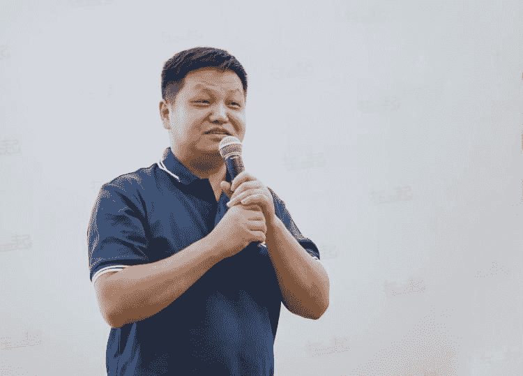
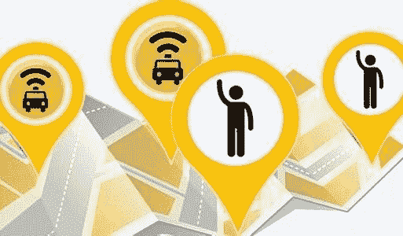
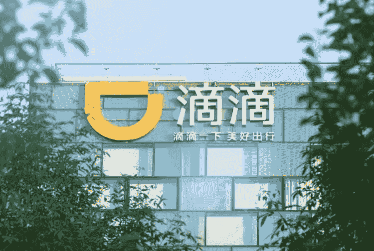
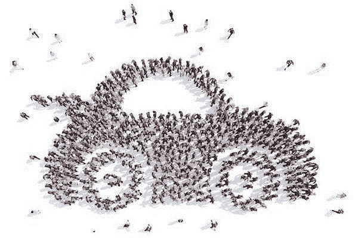

# 专访滴滴产品高级副总裁俞军：做一个非标准化的产品真是太特别了-品玩

> 来源：`https://leonzhang.feishu.cn/docx/DNDfdIE9JongEZxR2Bbc4fQ5nfh`

> 🔗 原文链接：`https://www.pingwest.com/a/129958`

“我有时下班打个顺风车，周围几大公司（滴滴、百度、新浪、网易）的产品经理都会来接我。因为我用的是真名。”

说这话的人是俞军，中国互联网最早的产品经理之一，前百度产品副总裁，人称“贴吧之父”。一年多前，他加入了滴滴，担任顾问。现在，他是滴滴的产品高级副总裁。

作为中国互联网许多产品经理的偶像，俞军的“产品方法论”一直为后辈推崇，他的理念和思考影响了一代又一代产品经理。而他对产品经理这个职业的理解和招聘要求，同样有其独特的价值所在。

这两年，随着移动互联网的发展日臻成熟，产品形态越来越少突破性的创新。在互联网公司里，市场、品牌和运营的地位越来越重要。但对一家真正成功甚至伟大的互联网公司来说，产品仍然是最重要的。

PingWest品玩（🛰️号：wepingwest）为此专访了俞军，跟他聊了聊着一年在滴滴做了些什么，以及他对产品和产品经理，又有了哪些新的思考。

在这次专访中，俞军介绍了滴滴的产品经理系统。这个系统与百度、阿里等其它大公司的相似却也不同。他还谈到了如何在具体的招聘与晋升中融入他的人才观：“一般的产品经理要在一个领域扎根，天赋优秀的则应该多在不同领域积累不同经验。”

关于滴滴的产品，俞军说“站点拼车是今年上半年最重要的事”，根据用户需求，他这一年的工作主要就是不断提高产品效率，而之前外界盛传的滴滴要做的社交方向，目前还只是在排期当中。

俞军过去不太看闲书，但现在他的办公室里摆了一堆《经济学原理》、《经济发展理论》和《统计心理学》等经济学专业书籍，这是俞军的变化，也是滴滴的工作要求的。俞军认为：滴滴的产品设计与业务模式既不是完全的“自由市场”和第三方平台；也不是一刀切的“计划经济”与企业定价。为此，他要多补一点经济学的常识。

滴滴出行产品高级副总裁俞军

以下是专访的 Q&A ：

## Q：此前你曾把产品经理按天赋分为 ABC 三类，那么不同的产品经理该如何培养？

A：C 类产品经理肯定还是有机会改变自己的。站在他个人的角度，可以去找低迭代、周期长的产品慢慢积累。有的行业可能是三五年迭代一次，像汽车行业，慢慢积累下去，总会比没积累的人更有优势。这些行业可能就是按部就班，尽力去做，你的价值总会产生的，所以从个人来说总是有机会的。

但是从整体行业来说，C 类产品经理的提升还是会较慢。从公司的角度，A 类的产品经理难找，B 类的并不难找，但发展快速的产品一般很少用 C 类。

我刚来滴滴的时候，ABC 产品经理的比例是 1 : 7 : 2，现在大概是 2 : 7 : 1。

过去一年招聘入职的产品经理可能有一百多个，但是离开了的也有四五十个，中间实现一定的流动，有十几个我还是挺满意的。但好的产品经理还是很难找，这也是我花那么多心思，平均一个月也只能招到一个多一点的原因。

我其实不太干涉产品经理的业务，而是让他们自己互相学，感兴趣的，能发挥效果最好。因为我们内部有活水制度，如果不愿意做了，或者更喜欢别的，可以内部互相转。

我的观点是，如果产品经理天赋弱一点呢，你就在某个领域扎根，不断积累。

但优秀的产品经理不应该这样，他应该经常换换领域，然后在不同领域积累不同经验，不管是不同业务还是一个业务上的不同岗位，无所谓的。他只要进来，不管去哪个业务我都高兴。只要是优秀的，他在这做一阵，你建议他换一个业务，有可能自己也会成长，而且这个业务经过一个更优秀的人过滤一遍，肯定也会有创造和提升。

## Q：产品经理的同理心是天赋吗？可以培养吗？

A：同理心跟跑步画画写作一样，是一个天赋，毫无疑问。但因为同理心在产品上的用途不是像跑步写作一样去争第一，不是要得世界冠军或诺贝尔文学奖，他只要达到某个程度，工作中就够用了。所以对大多数人来说，只要努力就行了，还轮不到拼天赋的程度。

努力主要从三个字上提高：愿、阅、历。

历，就是亲自经历。某一种产品用户感到痛苦，如果你自己亲自用过，这个经历是最扎实的。所以不管你做哪个产品，能自己用就用一下。当然有些产品可能很难自己去用，但这是最有效的，要多用。

阅，就是看别人用。不管是文字语音图片视频等，他们是怎么表达某个产品的满意或不满意，观察他怎么用，反正都是这些信息。你也可以从交流、用户反馈，从其他各种渠道，不管是自媒体或者媒体，都可以。

你真的愿意去了解别人，站在他人的角度。有些人很冷酷，他可能很聪明，事情都明白，但他可能不愿意站在别人的角度去思考，他想我跟你根本就不是一个同类，不是一个级别。愿意站在别人的角度去考虑，这个事情特别天生。

基本价值观和理念，最核心的，还是以用户为中心，围绕用户去做产品。

## Q：怎样判断一个人有没有产品经理的天赋？

A：在知乎上有一次看到一个回答，回答地挺好的，具体想不起来了，就把他招进来了。我以前就强调以文取人，看他回答这个问题的逻辑，反正不能出错，你得足够严谨。

我举一个很特别的例子。因为 滴滴所有核心骨干成员，都得每个月去开车 。我有一次跟另外一个同事两个人出去开车，同事每见到一个乘客都要问他一个问题，站点拼车等待有没有不满意。其中有一个人，他说了一句话，我就觉得这个人适合做产品经理。

后来我想了一下自己当时为什么有这种反应，其实也就是两方面，一个是逻辑特别严谨；还有一个，明显他回答那个问题时，他想过了你为什么问这个问题，你想要的是什么，然后他在回答之前也思考，不光是自己怎么回答这个问题，他会站在更上帝的视角，会思考其他人怎么想，会放在一个大环境中把这个想法概括出来，更跳出问题。所以只要一句话，就能看到他的思维方式不一样。

有这种思维方式，那做产品经理，反正基础领域知识都可以学嘛，熟练度可以锻炼。所以我在知乎上看问题也是两块，一个他的逻辑严谨，无懈可击，肯定他自己很多自我批判性思考过；然后说话内容，能感觉到他有没有站在别人的角度思考，那种同理心。

都有的话，那肯定是好苗子了，叫过来聊一下，确实不错，然后就让他挑业务，他本身是产品经理，但是才刚毕业。

有的时候我说这个人潜质高或不高，还要看分母的。同样能表达同理心和逻辑到一个程度，但如果五年才做到这个程度，跟只要一年就做到这个程度，那明显天赋不一样。所以有的人只是大三实习生，能回答成这样我觉得已经很厉害了，可能另外一个人回答地比他还好，但已经做了五年，就知道年轻的人更厉害。分母不一样，同等分子下，肯定挑小分母的。

## Q：滴滴怎么建设产品经理体系？

A：大概是三个方向。

1） 内部的培训和成长。

大一点的公司内部往往都有从低阶中阶到高阶的各种培训，鼓励他们自己去总结写作方法论，跟外部交流，内部的各种案例复盘，这些例行常规的制度，逐渐建立起来。

2）我们的职级体系，比较有意思。

我们现在新人职级是 D5，但是一般一年以后没被淘汰的话就是 D6。这个什么意思呢？就是新人第一年反正不用比职级吧，然后第二年也不用比。基本上要到第三、第四年，你就要挑战一下看看能不能到 D7。所以前三年你就完全不用把心思花在，我是什么职级，我要为职级做什么，选什么项目或者学什么，不用想这些。

我觉得这样的体系能把大量时间省下来。有些公司的经验教训是，太多人把太多心思花在如何升职上。那我们这么设计就是说，你前三四年都不用想升职这个事。就算三四年以后你想这个，你也不用按照职级标准一行一行地看，我要准备什么，做什么项目，要发展什么能力，下次才能升职。

那个没用的，虽然滴滴一行一行的规则也有，跟有些公司相似，但我们这边的评审机制本质上是一个大众评审团。比如说你要申请 D7，那就凑六七个 D8 过来评审，你讲完以后他们也会有细项写下来。

但是最后最关键的是让评审团来评审：我觉得他是 D7 还是 D6，然后在 D7 的多少百分位。比如，我听了他的评审，我觉得他是 D7 的 20 分位，意思就是他在 D7 里比百分之二十的人厉害，如果在 80 分位就是比 D7 的百分之八十的人厉害，还有的可能认为他只有 D6，但是在 D6 里是比较好的，90 分位，60 分位。

然后把大家的评审结果综合起来一看，他是 D 几的多少分位。基本上我们产品委员会不怎么干涉大众评审团的结果，其实这个评级相当于大家的一个公投。

而且因为我们这个团队还不太大，整个公司一共三百个 PM，所以互相的工作多少还有一点了解和交集，这样你真的不用费什么心思在评审升职，还是得平时工作做好，大家自然多半都能感受到。

所以我觉得我们这个职级体系，是帮大家省时间。大家只要做好工作就行，不用想太多。所谓的跟百度阿里对标也不是完全对标，只是钱能对标，只是一开始大致按这个来的，但是后来因为也一年多了，根据各自情况也有一些变化。

3）产品理念，产品基因。

我希望帮助滴滴有三方面的价值。一是用户价值理念。其实滴滴的价值观里面第一条就是创造用户价值，它不能保证你成功，但是所有成功的大公司，这是一个基本的点，没有这一点就算成功了也做不长。所以我觉得一个是用户价值理念不断强化。这不是我给滴滴带来的，但是我希望这一点不断加强。

第二可能特别一点，倡导产品经理的 ownership 的理念。你是这个产品的主人，你要把它当作自己的。从全局的角度看，什么时候该做妥协，什么时候该做权衡。而不是说我只代表用户，只代表我这个业务，或者只代表我目前这个层级，这都是不对的。你就是这个业务的主人，你怎样考虑站在长期发展和各方面的均衡。这个理念可能就不是每个公司都在推行的。

第三是崇尚人才的理念。我会不断地跟那些核心骨干的 PM 说，你未来两三年主成就是取决于你手下的、你招进来的人的水平，是他们的成长速度，而不是取决于你自己多能干。强调到现在，大家应该都能感觉到变化，会特别在意能否招一个 A 类人才，总想着什么时候该多招一个A类人才。就是一种重视人才的理念。

除了领导者、核心的骨干 PM，其他有些 PM 可能会想，厉害的人来会不会跟我竞争。那我一般会去说，我们每个人的产能，不光是取决于你自己的能力，更大范围是受限于你周围人的能力。如果你周围人的能力强，你的个人产能就会增加，如果其他人都是 A 类，哪怕你自己是 B 类，你的个人产能也会很强。包括研发、运营，你这个公司其他人的能力高低，也会影响你。

实际上，A 类人才的比例逐渐提高的时候，你会发现产品文化、产品氛围会很明显地提升。如果你这个团队里只有一个 A 类，那氛围可能会受其他人影响；但是变成三个A类的时候，你会发现不一样。如果四个五个，其他人喜欢产品的热情都会激发出来。

我并不是只想招 A 类，我觉得 B 类的进来，只要对产品有热情，我也都是很喜欢的。你会发现他的产品成果，和那些 A 类潜力但是产品热情低的，比起来是 B+的人，可能更好。有热情和没热情，这一点很重要。其实无所谓 A 还是 B，只要有产品热情，产品热情是可以通过文化来激发的，激发了以后大家都会成长更快。基本上 D7 以上的 PM 我都会面试，只要几句话就能知道，他是一个职业经理人，把这个当成一份普通工作还是真的喜欢产品。

## Q：怎么去定滴滴的产品大方向？

A：一切从用户价值出发。用户不满意的是哪些点，然后用户想要的又是哪些点。

这方面有很多渠道，反馈非常多。我们自己用的，包括产品经理工程师，其他高级负责人，外部合作伙伴，🛰️朋友圈，能收集到非常多。只要你筛选、铺开来，永远有一大堆的需求词，然后判断，一个是痛点在哪里，一个是想要的点在哪里。然后去分析每一个点的占比，它能影响多少人，这些人受影响的程度如何，排影响程度，排完就看那些比较高的。还要看技术资源投入，这是比较容易解决的。哪些是长期的项目，大概这样排一排，列出来。

当然这是常规步骤，但对于一个产品经理来说，永远要在想，最关键的、收益最大、能够引起质变的点在哪里。因为一个科技公司不可能靠常规的优化维持增长，必须要想真正能引起质变的是什么，是哪一个痛点或者引入哪一个新要素。

反馈也得做，因为你也会在反馈里激发灵感，也许某一个细节是关键点，你不做那么多事就发现不了。当然也有可能你做了很多事也没有关键点，那正常的优化还得去做。但永远要留一部分视线一直在找，真正能引起质变和下一个能引起质变的主要增长点是什么。

滴滴这边目前来看主要是拼车，但它是一个长线质变，不是说我今天上了明天就很明显的变化。我知道它一定会质变，但可能需要半年一年慢慢优化，市场渗透率和接受度也需要时间。

## Q：滴滴有收集到乘客社交的需求反馈吗？

A：乘客社交当然也有，用户群这么大，总归会有人提出来。

目前在顺风车方面，确实有相当一部分比例是有社交需求的。比如司机挑乘客。有些司机反正就是上下班，顺手带了，补贴点油钱，就不怎么挑；有些司机，比如像中关村和西二旗一带，他就想挑科技公司的员工，交流交流。

比如我自己，我下班有时会使用顺风车，周围公司的产品经理都会马上来接我，因为我用的是真名。这也是一种社交。

顺风车的社交便利性肯定跟快车什么的不一样，有一些，但也不能做的太重。因为还得兼顾其他的用户需求。所以社交有做，但不是特别大的重点。快车这边社交需求就比较少了，可能当年滴滴刚出现的时候有些人开着车去故意社交。现在有时我也能碰到一些老大爷觉得闲着没事出来聊聊天，但那是小众。

社交方向还有一个，我们做拼车，后面就考虑做定向的企业内拼车。现在拼车是任何人都互相组合的。虽然效率最高，但有些人就不太愿意跟别人拼车。但比如说，我们在同一个公司，不管是腾讯、PingWest 还是滴滴，上下班往往还比较一致。尤其这些大公司，大家往往住在回龙观，如果我们是一个公司的，大家就愿意拼车，那这个社交概率肯定就上来了。这个现在还没排上，但是往这个方向做了，肯定会出现社交的。

自然而然，乘客和司机有一个互选，顺风车就是两个司乘互选，只有互相 match 的时候才能社交。互相不 match 只有一方想社交，每个男生都想要个美女，那哪有那么多美女供应？美女还不愿意呢。

所以社交大概是这样，会有一些，但不是主流，对产品的大的推动也有一些。

## Q：接下来一段时间，滴滴的产品重点在哪里？

A：其实还是一个供需平衡的问题。

因为我们这个商业模式很特别，别的大公司都没有遇到过这样的问题。

它是一个注定供给小于需求的业务。 你说做一个搜索引擎，做一个 feed （动态信息流）新闻，哪怕是做社交做游戏，做个电商平台，你从来不担心没有供给的，可能极少数时令商品水果什么会缺供给，其他的都是只要越来越多人来用就好。社交也好游戏也好，内容更是越多越好，商品也是越多越好，他们公司的重点就是找需求找需求找需求，供给组织一下就行了，不是难点。

但在我们这个打车的模式，用户的需求是无限的，人民群众提高生活水平的需求。大家都想打车，只要收入增长上来，那更多的需求就会被释放，所以需求越来越大。但需求的增长速度肯定高于车辆供给和道路供给的速度。所以时间长了，终局一定是供给跟不上需求的。这是一方面，大的趋势。

然后具体的，有一个时间空间的问题。早高峰一定是供给不足的，因为突然想打车的人多了很多；一下雨，天一热天一冷，需求又会涨，可能涨百分之 30、50。但供给，司机不会突然多出来的，最多也就是多个三个五个，努力调度一下也就出来了。但是需求可能一下子多 30、50。

这是时间，然后还有地点。同一时间，这边空的空死，那边忙的忙死。市中心三环内，人多吧？但司机没钱，他是不能住在市中心的，都住在五环外或者更远的地方。早上司机还没进来的时候，市中心一大堆想要叫车的，肯定是需求远大于供给。司机也不愿意过来，我开二三十公里进来就接你一个客，供给总是小于需求。

有些城市有些阶段，供给需求会平衡一点，但这是阶段性的，长期而言滴滴的模式跟其他模式就是不一样，它是很特别的。

那我们就要花很多很多精力去解决这个问题。因为你供给小于需求，这么多人，不同的社会环境，他们又不会理解。每天可能有很多人是叫不到车的，那这些人肯定得骂你。虽然也有一部分人是能理解这个模式的，但总归有人不理解不满意。

这个压力很大，我们特别谨小慎微。要解决这个平衡，供给要努力去提升，然后包括供给的效率，派单的效率，还有增加拼车也是一种效率，反正各种能提高效率的做法。

但是效率是一点点提升的，而需求这边那么多人要打车，到底满足哪些需求呢？比如说常客，就是经常打的，会员制；还是说大家就是排队；还是通过一定的动态调价，价格杠杆；再或者通过一些组合，有一部分人就是可以有优待，比如老弱病残。

滴滴这边的压力很大。动态调价是不是要有所控制？已经有所控制了的话还要找其他方式，去实现需求和供给的，一个是匹配，另外一个其实是挑选需求。总归每天有很多人打不到车，那让哪些人打不到车呢？怎么合理地先满足部分人的需求，怎么实现既公平合理、又经济效率？

这个东西我觉得能做很多年，而且业务越成熟，越要有足够多的精力花在这里。 大数据，伦理，经济学研究，我们找了很多经济学家，心理学家，去研究去探索。所以我们这个业务的复杂性很有意思，海外很多华人教授，他们都很感兴趣，一听这个业务模式都愿意参与。因为这个对他们挑战太大了，从来没有过这么有意思的东西。

具体的话，目前拼车是比较明显的一个方向。因为它有多方面的确定性，然后是定价的探索。再比如排队，目前中关村、国贸等地在试点，原来晚上下班人多的时候，打不着车还在一直等，有不确定性。但是现在就可以排队，告诉你前面有多少人，你排在第几位，过不了太久就会全国推行。但是全排队也不行，有的人可能有急事，你得给他一个出口，用什么方式去识别，这个也够探索了。

## Q：乘客最关心的还是价格，滴滴怎么做动态调价？

A：我们的业务模式是非标商品，这也是商业模式的一个特点。你真正提供给乘客的服务，只有一小部分是能感受到标准的。 比如 App 的体验，售后的客服，派单时的效率。

但是很多时间，中间在车上，包括司机接驾，电话沟通，行驶过程的安稳程度和服务态度，体验是通过这些决定的。每个司机又不一样，同一个司机他做每一个订单的时候心情好不好也不一样。这里面特别容易起冲突，每一单都不一样，总会有概率产生冲突，你怎么去判别公平。

# 业务公平性与定价机制

## 公平性的理解与争议费用承担

公平性的理解又涉及到无数立场，所以为什么我们要请经济学家、心理学家去参与业务，因为这个很有意思很复杂。规则的公平性总归要逐渐提高，才能让业务稳定。一些争议机器和人工都判断不清楚的，目前是平台来承担这部分的费用，比如空驶补偿费。

## 动态加价与价格杠杆

关于动态加价，我们已经建立了封顶机制，但通过价格杠杆可以来识别有些乘客是真的着急。有乘客投诉说，他真正着急的时候怎么样都打不到车，他说你别给我这么多选择，我就一个选择，只要能打到车，我加一百块也愿意。

那怎样满足乘客最需要的那个需求。这个能做很多年，要各方面的支持，不管技术产品的，还是经济学的心理学的，还是大数据的。

## 平台模式与定价权衡

我们接待过一个大经济学家，他一来就问滴滴的模式究竟是平台还是企业。平台就像有的电商，是不定价的，反正无数卖家买家在充分竞争中去议定一个价格，但企业就是自己定价。

算来算去，我们这个模式很特别。自己定价效率高，但一旦自己定价，肯定两边都得罪。乘客永远希望价格越低越好，不管你定什么价，他都认为你定高了，是奸商；司机就永远希望价格越高越好，不管你定什么价，你肯定低了，偏袒乘客。所以这里面的权衡很重要。

也许未来会是组合模式，一部分可以是双方自由定价，但主流可能还是得中间给出一个建议价。

## 临时市场与撮合效率

这不是一个可以充分自由竞争的平台，不是那种无数司机无数乘客有充分的时间互相选的，它是一个短时间、小地域的临时市场。你发一个单，附近三公里内有一百个人和三十辆车，而且几分钟内需要撮合交易。过了这几分钟，车就开走了，乘客就放弃或者换其他交通方式。所以必须在几分钟内撮合交易，每拖延一分钟，司机的收益都在损失，乘客也在损失。

它不像大部分商品，早买一天晚买一天，其实没有太大差别，商品永远在，买的人不见得那么着急。但打车这东西大家都是希望几分钟内撮合交易的。

## 自由市场探索与派单模式

提供一个平台给双方充分议价也可以。顺风车其实就是这样，选择时双方都可以看到对方。现在是选择人，以后还可以选择价，每一方自由报价，但这个效率就会很低。有一部分对互联网特别熟练的人会觉得特别好，能选最低价格或者同样价格最好的车，这个比例很低。

对百分之九十几的用户来说，快点打到车是第一诉求。你只能通过综合运算，推荐出这个时间这个地点，差不多的价格，考虑到一点供需关系，推荐给他。

我们也在探索，符合某些条件场景的前提下，确实就是可以给大家自由市场的。还有些场景，给一个建议价，允许适当调整。但一定得是乘客发起，因为乘客是付钱方，司机发起的话又会带来问题。

这些都还没达成结论，只是说这个方向，然后我们持续在探索。大多数情况下还是只能给一个价格，提高效率。早期业务都是抢单模式，订单出去司机抢。后来发现这个效率太低了，还是派单效率高，虽然派单肯定也有一小部分伤害，但大部分情况下效率是高的，对司机乘客都是有利的。

# 用户情感联系与个性化服务

## 情感联系的建立基础

**Q：致力于提高效率的滴滴，能像其他一些互联网产品一样与用户建立情感联系吗？**

A：肯定是能的，因为我理解的用户价值就是钱、时间、身体和情感。尤其情感是更复杂，潜在空间更大。以前我们在这一块是真不擅长，其实优步做得挺好的。

现在基础还在加强建设中，你要做情感联系，但你不能脱离用户，是不是真的把用户当一回事。不管是从产品效率，还是从客服，或者产品的功能和理念上，先把这个价值观做扎实了，再去做情感联系就顺理成章。如果你产品的基础存在问题，那你找个品牌大师来也没用的。

目前情感联系这方面我们确实比较弱，这个问题我回答不好，也不是我擅长的，但如果以后公司里同事有好的想法，我觉得我是能看明白的。我能做的就是，在产品功能方面，能让用户感到更满意，更个性化。

## 个性化评价与屏蔽机制

比如说评价，除了从一星到五星，不同产品有不同的评价方式。有一些正在做试验，更人性化、更活泼的也在试，不光为了有效率地获得数据。另外我们也在考虑，比如一个乘客说我对这个司机不喜欢，他可以选择以后打车就屏蔽。

由于职业特色，一些司机因为住的近经常在一个范围内开车，其实重复接到一个乘客的概率也不小，那乘客如果不喜欢就可以屏蔽掉。有些司机对好多乘客的行为也不满意，那理论上司机也可以屏蔽乘客。这个我们都会去探索，最后拿数据或者市场意见说话。

如果你给了双方这种不满意就可以屏蔽的权利，我觉得肯定也是一种收益。

## 个性化需求与专车服务

还可以做更多个性化，你喜欢司机打电话还是不打电话，真的有这两种人的，还有打车喜欢开空调还是不开空调。有的乘客不喜欢跟司机说话，有的不要车里有音乐，这些都已经扔在需求池里了。

这些做多了，你再去做产品跟用户的情感联系，就容易多了。上半年我们还做了一个宝贝专车，自带婴儿座椅的，量不大。但是有小孩的乘客要出去的时候确实会感觉不一样。还有残疾人可以坐轮椅的专车，那个量更小，但是那个方向口碑太好了。这样的事，我觉得还可以探索很多。
