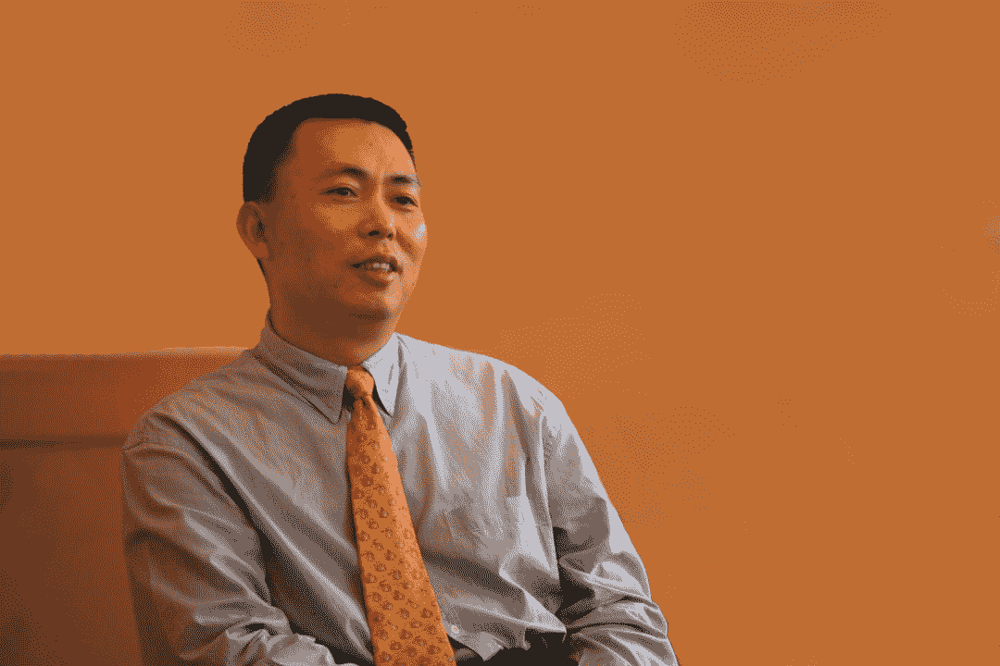

# 段永平：假装会投资很危险的

> 来源：[https://leonzhang.feishu.cn/docx/D1lmd1sFSocGCaxlpUCcni8vnTc](https://leonzhang.feishu.cn/docx/D1lmd1sFSocGCaxlpUCcni8vnTc)

**定性比定量分析重要****，最重要的****是商业模式

1.  这个****世界可能有几十几****百个甚至更多的行业和行业状元****，但商业模式好的凤毛麟角。用****找行业状元****的办法就会****很容易去投那些商业模式**不好的“行业状元”，那些状元很可能只是昙花一现的辉煌而已。

2.  如果你心里有（好的企业文化或商业模式），最后能找到的概率就会大很多，虽然这个概率也还是很小。但如果你心里没有，最后能找到的概率可能会很接近0。

3.  没把商业模式放在第一位那就基本上还不太懂生意，投资会蛮煎熬的。

4.  我不意外巴菲特会卖掉台积电。虽然台积电非常了不起，但商业模式有点累，实在是太重了。

台积电一直非常专注在他们做的事情上，结果也确实非常了不起。但投资是全方位比较的，我会更倾向于商业模式更好一点的公司。

5.  定性比定量分析重要，最重要的是商业模式。商业模式把绝大多数公司都过滤掉了，定量分析的重要性一下子就下降了很多。所以这些年想通了的最重要的一点就是商业模式。这点通了以后，投资确实就变得非常有意思了。

6.  投资到目前为止我还真没看过财报，也许确实有点看不懂（其实就是因为懒），也许真的觉得没必要。我见过太多很懂财务分析的人们对投资可真是一头雾水哈。

差异化是“用户需要但同行还没满足的东西”

7.  广告其实蛮简单，就是尽量用高效率传达给自己的用户或潜在用户一个或某些信息，让他们关注自己的产品。

8.  差异化的定义就是：用户需要但别人没能满足的东西。

“差异化”不是简单的不同，而是“用户需要但同行还没满足的东西”，潜在前提是至少要有“同行已经满足了的用户需要的东西”。

9.  所谓“秒成”渣渣的实际上本来就是渣渣。

10.  在有好产品的前提下，渠道会变得没那么重要。最好的渠道就是像苹果店这种模式，渠道完全和公司文化吻合，不然就是尽量朝这个方向努力。

11.  企业文化不好的公司长期必然日子没那么好过，好企业偶然也会有难过的日子。

12.  多元恶化一般是主业不够强，想靠多元化找出路，结果找了一条岔路。

13.  我如果不信任公司的文化和管理层了，我会决定离开的。对我来说，要搞懂公司经营的每个细节来决定投反对票还是赞成票是件很费时的事情，比搞懂商业模式或者是企业文化可能还要难。

如果整体上我看不懂公司的某些重要行为，我多数会选择离开，虽然这样也会犯错，但比老是很膈应要舒服很多。

苹果推出产品最重要的基点，是“我到底能为用户做什么”

14.  （谈苹果首款MR）想尝鲜的人很多，我觉得100万绝对打不住。关键在用了以后的反应，如果大家真的喜欢，那可能是千万级的产品。

15.  苹果进入一个产品的时机往往不是因为苹果在择时，而是因为苹果在这之前还没准备好或者说苹果还不满意自己的产品。

苹果推出产品的最重要的基点是“我到底能为用户做什么”。很多年前，网上疯传苹果会推苹果电视，我说那么大一台电视，苹果能做什么？结果苹果确实没推。

16.  我依然很难找到苹果会推苹果车的逻辑。苹果车到底能给用户带来什么巨大的用户体验改善呢？在可预见的未来，比如5-10年内，我们大概率是不会见到那些假视频里面的苹果车的。不过，苹果的Carplay确实很好用！

17.  （谈库克退休会不会对苹果造成影响）短期应该不会的，后面就要看库克是不是选对人了。选错了也没关系，但要看能不能改过来。

库克是选错过人的，原来那个卖奢侈品的女士管了苹果零售店，结果不到两年就换掉了。代价非常大但不换的代价更大。

当时我其实蛮纳闷的，为什么库克不从公司内部找一个人而是从外部找呢？我曾经当面问过库克（那时刚刚宣布这条消息），为什么选她？结果他把她狠狠滴夸了一通。哈，看来最后还是我对了。

不过，从这件事情上看到苹果的纠错能力是非常强的，发现错了就马上改，虽然有时候也会等三年（大屏手机）。

18.  （谈库克的工资）如果我是这家公司的“老板”，我觉得一年给10个亿也是便宜的不行了。公司一年赚1000个亿，10个亿才不过1%！大家可以统计一下所有的上市公司，看看赚到1000亿总和后，CEO们的薪水和奖励的总额是多少。

茅台早晚会到五万亿

19.  我买茅台的时候好像市盈率也不高吧？我不太记得，只是关注商业模式了。PE太高不买多数情况下是对的，我也不喜欢买PE高的公司，除非看到未来了。

20.  好像还没看到（茅台）比以前更乱搞的迹象。不过，我确实不喜欢他们去投资非相关产业的任何东西，我觉得那种钱长期来说不如回购。

21.  我觉得茅台早晚会到五万亿的，但确实没想过要多久，大概率不会是五万年的。

22.  很多人觉得酒的生意很容易做。我不太了解酒，但很容易看到这么容易做的生意这么多年下来能活好的牌子非常少，这里面应该有点啥道理在里面的。

“敢为天下后”的前提是能够“后中争先”！据说大概需要3-5倍于对方的兵力才有机会“后中争先”的。觉得自己有点钱就去卖酒我觉得属于“无知无畏”，他们对品牌是什么真的是一无所知哈。

23.  可口可乐配方最厉害的地方是喜欢喝的人喝不腻。让每个人各喝五罐就知道区别了。

投资和投机

24.  看到巴菲特之前，（我）没怎么碰过股市，因为觉得那是个投机的东西，不想碰。直到看到老巴后才突然想到，搞懂公司我应该比绝大多数人在行哈。

25.  赌好公司下跌或做空好公司是非常艰难的事情。

26.  我是一个满仓主义者，我管的投资里美股主要在苹果，A股主要在茅台，港股主要是腾讯。用来卖put的部分是很小的娱乐部分。当然，不懂的话，“娱乐”部分很可能会变得一点都不好玩。投资经常是件很无聊的事情，不折腾不好玩，折腾会经常更不好玩。

27.  我的“满仓主义”最大的特点是不太在意“择时”，但非常在意“商业模式+企业文化”当然前提是10年后看回来的价格是便宜的。“满仓主义”不意味着就一定要满仓，没有合适投资标的时（包括价格过高时）是可以拿着现金的。

28.  我只投资！投机只是小游戏，而且我这种“投机”赢得概率是远大于赌场的。

不择时不是追高的理由，是否卖出和眼前PE无关

29.  我看到有些人手里拿着钱，看见别人赚钱心里着急。眼看着股价越涨越高，心里跟着越来越急，最后在“不择时”的鼓励下，一咬牙一跺脚就冲进去了。“不择时”不是追高的理由。

真正不择时的人是真的看十年的人，而且人家钱大多早就已经在投资上了。追高不择时的人们实际上对短期的下跌是非常难以忍受的。

30.  “不择时”我的理解大概是：当我觉得从10年的角度看不贵而手里正好有钱的时候就可以买了，不需要等更便宜的价钱，因为这个价钱从10年的角度看已经很好了。

31.  很多人以为（买股票）是狩猎，其实是农夫种田。

32.  （是否卖出）跟眼前多少倍pe其实没关系，但和未来30年的生意状况有关。

33.  没有10年8年的可追溯历史，很难了解一个公司，了解一个小公司几乎是个不可完成的任务，除非开公司的人刚好是你以前就认识了很久的人。

新能源车行业看不出谁是最后的赢家

34.  目前为止我还看不出（新能源汽车和锂电池）谁会是最后的赢家。汽车多少还是可以做出一些差异化的，所以汽车企业可能能活的稍微好一点。电池应该很难有差异化，所以最后的结局多是价格和规模的竞争。也许三两年，也许10年8年就能看到结果了。

35.  差异化不大的产品，不靠价格战都很难走下去。个别走的早的公司也许日子能好过一些，但也未必。

36.  我觉得20年内估计搞不掂（完全自动驾驶），但辅助驾驶可以做得蛮好了。

总有一天会全仓S&P500

37.  如果你确认你一直在想但确实又想不太明白的话，最好的办法也许就是买S&P500，然后该干嘛干嘛去？对很多人而言，花太多时间在“投资”上不值得，这和你的学历没关系。

38.  我总有一天会全仓S&P500的，但目前还没买过，因为我觉得我还可以比S&P500表现好一点点。等库克退休后我就开始考虑如何转到S&P500的事情。

因为我觉得很长的时间里，苹果的表现会比S&P500好，哪怕是库克退休以后。。

39.  持有S&P500其实就是投资在美国经济的长远发展上。我觉得S&P500未来的发展依然会不错，除非我能找到我确信能好好投资的人接替我，不然我就都买S&P500了。

抄作业买西方石油

40.  我啥都没看，就看到老巴买了二十几个百分点（西方石油）。我知道他是认真的，就跟着买了差不多100万股。我不会加码也不会花时间的，反正花时间也看不懂。

那么多人看了那么久苹果还是一头雾水，凭什么我能很快看懂这个？不过，我看懂老巴了，所以跟点好玩。我很难在这个公司上赚到大钱的，一年内赚个十几个点就心满意足了。

41.  其实有点像老巴买的动视暴雪，老巴就是相信微软会买，他就买了点。千万别以为老巴懂暴雪，也千万别问我西方石油是怎么回事。这个行为简单讲就叫套利，当然也有被套的概率，但非常小。

42.  （谈巴菲特买西方石油）感觉到Warren买铁路公司的味道了。

第一共和银行这种飞刀最好别接

43.  券商的差异化一般很小而且转换成本也很小，所以一般来说很难是特别好的投资标的。

不过，客户在嘉信理财里面的资产绝大部分都是有保险的，所以应该大概率是安全的，除非客户本身用了margin。

44.  我知道银行是干什么的，但觉得这个商业模式很难理解，因为有很多贷款，始终搞不清风险到底在哪里。其实国内银行普遍很着很便宜，但看着也很深的样子。

45.  经过这次风波，FRC（第一共和银行）如果能活下来也可能要很长时间才能恢复元气。我猜很多人都把钱转走了，包括我自己在内。

ChatGPT 非常值得关注

46.  （谈ChatGPT对谷歌的冲击）我认为Google会很快作出反应的。Google在搜索和AI上都很强，过去的小日子太舒服了，有点短期冲击也许是好事。这个其实也从侧面说明了Google商业模式不如苹果强大。

47.  微软希望通过ChatGPT重新激活Bing搜索，ChatGPT至少短期内会给Bing带来不小的流量的，但长期而言还是看产品。除非人们以后不用搜索了，不然Google还是会蛮厉害的。

不过，ChatGPT确实有可能会降低一些搜索的需求，或者改变一点点人们搜索的习惯。感觉未来苹果也会慢慢拿走一些搜索的份额的。尽管如此，搜索依然还是一个很重要的需求，投在搜索上的广告很可能不会因为ChatGPT的出现而有很大的变化。

48.  我以前也曾经以为搜索就是偶尔用一下的工具，后来才发现有些人工作的时候是每分钟至少要用一次以上的，这些人才是Google起来的原因！

49.  不管怎么说，ChatGPT 还是非常值得关注，虽然目前当搜索用似乎还不行。希望能逼出一个最强的Google来。

50.  人们对ChatGPT颠覆搜索的愿望有点像对实现全自动驾驶的愿望差不多，虽然我也希望他们能做到。

不过，每个人都有自己的AI助理似乎是非常可能的，效率会高不少。Google独霸天下的局面也确实会受到冲击，份额多少会下降一些。

聊其他公司

51.  （zoom和顺丰）他们都是很难的生意。商业模式不好的生意也是生意。在有个好领导的时期，有时候苦生意也能做得还不错，但对投资而言比较难。

52.  我不太理解日本商社的商业模式，感觉是个日本文化的产物，别的地方没见过成功的例子。不知道是不是有点像20-30年前满地的xx贸易公司？巴菲特先生可能是看报表发现的机会吧。

53.  一直很喜欢迪斯尼的产品，但一直没明白迪斯尼的商业模式。为什么迪斯尼看起来很强大但老是很难赚钱呢？看起来这个商业模式似乎不是那么美妙，是种很累的商业模式。不过，我还是会保留对迪斯尼的投资，毕竟属于小于1%的投资哈。

54.  拼多多财报看着还是蛮赚钱的，说明开拓国际市场并不是一个很大的负担。

55.  我确实在Temu上买了一些东西，确实便宜也能用但并不能帮助我搞懂他的商业模式，我没办法看懂10年或以后到底是个什么情况，所以我不会因为Temu改变我对拼多多的任何看法。

56.  我对Amazon的看法一直是：零售很难赚钱，云服务会受到其他大公司的影响，微软Google苹果这些公司的云服务未来会占到一定市场份儿的。简单讲，我对电商没有太多的理解，目前为止还没有任何想认真投资的想法。

57.  我看不懂房地产。房地产最重要的就是位置，这个非常难上规模。

58.  投网易时我还是新手，满仓股票半年不到涨了20倍，当时确实有点晕哈，也有过梦中吓一跳的经历。苹果我基本上没啥操心的东西，从来没试过因为苹果睡不好觉的时候。

59.  关于靠近供应链的事情，早年长虹电视很火的那段时间，有次我跟一个朋友说，长虹离供应链那么远，成本会远高于竞争对手的，长期而言他们肯定不行。

60.  经营商务机有点像航空公司，但差异化比航空公司大一些，因为客户的价格敏感度会低一点，但也不是很好的商业模式，至少比起苹果来要差很多。

61.  我买GE的时候，似乎还没有把商业模式放在第一位。那时候觉得GE的企业文化很好，“世界在变，所有的东西都在变，但integrity不变”这句话让我非常欣赏。后来发现，GE官网上的企业文化都不再提integrity了，觉得非常怪异，加上后来对商业模式的重视度大幅提高，于是突然某一天就决定都卖了。

62.  假设这个产品成立的前提下，直觉上储能的产品很难有差异化，技术的差异很快就会被抹平的，价格战会一直伴随这个产品或行业。

做正确的事

63.  做正确的事情会少折腾很多。

64.  设定投资目标是件蛮愚蠢的事情。我的意思是：当你有了每年增长多少百分比的目标之后，你早晚会做出很愚蠢的事情。

65.  复杂的事情简单做，简单的事情重复做。

66.  炒股票下不了手吗？如果你在猜下一把是出大还是出小的话，你是很难下决心的。从10年以后往回看的话，你应该很容易知道下一把是大是小并不重要，最重要是要远离这种东西。

67.  好公司不要轻易卖的一个很重要的原因是，卖了以后换什么！拿着现金一般是比较难受的，很多人很可能会因为卖掉了好公司，现金又拿不住，于是换了连盈利模式都搞不清楚的公司，开始了睡不好觉的日子，犯不着啊！

68.  改正错误要尽快，多大的代价都是最小的代价。

69.  错了就改很好，改第二次也很好哈。

70.  在错误的路上奔跑的人，谁在乎他到底犯了哪些错误呢？结局从一开始就确定了。

71.  管的多少不重要，能到老巴那个年纪还能那么厉害才是重要的。

假装会投资是非常危险的

72.  不完全懂是不应该赌身家的。不敢赌身家的“投资”其实都很难算得上正经“投资”。

73.  大道只关心自己能看懂的。只有自己看不懂的人才会到处问：你认为呢？

74.  假装会游泳是很危险的，假装会投资也一样。不过很多人不很理解假装会投资的危险到底在哪里，直到他们理解了危险。

75.  所谓“商业直觉”不应该算天赋，应该是理性思考的结果。

76.  其实每个公司最后都会成为那个他本该成为的公司的，股价也是。没有长期的莫名其妙的股价，但短期会有。

77.  “本分”是对自己的要求，而不是对别人的照妖镜。

78.  想想最终你会成为的那个你自己，也许会对你的每个选择起到一点点作用。

