# What is OpenAI, Really?（OpenAI 到底是什么？)

> 来源：[https://leonzhang.feishu.cn/docx/KN4Hdpzl3oiH00xqAyjcuiJInig](https://leonzhang.feishu.cn/docx/KN4Hdpzl3oiH00xqAyjcuiJInig)

**AI Summary: **

```
OpenAI 是人工智能领域的领先公司，也可能是目前科技界最热门的公司。然而，最近 OpenAI 发生了一系列动荡，包括 CEO 被解雇和员工起义等事件。
- OpenAI 员工在推特上发起请愿，威胁要辞职。
- Altman 和 Brockman 宣布加入微软，领导一个新创建的人工智能部门
- 微软的 CEO 萨蒂亚·纳德拉出现在媒体上，表示希望继续与 OpenAI 保持战略合作关系。
最终，经过几天的混乱，OpenAI 的董事会同意让原 CEO 回归，并组建了新的董事会。整个事件揭示了 OpenAI 非营利性和营利性结构之间的冲突，以及公司内部对于利润和安全之间平衡的分歧。
```

OpenAI is the clear leader in the Artificial Intelligence (AI) sector, an[d](https://newsletter.pragmaticengineer.com/p/inside-openai-how-does-chatgpt-ship) probably the hottest company in tech, right now. Just last week, we published the first-ever deepdive into the engineering culture at OpenAI , looking at how ChatGPT ships so ridiculously fast. The short of it is that ChatGPT is a one-year-old-startup within the 3-year-old Applied group. OpenAI has high talent density and tight integration between engineering and research. ChatGPT operates like an independent startup, releasing frequently and incrementally.

However, just days after last week’s article, the tech world was shocked as OpenAI suddenly fell into crisis – with the risk it might even cease to exist. Last Friday, the company’s board fired CEO Sam Altman, and cofounder Greg Brockman also quit. By Sunday, employees were revolting and demanding Sam and Greg be brought back. By Monday, OpenAI had hired a new interim CEO, and Altman and Brockman had announced joining Microsoft to head up a newly created AI division. By Monday night, 743 of the 778 OpenAI employees had signed a petition threatening to follow Sam and Greg by joining Microsoft unless OpenAI’s board resigned and Sam returned as CEO. That same day, Microsoft confirmed it was ready to hire all OpenAI staff.

For a few hours, there was a very real possibility that OpenAI would shrivel to 30 employees, with 95% of OpenAI’s staff becoming Microsoft employees overnight.

Finally, on Tuesday night OpenAI’s board announced that an agreement had been reached, where Sam Altman returns as CEO, the board is updated, and things get mostly back to normal.

Last week, Evan Morikawa, who leads around half of OpenAI’s engineers, sha[red insight](https://x.com/E0M/status/1727319466135236885?s=20)s about its engineering culture in this newsletter. On Wednesday, he summarized events as “the most insane 100 hours of my career.”

Today, we analyze what happened, what caused this sudden near-death experience for OpenAI, and the potential implications of these dramatic events:

1.  Five days of chaos – the timeline

1.  From nonprofit to for-profit

1.  ChatGPT too successful, too fast?

1.  Microsoft’s interest in a standalone OpenAI

1.  OpenAI’s CEO: does something feel off?

1.  OpenAI’s board: plenty of questions

1.  What is OpenAI, anyway?

We’ll use PST (pacific standard time/California time) for all timestamps. OpenAI is headquartered in San Francisco, where events unfolded

**Noon (12pm): **Sam Altman, CEO of OpenAI and board member, joins a board meeting to which he was invited. At this meeting, he’s sacked, effective immediately. The board has 6 members, including Sam. The board’s chair, Greg Brockman, is not present.

**12:19pm: **Greg Brockman, cofounder of OpenAI, its president, and chair of the board, gets a message from Ilya Sutskever, cofounder, chief scientist, and fellow board member. Ilya asks Greg for a quick call.

**12:23pm: **Greg joins a Google meet with the other 4 board members. He’s told he is to be immediately removed from the board, and that Sam has been fired.

OpenAI publishes a blog post at the same time announcing this firing, writing:

> “The board of directors of OpenAI, Inc., the 501(c)(3) that acts as the overall governing body for all OpenAI activities, today announced that Sam Altman will depart as CEO and leave the board of directors. Mira Murati, the company’s chief technology officer, will serve as interim CEO, effective immediately. (...)

> Mr. Altman’s departure follows a deliberative review process by the board, which concluded that he was not consistently candid in his communications with the board, hindering its ability to exercise its responsibilities. The board no longer has confidence in his ability to continue leading OpenAI.”

**1:46pm: **Sam Altman [announces ](https://twitter.com/sama/status/1725631621511184771)on Twitter that his time at OpenAI is over, saying he’ll have more to say about what’s next, later.

**4:00pm **[: Greg Bro](https://twitter.com/gdb/status/1725667410387378559)ckman sends a message to the OpenAI team:

> “Hi everyone,

> 

> I’m super proud of what we’ve all built together since starting in my apartment 8 years ago. We’ve been through tough & great times together, accomplishing so much despite all the reasons it should have been impossible.

> 

> But based on today’s news, I quit.”

With each development, the reaction is disbelief inside and outside OpenAI: Sam fired; what? Greg quit; how? After all, Sam Altman was the public face for OpenAI for four years; the leader who championed the wildly successful ChatGPT. Greg had been there since the start of OpenAI and was a popular leader, like Sam.

T[he sto](https://news.ycombinator.com/item?id=38309611)ry of OpenAI’s board firing Sam Altman became the most upvoted story on Hacker News in the past five years, indicating just how unexpected and impactful it was for the tech community. The story is the third most upvoted of all-time, behind Stephen Hawking’s passing , and the news of Apple rejecting to install a backdoor on iOS that the US government requested.

So how did this firing take place, and what about the board which executed it? To understand this, here’s an overview of OpenAI’s admittedly exotic corporate structure, from its website :

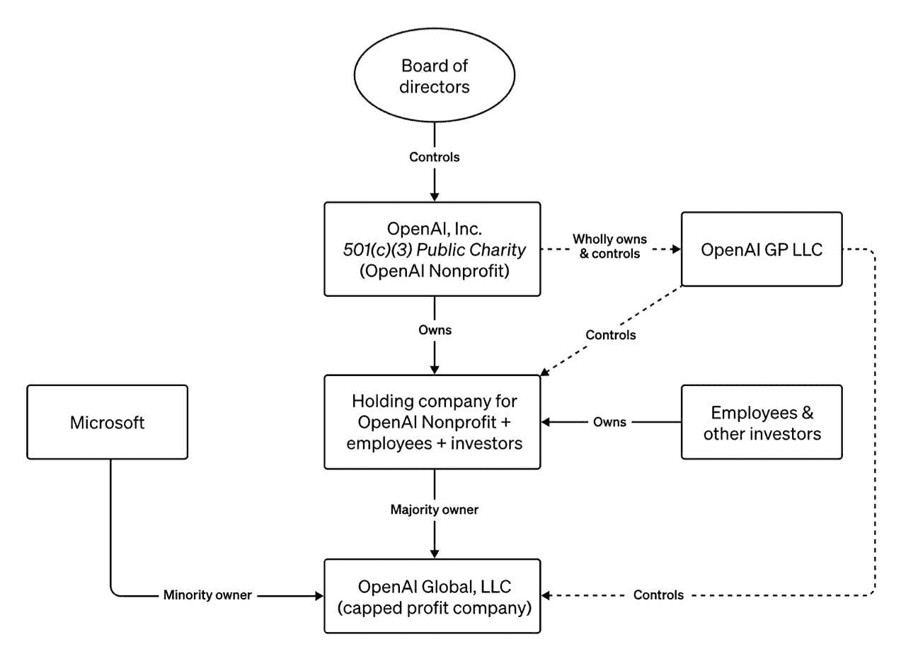

OpenAI’s corporate structure. The board controls the nonprofit, which controls the for-profit entity

OpenAI started as a nonprofit in 2015, and the board controls this nonprofit. In 2019, a “capped profit” company was created, which we’ll go into later. The nonprofit owns and controls this for-profit part of OpenAI, as well. Sam Altman was CEO of the OpenAI nonprofit, and the board controls the nonprofit.

OpenAI’s board of directors consisted of six people before noon on Friday, and looked pretty well balanced; with an equal number of employees represented as there were non-employee board members:

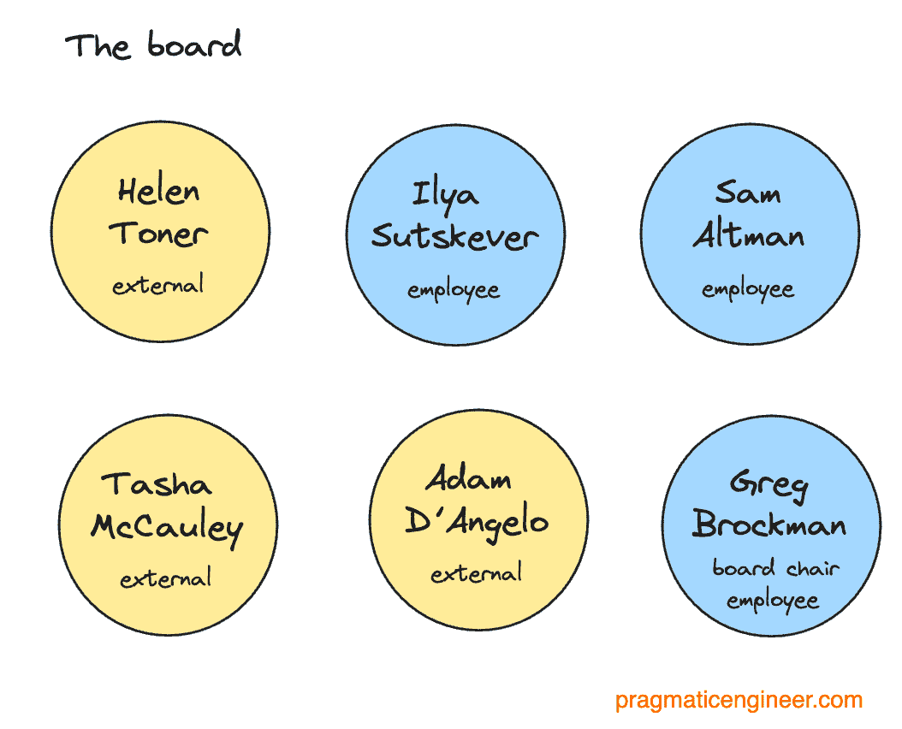

OpenAI’s board before noon, on Friday, 17 November

1.  Greg Brockman (cofounder, board chairman and president) – employee

1.  Sam Altman (CEO) – employee

1.  lya Sutskever (cofounder, chief scientist) – employee

1.  Adam D’Angelo (cofounder and CEO of Quora) – non-employee

1.  Helen Toner (director at Georgetown's Center for Security and Emerging Technology) – non-employee

1.  Tasha McCauley (CEO of 3D city modeling company GeoSim Systems; former cofounder and CEO of Fellow Robots) – non-employee

This dynamic changed rapidly, when four board members ganged up to remove the other two:

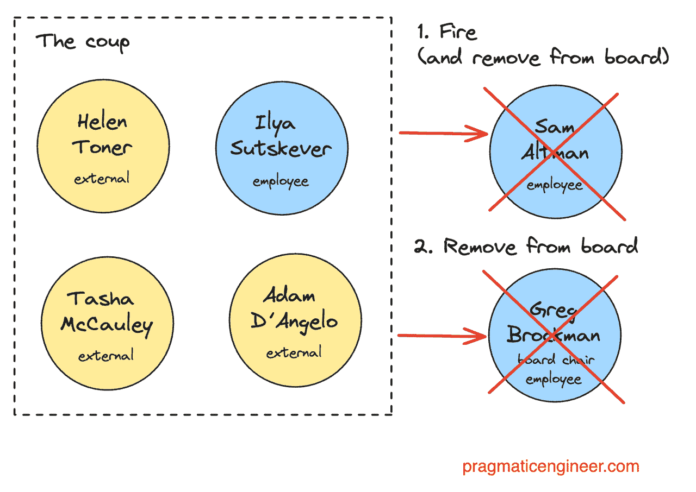

The board’s sudden and swift actions on Friday

Interestingly, the board acted without the chair, which could raise some governance questions. Also, we later learned that OpenAI’s biggest investor, Microsoft – which has invested $10B in January 2023 – was not notified of the firing in advance.

On Saturday, confusion reigned. The board wrote: “[Sam] was not consistently candid in his communications with the board, hindering its ability to exercise its responsibilities.” What did this vague statement really mean? Had Sam hidden essential details, or withheld vital information? No such details were released.

Wh[at did emerge](https://arstechnica.com/information-technology/2023/11/report-sutskever-led-board-coup-at-openai-that-ousted-altman-over-ai-safety-concerns/), however, were details on who organized this coup, and Microsoft’s anger about it. From Ars Technica :

> “The move [firing] also blindsided key investor and minority owner Microsoft, reportedly making CEO Satya Nadella furious. As Friday night wore on, reports emerged that the ousting was likely orchestrated by Chief Scientist Ilya Sutskever over concerns about the safety and speed of OpenAI's tech deployment. (...)

> 

> Internally at OpenAI, insiders say that disagreements had emerged over the speed at which Altman was pushing for commercialization and company growth, with Sutskever arguing to slow things down. Sources told reporter Kara Swisher that OpenAI's Dev Day event on November 6, with Altman front and center in a keynote pushing consumer-like products, was an ‘inflection moment of Altman pushing too far, too fast.’”

**O**penAI s[taff sign](https://x.com/miramurati/status/1721683980800684491?s=20)als strong public support for Altman. Around 9pm, Altman tweets: “i love the openai team so much.” In response, hundreds of OpenAI staff respond with a heart emoji, indicating their support. It’s rumored those responding could be ready to quit OpenAI to follow Sam wherever he goes next. Interim CEO Mira Murati also responds with a heart, indicating she is with “team Sam:”

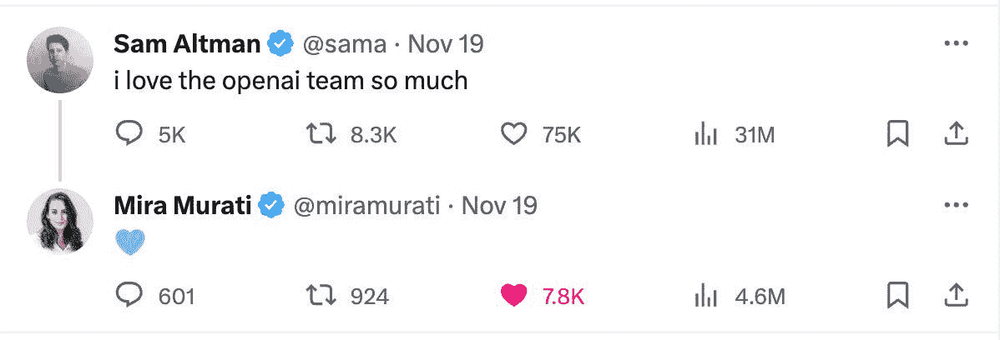

One of the hundreds of heart responses from OpenAI employees to Sam Altman’s tweet

This event was the first public indication of employees’ overwhelming support for Sam and Greg.

Investors – especially Microsoft – are unhappy, and start an attempt to reinstate Altman as CEO. As Microsoft is a massive investor, it’s reasonable to expect the company has a big say, and can get Sam Altman back to leading the company before the markets open on Monday. The markets matter to Microsoft because without a resolution, its stock price could lose value thanks to its financial links to OpenAI.

**1pm: **Altman enters OpenAI’s offices to meet the board and discuss his possible return. Before going into the meeting, he posts on social media, sending a message to the board that it’s the first and last time he’s taking a guest badge at the company he ran for four years:

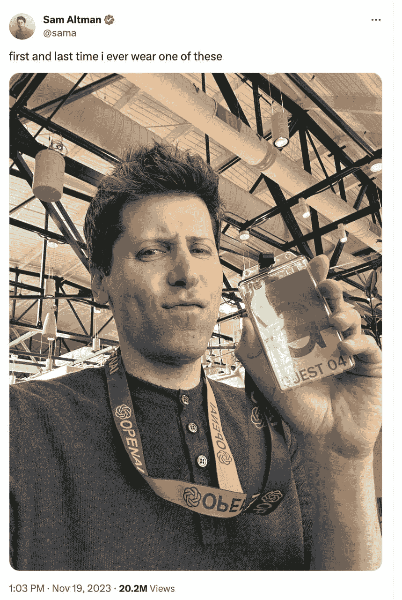

Key staff inside OpenAI who are pushing for Altman’s return to the CEO role, include interim CEO, Mira Murati, chief strategy officer, Jason Kwon, and chief operating officer, Brad Lightcap, as per Bloomberg .

**5pm: **the deadline for the board to agree to Altman’s demands. Nothing is announced

9pm: OpenAI gets another new CEO. In a further unexpected twist, the board does not announce Altman will return as CEO as investors have pushed for, but does name an new interim CEO; Twitch cofounder, Emmett Shear. He later shares that he made the decision within a few hours of getting the call from the board.

Before offering the CEO role to Emmett, the OpenAI board offered it to former GitHub CEO, Nat Friedman, and to Scale AI CEO, Alex Wan. Both declined. The board very clearly did not want Altman and was scrambling to find a new interim CEO because the first interim, Murati, also wanted Altman back:

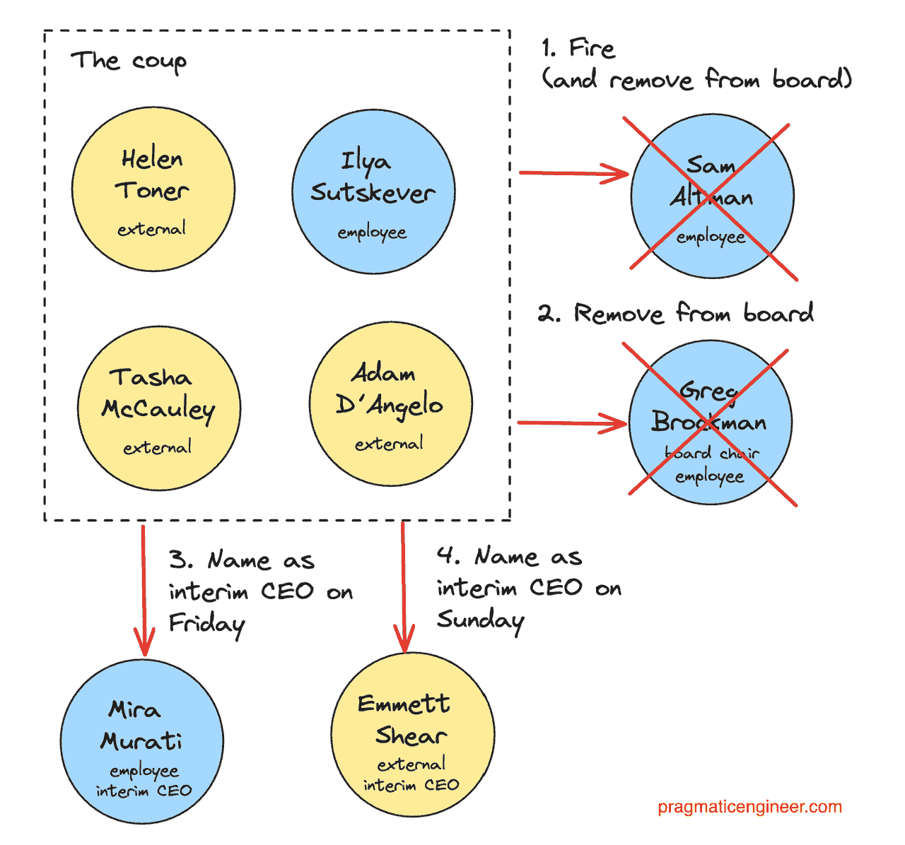

The board’s key decisions by Sunday

**Employees refuse to attend an e**merg[ency all-h](https://www.theverge.com/2023/11/20/23969586/sam-altman-plotting-return-open-ai-microsoft)ands. Following Shear’s appointment as CEO, a last-minute all-hands meeting is organized. Staff refuse to attend, and several people responded with a “fuck you” emoji, as per The Verge .

11:53pm: Sam to join Microsoft? Satya Nadella drops another bomb. Responding to OpenAI’s CEO announcement, the Microsoft CEO tweets that Sam and Greg are joining Microsoft, “together with their colleagues.” Remember those hearts replies under Altman’s earlier tweet? The signals are that a brain drain from OpenAI to Microsoft is imminent:

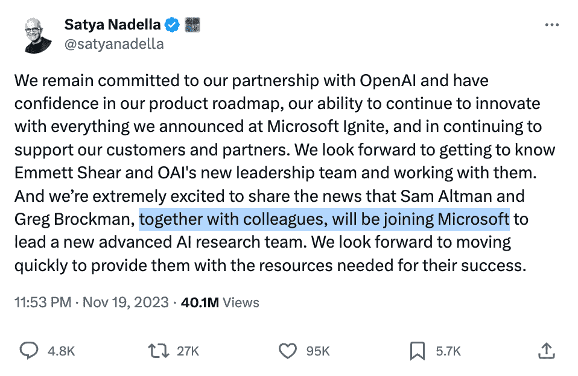

**5am: **I[lya Sutske](https://twitter.com/ilyasut/status/1726590052392956028)ver, supposedly the organizer behind the coup, announces a full-reverse:

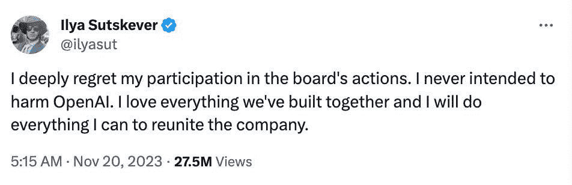

This means that on the remaining 4-person board, only 3 members now back the coup, with one, Sutskever, on “team Sam.” Could this mean there’s hope of reversing the board’s actions? What about Microsoft’s CEO tweeting that Sam and Greg are to become Microsoft employees?

**A**n employee revolt gathers[ momentum, a](https://x.com/karaswisher/status/1726599700961521762?s=20)nd threatens OpenAI’s existence. Around 1:30am, employees started a petition, threatening :

+   That all the undersigned may choose to leave OpenAI and join Microsoft

+   … unless all current board members resign, the board appoints two new independent directors like Bret Taylor and Will Hurd, and reinstates Altman and Brockman

At 2am, former inte[rim CEO ](https://x.com/miramurati/status/1726542556203483392?s=20)Mira Murati tweeted “OpenAI is nothing without its people” – and yet again, hundreds of OpenAI staff copy-post this phrase as a sign of defiance. Those posting this tweet also sign the petition.

By 6am, 505 from 778 employees have signed the petition, with doing so in the middle of the night. Among the signatories is board member, Ilya Sutskever. This is 65% of staff threatening to quit.

By 11am, this number is at 700 (90%.) By noon, it’s 715 (92%.) And by 3pm it’s 743 (95%.) Employees make it clear they’re ready to walk, placing the board under extra pressure to do something.

**On Monday, Satya Nadella does a** rapid media round. Due to the turmoil, current OpenAI customers are nervous and could consider moving to Anthropic, Google, Cohere, or other AI competitors. In an effort to calm things, Nadella appears on CNBC, Bloomberg TV, and the “On with Kara Swisher” podcast. In these appearances, it’s apparent that Nadella didn’t want OpenAI staff to join Microsoft, but that if OpenAI could not solve its problems, this would be an option. Answering a question, Nadella admitted Altman and Brockman were not Microsoft employees – at least not yet.

Nadella’s goal seemed to be exactly what OpenAI employees wanted: the board gone, Sam and Greg reinstated, and Microsoft continuing to be a strategic partner to OpenAI.

**Salesforce’s cofounder and CEO ma**[kes a b](https://x.com/Benioff/status/1726695914105090498?s=20)old offer to poach OpenAI staff. At noon, Marc Benioff tweets that Salesforce will “match any OpenAI researcher who has tendered their resignation full cash & equity OTE to immediately join our Salesforce Einstein Trusted AI research team under Silvio Savarese.”

This is a very generous offer, as it means OpenAI staff who have been offered large amounts of PPUs (profit participation units) which is not liquid – and whose value is at risk due to all the uncertainty – would get the same amount in cash or Salesforce stock!

Benioff uses this opportunity to a[dvertise](https://x.com/Benioff/status/1726714707409867012?s=20) Saleforce’s Einstein platform, writing that “Einstein is the most successful enterprise AI Platform, completing 1 Trillion predictive & generative transactions this week!” After days of chaos at OpenAI, this offer feels like a fair shot, and also a reminder to OpenAI’s board that it’s not just Microsoft they need to worry about.

The board has still not responded to the staff petition.

**6am: **Microsoft CTO, Kevin Scott, reassures all OpenAI staff that Microsoft will have a position for them and will match their current compensation. This message could have been a response to Salesforce’s aggressive hiring tactic.

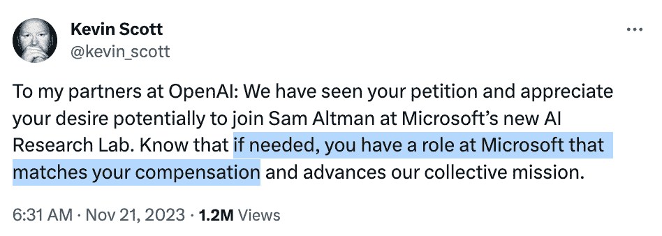

**9am: **News about Sam’s possible return to OpenAI surfaces yet again. Apparently, interim CEO, Emmett Shear, told the board he will quit if they cannot provide evidence of wrongdoing. It’s been four days, and there are still no details on why Sam was fired. If the new CEO cannot find compelling reasons, the board could find itself in trouble.

10pm: It’s over. An agreement is reached: Altman returns to OpenAI as a CEO. A new board is formed, with Bret Taylor (former CTO of Facebook, Chair of the board,) Larry Summers (formerly president of Harvard University), and Adam D'Angelo (existing board member, cofounder and CEO of Quora).

The OpenAI team celebrates in their San Francisco headquarters, and now has a peaceful Thanksgiving to look forward to.

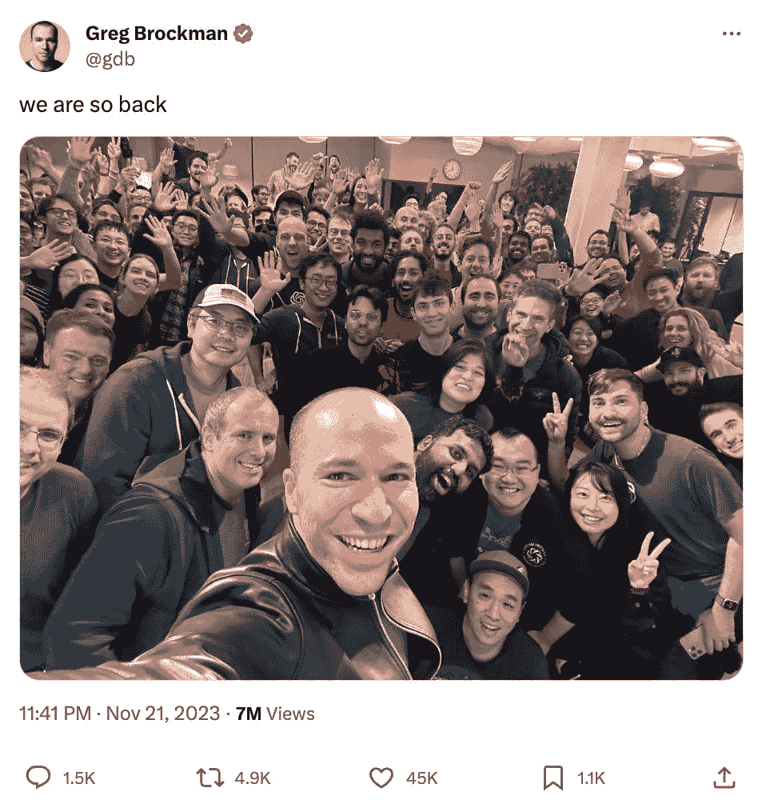

[The OpenAI t](https://x.com/gdb/status/1727230819226583113?s=20)eam celebrating the end of the crisis on Tuesday night

How did the world’s most envied tech company, valued around $86B, plunge into chaos for five days straight? Perhaps all of this was much more than the coup that it might look from the outside, and the roles of “good” (‘team Sam’) and “bad” (the board) might not be as clear-cut as they seem.

Let’s go back a few years, when the seeds of this conflict were likely sown.

When OpenAI was founded i[n 2015, the](https://openai.com/blog/introducing-openai) company introduced itself like this:

> “OpenAI is a non-profit artificial intelligence research company. Our goal is to advance digital intelligence in the way that is most likely to benefit humanity as a whole, unconstrained by a need to generate financial return. Since our research is free from financial obligations, we can better focus on a positive human impact.”

This is a worthy mission and refreshingly different from the for-profit model that’s common at most venture-funded tech companies. But over time, this approach has been predictably watered down to what is closer to a for-profit operation.

[The “cappe](https://openai.com/blog/openai-lp)d profit” change. On 11 March 2019, the company announced it had created a “capped-profit” company. OpenAI cofounders Greg Brockman and Ilya Sutskever explained it like this:

> “We want to increase our ability to raise capital while still serving our mission, and no pre-existing legal structure we know of strikes the right balance. Our solution is to create OpenAI LP as a hybrid of a for-profit and nonprofit—which we are calling a “capped-profit” company.

> The fundamental idea of OpenAI LP is that investors and employees can get a capped return if we succeed at our mission, which allows us to raise investment capital and attract employees with startup-like equity. (...) Returns for our first round of investors are capped at 100x their investment.”

**This so-called “capped profit” is unlikel**y to be a “cap” for practical purposes. It could be tempting to think that OpenAI’s approach of capping profit at 100x of the investment amount, is somehow noble or selfless. However, in practice, there’s little meaningful difference between capping profits at this level and having no cap. This is for two reasons:

**1. O****penAI needs a lot of ca**pital before it can generate profits. In this sense, the company is not too dissimilar from capital-intensive companies like ridesharing giant Uber, which has raised about $25B in funding, and has generated less than $1B in cumulative profits since its founding in 2009. Uber is worth $114B at time of publication, but the company has generated less than 1x the profit from what it has raised!

**2**. OpenAI has a “cap” of at least $1,200B in profits! OpenAI raised $12.3B from investors as per Dealroom : which means that the “returns cap” of the company is around $1,200B, which is $1.2T. It is sensible to assume that the company would pay out investor returns from profits that it generates. Sure, the company could start to pay returns to earlier investors from later-stage investments: but this doesn’t sound like a long-term sustainable approach. Generating profits, and then allocating these profits for investor returns is a far more sensible approach. But how easy is it to generate potentially $1.2T in profits?

To put this in perspective: Amazon has generated at a total of $100B in profits since being founded in 1994, Google earned $400B profit throughout its 25-year existence, while Microsoft has generated a total profit of $534B in the past qua[rter century. A](https://www.investopedia.com/articles/investing/081716/understanding-apples-capital-structure-aapl.asp)pple is one of the most profitable companies of all time, and not even Apple has generated as much profit since being founded in 1976! Total profits for Apple are in the region of $700B over nearly 50 years. And if we look at the ratio of money Apple raised (or borrowed), things are even more grim: Apple has $73B in long-term debt at the time of publishing, which would put it below a 10x “money raised/borrowed” vs total profits generated. So that 100x investment/profit ratio is far off, even for Apple!

To be clear, there is nothing wrong with a for-profit approach; we’ve seen many of tech’s biggest innovations come from for-profit companies! I cite the above examples to illustrate why OpenAI’s cap is essentially meaningless and illusory.

OpenAI might have also set a different multiplier for later stage investors, as they previously wrote “and we expect [the investor return multiple] multiple to be lower [than 100x] for future rounds as we make further progress.” However, the company has not communicated that it had lowered this multiple for later stage investments —and if so, what the new multiple is—, and so I use the 100x assumption.

On the same day this for-profit shift was announced, Altman – former president of startup accelerator Y Combinator – joined OpenAI as the CEO.

Prior to this setup, employees at OpenAI did not receive equity, only a base salary. OpenAI introduced equity compensation also unique to itself following the change to a “capped” profit model.

**Median compensation at Open**AI is $905,000/year , as per Levels.fyi data , based on 20 data points. This is very high median compensation even within Big Tech and underscores why Salesforce offering to match this amount in liquid compensation was a very generous deal.

Profit participation units (PPUs)  are an interesting equity structure, and how OpenAI issues a special kind of equity to its staff. This is how it works, also revealed by Levels.fyi :

+   Employees get a healthy base salary. For L5 levels – which maps roughly to staff engineer at the likes of Google – the median is around $300,000/year

+   An L5 engineer received PPUs valued at $2M, vesting over 4 years: so $500,000 per year.

PPUs entitle their holders to a percentage of profits generated by OpenAI. For example, if OpenAI issues a total of 1,000 PPUs, and an employee has vested a total of 10 of these (1% of them,) then they are entitled to 1% of the profits. OpenAI valuing PPUs at $2M means they expect that those units issued will yield $2M in profit – assuming the leadership’s profit projections are accurate.

**Compensation at OpenAI is based on the expectation of healthy** profits, in contrast to the nonprofit core of the company. There is nothing wrong with aiming to generate profits; the promise of profits is what motivates investors. It is also a major reason why employees join OpenAI: if the company never generated profits, the equity portion of their compensation would be worth zero. And if PPUs are worthless, employees would take a major pay cut compared to other Big Tech companies.

However, as OpenAI now must generate profits to keep employees and investors happy, this line of the company’s introduction seems at risk:

> “Since our research is free from financial obligations, we can better focus on a positive human impact.”

**O**penAI clearly wanted to “have its cake and eat it.” The changes made in 2019 attempted to inject a for-profit incentive into the nonprofit, which created some obvious conflicts:

+   Wanting to stay a nonprofit to pursue its humanity-first goals…

+   … but also putting profit-making first, in order to attract investors and hire world-class talent

+   Stating: “Our mission is to ensure that artificial general intelligence benefits all of humanity…”

+   … yet the majority of employees’ total compensation is tied to the company generating profits, which means selling services at a premium to those that are willing and able to afford these services, as opposed to “benefiting humanity” in general

The contradictions also apply to safety and speed. In order to benefit humanity, moving slower and safer is the sensible approach. However, to generate profits, OpenAI needs to be first to market, and first to monetize. And OpenAI, indeed, has moved fastest, with the ChatGPT product taking the world by storm. The company claims to prioritize safety equally with speed but internally, not everyone sees it like this.

ChatGPT’s [meteoric s](https://techcrunch.com/2023/11/06/openais-chatgpt-now-has-100-million-weekly-active-users/)ucce[s](https://newsletter.pragmaticengineer.com/p/inside-openai-how-does-chatgpt-ship)s is something we’ve not seen before. Launched in November 2022, a year later this product has passed 100M weekly active users, as announced by CEO Sam Altman on 6 November 2023. This meteoric rise in popularity —together with shipping faster than most startups seem to deliver— was the reason we did a deep dive on h ow their engineering team manages to move so incredibly fast . The success of ChatGPT, however, seems to have caught parts of OpenAI off-guard, though. The Atlantic ran an in-depth report on tensions at OpenAI a year before the firing of Altman:

> “From the outside, ChatGPT looked like one of the most successful product launches of all time. It grew faster than any other consumer app in history, and it seemed to single-handedly redefine how millions of people understood the threat—and promise—of automation. But it sent OpenAI in polar-opposite directions, widening and worsening the already present ideological rifts. ChatGPT supercharged the race to create products for profit as it simultaneously heaped unprecedented pressure on the company’s infrastructure and on the employees focused on assessing and mitigating the technology’s risks.”

In November 2022, OpenAI executives got wind that their biggest competitor, Anthropic, was developing a chatbot. Wanting to get ahead of the release, OpenAI leadership built ChatGPT in a matter of weeks, and did a low-key launch. The launch was more of a success than expected, with user numbers several times larger than anyone at OpenAI predicted. This revealed the tension between moving fast and moving safely, as per The Atlantic:

> “Safety teams within the company pushed to slow things down. These teams worked to refine ChatGPT to refuse certain types of abusive requests and to respond to other queries with more appropriate answers. But they struggled to build features such as an automated function that would ban users who repeatedly abused ChatGPT. In contrast, the company’s product side wanted to build on the momentum and double down on commercialization.”

And tensions hit the top, according to The Atlantic; chief scientist Ilya Sutskever grew more concerned that OpenAI was putting commercialization ahead of the governing nonprofit’s mission to create beneficial AGI.

It’s possible to see this as a fundamental, unresolvable conflict, and that the board voted to remove what Sam and Greg stood for, as their fellow board members saw it. Ejecting Altman and Brockman was a desperate attempt to refocus OpenAI on its nonprofit charter, ahead of profitability, growth, and moving fast.

During this crisis, we’ve learned something very interesting about Microsoft: the company wants to have an independent OpenAI team it can rely on. Microsoft’s bid for Altman and his team to join, was most likely a power play to pressurize the board to take back Altman as CEO.

Perception is something a Big Tech giant like Microsoft needs to worry about for reputational reasons, whereas a startup like OpenAI can move a lot more freely. For example, if OpenAI launched a new model that hallucinates and does weird things, it could be taken as just a model which the startup will fix and improve. But if Microsoft released a shonky model, criticism would be instant and harsh, and customers would be much less forgiving than with a model by a startup like OpenAI.

Regulatory scrutiny is another reason why it’s beneficial for Microsoft to not be center stage. Altman and OpenAI have done plenty of lobbying of regulators. OpenAI being an upstart without the significant market shares of Microsoft, Google or Amazon, makes it more approachable, and better lobbyists than Microsoft could ever hope to be.

**Microsoft has a near-controlli**ng stake in OpenAI. And this week’s events showed the Redmond-based giant does indirectly control OpenAI, even without a board seat.

While the crisis at OpenAI unfolded, it was eye-opening to see just how important OpenAI was for Microsoft. Satya Nadella did more interviews in a day than he usually does in a week: and it was all about OpenAI, and assuring the public that Microsoft has the situation under control . It almost felt like Microsoft itself was having a crisis: even though OpenAI is a fully separate entity from them!

In the end, events turned out more or less as Satya Nadella wanted: the board was removed and Altman reinstated, with Microsoft continuing to have exclusive access to OpenAI’s models, without much reputational risk. OpenAI might be an independent company on paper, but Microsoft sure got its way in the end.

It’s undeniable that Altman is charismatic, knows how to play to a crowd, with enough influence that 95% of OpenAI’s staff signed a petition saying they’d follow him to Microsoft.

This in itself should give us pause. How did Sam convince OpenAI staff to seriously consider abandoning the nonprofit cause, and march straight into the for-profit Microsoft? Personal charisma is one factor, but was it enough to convince staff to drop their principles?

And speaking of principles, why did Sam announce he was joining Microsoft, a for-profit business where he’d report to the CEO and ultimately serve shareholders? Of course, we now know this was a pressure tactic to force the board to move. Still, it’s hard to trust that Sam will indeed put the overly vague “good of humanity” goal ahead of personal enrichment and advancement, when it could be argued he’s already put this principle aside to get the outcome he wants.

In some ways, Sam Altman seems almost too charismatic. His former mentor, Paul Graham says this about him:

> “You could parachute him into an island full of cannibals and come back in five years and he’d be the king.”

Unsaid in this quote is that in order to be crowned king of the cannibals, you would probably need to give up some principles and become a cannibal yourself, at least temporarily.

**A**ltman was fired from a CEO position before, at Y Combinator. Just yesterday (22 November,) the Washington Post brought up a less discussed story: that before joining OpenAI, he was asked to leave Y Combinator  by his mentor, Paul Graham:

> “Graham had surprised the tech world in 2014 by tapping Altman, then in his 20s, to lead the vaunted Silicon Valley incubator. Five years later, he flew across the Atlantic with concerns that the company’s president put his own interests ahead of the organization — worries that would be echoed by OpenAI’s board.”

**O**penAI’s board strongly hinted at feeling manipulated. Fellow Substack writer Eric Newcomer was the first to point out that just because the board has done a poor job at articulating what they found troubling, we should not ignore what they were trying to signal:

> “We shouldn’t let poor public messaging blind us from the fact that Altman has lost the confidence of the board that was supposed to legitimize OpenAI’s integrity.

> Once you add the possibility of existential risk from a super powerful artificial intelligence — which OpenAI board member Sutskever seems genuinely concerned about — that only amplifies the potential risk of any breakdown in trust.”

A former colleague at OpenAI stated he observed Altman manipulate and deceive others – bringing up the same things the board said:

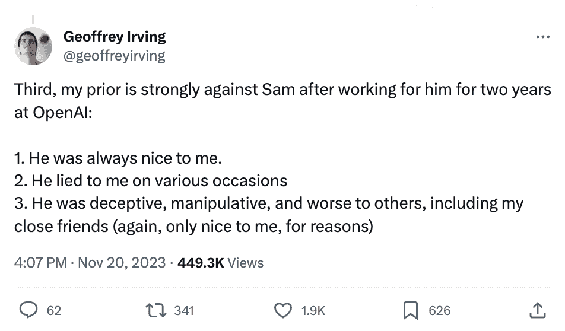

And I invite you to watch this 30-second video clip which just feels off . Answering a question, Altman claims the only reason he is at OpenAI and taking no salary or equity, is that “I’m doing this because I love it.” You can tell that he’s sincere – but perhaps only partly. Maybe it’s me, but this feels like half-truths: “I do it because I love doing this and for reasons I won’t mention right now. ” No one clings on to an unpaid CEO role as hard as we’ve seen Altman do, unless there are significant other upsides. But he doesn’t state these upsides. We know they exist, but we need to guess at them, and this just feels off. We don’t even know if Altman has PPUs —which staff considers as equity!— but Sam might have used the technical term in congress: and no wonder Senator Kennedy was sceptical. So am I!

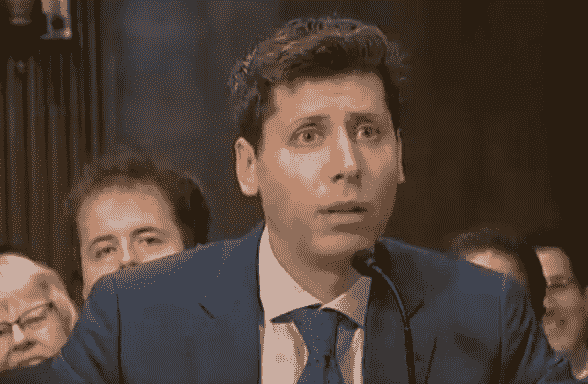

Senator Kennedy: "You make a lot of money, do you?" Sam Altman: “No.”

And then, there’s other projects with question marks on them:

**Worldcoin **: an AI-meets-crypto project which posits scanning people’s eyeballs and comes across as a way to gather biometric data for a private startup with an uncertain future or backing .

**N**o stake in Op[enAI, but ](https://observer.com/2023/05/openai-sam-altman-startup-portfolio)plenty[ of sta](https://observer.com/2023/05/microsoft-fusion-power-deal-helion-sam-altman/)kes in other companies. The Observer estimates Altman is worth more than $500M, having invested in more than 100 companies. Some of these investments have interesting timings. For example, three months after Microsoft invested $10B into OpenAI – in which Sam has no stake – Microsoft signed a deal to buy electricity from Helion, a company Altman has invested $375M in. Perhaps the two are unconnected. But if not, it makes sense that Sam should be making money somewhere , given OpenAI doesn’t pay him anything.

All this feeds into the nagging feeling that Altman could be using his OpenAI position and status in order to advance his other ventures. This is normal; many people in similar situations do it, but it would be nice to not have to guess in this case.

OpenAI’s board has been a mess in several ways.

**T**he board has been terrible at external communications. After firing their CEO and removing the chair, the board did not communicate anything publicly for five days.

While Altman, Brockman, and Nadella, used social media in a strategic sense, two of the four board members simply made their Twitter profiles private, and the remaining two – Ilya Sutskever and Adam D’Angelo – said nothing publicly. Due to this, public sentiment very quickly turned against them.

**W**ho took notes during the “deliberat[ive review](https://openai.com/blog/openai-announces-leadership-transition) process?” The only piece of communication that was done decently is a blog post that announced the firing of Altman. Here, the board stated:

> “Mr. Altman’s departure follows a deliberative review process by the board, which concluded that he was not consistently candid in his communications with the board”

However, when Emmett Shear joined as interim CEO, he asked why Altman had been fired and the board could not provide reasons. If there really was a deliberate review process, this needed to be in writing. So either this did not happen, or the board refused to hand the relevant documents to the new CEO they’d hired.

What was the plan, anyway? The board seemed to have little to no foresight in preparing for how events played out. They announced Mira Murati as interim CEO – and then swiftly moved to hire a new interim CEO when she sided with “team Sam.” They hired Shear in a matter of hours, but then failed to be candid about why they fired the first CEO.

**A likely conflict of interest **with Adam D’Angelo. OpenAI’s board used to be a lot bigger and included LinkedIn’s founder, Reid Hoffman. However, in March of this year, Hoffman stepped down to avoid a potential conflict of interest, as he cofounded AI startup, Inflection AI. Hoffman stepped down two months before Inflection AI publicly launched a ChatGPT-like chatbot.

One [boar](https://poe.com/)d member who didn’t consider their startup competing with ChatGPT is current member Adam D’Angelo. The Quora cofounder and CEO has a second startup called Poe , which is an AI chat app. It’s a competitor to ChatGPT, but also builds on it.

Poe launched bot creator monetization on 25 October. This feature puts Poe in direct competition with ChatGPT’s AI assistants which OpenAI launched on 6 November. This looks to be a conflict of interest that is currently unaddressed. Of course, there could be details we’re not privy to; for example, OpenAI getting access to training data from Quora, or Poe being more of a complementary product to ChatGPT than it seems. Clarifying how Poe is different to Inflection AI in conflict of interests terms would help clear the air.

**S**till, could the board have achieved what it set out to do? Set aside all criticism of the board, and let’s put ourselves in their shoes. This group of four people is worried OpenAI is commercializing too quickly, and not focusing enough on safety.

They know things stand at “the eleventh hour.” So, could it be that they knew things would play out roughly as they did, and the board stood its ground to get what they wanted? The dynamics have changed significantly from five days ago:

+   Sam Altman is no longer on the board, and is not a director. This change reduced his direct influence within OpenAI’s governance.

+   There will be more scrutiny on Altman’s actions in future from the media – at least for a few months.

+   Most OpenAI staff signaled they could be ready to join a for-profit entity like Microsoft, thereby making the fear of losing the nonprofit charter, black-and-white.

It feels to me that the board’s actions will force OpenAI to look into the mirror, and ask: “what are we? Is this what we want to be, today?” Perhaps forcing a period of reflection is the most the board could hope for.

What is OpenAI, at its core? Deep down, is it still the company that wants to advance digital intelligence in a way that is most likely to benefit humanity, as a whole ?

Or is it a Silicon Valley startup, where 95% of staff are ready to follow their leader who decides that working for Microsoft is a good-enough plan B – one that conveniently ensures that those standout total compensation packages – where the median is closer to $1M/year for many – will not drop?

My sense is that for all the fanfare and talk of acting for the good of humanity, OpenAI is more of a Silicon Valley, uncapped, for-profit company, than the people involved like to admit. But this is nothing to be ashamed of: all of Big Tech is the same!

The past few days have shown many things: that OpenAI staff stand together and keep shipping under pressure (they shipped ChatGPT voice during this crisis,) and that this is a group that’s hungry to move faster than any rival, and keep being a trailblazer in the AI field.

But if this is the case, how is OpenAI different from any venture funded, for-profit company? OpenAI has a new board and the time to consider what they are  after these events, and to verbalize this.

Since 2019, much has changed. OpenAI now has a strategic partner in Microsoft, which offers a vast infrastructure for OpenAI to build on. This infrastructure allows OpenAI to offer the benefits of AI to a wide group of people, while building out commercial applications. It’s been a fruitful relationship, if one that probably doesn’t exactly map to 2015’s lofty ideals.

If the chaos at OpenAI has shown anything, it’s that clinging to ideals no longer held by many of the people involved, can lead to dangerous division. Perhaps now is the time to get everyone on the same page by explaining to employees and the public alike, what OpenAI really is, today.

> 🔗 原文链接： h[ttps://newsletter.](https://newsletter.pragmaticengineer.com/p/what-is-openai)pragmaticenginee...