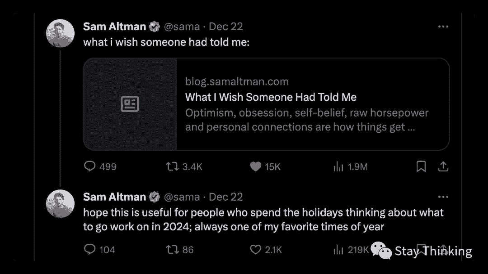

# Sam Altman: What I Wish Someone Had Told Me

> 来源：[https://leonzhang.feishu.cn/docx/Dwh6dDVHLoyiskxMtk7caWi8nrh](https://leonzhang.feishu.cn/docx/Dwh6dDVHLoyiskxMtk7caWi8nrh)

1.  乐观、执着、自信、强大的动力和人际关系是事情开始的关键。

1.  有凝聚力的团队、冷静与紧迫感的平衡，以及非凡的投入，是完成任务的关键。长期规划往往被人忽视；不必过于担忧短期内他人的看法，随着时间的推移，这会变得更加容易。

1.  对于团队来说，完成一项真正重要的艰巨任务，比起做一些并不那么重要的简单工作要更有意义；大胆的想法能够激发斗志。

1.  激励机制如同超能力；设定时需慎重考虑。

1.  把资源集中在少数你深信不疑的重点项目上；这听起来简单，但实际操作却颇具挑战。实际上，你可以剔除掉比想象中更多的无关事物。

1.  清晰且简洁地交流沟通。

1.  每当遇到废话和官僚主义，就坚决反对，并且鼓励他人也这么做。不要让组织架构阻碍人们高效地协同工作。

1.  成果才是最终的衡量标准；不要让良好的流程成为糟糕成果的遮羞布。

1.  在招聘上投入更多时间。敢于冒险，选择那些潜力巨大且进步迅速的人才。除了智力外，还要寻找他们实际完成任务的证据。

1.  超级明星比看起来更有价值，但评价员工时，你需要考虑他们对组织整体绩效的真正影响。

1.  快速迭代能够弥补许多不足；通常情况下，如果你能迅速调整，那么即使犯下错误也没关系。计划应以十年为周期，执行则应以周为计。

1.  不要试图挑战商业世界的基本法则。

1.  灵感易逝，人生苦短。不采取行动是一种隐蔽而又致命的风险。

1.  规模的增长往往会带来意想不到的新特性。

1.  利用复合增长的力量；尤其是，你会想要创建一个随着规模扩大而能够获得增长优势的企业。

1.  跌倒了就爬起来，继续前进。

1.  与优秀的人共事是人生中最美好的经历之一。

## **英文原文及原地址**

1.  Optimism, obsession, self-belief, raw horsepower and personal connections are how things get started.

1.  Cohesive teams, the right combination of calmness and urgency, and unreasonable commitment are how things get finished. Long-term orientation is in short supply; try not to worry about what people think in the short term, which will get easierovertime.

1.  It is easier for a team to do a hard thing that really matters than to do an easy thing that doesn’t really matter; audacious ideas motivate people.

1.  Incentives are superpowers; set them carefully.

1.  Concentrate your resources on a small number of high-conviction bets; this is easy to say but evidently hard to do. You can delete more stuff than you think.

1.  Communicate clearly and concisely.

1.  Fight bullshit and bureaucracy every time you see it and get other people to fight it too. Do not let the org chart get in the way of people working productively together.

1.  Outcomes are what count; don’t let good process excuse bad results.

1.  Spend more time recruiting. Take risks on high-potential people with a fast rate of improvement. Look for evidence of getting stuff done in addition to intelligence.

1.  Superstars are even more valuable than they seem, but you have to evaluate people on their net impact on the performance of the organization.

1.  Fast iteration can make up for a lot; it’s usually ok to be wrong if you iterate quickly. Plans should be measured in decades, execution should be measured in weeks.

1.  Don’t fight the business equivalent of the laws of physics.

1.  Inspiration is perishable and life goes by fast. Inaction is a particularly insidious type of risk.

1.  Scale often has surprising emergent properties.

1.  Compounding exponentials are magic. In particular, you really want to build a business that gets a compounding advantage with scale.

1.  Get back up and keep going.

1.  Working with great people is one of the best parts of life.

> 🔗 原文链接： h[ttps://blog.samalt](https://blog.samaltman.com/what-i-wish-someone-had-told-me)man.com/what-i-w...